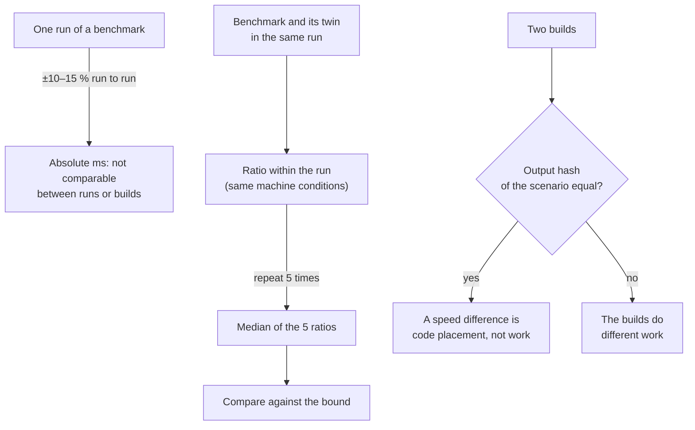

# Benchmarks and Performance

A plugin's CPU cost decides how many instances and voices a user can run before the host drops out. Corrosion's cost is dominated by one loop: every mode of every sounding voice, every sample (16 voices × up to 96 modes × 48 000 samples a second), followed by a per-sample post chain whose clipper oversamples up to 16×. This page covers how that cost is measured (the Criterion benchmarks, the ratio script, the web engine's V8 benchmarks), why single numbers from this repository's measurements can't be trusted, and the design rules that keep the hot loop fast.

The contract that forbids allocation and locks on the audio thread is a separate concern, on [Real-Time Safety](Real-Time-Safety).

## The native benchmarks (`benches/performance.rs`)

A [Criterion](https://crates.io/crates/criterion) 0.5 harness (`harness = false` in `Cargo.toml`). Each benchmark builds its scenario and renders 4 096 samples (8 192 for the brush) at 48 kHz, summing the output into `black_box` so the compiler can't drop the work.

| Benchmark | Scenario | What it is for |
|---|---|---|
| `voice_manager_idle` | `VoiceManager` with no notes | The per-sample overhead of an empty pool |
| `voice_manager_single_voice` | One Pipe note, Hand Strike, mono path | Baseline cost of one voice |
| `voice_manager_eight_voices` | 8 Pipe notes, mono | Scaling with voice count |
| `voice_manager_sixteen_voices` | 16 Pipe notes, Normal quality, stereo path | A full pool, typical |
| `voice_manager_sixteen_voices_render` | 16 Plate notes, Rust 0.3, Damage 1, Render quality (`mode_count_scale` 2.0), stereo | The worst-case bank size |
| `voice_manager_sixteen_voices_bent` | The Render scenario with a held +2-semitone pitch bend | Twin of the Render benchmark: what a bend costs |
| `voice_manager_sixteen_voices_cable_dynamics` | 16 Taut Cable notes at Render, Cable Tension Drop 0.4 (the default: every mode's pitch follows the ring's amplitude each sample) | An object with per-sample pitch dynamics |
| `voice_manager_sixteen_voices_cable_static` | The same with Tension Drop 0 | Twin of the dynamics benchmark |
| `wire_brush_dense_cluster` | `WireBrush` alone, density 512, triggered at 0.95 | The densest stochastic exciter |
| `post_processing_chain` | The whole post chain at Normal quality: filter at 8 kHz, drive, body, spread, Factory Space, clipper | Post-chain cost |
| `post_processing_chain_eco` | The same at Eco (clipper not oversampled) | What oversampling costs |
| `post_processing_chain_idle` | Post chain fed zeros, every effect at rest | Idle overhead |
| `offline_renderer_pipe_family` | `OfflineRenderer`: one Pipe bank, 48 000-frame impulse render | The resonator alone, no voice |
| `plugin_output_path_sixteen_voices` | `PresetRenderer` with the legacy `sheet_lightning` preset (Space, BODY and master drive), 16 notes, 4 096 samples in 512-sample blocks | The plugin's whole output path, `Corrosion::process_block`. The plugin is built in Criterion's setup closure, outside the timed part |
| `plugin_output_path_sixteen_voices_render` | The same preset at Render quality | Whole path with the most modes and the 16× clipper |

Run them (the target is needed because `.cargo/config.toml` defaults to Windows GNU):

```bash
export CARGO_BUILD_TARGET=x86_64-unknown-linux-gnu
cargo bench --no-default-features --bench performance -- voice_manager_sixteen_voices
```

The last argument is a filter: a substring (or regex) of benchmark names. CI only compiles the benchmarks (`cargo bench … --no-run`, Linux) so they can't rot; it never runs them, because CI machines are too noisy for timing to mean anything. See [CI and Releases](CI-and-Releases).

## Measuring honestly



The same rules in words:

1. **One run means little.** In the development container, the same benchmark moves ±10–15 % from run to run. A 10 % "speed-up" from one before/after pair is noise until shown otherwise.
2. **Compare twins within one run.** Each costly feature has a twin benchmark that differs only in that feature (bent vs unbent, dynamic vs static cable). Both run in the same `cargo bench` invocation, under the same machine conditions, and the ratio between them is far steadier than either absolute time.
3. **Take the median of 5 runs' ratios.** `scripts/bench_ratios.py` does exactly this.
4. **Build a "before" baseline in a clean worktree.** `cargo bench` compiles the working tree; editing `src/` while it builds mixes old and new code. Use a detached worktree with its own target directory:
   ```bash
   git worktree add --detach /tmp/base HEAD
   (cd /tmp/base && CARGO_TARGET_DIR=/tmp/base-target cargo bench --no-default-features --bench performance -- <filter>)
   ```
5. **Check that two builds do the same work.** Code layout alone can swing a plain benchmark by 30 % with bit-identical output (next section). Before believing a difference between builds, compare an output hash of the benchmark's scenario on both builds (the technique is on [Testing](Testing#proving-unchanged)). Equal hashes with different times means placement, not work.

### `scripts/bench_ratios.py`

```bash
python3 scripts/bench_ratios.py 5     # 5 runs (the default)
```

Each run calls `cargo bench --no-default-features --bench performance -- "voice_manager_sixteen_voices_(render|bent|cable)"`, parses Criterion's median time for each benchmark from its `time: [low median high]` line, and computes two ratios within the run:

| Pair | Measured | Twin | Bound |
|---|---|---|---|
| bent / plain | `voice_manager_sixteen_voices_bent` | `voice_manager_sixteen_voices_render` | 1.1× |
| dynamics / static | `voice_manager_sixteen_voices_cable_dynamics` | `voice_manager_sixteen_voices_cable_static` | 1.6× |

It prints each run's ratios with the times behind them, then the median of each ratio and `ok` or `OVER`, and exits 1 when a median is over its bound. The bounds are the `realtime-safety` capability's requirements (`openspec/specs/realtime-safety/spec.md`): holding a pitch bend may cost at most 10 % more than the same voices unbent, and an object with per-sample pitch dynamics at most 1.6× its static twin. The dynamics bound isn't 1.0× because a dynamic note sounds different, so its exciter and governor do different work even if retuning were free (about 1.1× measured with retuning disabled).

When last measured in the development container (median of 5), bent/plain was 1.019× and dynamics/static 1.535×.

*History:* [the retune-cost measurements](https://github.com/GerMP21/Corrosion-VST/blob/main/openspec/changes/archive/2026-11-08-h12-skip-redundant-mode-retunes/design.md).

## Code layout and cold paths

The per-sample mode loop is small and runs billions of times, so its machine code's size and placement matter as much as the arithmetic in it. Two findings shaped the code:

- **A cold branch inlined into the hot loop.** `SecondOrderMode::ensure_rate` runs for every mode every sample to check that the coefficients match the sample rate. Its rebuild branch was once inlined into the per-sample loops. Any edit to the coefficient code changed that branch's size, which moved the loop in memory and shifted the plain 16-voice Render benchmark between about 18 ms and 24 ms, with bit-identical output. The rebuild is now `rebuild_for_rate`, `#[cold] #[inline(never)]`, and `ensure_rate` inlines only the comparison.
- **The retune path.** `ModalResonator::apply_dynamics`, which retunes the bank during a bend or for pitch-dynamic objects, slowed plain notes by about 25 % when inlined, although plain notes never call it. It is `#[inline(never)]`.

The same treatment applies to the other rare paths (`advance_heat_wander`, `Voice::choke_gain`, `Corrosion::panic_frame`).

**When you add a branch to a per-sample loop** that runs rarely (a mode change, a rate change, a fade), put its body in a separate `#[cold] #[inline(never)]` function, and benchmark plain notes before and after.

## Design rules that keep the hot loop fast

| Rule | Where | Why |
|---|---|---|
| Keep `SecondOrderMode` small | `src/dsp/resonators/core.rs` | It is iterated for every mode of 16 voices every sample, and the working set sits near L1 size. Occasionally used data goes in parallel `Vec`s on `ModalResonator`: `mode_weights` and `retune_cache` |
| Skip redundant retunes | `apply_dynamics` | A held bend gives the same pitch factor every sample. The bank is retuned only when the factor has moved by more than `RETUNE_TOLERANCE` (2.8 × 10⁻⁵) since the last retune |
| Retune incrementally | `retune_incremental`, `RetuneCache` | A small pitch change rotates each mode's cached sine and cosine by a Taylor-series step instead of calling `sin_cos`; an exact recompute every `RETUNE_EXACT_EVERY` = 256 rotations, or on a large jump, keeps the drift negligible |
| No float division by a constant | Hot code throughout | The compiler won't turn `x / c` into `x * (1/c)` (they can round differently), and division is several times slower. Keep a reciprocal: `RetuneCache::inv_omega`, `omega_per_hz`, the clipper's `inv_span`, the `SIXTH` and `TWENTY_FOURTH` constants |
| Prune modes that can never sound | `rebuild_in_place` | Modes at or above 80 kHz, or with a decay under 0.1 ms, are dropped at note-on, so the loop doesn't pay for inaudible work |
| Cache work keyed on its inputs | `BidirectionalInteractionBus::mode_coefficients` | The per-mode coupling coefficients are a pure function of strike position, lock and mode count, so an unchanged key skips the per-mode `sin` |
| Fixed voice array, `match` dispatch | `VoiceManager`, `Voice` | No virtual calls or pointer chasing per sample |

Quality modes are the user's CPU knob: Eco, Normal, High and Render scale the mode count by 0.5, 1, 1.5 and 2, and the output clipper oversamples 1×, 4×, 8× and 16×. See [Post Chain](Post-Chain) and [Modal Resonator](Modal-Resonator).

## The web engine's benchmarks

The web app runs the same engine compiled to wasm inside an AudioWorklet, which renders 128-frame blocks: at 48 kHz each block has a budget of 128 / 48 000 s = 2 667 µs. Two Node scripts time the built engine in V8, Chrome's JavaScript engine. They instantiate `corrosion_web_engine.wasm` directly (the module has no imports) and call its C-ABI exports (`engine_new`, `engine_midi`, `engine_set_param`, `engine_process`, …). Build the wasm first with `web/scripts/build.sh`, which writes it to `web/dist/play/`.

| Script | Usage | Measures |
|---|---|---|
| `web/scripts/bench-engine.mjs` | `node web/scripts/bench-engine.mjs web/dist/play/corrosion_web_engine.wasm` | The default patch at each quality mode (Eco, Normal, High, Render) with 1, 4, 8 and 16 held notes (MIDI 36, 39, 42, …, velocity 100): µs per block after 20 warm-up blocks, averaged over 1 500 blocks, as a share of the budget, and the voices still sounding at the end |
| `web/scripts/bench-presets.mjs` | `node web/scripts/bench-presets.mjs web/dist/play/corrosion_web_engine.wasm presets/factory/bass/tank_boom_bass.corrosion-preset …` | Each named preset (loaded with `engine_load_preset`) with 1, 4, 8 and 16 held notes: µs per block over 400 blocks and the share of the budget |

Both are single runs with `performance.now()`, so the ±10–15 % noise applies. When last measured in the development container, wasm cost 1.3–2.1× the native engine, the default patch used about 12 % of the budget at Render with 16 voices, and the heaviest factory preset with 16 voices about 61 % (with `+simd128`, which the build enables and which saved 5–10 % on heavy presets). Firefox was not measured.

*History:* [the web engine's cost measurements](https://github.com/GerMP21/Corrosion-VST/blob/main/openspec/changes/archive/2026-11-15-add-web-app/design.md).

## What is not automated

There are no stored baselines: nothing flags a regression between commits. Criterion keeps its last run under the target directory and prints a change against it, which across commits is only as good as the noise allows. Persisting baselines is an open item in `docs/BACKLOG.md`.

## Source files

- [`benches/performance.rs`](https://github.com/GerMP21/Corrosion-VST/blob/main/benches/performance.rs): the Criterion benchmarks and their twins
- [`scripts/bench_ratios.py`](https://github.com/GerMP21/Corrosion-VST/blob/main/scripts/bench_ratios.py): median of within-run ratios against the spec's bounds
- [`web/scripts/bench-engine.mjs`](https://github.com/GerMP21/Corrosion-VST/blob/main/web/scripts/bench-engine.mjs): the wasm engine's cost per block by quality and voice count
- [`web/scripts/bench-presets.mjs`](https://github.com/GerMP21/Corrosion-VST/blob/main/web/scripts/bench-presets.mjs): the wasm engine's cost per block for given presets
- [`openspec/specs/realtime-safety/spec.md`](https://github.com/GerMP21/Corrosion-VST/blob/main/openspec/specs/realtime-safety/spec.md): the cost bounds the ratio script checks
- [`src/dsp/resonators/core.rs`](https://github.com/GerMP21/Corrosion-VST/blob/main/src/dsp/resonators/core.rs): `SecondOrderMode`, `ensure_rate`, `apply_dynamics`, `RetuneCache`, pruning
- [`src/dsp/interaction.rs`](https://github.com/GerMP21/Corrosion-VST/blob/main/src/dsp/interaction.rs): the cached coupling coefficients
- [`src/dsp/post_processing/post_chain.rs`](https://github.com/GerMP21/Corrosion-VST/blob/main/src/dsp/post_processing/post_chain.rs): the clipper's oversampling factor per quality mode
- [`src/offline/preset.rs`](https://github.com/GerMP21/Corrosion-VST/blob/main/src/offline/preset.rs): `PresetRenderer`, which the whole-path benchmarks drive
- [`Cargo.toml`](https://github.com/GerMP21/Corrosion-VST/blob/main/Cargo.toml): the Criterion dev-dependency and the `[[bench]]` entry
