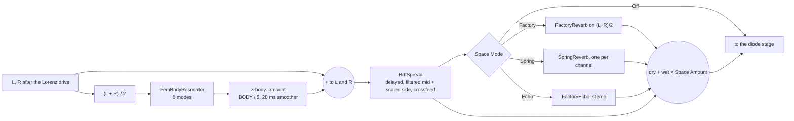

# Body Spread and Space

The middle of the post chain: a small modal "body" that resonates under the sound, a mid/side stage that sets width and proximity, and the Space section (a room, a spring tank or an echo). All three are cheap, real-time-safe approximations; their names (FEM, HRTF) describe the intent, not the algorithm. For where they sit in the chain, see [Post Chain](Post-Chain).

The same flow as a list (`PostProcessingChain::process`):

1. The body runs on the mono sum of the driven channels; its output times the smoothed BODY mix is added to both channels.
2. `HrtfSpread::process` rebuilds both channels (bypassed below Spread Width 0.001).
3. With Space Mode Off, the signal goes straight on. Otherwise only the selected processor runs, and its wet output times Space Amount is added to the full dry signal (it is not a dry/wet crossfade).

## The FEM body

`FemBodyResonator` (`src/dsp/post_processing/fem_body.rs`) is **not a finite-element model**: it is a bank of eight fixed two-pole resonators, a stand-in for the resonances of a chassis or cabinet the object sits in.

### Mode frequencies

The base frequencies are 220, 380, 550, 720, 890, 1060, 1230 and 1400 Hz. `update_mode_frequencies` scales them all by

`f = base × (0.7 + 0.6·material) / (0.5 + 1.0·volume)`

| Control | Parameter | Range, default | Effect |
|---|---|---|---|
| Material | Chassis Material | 0–1, 0.5 | ×0.7 to ×1.3 on frequency; also the decay and output gain below |
| Volume | Chassis Volume | 0–1, 0.5 | ÷0.5 to ÷1.5: a bigger chassis rings lower |

At the defaults the factor is exactly 1. The lowest mode is about 314 Hz at volume 0.2 and 169 Hz at 0.8 (`larger_chassis_moves_the_body_peak_lower_in_the_output`). Volume only retunes: it applies no gain of its own (`volume_applies_no_output_gain`), though lower modes ring with more resonant gain, so a larger chassis sounds slightly louder.

### The resonator

Per mode, every sample:

`y[n] = 0.05·x + (2 − ω² − d)·y[n−1] − (1 − d)·y[n−2]`, with `ω = 2π·f/fs`

- `1 − d` is the squared pole radius, and `d = 0.01 + 0.005·material + 0.002·i` per 48 kHz sample (mode `i` from 0). Higher modes and harder materials decay faster. At the default material the lowest mode's amplitude falls 60 dB in roughly 23 ms (derived from `d = 0.0125`): the body is a short, dense coloration, not a ringing tail.
- Each mode's state is clamped to ±10; the output is `Σ y_i·(0.8 + 0.4·material)/(i + 1)`, clamped to ±1.
- **Sample-rate rule.** `d` is converted with `rate::smoother(d, ratio)` and the input gain is `0.05·ratio²` (`ratio = 48 000/fs`), so the body has the same level and ring time at any rate (`body_sounds_the_same_at_any_sample_rate`: peak within 1 dB and ring time within 10 % at 44.1 and 96 kHz). Both are exactly the 48 kHz values at 48 kHz. See [Sample Rate Rule](Sample-Rate-Rule).

### The BODY mix

The header's BODY control (0–5, default 2.62) becomes `body_mix = BODY / 5` (0.524 at the default) in `begin_block`. `PostProcessingChain` smooths it per sample (τ 20 ms; the first set after `new` or `reset` snaps). Chassis Volume and Material only tune the body; BODY alone sets its level, so at BODY 0 Chassis Volume changes nothing (`body_zero_ignores_chassis_volume`), and the body contribution scales linearly with the amount (`body_level_tracks_body_amount`).

## The HRTF spread

`HrtfSpread` (`src/dsp/post_processing/hrtf_spread.rs`) is named after head-related transfer functions but uses none: no HRIR convolution, no interaural time difference. It is a mid/side remix.

Per frame, unless Spread Width < 0.001 (then it returns the input untouched):

1. `mid = (L + R)/2`, `side = (L − R)/2`.
2. The mid is delayed by `floor(floor(fs·0.001)·width)` whole samples, up to 1 ms at full width. The **same** delayed mid feeds both channels, so it is not a time difference between the ears. No interpolation: moving Width steps the delay by whole samples.
3. Proximity filters on the delayed mid: `lpf = 0.8·lpf + 0.2·mid`, `hpf = 0.5·hpf + 0.5·(mid − lpf)`.
4. `out_L = lpf·(0.5 + 0.3p) + hpf·(0.3 + 0.2p) + side·(1 − w/2)`, and `out_R` the same with `− side`, where `p` is Listener Proximity and `w` Spread Width.
5. Crossfeed `c = 0.3·w`: `L' = L·(1 − c) + R·c`, and the mirror for the right.
6. Clamp to ±1.5.

Consequences, worked out from those formulas:

- **Raising Spread Width narrows the voices' own image.** The side's net gain is `(1 − w/2)·(1 − 0.6·w)`: 0.74 at 0.25, 0.53 at the default 0.5, 0.2 at 1. What Width adds is the delayed, filtered mid, not side energy. (The editor's help text says "Higher sounds wider".)
- **Width is discontinuous at 0.** Above the 0.001 bypass, a low tone's mid passes at `0.5 + 0.3·p`: 0.65 (−3.7 dB) at the default proximity. Sweeping Width up from 0 drops the level and changes the tone at once, and re-entering from bypass starts from stale filter and delay state.
- **The proximity filters ignore the sample rate.** Their coefficients (0.8/0.2, 0.5/0.5) are raw per-sample constants, so their corners move up an octave at 96 kHz. This breaks the [Sample Rate Rule](Sample-Rate-Rule).
- **Buffer sizing.** `DELAY_CAPACITY` is 256 samples, which holds the 1 ms delay up to 192 kHz (192 samples) (`full_width_delay_is_one_millisecond_at_every_rate`).

## Space

### Mode selection and the wet mix

`SpaceMode` is Off, Factory, Spring or Echo (parameter values 0–3). `PostProcessingChain::process_space` runs only the selected processor and returns its wet pair; the chain adds `wet × space_amount` to the dry signal. Space Amount (0–1, default 0) and Space Mode (default Off) are applied once per block with no smoothing.

### Factory room

`FactoryReverb` is a Schroeder reverb, mono in, and the chain returns `(wet, wet)` to both channels.

- **Four parallel combs**, delays `COMB_DELAYS_48K = [1553, 1657, 1789, 1913]` samples at 48 kHz (32–40 ms), mutually prime, times `size_scale = 0.5 + 1.5·size` (Factory Size 0–1, default 0.5 → 1.25) and `fs/48 000`. Feedback `(0.7 + 0.28·impedance)·(1 − 0.3·clutter)`: 0.49 to 0.98, about 0.76 at the defaults (Wall Impedance 0.5, Machinery Clutter 0.3). The comb outputs are averaged (×0.25).
- **Two series all-passes**, 200 and 300 samples at 48 kHz, coefficient 0.5, not scaled by size.
- Output × size. Below size 0.001 the reverb outputs 0 and doesn't advance.
- Delays are always rebuilt from the 48 kHz constants (`update_delays`), never from the previous lengths, so repeated per-block updates can't compound (`factory_delays_stable_across_repeated_updates`). Decay time doesn't depend on the sample rate (`factory_decay_does_not_depend_on_the_sample_rate`).
- The comment on `COMB_DELAYS_48K` calls a scale of 1 "size 0.5's neutral scale"; the formula gives 1.25 at size 0.5 (1.0 at size 1/3).

### Spring tank

`SpringReverb` is one recirculating delay line with a one-pole "dispersion" low-pass in the loop. The chain runs one per channel (`spring_left`, `spring_right`), so each tail comes from its own input.

- Delay: `floor(0.08·fs) × (0.5 + tank)`: 40–120 ms (Spring Tank Size 0–1, default 0.5 → 80 ms).
- Loop: `state = state·(1 − c) + delayed·c`, then `write = input + state·(0.6 + 0.35·tension)` (Spring Tension: feedback 0.6–0.95).
- Dispersion coefficient `c = 0.5 + 0.4·s + (s − 0.5)·r`, with `r = 0.7` below 0.5 and 0.2 above (Spring Wire Stiffness `s`): 0.15 (dark) at 0, 0.7 at the default 0.5, 1.0 (passes everything) at 1. It is a raw per-sample constant and so changes with the sample rate.
- Output: the delay line's output times `tank × 0.7`, so the first echo arrives one full delay after the input (`spring_echo_arrives_after_full_delay`). Below tank 0.001 it outputs 0.

### Echo

`FactoryEcho` is a stereo feedback delay with a slow modulation, two independent lines (no ping-pong).

- **Delay** `(0.02 + 0.78·delay_time) × fs`: 20–800 ms (Delay Time default 0.25 → 215 ms).
- **Tempo sync.** When Sync Rate is at or above `SYNC_OFF_BELOW` (0.05) and the host reports a tempo, `sync_rate_to_delay_time` (`src/lib.rs`) picks one of `SYNC_DIVISIONS` (1/16 to 2/1), halves a division longer than 0.8 s until it fits (`fit_on_the_beat`: 1/1 at 120 BPM plays as 0.5 s) and converts it back to the 0–1 Delay Time scale.
- **Modulation.** Machinery Movement `m` (smoothed, τ 20 ms, `ECHO_MOVEMENT_SMOOTHING_SECONDS`) drives a sine LFO at `0.05 + 2·m` Hz with depth ±`10 %·m` of the delay. Unmodulated, the delay is rounded to a whole sample and read directly; modulated, it is read with 4-point Hermite interpolation, so the sweep glides instead of repeating or skipping samples (`echo_modulation_glides`, `unmodulated_echo_is_a_single_sample`). Smoothing the depth keeps a knob move from jumping the read head (`changing_machinery_movement_does_not_tick`).
- **High Frequency Damping** is a one-pole low-pass inside the loop, cutoff `20 000 × (1500/20 000)^amount` Hz (about 5.5 kHz at the default 0.5, 1.5 kHz at 1), coefficient from the cutoff in hertz so the tone is the same at every rate; bypassed at 0. Each repeat is darker than the last.
- **Levels.** Wet = filtered read × `ECHO_WET_GAIN` 0.7; the line is written with `input + wet × 0.45`, so each repeat is 0.315× (about −10 dB) of the last before damping. There is no feedback control.

### Buffer sizing for 192 kHz

Every delay is defined in time at 48 kHz and scaled by `fs / 48 000`. Buffers are boxed slices allocated in `new()` (never on the audio thread) and sized for `space::MAX_SAMPLE_RATE` = 192 kHz by `capacity_for(max_at_48k) = max × 4 + 8`:

| Buffer | Longest delay at 48 kHz | Capacity (samples) | Count |
|---|---|---|---|
| Factory comb (`COMB_CAPACITY`) | 1913 × 2 | 15 312 | 4 |
| Factory all-pass (`ALLPASS_CAPACITY`) | 300 | 1 208 | 2 |
| Spring (`SPRING_CAPACITY`) | 3840 × 1.5 | 23 048 | 2 (one per channel) |
| Echo (`ECHO_CAPACITY`) | 38 400 × 1.1 (0.8 s + 10 % modulation) | 168 968 | 2 |

About 1.8 MB of `f32` in all, the echo 1.35 MB of it. The clamps on the computed lengths are guards that never bind at supported rates; tests check the full delay at 48, 96 and 192 kHz (`echo_reaches_its_full_delay_at_every_rate`, `spring_delay_does_not_depend_on_the_sample_rate`).

## Traps

- **Inactive Space processors keep their buffers.** Switching back to a mode replays the tail it held when you left it, even much later; switching away cuts the wet signal in one sample.
- **Unsmoothed controls.** Space Amount steps once per block. Echo Delay Time (and a change of synced division) jumps the read head; Factory Size and Spring Tank Size change their delay lengths with `index %= delay`. All of these can click under automation.
- **Mono room.** The Factory room is mono; only Spring and Echo keep left and right apart.
- **Body cost.** The body runs even at BODY 0, and computes `2π·f/fs` (a division) per mode per sample.

*History:* the rate scaling of the Space section is explained in [its change](https://github.com/GerMP21/Corrosion-VST/tree/main/openspec/changes/archive/2026-11-08-h10-scale-space-effects-with-sample-rate); the echo interpolation and spread tidy-up in [this one](https://github.com/GerMP21/Corrosion-VST/tree/main/openspec/changes/archive/2026-11-09-m07-m08-interpolate-echo-and-tidy-spread).

## Source files

- [`src/dsp/post_processing/fem_body.rs`](https://github.com/GerMP21/Corrosion-VST/blob/main/src/dsp/post_processing/fem_body.rs): `FemBodyResonator`, the eight-mode body and its rate tests.
- [`src/dsp/post_processing/hrtf_spread.rs`](https://github.com/GerMP21/Corrosion-VST/blob/main/src/dsp/post_processing/hrtf_spread.rs): `HrtfSpread`, the mid/side spread with proximity filters and crossfeed.
- [`src/dsp/post_processing/space.rs`](https://github.com/GerMP21/Corrosion-VST/blob/main/src/dsp/post_processing/space.rs): `SpaceMode`, `MAX_SAMPLE_RATE`, `FactoryReverb`, `SpringReverb`, `FactoryEcho` and their tests.
- [`src/dsp/post_processing/post_chain.rs`](https://github.com/GerMP21/Corrosion-VST/blob/main/src/dsp/post_processing/post_chain.rs): the BODY mix, Space routing and the routing tests.
- [`src/dsp/utils/rate.rs`](https://github.com/GerMP21/Corrosion-VST/blob/main/src/dsp/utils/rate.rs): `ratio` and `smoother`, used by the body.
- [`src/lib.rs`](https://github.com/GerMP21/Corrosion-VST/blob/main/src/lib.rs): `body_mix`, `sync_rate_to_delay_time` and `fit_on_the_beat`.
