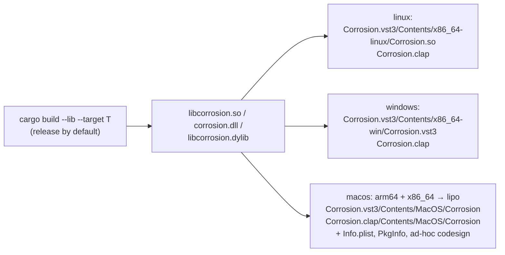
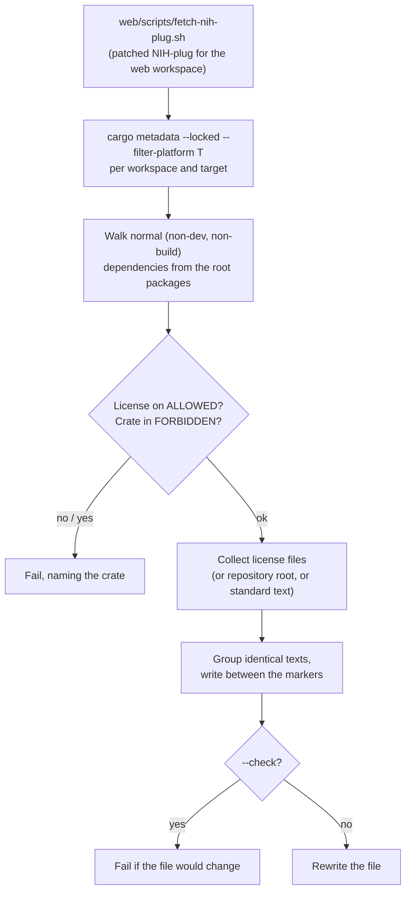

# Building and Bundling

Corrosion ships as two plugin formats (VST3 and CLAP) on three platforms (Linux, Windows, macOS), plus a web app. All of them come from one Rust library crate, `corrosion`, built as a `cdylib`: the same shared library, placed in the folder layout each format and platform expects. This page covers the build targets, how `scripts/bundle.sh` lays out the bundles, how they are checked and validated, the full local check script, the third-party notices, the vendored and patched crates, the editor's font files, and how to check the plugin in REAPER from a headless Linux session.

CI runs the same scripts; see [CI and Releases](CI-and-Releases). The repository's directories are mapped on [Repository Layout](Repository-Layout).

## Targets

`.cargo/config.toml` is written for the maintainer's Windows machine, which has the MinGW-w64 GCC toolchain and no MSVC:

| Setting | Value | Effect |
|---|---|---|
| `[build] target` | `x86_64-pc-windows-gnu` | Every `cargo` command builds for Windows GNU unless told otherwise |
| `[build] target-dir` | `../corrosion-target` | Build output goes next to the repository, not inside it |
| `[target.x86_64-pc-windows-gnu] linker` | `x86_64-w64-mingw32-gcc` | The MinGW linker |
| `[target.x86_64-unknown-linux-gnu] linker` | `gcc` | |
| `[target.x86_64-unknown-linux-musl]` | `rust-lld`, `-C link-self-contained=yes` | A static musl build without a musl toolchain installed |

**On any other machine, set your host target first**, or every build tries to cross-compile to Windows:

```bash
export CARGO_BUILD_TARGET=x86_64-unknown-linux-gnu   # aarch64-apple-darwin, x86_64-pc-windows-msvc, …
```

The environment variable overrides the config file. CI also sets `CARGO_TARGET_DIR` to `target/` inside the workspace so its cache can keep it.

Other build facts:

- **Toolchain:** stable Rust 1.99 or newer. `src/lib.rs` allows the lint `semicolon_in_expressions_from_non_local_macros`, which older compilers reject under `-D warnings`.
- **Features** (`Cargo.toml`): `default = ["gui"]` builds the egui editor (and the native file dialogs, `rfd`). `--no-default-features` builds the engine only, which is what the CI test lane, the benchmarks and the offline tools use. `web-host` and `web-gui` build only inside the `web/` workspace; see [Web App](Web-App).
- **Linux GUI builds** need the X11 and GL development packages (`pkg-config libx11-dev libx11-xcb-dev libxau-dev libxcb1-dev libxcursor-dev libxext-dev libxfixes-dev libxft-dev libxi-dev libxinerama-dev libxkbcommon-dev libxrandr-dev libxrender-dev libxtst-dev libxxf86vm-dev libgl-dev`).
- **Binaries:** besides the library, the crate has five command-line tools under `src/bin/`: `render` and `render_presets` ([Testing](Testing#the-offline-renderers)), `seed_presets` ([Factory Bank](Factory-Bank)), `export_guide_data` and `render_guide_clips` ([Site and User Wiki Tooling](Site-and-User-Wiki-Tooling)).

## Bundling (`scripts/bundle.sh`)

A host doesn't load a bare `.so` or `.dll`: VST3 wants a bundle directory with a fixed inner layout, and on macOS both formats are bundles with an `Info.plist`. `bundle.sh` builds the library and arranges it.

```bash
scripts/bundle.sh <linux|windows|macos> [release|debug]
```



| Platform | Target(s) | Output in `target/bundled/<platform>/` |
|---|---|---|
| `linux` | `x86_64-unknown-linux-gnu` | `Corrosion.vst3/Contents/x86_64-linux/Corrosion.so`; `Corrosion.clap` is the same library renamed |
| `windows` | `x86_64-pc-windows-msvc` (what CI ships); set `CORROSION_WINDOWS_TARGET=x86_64-pc-windows-gnu` for the MinGW build | `Corrosion.vst3/Contents/x86_64-win/Corrosion.vst3` (the DLL); `Corrosion.clap` is the same DLL |
| `macos` | `aarch64-apple-darwin` and `x86_64-apple-darwin` | Both libraries joined by `lipo` into one universal binary, copied into `Corrosion.vst3/Contents/MacOS/Corrosion` and `Corrosion.clap/Contents/MacOS/Corrosion`, each with an `Info.plist` (bundle ID `com.corrosion.corrosion.<format>`, version from `Cargo.toml`) and `PkgInfo`, then ad-hoc signed with `codesign --sign -` |

Notes:

- The library is looked up under `$CARGO_TARGET_DIR`, or `../corrosion-target` when that is unset, but the bundles always go to `target/bundled/<platform>/` inside the repository. The script deletes that folder first.
- macOS bundles are **ad-hoc signed, not notarized**: Apple Silicon refuses to load unsigned code, but Gatekeeper still quarantines a downloaded bundle. The release notes tell users to clear the quarantine attribute.
- One library is both formats because nih-plug's export macros put the VST3 and CLAP entry points in the same binary.
- `scripts/archive/` keeps two thin wrappers for old habits: `bundle.sh` (runs `scripts/bundle.sh linux`) and `bundle-win.sh` (runs it for `windows` with the GNU target). Use `scripts/bundle.sh` directly.

### Checking the layout (`scripts/check_bundle.sh`)

```bash
scripts/check_bundle.sh <linux|windows|macos> [dir]
```

It checks each file sits where hosts look for it and is the right kind of binary (by `file`): `ELF 64-bit … shared object` on Linux, `PE32+ executable … DLL` on Windows, `Mach-O universal binary` on macOS. On macOS it also requires both `arm64` and `x86_64` slices (`lipo -archs`), an `Info.plist` and a `PkgInfo`, and a strict `codesign --verify`. It exits non-zero on the first failure, naming it.

### Validators (`scripts/validate-plugins.sh`)

```bash
scripts/validate-plugins.sh [linux|windows|macos] [dir]
```

The platform defaults to the host's (by `uname`). If the bundles are missing it builds them first. Then:

- **pluginval** (Tracktion's plugin validator) loads the VST3 at strictness level 5 with `--skip-gui-tests`;
- **clap-validator** (free-audio's) runs `validate` on the CLAP.

A validator missing from `PATH` is skipped with a message, unless `CORROSION_REQUIRE_VALIDATORS=1`, which CI sets so a missing tool is an error. CI pins clap-validator 0.3.2 and pluginval v1.0.4, and on Linux runs pluginval under `xvfb-run` because JUCE wants a display even without GUI tests. Locally, put the validators' executables on `PATH` from their GitHub releases.

## The full local lane (`scripts/verify-local.sh`)

One command that mirrors most of CI on a Linux machine. It stops at the first failure:

1. `cargo fmt --check`
2. `python3 scripts/third_party_notices.py --check`
3. `cargo clippy --workspace --all-targets --no-default-features -- -D warnings`
4. `cargo test --workspace --no-default-features` (the CI lane)
5. `cargo test --lib --target x86_64-unknown-linux-gnu` (the GUI lane)
6. `render --suite family` into `/tmp/corrosion-local-verify-render`, then `check_wav.py` on `pipe_comparison.wav`
7. `scripts/bundle.sh linux release` and `scripts/check_bundle.sh linux`

Steps 1–4 and 7 use whatever target `CARGO_BUILD_TARGET` says, so export it first. It doesn't run `cargo doc`, the explicit `no_alloc` step (the CI lane includes `tests/no_alloc.rs` anyway, in debug), the validators or the web and user-Wiki checks. The other checks are listed on [Testing](Testing#test-lanes).

## Third-party notices

Corrosion is GPLv3-or-later and ships other people's code: about 270 crates, fonts, vendored crates, generated files. Their licenses ask for their notices to travel with the binaries, so `THIRD-PARTY-NOTICES.md` collects them, and CI copies it into every release zip next to `LICENSE`.

| Section | Written by | Holds |
|---|---|---|
| 1. Material in this repository | Hand | The OpenSpec-generated skills and commands under `.claude/` and `.opencode/`, `vendor/nih_log`, the editor fonts, `vendor/egui-baseview`, the NIH-plug patch the web build applies |
| 2. The website | Hand | The npm packages whose client code the site ships (Astro, Starlight, Expressive Code, Pagefind) |
| 3. Trademarks | Hand | VST and CLAP |
| 4. Rust crates | `scripts/third_party_notices.py` | Between `<!-- BEGIN GENERATED … -->` and `<!-- END GENERATED -->`: a table of every shipped crate, then each distinct license text once with the crates it covers |

### How `third_party_notices.py` works



1. It runs `web/scripts/fetch-nih-plug.sh` first, because the web workspace's dependency graph points at a patched NIH-plug in `web/vendor/nih-plug`.
2. For each workspace and target it runs `cargo metadata --locked --filter-platform <target>`: the root workspace for `corrosion` on `x86_64-unknown-linux-gnu`, `x86_64-pc-windows-msvc`, `x86_64-pc-windows-gnu`, `x86_64-apple-darwin` and `aarch64-apple-darwin`; the `web` workspace for `corrosion-web-engine` and `corrosion-web-editor` on `wasm32-unknown-unknown`. The list is the union, so a crate may ship on only some targets.
3. It walks the normal-dependency closure from the root packages (dev and build dependencies don't ship), leaving out Corrosion's own packages.
4. Each crate's SPDX expression must use only identifiers in `ALLOWED`, a GPLv3-compatible allowlist (MIT, Apache-2.0, BSD variants, ISC, Zlib, MPL-2.0, Unicode, BSL-1.0, CC0, GPL-3.0 and a few more). A crate in `FORBIDDEN` fails the run: today only `epaint_default_fonts`, egui's built-in fonts, which the editor replaces with its own.
5. License texts come from the crate's own files (`LICENSE*`, `COPYING*`, `NOTICE*`, …). A crate published without one gets its git repository root's license files when the root declares the same license, otherwise the standard MIT, ISC or BSL text with the authors from its `Cargo.toml`; those crates are listed in their own subsection.
6. Texts that differ only in whitespace (and `http` vs `https`) are grouped and printed once. Apache-2.0 copies are cut at "END OF TERMS AND CONDITIONS", since copies differ only in the appendix.

```bash
python3 scripts/third_party_notices.py          # rewrite section 4
python3 scripts/third_party_notices.py --check  # fail if it is stale
```

It needs the network or a warm Cargo cache. **Rerun it after any change to `Cargo.lock` or `web/Cargo.lock`**, `cargo update` included, and commit the result. CI's `web` job and `verify-local.sh` run `--check`. If a new license fails the allowlist, ask the maintainer; don't widen `ALLOWED` yourself. Third-party material that isn't a crate (vendored code, fonts, generated files, site code) needs a hand-written entry in sections 1–3.

## Vendored and patched crates (`vendor/`)

Two dependencies are carried as local copies with one change each, wired in through `[patch]` sections of the root `Cargo.toml`. Each folder's `PATCHED.md` says what was taken from where, the one change, and when to drop the copy.

| Copy | Upstream | The change | Why | Patched in |
|---|---|---|---|---|
| `vendor/nih_log` | nih_log 0.3.1 at `0f3819a` (ISC) | `atty` removed: `src/target.rs` uses `std::io::stderr().is_terminal()` | `atty` is unmaintained and has an open advisory (RUSTSEC-2021-0145) | `[patch.crates-io]` in `Cargo.toml` and `web/Cargo.toml` |
| `vendor/egui-baseview` | egui-baseview 0.5.0 at `ec70c3f`, the revision `nih_plug_egui` pins (MIT) | `default_fonts` is no longer a default feature (`default = ["opengl"]`); `src/` untouched | `nih_plug_egui` enables egui-baseview's defaults, which would embed egui's default fonts in every binary | `[patch."https://github.com/BillyDM/egui-baseview.git"]` in `Cargo.toml` |

**Trap:** if NIH-plug moves to another egui-baseview revision, the patch no longer matches and egui's fonts come back. The notices script's `FORBIDDEN` check then fails, which is the intended alarm: refresh the copy from the new revision and reapply the change.

The web workspace also patches NIH-plug itself, with `web/nih-plug-public-setters.patch` applied by `web/scripts/fetch-nih-plug.sh` to a clone at the revision `Cargo.lock` pins; see [Web App](Web-App).

## The editor's fonts (`assets/fonts/`)

The editor and the web app embed two font files, unmodified, both under the SIL Open Font License 1.1 with their license texts beside them:

| File | Font | Used for |
|---|---|---|
| `Inter-Regular.ttf` | Inter 4.1 Regular | The whole interface |
| `IBMPlexSans-SemiBold.ttf` | IBM Plex Sans 1.1.0 SemiBold | The brand block in the header |

`assets/fonts/README.md` records each file's source release. IBM Plex Sans carries the Reserved Font Name "Plex", so a modified copy may not keep the name: don't subset or edit it. A third font, Corrosion Icons (the triangles egui draws on submenus), is built in code by `icon_font()` in `src/gui/fonts.rs` and has no file. Changing a font means replacing the file and updating the README's table, the cap-height notes behind `UI_EM_SCALE` in `src/gui/fonts.rs`, and section 1 of the notices. How the fonts are loaded and scaled is on [Editor](Editor).

## Checking in REAPER from a cloud session

The development sessions run in a Linux container with no screen and no audio device. `docs/REAPER_TESTING.md` is the step-by-step recipe for checking the editor in a real host there anyway; it takes about five minutes to set up, everything lives under `/tmp/claude-0/`, and a recycled container loses it.

1. **Display:** Xorg with the `dummy` video driver on `:98` at 1920 × 1200. Not Xvfb: egui needs an OpenGL context, and only the dummy driver with Mesa gave one.
2. **REAPER:** the Linux tarball, run unpacked, in evaluation mode. A `__startup.lua` script inserts a track, adds `CLAP: Corrosion`, opens its window and logs what it found.
3. **A screenshot build:** the dummy server has no sRGB framebuffer config, so the normal editor fails with `InvalidFBConfig`. Build from a separate worktree whose `Cargo.toml` patches NIH-plug to a local clone (at the pinned revision) with `srgb: false` in `nih_plug_egui`'s editor. This build is only for screenshots; colours differ slightly.
4. **Install** the library as `~/.clap/Corrosion.clap`, start REAPER, and drive it with `xdotool` (clicks, drags, scrolls, typing, the computer keys `A W S E D F T G Y H U J K`), taking screenshots with ImageMagick's `import`. At the default 75 % UI Scale the plugin window is 810 × 658 including REAPER's title bar.
5. **Other actions** (save and reopen a project, read a parameter) go through Lua scripts run with `reaper -nonewinst`.

Limits: nothing can be heard (no audio device; check sound with the offline renderer and the tests), it says nothing about Windows or macOS hosts, and none of it is automated in CI. The scripts in `tests/daw/` are early placeholders, not this recipe; see [Testing](Testing#integration-tests-tests).

## Source files

- [`scripts/bundle.sh`](https://github.com/GerMP21/Corrosion-VST/blob/main/scripts/bundle.sh): builds and lays out the VST3 and CLAP bundles per platform
- [`scripts/check_bundle.sh`](https://github.com/GerMP21/Corrosion-VST/blob/main/scripts/check_bundle.sh): checks the bundle layout, binary kind, architectures and signature
- [`scripts/validate-plugins.sh`](https://github.com/GerMP21/Corrosion-VST/blob/main/scripts/validate-plugins.sh): runs pluginval and clap-validator
- [`scripts/verify-local.sh`](https://github.com/GerMP21/Corrosion-VST/blob/main/scripts/verify-local.sh): the full local lane
- [`scripts/third_party_notices.py`](https://github.com/GerMP21/Corrosion-VST/blob/main/scripts/third_party_notices.py): generates and checks section 4 of the notices
- [`THIRD-PARTY-NOTICES.md`](https://github.com/GerMP21/Corrosion-VST/blob/main/THIRD-PARTY-NOTICES.md): the notices that ship with every release
- [`docs/REAPER_TESTING.md`](https://github.com/GerMP21/Corrosion-VST/blob/main/docs/REAPER_TESTING.md): the REAPER recipe for headless Linux sessions
- [`.cargo/config.toml`](https://github.com/GerMP21/Corrosion-VST/blob/main/.cargo/config.toml): default target, target directory and linkers
- [`scripts/archive`](https://github.com/GerMP21/Corrosion-VST/tree/main/scripts/archive): old bundling wrappers kept for habit
- [`vendor/nih_log/PATCHED.md`](https://github.com/GerMP21/Corrosion-VST/blob/main/vendor/nih_log/PATCHED.md): what the nih_log copy changes and why
- [`vendor/egui-baseview/PATCHED.md`](https://github.com/GerMP21/Corrosion-VST/blob/main/vendor/egui-baseview/PATCHED.md): what the egui-baseview copy changes and why
- [`assets/fonts/README.md`](https://github.com/GerMP21/Corrosion-VST/blob/main/assets/fonts/README.md): the editor's font files and their sources
- [`Cargo.toml`](https://github.com/GerMP21/Corrosion-VST/blob/main/Cargo.toml): features, binaries, per-target dependencies and the `[patch]` sections
- [`web/scripts/fetch-nih-plug.sh`](https://github.com/GerMP21/Corrosion-VST/blob/main/web/scripts/fetch-nih-plug.sh): the patched NIH-plug the notices script and the web build need
