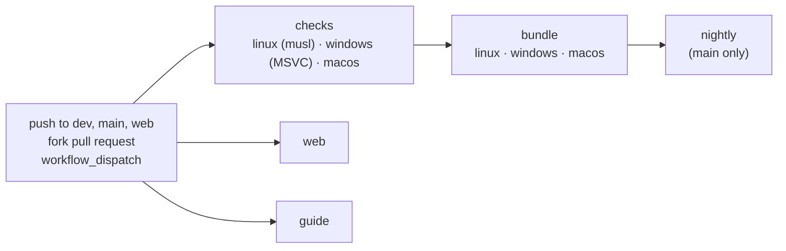
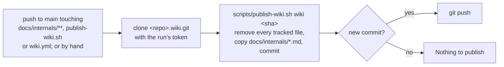

# CI and Releases

Corrosion has no release manager and no build machine of its own: GitHub Actions is both. Two workflows live in `.github/workflows/`:

- **`ci.yml`** checks every push and fork pull request on Linux, Windows and macOS, builds and validates the plugin bundles on each platform, and, on `main`, replaces the rolling `nightly` pre-release with the new zips.
- **`wiki.yml`** publishes this wiki: it mirrors `docs/internals/` into the repository's GitHub Wiki on pushes to `main`.

The website is deployed by its host's own build, outside Actions; see [The site's deploy check](#the-sites-deploy-check).

## The `ci` workflow

The same graph in words: `checks`, `web` and `guide` start in parallel. `bundle` waits for all three `checks` jobs. `nightly` waits for all three `bundle` jobs and runs only on `main`. `web` and `guide` are not dependencies of `bundle` or `nightly`.

### Triggers and concurrency

| Setting | Value | Why |
|---|---|---|
| `on.push.branches` | `dev`, `main`, `web` | `dev` is the maintainer's working branch and `main` the release branch; the workflow doesn't document why `web` is listed |
| `on.pull_request` | all | But see the `if` below |
| `on.workflow_dispatch` | by hand | On `main` it also refreshes the nightly |
| `if` on `checks`, `web`, `guide` | not a pull request, or a pull request from a fork | A pull request from a branch of this repository was already tested by that branch's push run |
| `concurrency.group` | `ci-<ref>` | One run per branch |
| `cancel-in-progress` | true except on `main` | A newer push cancels an older run, but a run on `main` may be publishing the nightly and is left to finish |
| `permissions` | `contents: read` (the `nightly` job raises it to `write`) | Least privilege |
| `defaults.run.shell` | `bash` | Git Bash on Windows, so every step and script is the same bash |

Global environment: `CARGO_TARGET_DIR` is `target/` inside the workspace (the config file's `../corrosion-target` would fall outside the cache), and the validator versions are pinned (`CLAP_VALIDATOR_VERSION` 0.3.2, `PLUGINVAL_VERSION` v1.0.4).

### `checks` (Linux, Windows, macOS)

A matrix with `fail-fast: false`, so one platform's failure doesn't hide another's. Each platform has a `target` for the no-GUI lane and a `native` target for the GUI, real-time and renderer steps:

| Platform | Runner | `target` (`CARGO_BUILD_TARGET`) | `native` |
|---|---|---|---|
| linux | `ubuntu-latest` | `x86_64-unknown-linux-musl` | `x86_64-unknown-linux-gnu` |
| windows | `windows-latest` | `x86_64-pc-windows-msvc` | same |
| macos | `macos-latest` | `aarch64-apple-darwin` | same |

Steps, in order:

| Step | Platforms | Command |
|---|---|---|
| Install X11/GL dev packages | Linux | `apt-get install` of the list on [Building and Bundling](Building-and-Bundling#targets) |
| Install stable Rust with both targets, clippy, rustfmt | all | `dtolnay/rust-toolchain@stable` |
| Cache | all | `Swatinem/rust-cache@v2`, key `checks-<platform>` |
| Format | Linux | `cargo fmt --check` |
| Clippy | all | `cargo clippy --workspace --all-targets --no-default-features -- -D warnings` |
| CI test lane | all | `cargo test --workspace --no-default-features` (on Linux this is the musl lane) |
| GUI lane | all | `cargo test --lib --target <native>` |
| Real-time safety | Linux, macOS | `cargo test --no-default-features --test no_alloc --target <native>` |
| Real-time safety | Windows | The same with `--features nih-plug/assert_process_allocs`, `CORROSION_EXPECT_ALLOC_CHECKER=1` and a 10-minute timeout (the feature once hung nih-plug's test setup on Windows) |
| Docs | Linux | `cargo doc --no-deps --no-default-features` with `RUSTDOCFLAGS=-D warnings` |
| Benchmarks compile | Linux | `cargo bench --no-default-features --bench performance --no-run` |
| Renderer smoke | all | `cargo run --bin render -- --suite family --out-dir <temp>` |
| WAV check | all | `scripts/check_wav.py` on `pipe_comparison.wav` |

The test lanes, `no_alloc` and the renderer are explained on [Testing](Testing) and [Real-Time Safety](Real-Time-Safety). The Internals wiki's test (`tests/internals_wiki.rs`) runs inside the CI test lane like any integration test.

### `web` (Linux)

The browser build is its own Cargo workspace in `web/`, with a patched NIH-plug. The job runs with `working-directory: web`, `CARGO_BUILD_TARGET=x86_64-unknown-linux-gnu` and `CARGO_TARGET_DIR=web/target`, and a `rust-cache` keyed `web` on that workspace:

1. `./scripts/fetch-nih-plug.sh`: clone NIH-plug at the revision the root `Cargo.lock` pins and apply `web/nih-plug-public-setters.patch`.
2. `python3 ../scripts/third_party_notices.py --check`: the notices' crate section must match both lockfiles. This is the only CI job that runs it.
3. `cargo fmt --check`.
4. Clippy with `-D warnings`: `corrosion-web-engine` natively (all targets), then the engine and `corrosion-web-editor` for `wasm32-unknown-unknown`.
5. `cargo test -p corrosion-web-engine`: the engine and bridge tests, including the web engine's `no_alloc`.
6. `bash scripts/cloudflare-build.sh`: the same build script the site's host runs (installs the pinned `wasm-bindgen` CLI and Node if missing, then `scripts/build.sh`, which builds the app and the user Wiki into `web/dist`).
7. Install Playwright 1.63.0 and headless Chromium.
8. Serve `dist` with `scripts/serve.cjs` (which follows the host's trailing-slash and 404 rules) and run `site.cjs`, `smoke.cjs` and `features.cjs` (the last with a factory preset) against it.

What those browser scripts check is on [Web App](Web-App) and [Site and User Wiki Tooling](Site-and-User-Wiki-Tooling).

### `guide` (Linux)

The user Wiki (`web/guide/`, an Astro Starlight site) with Node 22.23.4 and npm's cache keyed on `web/guide/package-lock.json`: `npm ci`, `npm run check -- --complete` (generated data, Spanish twins, coverage, clip references, no placeholder page), `npm test` (the check script's own tests), and `npm run build`, which also validates internal links. No Rust: the Wiki's data and clips are committed, and their drift tests run in `checks`.

### `bundle` (Linux, Windows, macOS)

Needs every `checks` job, so a release never mixes a tested platform with an untested one.

| Platform | Targets | Validator assets |
|---|---|---|
| linux (`x86_64`) | `x86_64-unknown-linux-gnu` | clap-validator `*ubuntu*`, `pluginval_Linux.zip` |
| windows (`x86_64`) | `x86_64-pc-windows-msvc` | `*windows*`, `pluginval_Windows.zip` |
| macos (`universal`) | `aarch64-apple-darwin`, `x86_64-apple-darwin` | `*macos*`, `pluginval_macOS.zip` |

Steps: install the build dependencies (plus `xvfb` on Linux) and Rust; cache keyed `bundle-<platform>`; `scripts/bundle.sh <platform> release`; `scripts/check_bundle.sh <platform>`; download the pinned validator releases with `gh release download` using the run's token, unpack them and put their folders on `PATH`; `scripts/validate-plugins.sh <platform>` with `CORROSION_REQUIRE_VALIDATORS=1` (under `xvfb-run` on Linux, because pluginval's JUCE wants a display).

Then **Package**: copy `LICENSE` and `THIRD-PARTY-NOTICES.md` into `target/bundled/<platform>/` and make one zip per format, `Corrosion-<platform>-<arch>-vst3.zip` and `…-clap.zip`, each holding the bundle at its root (ready to drop into the plugin folder) plus those two files. The zips are uploaded as the artifact `corrosion-<platform>`. The scripts are described on [Building and Bundling](Building-and-Bundling).

### `nightly`: the rolling pre-release

Runs after every `bundle` job succeeds, only for a push or a manual run on `refs/heads/main`. Its own concurrency group `nightly` never cancels, so publishes don't overlap and the newest publishes last. With `contents: write`:

1. Download all `bundle` artifacts into `dist/` and require exactly six zips: `Corrosion-{linux-x86_64,windows-x86_64,macos-universal}-{vst3,clap}.zip`.
2. Write release notes: the commit, the fact that every bundle passed its platform's tests, clap-validator and pluginval (strictness 5, no GUI tests) and that no DAW checks are automated, a table of plugin folders per platform, that each zip holds `LICENSE` and `THIRD-PARTY-NOTICES.md`, and the `xattr -dr com.apple.quarantine` command macOS users need because the bundles are ad-hoc signed, not notarized.
3. `gh release delete nightly --yes --cleanup-tag`, then `gh release create nightly` with the six zips, `--prerelease`, `--target` the commit and the title `Nightly (<short sha>)`.

So the `nightly` tag always points at the last `main` commit whose `checks` and `bundle` jobs passed on all three platforms. Because `nightly` depends only on `bundle`, a failure in the `web` or `guide` job doesn't stop a nightly from publishing.

### What is cached

| Job | Cache | Key |
|---|---|---|
| `checks` | Cargo registry and `target/` (`Swatinem/rust-cache@v2`) | `checks-<platform>` |
| `web` | Cargo registry and `web/target` | `web` |
| `bundle` | Cargo registry and `target/` | `bundle-<platform>` |
| `guide` | npm cache (`actions/setup-node`) | `web/guide/package-lock.json` |

Validators and Playwright's Chromium are downloaded on every run.

## The site's deploy check

The website (`corrosion-vst.org`: home, the web app at `/play/`, the user Wiki at `/wiki/`) is built and deployed by Cloudflare Workers Builds, configured in Cloudflare's dashboard, not in this repository. The repository holds what it runs: `web/wrangler.toml` (static assets from `web/dist`, the custom domain, trailing-slash and 404 handling) and the build command `bash scripts/cloudflare-build.sh` from `web/`, followed by `npx wrangler deploy`. It reports a check on commits; that check **only works on `main`**. On `dev` and on pull requests from `dev` it fails or is skipped, and that is expected, not a broken build. CI's `web` job runs the same build script on every branch, so a broken site build still fails CI. See [Site and User Wiki Tooling](Site-and-User-Wiki-Tooling).

## The `wiki` workflow: publishing this wiki

GitHub stores a repository's wiki in a separate git repository (`<repo>.wiki.git`). Editing pages on GitHub would let the wiki drift from the code, so the pages are written in `docs/internals/` and reviewed with the code, and a workflow mirrors them.

In words:

- **Trigger:** a push to `main` that changes `docs/internals/**`, `scripts/publish-wiki.sh` or `.github/workflows/wiki.yml`, or a manual run. The pages link to code on `main`, so the wiki follows `main`, not `dev`.
- **Concurrency:** group `wiki`, `cancel-in-progress: true`: the newest `main` wins.
- **Permissions:** `contents: write`, needed to push to the wiki repository.
- **Clone:** `https://x-access-token:<token>@github.com/<repo>.wiki.git`. GitHub creates the wiki repository only after its first page exists; if the clone fails, the job's error says to create any page once in the Wiki tab and rerun.
- **Mirror** (`scripts/publish-wiki.sh <wiki-clone-dir> [source-sha]`): removes every tracked file in the clone, copies `docs/internals/*.md` in, stages everything, and commits as `github-actions[bot]` with the message `Publish docs/internals from <sha>` only when something changed. Pages deleted from `docs/internals/` are deleted from the wiki; nothing else is kept. Only `.md` files are copied.
- **Push:** only when the clone has a commit its upstream doesn't.

**Never edit the wiki on GitHub:** the next publish overwrites it. You can run `publish-wiki.sh` locally against a clone of the wiki to see what would change; it commits but never pushes.

## Source files

- [`.github/workflows/ci.yml`](https://github.com/GerMP21/Corrosion-VST/blob/main/.github/workflows/ci.yml): the `checks`, `web`, `guide`, `bundle` and `nightly` jobs
- [`.github/workflows/wiki.yml`](https://github.com/GerMP21/Corrosion-VST/blob/main/.github/workflows/wiki.yml): publishes `docs/internals/` to the GitHub Wiki on `main`
- [`scripts/publish-wiki.sh`](https://github.com/GerMP21/Corrosion-VST/blob/main/scripts/publish-wiki.sh): mirrors the pages into a wiki clone and commits
- [`scripts/bundle.sh`](https://github.com/GerMP21/Corrosion-VST/blob/main/scripts/bundle.sh): what the `bundle` job builds
- [`scripts/validate-plugins.sh`](https://github.com/GerMP21/Corrosion-VST/blob/main/scripts/validate-plugins.sh): what the `bundle` job validates
- [`web/scripts/cloudflare-build.sh`](https://github.com/GerMP21/Corrosion-VST/blob/main/web/scripts/cloudflare-build.sh): the site build both CI and the host run
- [`web/wrangler.toml`](https://github.com/GerMP21/Corrosion-VST/blob/main/web/wrangler.toml): the site's hosting configuration
