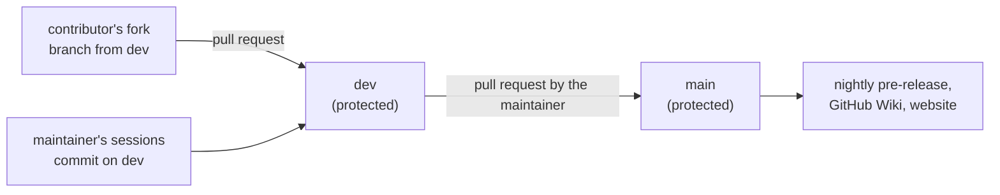
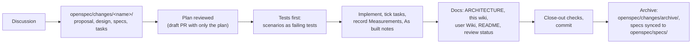

# Contributing and Keeping This Wiki Current

This page is the process side of the codebase: which branch work goes on, how a significant change is planned and closed with OpenSpec, the checks every change passes, the commit and pull request conventions, and the rule that keeps this wiki true. `CONTRIBUTING.md` is the contributor-facing source for all of it, and `CLAUDE.md` holds the same rules for coding agents; this page summarises them for a developer and adds where things live. When they disagree, `CONTRIBUTING.md` and `CLAUDE.md` win, and this page needs fixing.

## Branches



In words:

- **`dev` and `main` are protected**: only the maintainer pushes to them.
- **The maintainer works on `dev`.** Every change of theirs is committed and pushed there; no other branches.
- **Contributors** fork the repository, branch from `dev` in their fork (`git fetch upstream && git switch -c <name> upstream/dev`), and open the pull request **against `dev`, never `main`**, filling in `.github/pull_request_template.md`.
- **`dev` reaches `main`** only through the maintainer's own pull requests. After one merges, `dev` is fast-forwarded to `main` before new work.
- **Publishing follows `main`:** the `nightly` pre-release, this wiki and the website are built from `main` only. See [CI and Releases](CI-and-Releases).

## Where to post

| You have | Post it as |
|---|---|
| A confirmed, reproducible bug | The Bug report issue form (`.github/ISSUE_TEMPLATE/bug_report.yml`) |
| A concrete feature or improvement | The Feature proposal issue form (`feature_proposal.yml`) |
| A question, an idea, sound-design feedback, a DSP review, or any change that isn't small | GitHub Discussions |

Before starting, check `openspec/changes/` (work in progress; `archive/` is finished work) and `docs/BACKLOG.md` (open review findings, known issues, deferred features).

## The OpenSpec workflow

New features, significant refactors and architectural changes are planned before code, with [OpenSpec](https://github.com/Fission-AI/OpenSpec). Small fixes don't need it.



The steps in words:

1. **Discuss** the problem, who it affects and the alternatives.
2. **Write the change** in `openspec/changes/<name>/`:
   - `proposal.md`: why, what changes, what's out of scope; a change that breaks presets, projects or automation says **BREAKING**;
   - `design.md`: decisions and their reasons, with the numbers behind them;
   - `specs/<capability>/spec.md`: delta requirements, each with `#### Scenario:` blocks (WHEN/THEN) against one of the capabilities in `openspec/specs/` (about 37, such as `realtime-safety`, `modal-bank`, `output-clipper`, `factory-preset-bank`);
   - `tasks.md`: a checklist.

   `openspec validate <name>` checks the artifacts. The CLI is `npm install -g @fission-ai/openspec`; the repository also ships `/opsx:*` commands for Claude Code (`.claude/`) and OpenCode (`.opencode/`), but the artifacts are plain Markdown anyone can write. `openspec/config.yaml` selects the `spec-driven` schema.
3. **Get the plan reviewed** before implementing it.
4. **Tests first.** Write the spec's scenarios as tests and check that they fail on the current code (or that a reference test passes), then implement.
5. **Implement** within the tasks. Tick each task `- [x]` once it is done and verified.
6. **Record numbers** in a `## Measurements` section of `design.md`: before and after values, benchmark medians, anything the proposal guessed wrong. Where the implementation differs from a design decision, add an *As built* note instead of leaving the design stale.
7. **Update the docs** (next section).
8. **Close out** with the checks below, then commit.
9. **Archive** (`/opsx:archive`): the change folder moves to `openspec/changes/archive/<date>-<name>/` and its delta specs are merged into `openspec/specs/`. The archive is where design history lives; that's why this wiki can stay free of it.

When a plan, a spec bound or a design decision turns out not to hold, stop and ask the maintainer, with the numbers and the options. Don't relax a spec silently.

## Close-out checks

Every change passes these before it's committed. CI runs them again on all platforms ([CI and Releases](CI-and-Releases)); the lanes are explained on [Testing](Testing).

| Check | Command |
|---|---|
| Format | `cargo fmt --check` |
| Lint | `cargo clippy --workspace --all-targets --no-default-features -- -D warnings` |
| Tests (CI lane) | `cargo test --workspace --no-default-features` |
| Editor tests (GUI lane) | `cargo test --lib` |
| Real-time safety | `cargo test --no-default-features --test no_alloc` (debug only) |
| Docs | `cargo doc --no-deps --no-default-features` adds no warnings |
| This wiki | `cargo test --no-default-features --test internals_wiki` |
| Third-party notices | `python3 scripts/third_party_notices.py --check` (after any lockfile change, run it without `--check` and commit the result) |
| User Wiki | `npm run check -- --complete` in `web/guide/`, when the user Wiki or its data changed |
| Web app | `web/scripts/build.sh`, when the web app changed |

Set `CARGO_BUILD_TARGET` to your host first ([Building and Bundling](Building-and-Bundling#targets)). `./scripts/verify-local.sh` runs most of the Rust checks and the Linux bundle in one go.

Depending on what changed, also:

- **A parameter's meaning changed:** migrate user presets (`migrate_preset_json`, `src/presets/mod.rs`) and saved DAW projects (`Plugin::filter_state`, `src/lib.rs`). Host automation can't be migrated, which makes the change breaking. See [Presets and Migrations](Presets-and-Migrations).
- **Levels or timbre moved engine-wide:** run the factory bank tests, reseed with `cargo run --release --bin seed_presets`, and say what moved. See [Factory Bank](Factory-Bank).
- **A claim that sound is unchanged:** prove it with a test-only switch or a render-hash comparison against a clean worktree ([Testing](Testing#proving-unchanged)).
- **An intended change to note-on banks:** regenerate the golden mode-bank fixture with `CORROSION_UPDATE_GOLDEN=1 cargo test mode_banks_match_golden` and document why.
- **A performance claim:** the median of 5 within-run ratios ([Benchmarks and Performance](Benchmarks-and-Performance)).
- **A new dependency:** justify it, check it is the real package and its license is GPLv3-compatible, make sure it doesn't allocate or lock on the audio thread, commit the lockfile, regenerate the notices.

## Commits and pull requests

- **Subject:** imperative mood, sentence case, no trailing period, under 72 characters; add the change or finding identifier in parentheses when there is one (`Skip redundant mode retunes (H12)`). The body says what was wrong, what changed and why, with measurements when they matter, and says explicitly when the change breaks something.
- **Sign-off** (`git commit -s`, the Developer Certificate of Origin) is strongly recommended. Commits made by an AI tool under its own identity should be re-authored and signed off by the person responsible.
- **AI assistance** is welcome if disclosed: the pull request template's "AI assistance" section names the tool (not the model or its version), what it was used for and how the output was verified, and commits credit it with `Co-Authored-By: Claude <noreply@anthropic.com>`, without a model name.
- **One logical change per pull request.** Don't mix refactoring or formatting with behaviour changes.
- **The template** (`.github/pull_request_template.md`) is short on purpose. It asks for: why, with the related issue, Discussion or OpenSpec change; what changed; behaviour changes, with a box for breaking changes and how to migrate (and, in a hidden hint, migrations, regenerated files, dependencies and benchmarks when they apply); how it was tested, with three boxes for format and clippy, the test suite, and the docs (Wiki in both languages, this wiki, README, `docs/ARCHITECTURE.md`); AI assistance; and optional notes for the reviewer. Anything that doesn't apply is deleted.
- The site's deploy check only works on `main`; on a pull request it may fail or be skipped, which is expected.

## The rule: this wiki follows the code

**Every change updates, in the same change, every page of this wiki that describes what it touched.** That covers code, build, tests, CI, scripts and tooling, not only sound. A new file is named in some page's `## Source files` section in the same change. A change isn't done while a page here says something the code no longer does. The rule binds contributors' pull requests too, and the pages are English only.

### How to follow it

1. **Find the pages.** For each file the change touches:
   ```bash
   grep -rl '<path>' docs/internals/
   ```
   e.g. `grep -rl 'src/dsp/resonators/core.rs' docs/internals/`. Every page names its files in `## Source files`, so this finds the pages that describe them. Read what they say about the file, and also search for the type and function names you changed (`grep -rn 'rebuild_in_place' docs/internals/`): prose mentions code by name in backticks.
2. **Fix what they say.** Constants, function names, ordering, numbers, traps. If you removed a file, remove its line from `## Source files`; if you added one, name it on the page that describes its area, or write a new page.
3. **A new page** is `docs/internals/<Page-Name>.md` with the first line `# Page Name` (the file name with hyphens as spaces), ends with `## Source files`, and gets a link in `_Sidebar.md`.
4. **Run the check:**
   ```bash
   cargo test --no-default-features --test internals_wiki
   ```
   It runs in CI's test lane. It fails when a named path no longer exists; when a non-test `src/` file, or a top-level item of `web/`, `scripts/`, `tests/`, `benches/` or `.github/workflows/`, isn't named by any page; when a link between pages, or to a heading, is broken; and when a page is missing from the sidebar. If one of its checks is marked `#[ignore]`, add `-- --include-ignored`. What each check does is on [Testing](Testing#the-internals-wikis-own-test). It can't tell whether the prose is still true: that part is the rule, and the reviewer's job.

### Format and voice

- One file per page in `docs/internals/`, named as the wiki names it.
- Links between pages as `[text](Page-Name)` or `[text](Page-Name#heading-anchor)`, with GitHub's anchor rule (lower case; drop everything but letters, digits, spaces, `-` and `_`; spaces become `-`).
- Mermaid diagrams where they explain structure or flow, each followed by the same content as a list or table, for readers whose viewer doesn't render Mermaid.
- Code references in backticks. Repository links as `https://github.com/GerMP21/Corrosion-VST/blob/main/<path>` (files) or `…/tree/main/<path>` (directories), to paths that exist.
- A final `## Source files` list, one line per path with what the page uses it for, and no `## ` heading after it.
- Written for a developer who knows Rust and has never opened this code: plain words, why before how, the diagram before the details, numbers where they matter, the real names of types, functions and constants, and the traps.
- **No history in the prose:** no review finding IDs and no OpenSpec change names. Where a design choice needs its reasoning, a section may end with one `*History:*` line linking to `docs/ARCHITECTURE.md` or an `openspec/changes/archive/<dir>`.

### Publishing

`.github/workflows/wiki.yml` mirrors `docs/internals/` into the repository's GitHub Wiki on every push to `main` that changes it (`scripts/publish-wiki.sh`). **Never edit the wiki on GitHub**: the next publish overwrites it. Details on [CI and Releases](CI-and-Releases#the-wiki-workflow-publishing-this-wiki).

## How this wiki relates to the other documents

| Document | Audience | Holds | Kept current by |
|---|---|---|---|
| This wiki (`docs/internals/`) | Developers new to the code | How every part works now, page by page, each naming its source files | The rule above, checked by `tests/internals_wiki.rs` |
| `docs/ARCHITECTURE.md` | The maintainer and reviewers | The as-built record: signal chain, module map, contracts, with history, measurements and the change that introduced each decision | Each change's docs step |
| `openspec/changes/archive/` and `openspec/specs/` | Anyone asking why | Every finished change's proposal, design with measurements, and tasks; the merged requirements per capability | Archiving each change |
| `docs/BACKLOG.md` | Planners | Open work only: review findings, known issues, deferred features; finished items are removed | Each change that closes an item |
| `README.md` | Users | What the plugin is and how it sounds | Changes users notice |
| The user Wiki (`web/guide/`, served at `/wiki/`) | Players | What every control does and sounds like, with tips and audio clips, in **English and Spanish** | Its own rule: any change to how the plugin works or sounds updates every user Wiki page that describes it, in both languages, in the same change. See [Site and User Wiki Tooling](Site-and-User-Wiki-Tooling) |
| `CONTRIBUTING.md`, `CLAUDE.md` | Contributors; coding agents | The process on this page, and for agents the project's current state | The maintainer |

A change that moves the code usually touches several of these: ARCHITECTURE (as before), this wiki, and the user Wiki when players can hear or see the difference. This wiki doesn't replace any of them.

## Source files

- [`CONTRIBUTING.md`](https://github.com/GerMP21/Corrosion-VST/blob/main/CONTRIBUTING.md): the contributor process, checks, conventions and the wiki rules
- [`CLAUDE.md`](https://github.com/GerMP21/Corrosion-VST/blob/main/CLAUDE.md): the same rules for coding agents, branches, and the project's current state
- [`.github/pull_request_template.md`](https://github.com/GerMP21/Corrosion-VST/blob/main/.github/pull_request_template.md): what a pull request reports and checks
- [`.github/ISSUE_TEMPLATE`](https://github.com/GerMP21/Corrosion-VST/tree/main/.github/ISSUE_TEMPLATE): the bug report and feature proposal forms
- [`openspec`](https://github.com/GerMP21/Corrosion-VST/tree/main/openspec): changes in progress, the archive and the capability specs
- [`docs/ARCHITECTURE.md`](https://github.com/GerMP21/Corrosion-VST/blob/main/docs/ARCHITECTURE.md): the as-built record with history
- [`docs/BACKLOG.md`](https://github.com/GerMP21/Corrosion-VST/blob/main/docs/BACKLOG.md): open work
- [`tests/internals_wiki.rs`](https://github.com/GerMP21/Corrosion-VST/blob/main/tests/internals_wiki.rs): the check on this wiki
- [`scripts/publish-wiki.sh`](https://github.com/GerMP21/Corrosion-VST/blob/main/scripts/publish-wiki.sh): mirrors this wiki to GitHub
