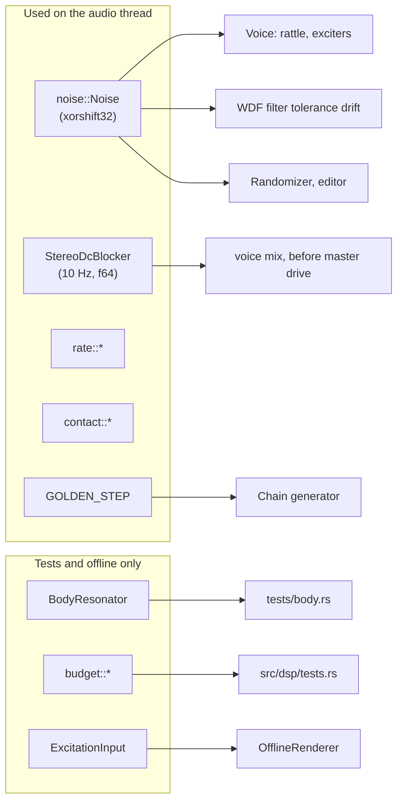

# DSP Utilities

`src/dsp/utils/` holds the small building blocks the engine shares: a stereo DC blocker, the noise generator every random source uses, the sample-rate conversion helpers, and a few helpers that only tests and offline tools still use (a four-mode body resonator, mode-budget estimates, a deterministic impulse buffer). This page says what each one is, where it is used and what its constants are.

Two modules have pages of their own: `rate.rs` is the [Sample Rate Rule](Sample-Rate-Rule), and `contact.rs` belongs to [Interaction Bus and Contact](Interaction-Bus-and-Contact).

## Map



The same as a table:

| Item | File | Used by |
|---|---|---|
| `Noise`, `note_seed`, `salted` | `noise.rs` | the voice's Damage rattle, five exciters, the WDF filter's Component Tolerance drift, the randomizer and the editor's randomize button |
| `StereoDcBlocker` | `dc_blocker.rs` | the plugin's voice mix (`Corrosion::block_mix_dc`) |
| `rate::*` | `rate.rs` | exciters, voice, resonator, FEM body ([Sample Rate Rule](Sample-Rate-Rule)) |
| `contact::*` | `contact.rs` | contact exciters ([Interaction Bus and Contact](Interaction-Bus-and-Contact)) |
| `GOLDEN_STEP` | `mod.rs` | the Chain generator |
| `BodyResonator` | `body.rs` | `tests/body.rs` only |
| `realtime_mode_count_estimate` and friends | `budget.rs` | `src/dsp/tests.rs` only |
| `ExcitationInput` | `deterministic_excitation.rs` | `OfflineRenderer` in `src/offline/mod.rs`, tests |

The module comment in `src/dsp/utils/mod.rs` still says these modules are "not used in the real-time plugin path". That is no longer true for `noise`, `dc_blocker`, `rate` and `contact`, which all run per sample.

## The voice-mix DC blocker

`StereoDcBlocker` removes DC and sub-audible drift from the sum of all voices.

**Why it exists.** A modal bank driven by a force of one sign (a bow pressing, a felt mallet's ~60 ms thump) holds a static deflection: its output sits off zero while the force lasts. That offset then feeds the master drive and the asymmetric diode stage, where it shifts the operating point. A 10 Hz high-pass on the mix takes it out before any nonlinearity.

**Where.** `Corrosion` owns one, `mix_dc_blocker`, built with `VOICE_MIX_DC_CUTOFF_HZ` = 10.0 (`src/lib.rs`). `render_frame_unlimited` applies it right after `VoiceManager::process_sample_stereo` and before the master drive. `prepare` and `begin_block` rate it for the host; `reset` and a panic clear it. `mix_dc_blocker_enabled` is a test-only switch. The diode stage has its own, separate 2 Hz one-pole blocker; see [Output Protection](Output-Protection).

**The filter.** A second-order Butterworth high-pass (Q = 1/√2) from the bilinear transform, with the cutoff prewarped so it is the same in hertz at every rate:

```text
w0 = 2π · fc / fs,  α = sin w0 / (2Q) = sin w0 · (1/√2),  a0 = 1 + α
b0 = b2 = (1 + cos w0) / 2 / a0,   b1 = −(1 + cos w0) / a0
a1 = −2 cos w0 / a0,               a2 = (1 − α) / a0
y = b0·(x + x[n−2]) + b1·x[n−1] − a1·y[n−1] − a2·y[n−2]
```

- **`f64` coefficients and state.** At 10 Hz the poles sit about 0.001 inside the unit circle, where an `f32` direct form would amplify its own rounding noise by about 10⁶ at DC. Input and output are `f32`.
- `set_sample_rate` is a no-op when the rate is unchanged; the coefficient rebuild is `#[cold] #[inline(never)]`.
- Measured effect: −0.05 dB at 30 Hz; a strike's mean over its first 20 ms falls by 16.6 dB.

Tests: `removes_a_constant`, `reset_clears_the_state`, `cutoff_is_the_same_in_hertz_at_every_rate` (−3.01 dB ± 0.05 at 10 Hz for 44.1, 48, 96 and 192 kHz).

*History:* [`openspec/changes/archive/2026-11-10-block-voice-mix-dc`](https://github.com/GerMP21/Corrosion-VST/tree/main/openspec/changes/archive/2026-11-10-block-voice-mix-dc).

## Noise

`noise::Noise` is the one random source for the whole engine: a xorshift32 generator, white and uniform, allocation-free and deterministic for a given seed.

```text
x ^= x << 13;  x ^= x >> 17;  x ^= x << 5        (next_u32)
unit()    = (x >> 8) / 2^24                      in [0, 1), the top 24 bits fill an f32 mantissa exactly
bipolar() = 2·unit() − 1                          in [−1, 1)
```

- **Seeding.** `Noise::new(seed)` first mixes the seed with `mix` (the lowbias32 integer hash), so nearby seeds give unrelated sequences, and avoids the all-zero state (which xorshift never leaves). `reseed` restarts it as `new` would.
- **Per note.** At note-on the voice computes `note_seed(note, velocity, start_frame)`, unique per note, velocity and start frame (so per voice) and stable across runs, and gives each consumer its own stream with `salted(seed, salt)`:

| Salt | Consumer |
|---|---|
| 0 | the Damage rattle ([Material Transformations](Material-Transformations#the-rattle)) |
| 6 | Wire Brush |
| 8 | Metal Chain |
| 10 | Heavy Grinding |
| 12 | Tension Rise |
| 13 | Pneumatic Jet |
| 16 | Particle Rain |

- **Rate independence.** Per-sample noise forces go through `rate::white_noise`, so their level in the audible band doesn't depend on the sample rate; random event parameters are drawn once per event. See [Sample Rate Rule](Sample-Rate-Rule).
- **Why integer noise.** It replaced `fract(sin(phase)·K)` hashes whose `f32` phase grew every call, so their resolution coarsened as a note went on, faster at higher rates: their spectrum drifted with note length and sample rate.

Other users: the WDF filter's Component Tolerance random walk ([Filter and Drive](Filter-and-Drive)), the [Randomizer](Randomizer) and the editor's randomize seed (from the clock).

Tests: `same_seed_same_sequence_and_different_seeds_differ`, `values_stay_in_range_with_zero_mean`, and `spectrum_is_flat` (four octave bands within 1 dB of their mean, at the start and after 10 million draws).

## `GOLDEN_STEP`

`GOLDEN_STEP: f32 = 1.618_034`, the golden ratio as a literal. The Chain generator uses `frac(i · GOLDEN_STEP)` as a deterministic scatter for its mode frequencies ([Objects](Objects#chain)). The literal is kept (rather than `f32::consts::GOLDEN_RATIO`, which may round differently) so the sequence, and the sound, stays bit-identical. Its doc comment says exciters and voices use it too; in the current code only the Chain generator does (the Coil Spring generator uses its own literal `1.618`).

## Body resonator (legacy)

`BodyResonator` is a fixed four-mode body in direct-form biquads (`ResonatorCoefficients`, built on the first sample at each rate):

| Mode | Frequency | Decay (τ) | Gain |
|---|---|---|---|
| 1 | 220 Hz | 0.8 s | 0.12 |
| 2 | 380 Hz | 0.6 s | 0.10 |
| 3 | 550 Hz | 0.5 s | 0.08 |
| 4 | 720 Hz | 0.4 s | 0.06 |

`process_sample(input, rate, amount)` returns `input + Σ modes · amount`, and **0.0** (not the dry input) when `amount ≤ 0`; `tests/body.rs` asserts that. The input gain has no `(48 000/fs)²` correction, so its level changes with the rate.

Nothing in the plugin uses it: the BODY control drives `FemBodyResonator` in the post chain ([Body, Spread and Space](Body-Spread-and-Space)). Its doc comments ("driven in the audio-rate voice path", "the input is returned dry when the amount is zero") don't match the code.

## Budget estimates

`budget.rs` estimates mode counts per profile from the static tables ([Objects](Objects#what-a-profile-is-now)):

- `RealtimeModeCountEstimate { profile_id, canonical_mode_count, safe_realtime_mode_count, offline_peak_mode_count }`: the table length, the same number as the "safe" count, and the count after the legacy table path with Damage 1 (twice the table).
- `realtime_mode_count_estimates()` covers Pipe, Plate, Tank and Chain only; `safe_realtime_shared_mode_limit()` and `offline_peak_shared_mode_limit()` take their maximum.

The functions are `#[cfg_attr(not(test), allow(dead_code))]` and only `realtime_mode_count_estimates_stay_grounded_in_current_profile_tables` in `src/dsp/tests.rs` calls them. The module comment says the voice uses them to choose polyphonic mode counts; it doesn't. The real bound is `MAX_MODES` ([Modal Resonator](Modal-Resonator#max_modes-and-max_raw_modes)).

## Deterministic excitation

`ExcitationInput` is a `Vec<f32>` impulse buffer: `impulse(frame_count, excitation_frame, amplitude)` puts one sample of `amplitude` at `excitation_frame`. `OfflineRenderer::deterministic_excitation` builds one from its `RenderConfig`, and `render_with_excitation` feeds it sample by sample to any `ResonatorCore`, for repeatable offline renders and tests. It allocates, so it is never used on the audio thread.

## Source files

- [`src/dsp/utils/mod.rs`](https://github.com/GerMP21/Corrosion-VST/blob/main/src/dsp/utils/mod.rs): the module list, re-exports and `GOLDEN_STEP`.
- [`src/dsp/utils/body.rs`](https://github.com/GerMP21/Corrosion-VST/blob/main/src/dsp/utils/body.rs): the legacy four-mode `BodyResonator`.
- [`src/dsp/utils/budget.rs`](https://github.com/GerMP21/Corrosion-VST/blob/main/src/dsp/utils/budget.rs): the mode-budget estimates.
- [`src/dsp/utils/dc_blocker.rs`](https://github.com/GerMP21/Corrosion-VST/blob/main/src/dsp/utils/dc_blocker.rs): `StereoDcBlocker` and its tests.
- [`src/dsp/utils/deterministic_excitation.rs`](https://github.com/GerMP21/Corrosion-VST/blob/main/src/dsp/utils/deterministic_excitation.rs): `ExcitationInput`.
- [`src/dsp/utils/noise.rs`](https://github.com/GerMP21/Corrosion-VST/blob/main/src/dsp/utils/noise.rs): `Noise`, `note_seed`, `salted` and their tests.
- [`src/lib.rs`](https://github.com/GerMP21/Corrosion-VST/blob/main/src/lib.rs): `VOICE_MIX_DC_CUTOFF_HZ` and where the mix blocker runs.
- [`tests/body.rs`](https://github.com/GerMP21/Corrosion-VST/blob/main/tests/body.rs): the only user of `BodyResonator`.
