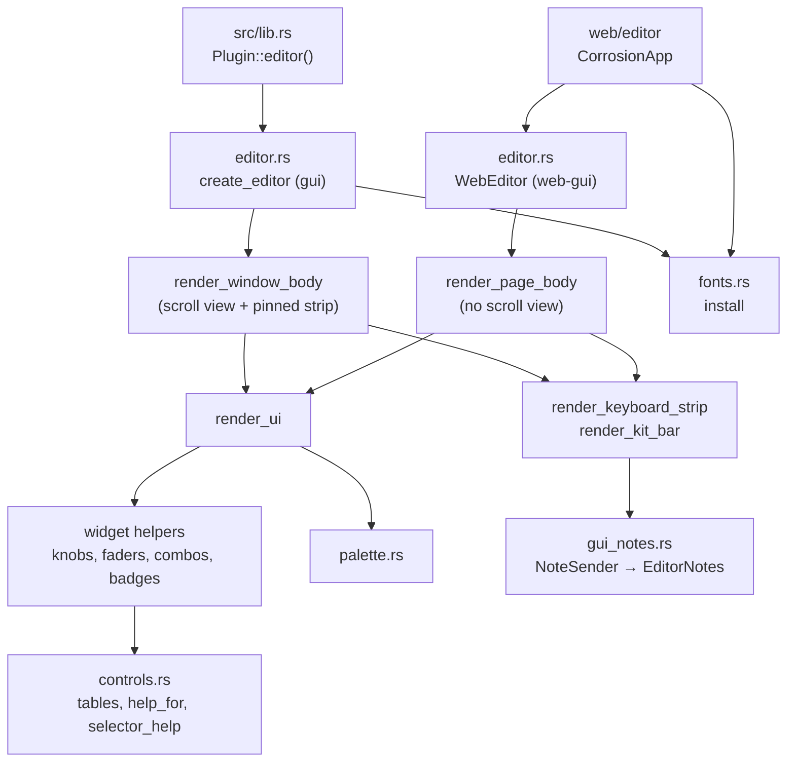
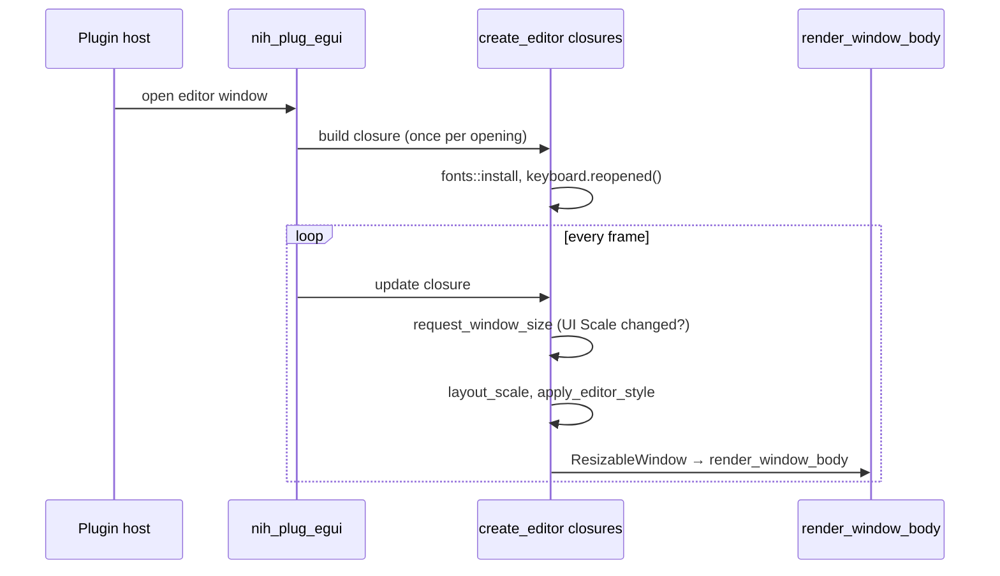
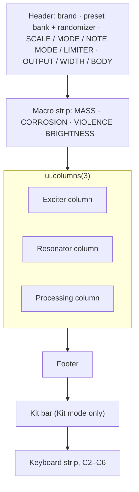
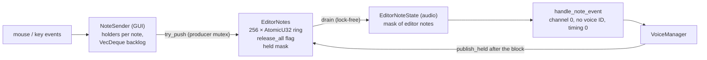

# Editor

The editor is Corrosion's own window: an [egui](https://github.com/emilk/egui) immediate-mode UI that redraws every frame from the plugin's parameters. The same Rust code (`src/gui/editor.rs`) runs in two hosts:

- **the plugin window**, through `nih_plug_egui` on baseview (feature `gui`, the default);
- **the web page**, on plain `egui` inside eframe with no window of its own (feature `web-gui`; see [Web App](Web-App)).

Everything the editor needs that isn't drawing (control tables, help texts, the palette, the editor's note queue) lives in modules with no egui dependency, so the CI lane, built with `--no-default-features`, can test them and the user Wiki's exporter can read them.

## Module map

| File | Feature gate | What it holds |
|---|---|---|
| `src/gui/mod.rs` | `controls`, `palette`: always; `editor`, `fonts`: `gui` or `web-gui`; `file_dialog`: `gui` | Module wiring. Re-exports `create_editor` (`gui`), `WebEditor` and `install_fonts` (`web-gui`). |
| `src/gui/editor.rs` | `gui` or `web-gui` | Window creation, scale, style, every widget, the panels, the keyboard strip and kit bar, the editor tests. |
| `src/gui/controls.rs` | none | Exciter and object slot tables, `FIXED_CONTROLS`, selector option lists, `help_for`, `selector_help`. |
| `src/gui/palette.rs` | none | The 13 colours as `[u8; 3]`. |
| `src/gui/fonts.rs` | `gui` or `web-gui` | Inter, IBM Plex Sans, the generated Corrosion Icons font, `UI_EM_SCALE`. |
| `src/gui/file_dialog.rs` | `gui` | Import/Export's system dialog (see [Presets and Migrations](Presets-and-Migrations)). |
| `src/gui_notes.rs` | none | The lock-free note queue between the editor and the audio thread. |

The doc comment at the top of `src/gui/mod.rs` still describes an older four-section layout ("Exciter, Object, Damage, Space"); the layout below is what the code draws.

## Two hosts, one body

- **Plugin.** `Plugin::editor` (`src/lib.rs`) calls `gui::create_editor(params, editor_state, diode_meter, editor_notes)`. It builds an `EditorUiState` and hands two closures to `create_egui_editor`:
  - the build closure runs each time the window opens: it installs the fonts and calls `KeyboardStrip::reopened`;
  - the update closure runs every frame: it asks the host for a new size if the UI Scale changed, computes the layout scale, applies the style, and draws `render_window_body` inside a `ResizableWindow` (minimum size half the 100 % size).
- **Web.** `WebEditor::frame` computes `page_scale` from the canvas width, applies the same style and draws `render_page_body` in a `CentralPanel`, then records `content_height` so the page can size the canvas (see [Web App](Web-App#the-editor-wasm)).

The two bodies differ in one thing:

| | `render_window_body` (plugin) | `render_page_body` (web) |
|---|---|---|
| Panels | in a vertical `ScrollArea` whose height is the window minus the strip | laid out at full height, no scroll view |
| Kit bar, strip | pinned under the scroll view, always visible | follow the panels |
| Who scrolls | egui | the browser page |

**The state outlives the window.** `nih_plug_egui` keeps the `EditorUiState` between openings. Anything that must reset when the window reopens (the strip's held notes) is reset in the build closure, and the audio thread watches the window close (see [How a closing window releases notes](#how-a-closing-window-releases-notes)).

`EditorUiState` holds: the last UI Scale and requested size, the factory presets (embedded at compile time with `include_dir!` from `presets/factory/`, so the shipped bundle needs no files) and user presets, the Save row's folder, name and message, an open file dialog (`gui` only), the randomizer's mode and its `Noise` source, the diode meter and dot state, and the `KeyboardStrip`.

## Window size and UI scale

The layout is designed at a 100 % size of 1080 × 840 logical points and scaled as a whole.

| Constant / function | Value | Role |
|---|---|---|
| `BASE_EDITOR_WIDTH` | 1080 | Width at 100 %. |
| `BASE_LAYOUT_HEIGHT` | 768 | Height the panels are laid out against (`height_pct`, `editor_height`). |
| `BASE_EDITOR_HEIGHT` | 840 | `BASE_LAYOUT_HEIGHT` + strip (64) + gap (8): the window's height at 100 %. |
| `UI_SCALE_CHOICES` (`src/params.rs`) | 21 entries, 50 % … 150 % in 5 % steps | (index, label, factor). The original five steps keep indices 0–4 (50, 75, 100, 125, 150 %), the added ones are 5–20, so saved projects keep their meaning. |
| `ui_scale_factor(index)` | factor, or 1.0 if unknown | Looks the index up. |
| `scaled_editor_size(scale)` | `(round(1080·s), round(840·s))` | The size the host is asked for. Default UI Scale is index 1, 75 %: 810 × 630, which is also `EguiState::from_size(810, 630)` in `CorrosionParams`. |
| `layout_scale(requested, window_width)` | `min(requested, window_width / 1080)`, floor 0.25 | The plugin's layout never gets wider than the window it actually has: a host that refuses the resize, or a DPI mismatch, shrinks the layout instead of pushing columns off screen. |
| `page_scale(width)` | `width / 1080`, floor 0.25 | The web layout always fills the canvas width; UI Scale has no effect there. |
| `width_pct(s, p)`, `height_pct(s, p)` | `1080·s·p`, `768·s·p` | Every size in the layout is a fraction of the base width or layout height. |
| `font_size(s, p)` | `(1080·s·p + FONT_SIZE_BOOST·s) · UI_EM_SCALE` | `FONT_SIZE_BOOST` is 1 point at 100 %. |

**Resizing.** `request_window_size` compares the current UI Scale and desired size with the last ones. On a change it stores the size in the `EguiState` (`persist_editor_size`, which the host reads through `Editor::size`) and calls `GuiContext::request_resize`; only if the host agrees does the update closure send `ViewportCommand::InnerSize` to the embedded window.

**Style.** `apply_editor_style(ctx, scale)` builds an `egui::Style` from `Visuals::dark()` with the palette colours, and multiplies egui's own fixed-point widget sizes (interact size, button padding, icons, combo and slider widths, scroll bar) by the scale so the editor keeps its proportions at every UI Scale. Two traps it handles:
- `default_area_size` is set to the editor's width and four times its layout height. egui sizes a popup on its first frame within this; the default 600 × 400 cut the UI Scale menu's 21 items at 110 % and above.
- `industrial_combo` puts `scale.to_bits()` in each combo box's ID, because egui keeps a popup's size from its first opening; without it, a menu opened at one scale kept that size after a scale change.

## Layout

`render_ui` paints the shell (background and four decorative screws), then, top to bottom:

1. **Header** (`render_header`), three columns: the brand block (`HEADER_BRAND_SHARE` = 0.21 of the width; "CORROSION" and two subtitle lines in the brand font), the preset bank (a third of the width: `render_preset_loader`, with the browser, Save row and randomizer; see [Presets and Migrations](Presets-and-Migrations) and [Randomizer](Randomizer)), and the rest: four selectors (SCALE, MODE, NOTE MODE, LIMITER) and three vertical faders (`vfader_global`: OUTPUT, WIDTH, BODY).
2. **Macro strip** (`render_macro_strip`): the four macros, between the header and the columns.
3. **Three columns**, drawn with `item_spacing.x` set to 0:
   - `render_exciter_column`: the Model Type selector, the model's description, the global Pressure/Speed/Roughness knobs, the model's slot panel, the family's envelope panel (`render_envelope`), and Gesture Modifiers.
   - `render_resonator_column`: the Material (object) selector, the object's slot panel, Environmental Exposure, Mechanical Linkage.
   - `render_processing_column`: Filter Bank, Overdrive Unit, Dispersion, Space (controls follow the Space mode) and Brickwall Limiter with the diode meter dot.
4. **Footer** (`render_footer`): "CORROSION ENGINE v" plus the crate version.

Then the kit bar (Kit mode only) and the keyboard strip.

The sections, as `FIXED_CONTROLS` lists them (labels as drawn):

| Panel | Section | Controls |
|---|---|---|
| Header | Header | SCALE, MODE, NOTE MODE, LIMITER, OUTPUT, WIDTH, BODY |
| Macros | Macros | MASS, CORROSION, VIOLENCE, BRIGHTNESS |
| Exciter | Exciter | Model Type, Pressure, Speed, Roughness |
| Exciter | Force Envelope (AD), Hit family only | Attack, Release |
| Exciter | Force Envelope (MSEG), Friction family only | Onset, Onset Lvl, Attack, Hold, Decay, Sustain, Release, Loop, Start, End |
| Exciter | Force Envelope (ADSR), Specialty family only | Attack, Decay, Sustain, Release |
| Exciter | Gesture Modifiers | Env Amount, Vel To Peak, Global Time, Vel To Level, Vel To Time, Curve |
| Resonator | Resonator / Object | Material, Brightness |
| Resonator | Environmental Exposure | Rust, Damage, Heat, Sludge, Thickness |
| Resonator | Mechanical Linkage | Strike Pos, Coupling, Pos Wander, Wander Rate, Pos Env, Anchor |
| Processing | Filter Bank | Cutoff, Resonance, Tolerance |
| Processing | Overdrive Unit | Drive Amt, Bias Starve, Chaos, Legacy Drive |
| Processing | Dispersion | Chassis Mat, Chassis Vol, Spread, Proximity |
| Processing | Space | Mode, Amount; Factory Size, Machinery, Wall Impedance (Factory); Spring Tension, Wire Stiffness, Tank Size (Spring); Sync, Delay Time, Movement, HF Damping (Echo) |
| Processing | Brickwall Limiter | Ceiling, Softness, Asymmetry |

The model slot panels (four to six knobs per exciter or object) come from the tables in `controls.rs`, described next. The parameters themselves are on [Parameters](Parameters).

## Control tables (`controls.rs`)

The tables are plain data, so the editor, the user Wiki exporter (`src/guide/mod.rs`) and the tests share one source.

- **Slot specs.** `ExciterControlSpec { id, label, min, max }` and `ResonatorControlSpec` (same fields), in one `const` table per model: `HAND_STRIKE_CONTROLS` … `PARTICLE_RAIN_CONTROLS` (16 exciters) and `PIPE_RESONATOR_CONTROLS` … `INDUSTRIAL_COG_RESONATOR_CONTROLS` (9 objects). `min`/`max` are the slider's range, which can be narrower than the parameter's host range.
- **Panels.** `exciter_panel(ExciterType)` and `resonator_panel(Object)` return `{ title, description, controls }`. The description is the grey text under the selector.
- **IDs to parameters.** `ExciterControlId` / `ResonatorControlId` are enums; `exciter_param_ref` and `resonator_param_ref` map each to its `&FloatParam` in `CorrosionParams`. Several models reuse one parameter under different labels (for example "Wire Stiffness" is a brush wire or a spring coil), which is why help is keyed by label.
- **Slot layout.** The exciter column lays slots out in rows: up to 3 controls in one row, 4–5 in rows of 2, 6 or more in rows of 3, with equal gaps.
- **Fixed controls.** `FIXED_CONTROLS` (76 entries) lists every control that isn't a model slot, in drawing order, as `FixedControl { id, label, panel, group, shown }`. `Shown` is `Always`, `Family(ExciterFamily)` (the three envelope panels) or `SpaceMode(i32)` (1 Factory, 2 Spring, 3 Echo). A parameter drawn in several panels has one entry per panel (the AD and ADSR envelopes share `env_attack` and `env_release`). `fixed_control_shown` evaluates `shown`.
- **Selector options.** `UI_SCALE_ITEMS` (built at compile time from `UI_SCALE_CHOICES`), `QUALITY_MODE_ITEMS` (Eco, Normal, High, Render), `PLAY_MODE_ITEMS` (Tonal, Kit, Drone), `LIMITER_MODE_ITEMS` (Hard, Lookahead), `LOOP_MODE_ITEMS`, `LOOP_STAGE_ITEMS` (0–5), `SPACE_MODE_ITEMS` (Off, Factory, Spring, Echo). `selector_items(id)` returns them by parameter ID; the exciter list comes from `params::exciter_model_items`.

**Trap.** `FIXED_CONTROLS` and the drawing code are two lists of the same thing. `fixed_controls_match_the_editor` (GUI lane) renders every panel variant and fails when they disagree, so a control added to the editor needs a table entry in the same change (and then the user Wiki's data must be re-exported; see [Site and User Wiki Tooling](Site-and-User-Wiki-Tooling#generated-data)).

## Widget helpers

All widgets are custom-painted with `ui.painter()`; none uses egui's sliders. Each one calls `note_drawn(param.as_ptr())` (a no-op outside tests) and takes a `&ParamSetter`, wrapping a drag in `begin_set_parameter` / `set_parameter` / `end_set_parameter` so the host records one automation gesture.

| Helper | Draws | Notes |
|---|---|---|
| `industrial_knob`, `industrial_knob_text` | Round knob, marker over −135°…+135°, label, value | Vertical drag. `knob_drag_value`: full range per `width_pct(scale, 0.1388889)` points of travel (150 points at 100 %), clamped. The drag's start value and pointer are kept in egui's temp data (`KnobDragState`). `_text` shows the parameter's own display string (Pressure's "+6.0 dB"). |
| `industrial_fader`, `industrial_fader_text` | Horizontal fader | `FaderText::Plain` (number, linear travel), `Param` (the parameter's display string, linear travel), `ParamRange` (display string, travel follows the parameter's own skewed range; `min`/`max` ignored; used by Wander Rate). |
| `industrial_vfader` | Vertical fader | The envelope panels. |
| `vfader_global` | Tall vertical fader | OUTPUT, WIDTH, BODY in the header. |
| `industrial_combo` | Label, help badge, `egui::ComboBox` | For `IntParam` selectors; one gesture per click. |
| `format_value` | Number text | Decimals by range: 0 above 100, 1 above 10, 2 above 1, else 3. |
| `metal_panel`, `recessed_panel`, `section_heading`, `paint_screw` | Frames and decoration | |

## Inline help

Every labelled control carries a help badge: a 1-physical-pixel circle with a centred "i", in `MUTED_GREY`. It is painted, not a glyph: the editor's fonts have no U+24D8 (ⓘ).

- `paint_label_with_badge` paints the label and the badge as one unit, placed by an `Align2` anchor. Knobs and faders use it.
- `paint_info_badge` paints the badge and registers its own hover area (`ui.interact` with ID `("help-badge", param)`). Only the badge shows the tooltip; hovering the knob shows nothing.
- The tooltip opens **above** the badge, where the pointer doesn't cover it. egui places a tooltip below its widget whenever it fits, so the response's rect is stretched to the bottom of the screen before `on_hover_text`; egui then has no room below and places it above (or beside, at the top of the screen). The hover area was taken before the stretch, so it stays the badge.
- **Text.** `help_for(label)` is one `match` on the lower-cased display label, returning a 1–2 sentence `&'static str` (`""` if unknown). Because it is keyed by label, slot help follows the selected exciter or object automatically. The cost: two models that share a slot label share its help. `shared_slot_labels_are_reviewed` fails unless every such label is listed in `SHARED_SLOT_LABELS` (today only "Mallet Mass") after someone checked it means the same in each model.
- **Selector help** (`selector_help(label, selected)`) describes the selected option: an exciter or object name returns its panel description; Space, quality, note, limiter and loop modes have their own texts. The code marks it as a removable trial: delete the function and the marked block in `industrial_combo`.

When a control's behaviour changes, its `help_for` text changes with it, and the user Wiki's data must be re-exported.

## Palette

`src/gui/palette.rs` holds 13 colours as `[u8; 3]` constants plus `PALETTE`, the (name, value) list. The editor builds its `egui::Color32` constants from them with the `const fn rgb`.

| Constant | Hex | Use |
|---|---|---|
| `CHARCOAL` | `#0D0D0D` | Main background, egui's extreme background |
| `DARK_STEEL` | `#1A1A1A` | Panels, window fill |
| `CONCRETE` | `#333333` | Borders |
| `SAFETY_YELLOW` | `#FACC15` | Accent, exciter headings, pad bands |
| `RUST_ORANGE` | `#C2410C` | Object panel heading |
| `DANGER_RED` | `#B91C1C` | Environmental Exposure heading, Brickwall Limiter border and title, diode dot, held keys |
| `OFF_WHITE` | `#D4D4D4` | Text, white keys |
| `MUTED_GREY` | `#737373` | Secondary text, help badges |
| `STEEL_LIGHT` | `#555555` | Inactive outlines |
| `RECESSED_BG` | `#111111` | Recessed panels, black keys |
| `FADER_TRACK_BG` | `#000000` | Fader tracks |
| `THUMB_BG` | `#444444` | Fader thumbs |
| `THUMB_BORDER` | `#666666` | Thumb borders |

`web/theme/tokens.css` repeats each colour as a CSS custom property with the same name in kebab case (`--dark-steel`). `palette::tests::site_theme_matches_editor_palette` (CI lane) parses every `--name: #RRGGBB;` line and fails, naming the colour, when one is missing on either side or differs. A few one-off colours stay inline in `editor.rs` (knob body greys, `KIT_LOCKED_*`).

## Fonts

The editor draws with its own fonts and no build embeds egui's default ones (Ubuntu Light, Noto Emoji, Hack, an emoji icon font).

| Family | Fonts, in fallback order | Sets |
|---|---|---|
| `Proportional`, `Monospace` | Inter 4.1 Regular, Corrosion Icons | Everything |
| `Name("brand")` (`fonts::brand_family()`) | IBM Plex Sans 1.1.0 SemiBold, Inter, Corrosion Icons | The header's brand block |

- **Files.** `assets/fonts/Inter-Regular.ttf` and `IBMPlexSans-SemiBold.ttf` (both OFL 1.1, licenses beside them), embedded with `include_bytes!`.
- **Corrosion Icons** is a TrueType font that `fonts::icon_font()` builds in code at startup: `.notdef` plus four filled triangles at U+23F4–U+23F7 (⏴⏵⏶⏷), with Inter's em (2048), ascender (1984) and descender (−494), so a fallback glyph sits on Inter's baseline. It writes only the tables a reader needs (`cmap`, `glyf`, `head`, `hhea`, `hmtx`, `loca`, `maxp`, `post`), with checksums. egui draws `⏵` on submenus (the preset browser's folders), and Inter has no such glyph.
- **`UI_EM_SCALE`** = Ubuntu Light's cap height / Inter's = (693/1000) / (1490/2048) ≈ 0.9525. Every size goes through `font_size`, which multiplies by it, so capitals are as tall as with the font the layout was tuned for, and rows stay within 0.3 % (Inter's 1.21 em × 0.9525 = 1.153 em against 1.149 em). IBM Plex Sans gets a `FontTweak` scale of `PLEX_GLYPH_SCALE` on top, so the brand's capitals match too.
- **Installing.** `fonts::install(ctx)` calls `ctx.set_fonts(definitions())`. It runs once per context: in `create_editor`'s build closure (each time the window opens), in the web app's eframe creation closure (`corrosion::gui::install_fonts`), and in `editor_test_context()`. **A context without them panics on its first layout** (`FontFamily::Name("brand")` is not bound to any fonts), because `FontDefinitions::empty()` is the starting point.
- **Keeping egui's fonts out.** `nih_plug_egui` depends on egui-baseview with its default features, which include `default_fonts`, and a dependent crate can't turn a transitive default feature off. So `vendor/egui-baseview` (patched in through `[patch."https://github.com/BillyDM/egui-baseview.git"]` in `Cargo.toml`) drops `default_fonts` from its defaults; `nih_plug_egui` is used with `default-features = false, features = ["opengl"]`; and the root `egui`, plus `web/editor`'s `egui` and `eframe`, are used without default features. `scripts/third_party_notices.py` fails if `epaint_default_fonts` reaches a shipped build.

Tests in `gui::fonts::tests`: `the_editor_uses_only_its_own_fonts`, `every_drawn_character_has_a_glyph` (the editor's non-ASCII labels and units and egui's arrows, in each family), `the_icon_font_draws_the_submenu_arrow` (`⏵` comes from Corrosion Icons, not a replacement glyph), `the_icon_font_is_well_formed` (every table checksum and the file checksum), `inter_keeps_the_layouts_text_metrics`.

## Diode meter dot

The Brickwall Limiter panel's red dot shows how hard the diode stage is clipping (see [Output Protection](Output-Protection)).

- The audio thread publishes each block's reduction into `DiodeMeter` (`src/dsp/post_processing/oversampled_clipper.rs`): an `AtomicU32` holding the bits of a non-negative `f32`, updated with `fetch_max` (non-negative float bit patterns order like their values), read and cleared by `take`.
- Each frame, `EditorUiState::advance_diode_dot(now)` takes the peak (capped at `DIODE_DOT_FULL_DB`, 6 dB) and returns `max(fresh, previous − 20 dB/s × elapsed)`: instant rise, fall back at `DIODE_DOT_RELEASE_DB_PER_SECOND` (about 300 ms from full to rest).
- `diode_dot_colour(db)`: under `DIODE_DOT_REST_DB` (0.1 dB) the dot rests at 30 % brightness (`DIODE_DOT_REST_BRIGHTNESS`); from there brightness rises linearly to full `DANGER_RED` at 6 dB.
- While the dot is above rest, `render_ui` calls `request_repaint` so it falls back on its own without input events.

In the web app the engine's meter is in another wasm instance; the bridge republishes the reported peak into the editor's own `DiodeMeter` (see [Web App](Web-App#reports)).

## Keyboard strip and computer keys

The strip at the bottom plays notes with the mouse and the computer keyboard, so a sound can be tried without a MIDI controller.

| Constant | Value | Meaning |
|---|---|---|
| `STRIP_LOW_NOTE`, `STRIP_HIGH_NOTE` (`gui_notes.rs`) | 36, 84 | C2–C6 (middle C, MIDI 60, is C4 in the plugin's naming). C2 so the kit zone is on screen. |
| `KEYBOARD_STRIP_BASE_HEIGHT`, `KEYBOARD_STRIP_BASE_GAP` | 64, 8 points at 100 % | Strip and gap above it. |
| `BLACK_KEY_WIDTH`, `BLACK_KEY_LENGTH` | 0.6, 0.62 of a white key | |
| `KEY_TOP_VELOCITY` | 0.25 | Mouse velocity at the top edge of a key; 1.0 at the bottom. |
| `KEY_LETTERS` | `A W S E D F T G Y H U J K` | 13 keys, one octave plus one note. |
| `KEY_LOW_NOTE`, `KIT_KEY_LOW_NOTE` | 60, 36 | First note of the computer keys: C4, or C2 in Kit mode. |
| `KEY_VELOCITY` | 100 | Velocity of computer-key notes. |

**Mouse.** `strip_keys(rect)` returns white keys first, then black keys; `key_at` searches from the end, so black keys (drawn on top) are hit first. While the button is down on the strip, the key under the pointer is held; moving onto another key releases the old one and presses the new one (a glissando). `press_velocity` maps the press height to 0.25–1.0, then to 1–127.

**Computer keys.** Matching is **by letter**, not by physical key, because egui-baseview reports no physical key. `key_letter(key, physical_key)` uses the physical key when a backend gives one and the logical key otherwise, and accepts single ASCII letters only. In the plugin, where only the logical key is known, the keys follow the printed letters on non-QWERTY layouts, not the QWERTY positions.

**When keys are live.** Each frame `render_keyboard_strip` reads `input.focused`, `pointer.has_pointer()` and the events:
- the strip counts as *lost focus* when the window isn't focused, the pointer isn't over the editor, or the frame has `WindowFocused(false)` or `PointerGone`;
- on the edge into lost focus it releases everything the strip holds (`KeyboardStrip::release_all`) and removes the mapped letters from egui's `keys_down`;
- presses play only while the strip is focused **and** `ctx.wants_keyboard_input()` is false (no text field has focus; only the preset-name field takes it). Releases always apply.

Why the pointer rule: baseview reports focus loss only on macOS. On Windows and X11 a key held while focus moves to another window never sees its key-up; the pointer leaving the window (which baseview reports everywhere) stands in for focus loss. Why `keys_down` is edited: egui never clears that set by itself and marks a press of a key still in it as a repeat, so after a key-up lost to another window the next press would be ignored.

**X11 auto-repeat.** X11 delivers a held key's auto-repeat as a key-up immediately followed by a key-down of the same key, in the same frame and not flagged as a repeat. `key_actions(events)` turns `(letter, up)` followed by `(letter, down)` into one `(letter, down, repeat = true)` entry; `NoteSender::key_event` ignores repeats. A person can't release and press a key again within one frame, so nothing real is lost.

**Highlights.** A key is lit when the editor holds it (`NoteSender::holds_any`) or the audio thread reports a voice on it (`EditorNotes::held`). While anything is lit or the mouse holds a note the strip repaints every frame; otherwise every 50 ms, so highlights still follow notes that end on the audio side.

## The note path to the audio thread

The strip and the audio thread share one `Arc<EditorNotes>`, created in `Corrosion::default` and passed to `create_editor`.

1. `NoteSender::press(note, velocity, source)` and `release(note, source)` track, per note, which `NoteSource`s (Mouse, Key) hold it as a bit set. A note starts when its first holder arrives and stops when its last one leaves, so a note held by both the mouse and a key stops only when both let go.
2. Events go into a GUI-side `VecDeque` backlog, then `flush` moves them into the ring while it has room. `flush` runs on each press and release and once per frame, so **no event is lost when the ring is full**; it waits.
3. `EditorNotes` is a single-producer, single-consumer ring of `QUEUE_CAPACITY` = 256 `AtomicU32` slots with `head`/`tail` counters (Release/Acquire ordering). Each event is packed into one `u32`: bit 16 = note-on, bits 8–14 = velocity (clamped to 1–127), bits 0–6 = note. Producers are serialised by a `Mutex` that only the GUI side takes, so the consumer stays lock-free even if a host briefly holds two editor instances.
4. `Corrosion::process_block` calls `handle_editor_notes` right after `begin_block`, before the block's first host event. `EditorNoteState::drain` hands each event to `handle_note_event` as a `NoteOn`/`NoteOff` on channel 0, no voice ID, `timing: 0`, velocity `v / 127`, and records which notes the editor has on in a 128-bit `NoteMask`. Drain is allocation-free (`editor_note_drain_is_alloc_free` in `tests/no_alloc.rs`).
5. After the block, `process_block` publishes `voice_manager.active_notes()` as the held mask (two `AtomicU64`), which the strip reads for its highlights.

`NoteSender::key_event` remembers the note each key started (`key_notes`), so a key released after the base moved (Tonal ↔ Kit) stops the note it actually started.

### How a closing window releases notes

`nih_plug_egui` keeps the editor's state when its window closes, and no frame runs after the close, so the GUI can't be relied on to send note-offs. Two mechanisms cover it:

- `process()` calls `EditorNoteState::observe_editor_open(editor_state.is_open(), …)` once per block (`gui` feature). On the open → closed edge it calls `request_release_all`.
- `NoteSender`'s `Drop` also releases what it holds and requests a release-all.

The next `drain` then sends a note-off for every note set in the editor's own mask, and clears it. Host notes are never touched. When the window reopens, `KeyboardStrip::reopened` calls `NoteSender::forget_held` (clears holders and backlog without sending), because the audio side already released those notes.

## Kit bar

In Kit mode (see [Kit Mode](Kit-Mode)) `render_window_body` takes `KIT_BAR_BASE_HEIGHT` (24 points at 100 %) from the scroll view for the kit bar, so the window keeps its size. `render_kit_bar` shows:

- **KEY**: the selected key as `note_name` (for example "KEY C2 (36)");
- **Tune**: a `DragValue` in semitones, ±`MAX_TUNE` (48), enabled only when the key has a pad; a change rewrites the pad with `store_pad`;
- **Assign**: stores `KitPad::from_params(key, params, tune, level_db)` for the selected key, with `tune = last_auditioned − key` (0 if nothing was auditioned) and the old pad's level (0 dB if new);
- **Clear**: removes the pad (`clear_pad`);
- **Full keyboard**: a toggle that unlocks keys outside `KIT_ZONE` (36–59).

State lives in `KitEditor { selected, full_keyboard, last_auditioned }` inside `KeyboardStrip`.

- A fresh mouse press in Kit mode (not a glissando onto a key) selects the key (`select_kit_key`). If the key has a pad, `load_pad` copies its sound into the editor's parameters, one host gesture per parameter as loading a preset does, skipping `PAD_MACRO_PARAMS` (the macros also move post-chain controls), and sets `last_auditioned = key + tune`.
- `last_auditioned` is also set by any editor note played outside Kit mode (mouse or computer key). Empty keys in Kit mode play nothing and don't set it.
- `store_pad` and `clear_pad` write both `params.kit` (the persisted `KitState`) and `params.kit_table` (the audio thread's seqlock table).
- Painting: locked keys (Kit mode, outside the zone, Full keyboard off) use `KIT_LOCKED_WHITE` / `KIT_LOCKED_BLACK` and ignore the mouse; keys with a pad get a `KIT_PAD_BAND` (4 points) yellow band along the top; the selected key gets a 2-point yellow outline.
- In Kit mode the computer keys play 36–48 (`NoteSender::set_key_base`), all inside the zone.

## Tests

The editor's tests render real frames headlessly; no window or GPU is needed.

- **Context.** `editor_test_context()` makes an `egui::Context` and installs the editor's fonts (without them the first layout panics). Tests build an `egui::RawInput` with a `screen_rect` of the editor's size, call `ctx.run`, and draw `render_ui`, `render_window_body` or `render_page_body` inside a `CentralPanel`.
- **Hosts.** `NullGui` is a `GuiContext` that accepts every gesture and does nothing; `ResizeRecordingGui` counts `request_resize` calls and accepts or refuses them.
- **Recording what was drawn.** Thread-local sets, filled only under `cfg(test)` by the `note_*` hooks: `DRAWN_PARAMS` (`note_drawn`), `DRAWN_HELP`, `DRAWN_BADGES` (badge and widget rects), `DRAWN_DIODE_DOT` (dot colour) and `DRAWN_KEYBOARD` (strip rect and key rects). Outside tests the hooks compile to nothing.

| Area | Tests (examples) |
|---|---|
| Coverage | `editor_covers_every_parameter` (every host parameter is drawn in some panel variant, or listed in `HOST_ONLY_PARAMS`, today empty), `fixed_controls_match_the_editor`, `exciter_panel_resolves_algorithm_specific_control_counts` |
| Scale and size | `editor_opens_at_75_percent_by_default`, `ui_scale_steps_by_five_percent`, `ui_scale_change_requests_a_host_resize`, `layout_scale_never_exceeds_the_window`, `editor_content_fits_the_window_width`, `web_page_fills_the_width`, `print_editor_content_height` (ignored, prints a table) |
| Help | `every_drawn_control_has_help`, `every_slot_spec_has_help`, `hovering_the_badge_shows_help`, `hovering_the_knob_shows_no_help`, `help_opens_above_the_badge`, `help_follows_the_selected_exciter` / `_object`, `selector_help_describes_the_selection`, `shared_slot_labels_are_reviewed`, `badge_scales_with_the_ui` |
| Diode dot | `diode_dot_rests_when_the_signal_stays_under_the_knee`, `diode_dot_is_full_when_the_stage_clips_hard`, `diode_dot_falls_back_within_a_second` |
| Presets | `factory_folders_are_submenus`, `arrows_stay_in_the_folder`, `save_into_a_user_subfolder`, import/export cases |
| Keyboard | `the_strip_is_pinned_to_the_bottom`, `the_strip_fits_at_every_ui_scale`, `velocity_follows_the_press_position`, `black_key_over_white_key`, `keys_need_the_pointer_over_the_editor`, `the_pointer_leaving_releases_held_notes`, `typing_a_preset_name_does_not_play`, `x11_auto_repeat_pairs_do_not_retrigger` |
| Kit bar | `the_kit_bar_shows_only_in_kit_mode`, `assign_takes_the_tune_from_the_last_auditioned_note`, `keys_outside_the_zone_are_locked_until_full_keyboard`, `computer_keys_play_the_kit_zone_in_kit_mode` |

These need the `gui` feature: they run in the GUI lane (`cargo test --lib`, with the X11/GL dev packages; see [Testing](Testing)). `gui_notes.rs`, `controls.rs` and `palette.rs` have no egui dependency, so their tests run in the CI lane too. Visual checks in a real host are manual (`docs/REAPER_TESTING.md`).

*History:* [docs/ARCHITECTURE.md](https://github.com/GerMP21/Corrosion-VST/blob/main/docs/ARCHITECTURE.md) (sections on inline help, fonts and the editor keyboard), [openspec/changes/archive/2026-11-10-add-editor-keyboard](https://github.com/GerMP21/Corrosion-VST/tree/main/openspec/changes/archive/2026-11-10-add-editor-keyboard).

## Source files

- [`src/gui/mod.rs`](https://github.com/GerMP21/Corrosion-VST/blob/main/src/gui/mod.rs): module wiring and feature gates, the public re-exports.
- [`src/gui/editor.rs`](https://github.com/GerMP21/Corrosion-VST/blob/main/src/gui/editor.rs): window creation, scale and style, widgets, panels, inline help painting, diode dot, keyboard strip, kit bar, tests.
- [`src/gui/controls.rs`](https://github.com/GerMP21/Corrosion-VST/blob/main/src/gui/controls.rs): slot specs, panel specs, `FIXED_CONTROLS`, selector options, `help_for`, `selector_help`.
- [`src/gui/palette.rs`](https://github.com/GerMP21/Corrosion-VST/blob/main/src/gui/palette.rs): the colour constants and the test against the site tokens.
- [`src/gui/fonts.rs`](https://github.com/GerMP21/Corrosion-VST/blob/main/src/gui/fonts.rs): font families, the generated Corrosion Icons font, `UI_EM_SCALE`, font tests.
- [`src/gui_notes.rs`](https://github.com/GerMP21/Corrosion-VST/blob/main/src/gui_notes.rs): `EditorNotes`, `NoteSender`, `EditorNoteState`, key mapping constants.
- [`src/gui/file_dialog.rs`](https://github.com/GerMP21/Corrosion-VST/blob/main/src/gui/file_dialog.rs): the Import/Export dialog the preset bank opens.
- [`src/lib.rs`](https://github.com/GerMP21/Corrosion-VST/blob/main/src/lib.rs): `Plugin::editor`, `handle_editor_notes`, `observe_editor_open`, held-mask publishing.
- [`src/dsp/post_processing/oversampled_clipper.rs`](https://github.com/GerMP21/Corrosion-VST/blob/main/src/dsp/post_processing/oversampled_clipper.rs): `DiodeMeter`, which the dot reads.
- [`assets/fonts`](https://github.com/GerMP21/Corrosion-VST/tree/main/assets/fonts): the font files and their licenses.
- [`vendor/egui-baseview`](https://github.com/GerMP21/Corrosion-VST/tree/main/vendor/egui-baseview): egui-baseview without `default_fonts`.
- [`web/theme/tokens.css`](https://github.com/GerMP21/Corrosion-VST/blob/main/web/theme/tokens.css): the site tokens the palette test compares against.
