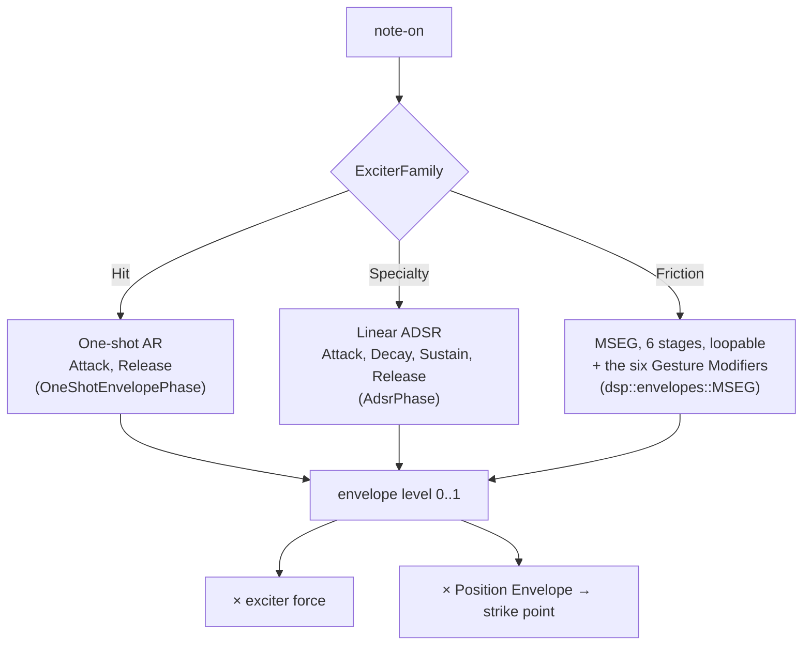
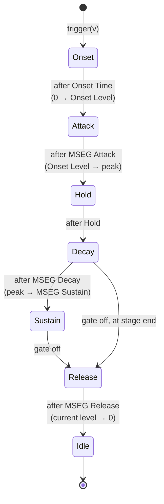

# Envelopes and Modulation

Every exciter's force is multiplied by a force envelope, and which envelope depends on the exciter's family: a one-shot AR for struck models, a linear ADSR for the specialty models, a six-stage looping MSEG for the friction models. The envelope shapes how hard the exciter pushes, not the output level: the object answers that push and rings on after it ends.

The same envelope also moves the strike point (Position Envelope), and a slow sine moves it too (Position Wander). That is all the modulation there is in the engine: there is no LFO, no modulation matrix and no tempo sync on any of these. The only tempo-synced thing in Corrosion is the Echo's Sync in the post chain ([Body, Spread and Space](Body-Spread-and-Space)).

## Which family gets which envelope

`Voice::configure_envelope` runs at note-on and picks by `ExciterType::family()` ([Exciters](Exciters#families-and-their-envelopes)):

The same, as a table:

| Family | Envelope | Lives in | Host controls |
|---|---|---|---|
| Hit | one-shot AR | fields on `Voice` (`one_shot_*`) | Attack (`env_attack`, 0.001–2 s, 0.05), Release (`env_release`, 0.01–5 s, 0.5) |
| Specialty | linear ADSR | fields on `Voice` (`adsr_*`) | Attack, Decay (`env_decay`, 0.01–5 s, 0.3), Sustain (`env_sustain`, 0–1, 0.7), Release |
| Friction | `MSEG` | `src/dsp/envelopes/mod.rs` | Onset Time and Level, MSEG Attack, Hold, MSEG Decay, MSEG Sustain, MSEG Release, Loop, Start, End, and the Gesture Modifiers |

Attack and Release are shared by the Hit and Specialty families. The envelopes are plain fields and a struct inside each `Voice`, rebuilt at note-on without allocating. All three advance once per sample in `Voice::process_force_envelope`.

## Hit: the one-shot AR

A struck model only needs its force to start and stop. The AR rises linearly from 0 to 1 over Attack, then falls linearly to 0 over Release, **whether or not the key is still held** (there is no sustain). A note-off during the rise jumps straight to the fall from the current level.

- **Attack sampled at sample centres.** The first step is half a step (`one_shot_first_step`), so a short attack has the same area at every rate (`hit_attack_has_the_same_area_at_every_rate`).
- Minimums: Attack and Release are floored at 1 ms in `configure_envelope`.
- **Trap:** the AR multiplies everything the model does, including late events (Drumstick re-strikes, Metal Chain links, Wire Brush impulses) and the first contact itself: at Attack 50 ms a body touching 10 ms in pushes at a fifth of its force. The strike ends when the AR does, after Attack + Release. See [Hit Exciters](Hit-Exciters).

## Specialty: the linear ADSR

Attack rises linearly from 0 to 1, Decay falls linearly to Sustain, Sustain holds while the key is down, Release falls to 0.

- Decay's slope is `(1 − sustain) / decay` per second, so Decay is the time from 1 to Sustain.
- Release's slope is `sustain / release` per second: Release is the time **from the Sustain level** to 0.
- A note-off during Attack or Decay goes straight to Release, from wherever the level is, at that same slope.

**Trap: Sustain 0 plus an early note-off leaves the voice on forever.** With Sustain at 0 the release slope is 0, so a note released during Attack or Decay never falls: the exciter keeps blowing, humming or raining at the level it had, and the voice never stops rendering (it can only be stolen). More generally, released above Sustain, the release takes `Release · level / Sustain`: Sustain 0.1 and Release 0.5 s, released at the end of Attack, takes 5 s. Measured with `Voice` directly (Pipe, Pneumatic Jet, Electromagnetic Hum and Particle Rain, default controls but Sustain 0, note-off at 100 ms): all three were still rendering after 20 s, at −14 to −16 dBFS; with Sustain 0.7 all three had stopped. The MSEG doesn't have this problem: its release ramps from the current level over its Release time.

`a_longer_release_keeps_the_jet_blowing` checks that Release reaches the sound.

## Friction: the six-stage MSEG

The same, as a list (`Stage` and `MSEG::process_sample`):

| Stage | From | To | Length | Curve |
|---|---|---|---|---|
| Onset | 0 | Onset Level (`mseg_onset_level`, 0–1, 0.01) | Onset Time (`mseg_onset`, 0.001–1 s, 0.01) | Curve |
| Attack | Onset Level | peak, `0.5 + 0.5·Vel To Peak` | MSEG Attack (0.001–2 s, 0.05) | Curve |
| Hold | peak | peak | Hold (0–2 s, 0.02) | linear |
| Decay | peak | MSEG Sustain (0–1, 0.5) | MSEG Decay (0.01–5 s, 0.3) | Curve |
| Sustain | MSEG Sustain | — | until the gate closes | — |
| Release | the level at the gate's closing | 0 | MSEG Release (0.01–5 s, 0.1) | Curve |

- **Gate.** `trigger` opens it, `release()` closes it. Closing it in any stage jumps to Release, starting from the current level (`release_level`), so releasing mid-Attack doesn't first jump to Sustain (`release_starts_from_the_current_level`).
- **Transitions.** A stage ends when its time is up (Onset also when its time is 0). Several zero-length stages can end in one sample; `process_sample` resolves them in a loop capped at `MAX_TRANSITIONS` (8); the longest legitimate chain is four. Each new stage starts at `step`, not 0.
- **Curve** (`apply_curve`, `curve_tension`, −1 to 1): `t^(1 + |c|)` for negative `c` (slow start), `1 − (1 − t)^(1 + c)` for positive (fast start), linear near 0. The voice sets the same curve on Onset, Attack, Decay and Release.
- **Output:** `clamp(level · gain, 0, 1) · env_amount`, with `gain = (1 − vtl) + vtl · (0.5 + 0.5·v)`. Velocity is a pure gain, so a zero level is silent at any velocity.
- **Peak level.** Despite its name, Vel To Peak doesn't read velocity: it sets the peak to `0.5 + 0.5·velocity_to_peak` (0.75 at the default 0.5). Velocity reaches the level through Vel To Level.

### Looping

With the gate held, when a stage hands over to the loop's **end** stage, the MSEG jumps to the loop's **start** stage instead (`advance_stage`). The end stage itself is never played. Stage indices follow the host parameters: 0 Onset, 1 Attack, 2 Hold, 3 Decay, 4 Sustain, 5 Release; Onset and Release are never looped, so 0 acts as 1 and 5 as 4 (`set_loop` and `loop_region` clamp to 1–4).

| Loop | Region | What repeats |
|---|---|---|
| Off | none | play once, hold Sustain |
| Forward, start < end | start … end − 1 | e.g. the default 3 → 4 repeats Decay: a sawtooth from the peak down to Sustain, every MSEG Decay |
| Forward, start ≥ end | empty | as Off (`start_after_end_matches_loop_off`) |
| Ping-Pong | always 3 → 4 | the same as Forward 3 → 4; it ignores Start and End and doesn't reverse |

A loop jumps, it doesn't glide: Attack restarts from Onset Level, Decay from the peak. Closing the gate leaves the loop at the next transition into Release.

**Safety.** A loop whose stages all have zero length would hand over forever within one sample. The transition cap stops it there; `every_loop_configuration_is_bounded` runs every mode × start × end, with normal and zero-length stages, on a thread with a deadline, and requires output in [0, 1] and Idle after release. `loop_start_at_sustain_does_not_recurse` and `tests/mseg_loop_safety.rs` (through `VoiceManager`) guard the start-at-Sustain case that once hung the audio thread; `default_and_drone_loops_never_hit_transition_cap` checks the normal loops stay under the cap; `loop_output_matches_golden` pins the output bit-for-bit on Linux (it depends on the platform's `powf`).

*History:* [the loop-recursion fix](https://github.com/GerMP21/Corrosion-VST/tree/main/openspec/changes/archive/2026-10-05-fix-mseg-loop-recursion) and [the velocity-gain fix](https://github.com/GerMP21/Corrosion-VST/tree/main/openspec/changes/archive/2026-10-05-fix-mseg-velocity-scaling).

### Drone mode

`note_setup` (in `src/lib.rs`) forces `loop_mode = Forward`, start 3, end 4 for every note in Drone mode, whatever the preset stores (`drone_mode_forces_mseg_loop_on`). Only the friction models use the MSEG, so Drone changes nothing for Hit and Specialty models. The point: in Tonal with the loop off, a held friction note sits at a constant MSEG Sustain, the push is nearly constant and the object is held almost still; the Decay loop keeps the force moving.

### The Gesture Modifiers

Six host parameters configure the MSEG only (`set_velocity_response`, `set_env_amount`, `set_global_time_scale`, `set_curves`, and the peak):

| Control | Range, default | Effect |
|---|---|---|
| Env Amount (`env_amount`) | 0–1, 1 | final gain on the MSEG output; **0 silences every friction model** |
| Vel To Peak (`velocity_to_peak`) | 0–1, 0.5 | the peak level, `0.5 + 0.5·x` (no velocity involved) |
| Global Time (`global_time_scale`) | 0.1–10, 1 | multiplies the envelope's **speed**: 10 runs every stage ten times faster, 0.1 ten times slower |
| Vel To Level (`velocity_to_level`) | 0–1, 1 | how much velocity scales the level |
| Vel To Time (`velocity_to_time`) | 0–1, 0.15 | how much soft notes slow the envelope down: speed × `1 − x·(1 − (0.5 + 0.5·v))` |
| Curve (`curve_tension`) | −1–1, 0 | the stage curve above |

**Trap: they show for every exciter but act only on friction ones.** The editor draws the Gesture Modifiers panel for all 16 models; the AR and the ADSR ignore them. This is an open item in `docs/BACKLOG.md`, and the help texts say "friction envelope". Also, Env Amount 0 silencing the friction models is open there.

The MSEG also has three preset constructors, `hit_envelope`, `scrape_envelope` and `tension_rise_envelope`; nothing outside the module's tests uses them.

## Position Envelope

Position Envelope (`position_envelope`, 0–1, default 0) moves the strike point with the force envelope: every sample, before the resonator prepares the sample, the voice sets `envelope_offset = amount · envelope · 0.5` (`set_envelope_offset`), which `InteractionState::update_position` adds to Strike Position before the wander and the clamp ([Interaction Bus and Contact](Interaction-Bus-and-Contact#the-effective-position)). A strike or a bow swell then sweeps the contact point, and the timbre with it.

- At 0 the voice never touches the offset per sample (`set_position_envelope_amount` clears it once), so the output is bit-identical to a voice without the feature (`zero_position_envelope_leaves_the_position_alone`).
- It is live on held notes, through `update_live_controls`.
- Tests: `force_envelope_moves_the_strike_position`, `position_envelope_is_audible_without_wander`.

## Position Wander

Position Wander adds a slow sine to the strike point: `sin(phase) · amount`, with the phase advancing by `2π · rate / fs` per sample.

| Control | Range, default | Note |
|---|---|---|
| Pos Wander (`position_wander`) | 0–1, 0 | `InteractionState::set_position_wander` clamps the amount to **0–0.5** |
| Wander Rate (`position_wander_rate`) | 0.1–5 Hz, 0.1 | clamped again to 0.1–5 in `set_interaction_params` |

- It is a deterministic sine, not noise: the phase starts at 0 at every note-on (the bus is reset with the bank), so every note wanders the same way.
- Both are live on held notes; the phase continues across changes.
- **Trap:** because of the 0.5 clamp, the upper half of the Pos Wander knob does nothing more than its middle. (The `VoiceControls` doc comment calls it "randomized movement"; it is a sine.)
- `wander_period_follows_wander_rate` checks the rate.
- **Migration.** Presets and DAW projects saved before Wander Rate existed load the rate their Position Envelope used to set, `legacy_wander_rate(pe) = 0.1 + 4.9·pe`, with Position Envelope 0 ([Presets and Migrations](Presets-and-Migrations)).

## Live versus note-on

The envelopes are configured at note-on from the `VoiceControls` snapshot and don't follow later parameter changes: moving MSEG Decay affects the next note. Live on held notes, once per block: Position Envelope, Pos Wander, Wander Rate and the other interaction controls, and Pressure ([Parameters](Parameters)).

## Source files

- [`src/dsp/envelopes/mod.rs`](https://github.com/GerMP21/Corrosion-VST/blob/main/src/dsp/envelopes/mod.rs): `MSEG`, `Stage`, `LoopMode`: the six stages, looping and its transition cap, curves, velocity response, and their tests.
- [`src/voice/mod.rs`](https://github.com/GerMP21/Corrosion-VST/blob/main/src/voice/mod.rs): `configure_envelope`, `process_force_envelope` and `release_force_envelope` (the AR, the ADSR and the MSEG wiring), Position Envelope.
- [`src/dsp/interaction.rs`](https://github.com/GerMP21/Corrosion-VST/blob/main/src/dsp/interaction.rs): the effective strike position and the wander sine.
- [`src/lib.rs`](https://github.com/GerMP21/Corrosion-VST/blob/main/src/lib.rs): `note_setup`, which builds the controls and forces the Drone loop.
- [`tests/mseg_loop_safety.rs`](https://github.com/GerMP21/Corrosion-VST/blob/main/tests/mseg_loop_safety.rs): a bow note whose loop starts at Sustain renders in bounded time.
