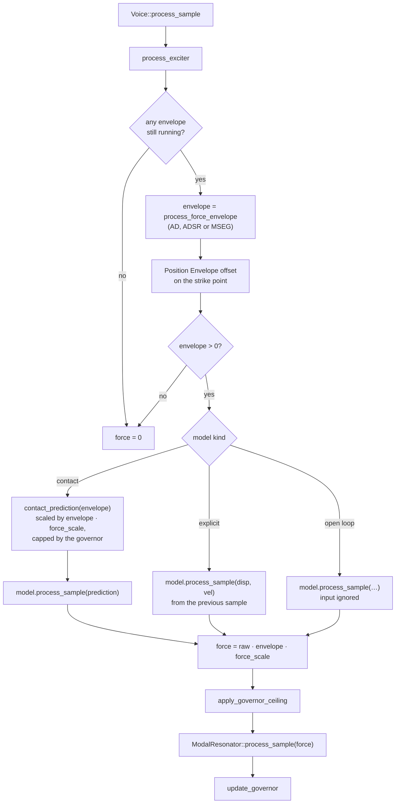
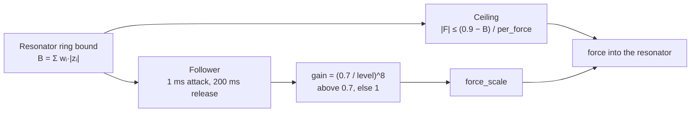

# Exciters

An exciter is the thing that hits, scrapes, blows or hums on the object. Corrosion has 16 of them. They share one contract with the voice: once per sample the voice asks the selected exciter for a force, multiplies it by the force envelope and a few gains, and feeds it into the modal resonator. The resonator's response at the contact point goes back to the exciter on the next call, so most exciters react to the object they excite.

This page covers what the 16 models share: how one is chosen and dispatched, which envelope it gets, the gains between its force and the resonator (drive level, Pressure, the drive governor), the global Speed and Roughness controls, releases, noise, sub-sample events and determinism. The models themselves are on [Hit Exciters](Hit-Exciters), [Friction Exciters](Friction-Exciters) and [Specialty Exciters](Specialty-Exciters); the contact maths is on [Interaction Bus and Contact](Interaction-Bus-and-Contact); the envelopes on [Envelopes and Modulation](Envelopes-and-Modulation).

## No trait: one struct per model, dispatched by integer

There is no `Exciter` trait. Each model is a plain struct in `src/dsp/exciters/`, and every `Voice` owns one of each, side by side (`bow_exciter`, `hand_strike`, … `particle_rain` in `src/voice/mod.rs`). The voice picks one with a `match` on the integer `exciter_type` twice: at note-on (configure and trigger) and every sample (process).

Why not a `Box<dyn Exciter>`: changing the model at note-on must not allocate on the audio thread, and the 16 structs have different inputs (some take a `ContactPrediction`, some a displacement and a velocity). Keeping all 16 resident costs memory (16 voices × 16 structs) but makes note-on a field write. The models with buffers preallocate them in `new()`: `WireBrush` 5 000 impulses, `MetalChain` 20 links, `ParticleRain` 64 particles, `MetalPipe` 3 internal modes (see [Real-Time Safety](Real-Time-Safety)).

The methods are the same by convention, not by type:

| Method | Called by | What it does |
|---|---|---|
| `new()` | `Voice::new` | Default state; allocates any buffer once. |
| `set_sample_rate(fs)` | `Voice::set_rate`, only when the rate changes | Converts the model's 48 kHz per-sample constants (see [Sample-Rate Rule](Sample-Rate-Rule)). |
| `set_parameters(…)` | note-on dispatch | Takes the model's dedicated controls, each clamped to a code range that is wider than the host range. |
| `reseed(seed)` | note-on, noisy models only | Restarts the model's `Noise` stream. |
| `trigger(v)` | note-on dispatch | Restarts all per-note state from the normalized velocity `v = velocity / 127`. |
| `process_sample(…)` | `Voice::process_exciter`, every sample | Returns this sample's force before the envelope. |
| `is_active()`, `release()` | nobody in the engine | The voice never calls them (one unit test reads `WireBrush::is_active`); see [Releases](#releases). |

### The 16 models

`ExciterType` (in `src/params.rs`) maps the host integer to a model and the model to its family. The host parameter `exciter` is an `IntParam` with range 1–16; the editor's menu lists the models in another order (Hand Strike first, Bow eighth), but the stored value is always the ID below.

| ID | Model (`ExciterType`) | Struct | Family | What `process_sample` reads | Drive level |
|---|---|---|---|---|---|
| 1 | Bow | `BowExciter` | Friction | resonator velocity, previous sample | 2.1664e-2 |
| 2 | Hand Strike | `HandStrike` | Hit | `ContactPrediction` (in `HAND_SCALE` units) | 55.4 (`HAND_SCALE`) |
| 3 | Felt Mallet | `FeltMallet` | Hit | `ContactPrediction` | 0.81953 |
| 4 | Hard Mallet | `HardMallet` | Hit | `ContactPrediction` | 5.7269 |
| 5 | Drumstick | `Drumstick` | Hit | `ContactPrediction` | 0.92944 |
| 6 | Wire Brush | `WireBrush` | Hit | nothing (open loop) | 0.53012 |
| 7 | Metal Pipe | `MetalPipe` | Hit | `ContactPrediction` (in `PIPE_SCALE` units) | 0.541 |
| 8 | Metal Chain | `MetalChain` | Hit | `ContactPrediction` | 0.44 |
| 9 | Stiff Point Scrape | `StiffPointScrape` | Friction | resonator velocity, previous sample | 2.1089e-2 |
| 10 | Heavy Grinding | `HeavyGrinding` | Friction | `ContactPrediction` | 2.6216e-3 |
| 11 | Corrugated Drag | `CorrugatedDrag` | Friction | resonator velocity, previous sample | 1.9438e-2 |
| 12 | Tension Rise | `TensionRise` | Friction | resonator velocity, previous sample | 9.0962e-2 |
| 13 | Pneumatic Jet | `PneumaticJet` | Specialty | resonator velocity, previous sample | 5.9898e-3 |
| 14 | Electromagnetic Hum | `ElectromagneticHum` | Specialty | nothing (open loop) | 3.2879e-3 |
| 15 | Tension Snap | `TensionSnap` | Specialty | `ContactPrediction` | 0.62745 |
| 16 | Particle Rain | `ParticleRain` | Specialty | `ContactPrediction` (in `RAIN_SCALE` units) | 4.4103e-2 |

- **Contact models** (a `ContactPrediction`) solve their force together with this sample's response of the resonator, with no one-sample lag: see [Interaction Bus and Contact](Interaction-Bus-and-Contact#implicit-contact).
- **Explicit models** read `ModalResonator::get_velocity()`, the value the resonator left after the previous sample. Their laws aren't monotone in the force (friction curves, the jet's cubic), which the implicit solver needs, and none of them runs away.
- **Open-loop models** (Wire Brush, Electromagnetic Hum) receive the displacement or nothing and ignore it: their force doesn't depend on the object.

### Out-of-range values become Hand Strike

`ExciterType::from_int` maps 1–16 to the models and **anything else to Hand Strike** (ID 2), the default. A hand-edited preset with `exciter: 0` or `17` therefore loads as Hand Strike instead of failing; `out_of_range_exciter_loads_as_hand_strike` in `tests/preset_roundtrip.rs` pins it. `Voice::note_on_with_controls` also normalizes its argument with `ExciterType::from_int(x).to_int()`, so the voice's own `match` arms `_ => {}` and `_ => 0.0` are unreachable in practice, and `EXCITER_DRIVE_LEVEL[0]` (1.0) is never used.

## The per-sample path

The same steps, in order (`Voice::process_exciter` and `Voice::process_sample` in `src/voice/mod.rs`):

1. **Pressure smoothing.** `pressure_gain` moves toward `pressure_target` with a 10 ms one-pole (`PRESSURE_SMOOTHING_S`). At rest the step adds exactly zero, so a constant Pressure stays bit-exact.
2. **Idle check.** If the key is up and the family's envelope is idle (`OneShotEnvelopePhase::Idle`, `AdsrPhase::Idle`, `!MSEG::is_active()`), the force is 0 and the exciter is not called. This is the only way the voice stops calling a model; a model can also go quiet by itself (a mallet that has left, a brush out of impulses), through its own `active` flag.
3. **Feedback read.** `res_disp` and `res_vel` are the resonator's contact displacement and velocity after the previous sample.
4. **Envelope.** `process_force_envelope` advances the family's envelope one sample.
5. **Position Envelope.** If Position Envelope is above 0, the strike point moves by `amount · envelope · 0.5` before this sample is prepared ([Envelopes and Modulation](Envelopes-and-Modulation#position-envelope)).
6. **Ring tracking.** The resonator tracks its ring bound only while the envelope is above 0 (`set_ring_tracking`), because it costs a square root per mode.
7. **Dispatch.** A `match` on `exciter_type` calls the model with what it reads (table above).
8. **Scaling.** `excitation · envelope · force_scale()`, where `force_scale = EXCITER_DRIVE_LEVEL[id] · drive_scale · governor_gain · pressure_gain`.
9. **Ceiling.** `apply_governor_ceiling` clamps the force so the ring bound can't pass 0.9.
10. **Resonator.** `ModalResonator::process_sample` (or `_stereo`) applies the force to every mode and writes the new contact displacement and velocity.
11. **Governor follower.** `update_governor` reads the new ring bound and sets next sample's `governor_gain`.

The voice then sanitizes the sample, adds the damage rattle, applies the velocity brightness boost and the ±1 clamp; that part is on [Voices and Polyphony](Voices-and-Polyphony).

**Trap: call `contact_prediction` at most once per sample.** It runs the resonator's per-sample preparation (strike weights, heat wander, dynamic retune) and sets a `prepared` flag that `process_sample` consumes. The voice calls it only from the contact branches, once.

## Families and their envelopes

`ExciterType::family()` sorts the 16 models into three families, and `Voice::configure_envelope` gives each family its own envelope at note-on:

| Family | Models | Envelope | Its controls |
|---|---|---|---|
| Hit | Hand Strike, Felt Mallet, Hard Mallet, Drumstick, Wire Brush, Metal Pipe, Metal Chain | one-shot AR: linear rise over Attack, then linear fall over Release, whether or not the key is held | Attack (`env_attack`), Release (`env_release`) |
| Friction | Bow, Stiff Point Scrape, Heavy Grinding, Corrugated Drag, Tension Rise | 6-stage `MSEG`, loopable | Onset Time and Level, MSEG Attack, Hold, MSEG Decay, MSEG Sustain, MSEG Release, loop controls, and the six Gesture Modifiers |
| Specialty | Pneumatic Jet, Electromagnetic Hum, Tension Snap, Particle Rain | linear ADSR | Attack, Decay, Sustain, Release (`env_*`) |

The envelope multiplies the exciter's force; it is not an amplitude envelope on the sound. A struck object keeps ringing after its Hit envelope ends, and a friction exciter's envelope shapes how hard it presses, which the object then answers. The details, including two traps (the Gesture Modifiers reach only the MSEG; a Specialty note with Sustain 0 released early never stops), are on [Envelopes and Modulation](Envelopes-and-Modulation).

**Trap: the Hit envelope gates the whole strike.** A struck model's force is multiplied by the AR envelope, so anything the model schedules late (Drumstick re-strikes, Metal Chain links up to 400 ms in, a Wire Brush spread up to 250 ms) is scaled by the falling envelope and cut off when it reaches 0, after Attack + Release (0.55 s at the defaults). The envelope also scales the first contact: at the default Attack of 50 ms, a mallet that touches the surface 10 ms in pushes at a fifth of its force.

## Velocity

The voice passes `v = velocity / 127` to `trigger`. Each model maps it into its own state (a throw speed, a pull speed, a flow rate), listed per model on the family pages. Velocity also reaches the sound in three places outside the exciter: the friction MSEG's level and time (`MSEG::trigger`), the voice's high-pass brightness boost (`HIGHPASS_BOOST · v`), and the ring-bound weights the governor uses.

## Drive levels

The resonator's banks are normalized to one strike level at note-on (`STRIKE_LEVEL_REF`, see [Modal Resonator](Modal-Resonator)), so what remains between models is how hard each one pushes. `EXCITER_DRIVE_LEVEL` in `src/voice/mod.rs` is a per-ID multiplier, chosen so each model's median note over every object at C2, C4 and C6 (velocity 127, default controls) peaks at about 0.35 before the voice clamp.

- `print_exciter_overdrive` (ignored test) measures the medians and suggests levels.
- Hand Strike, Tension Snap and Metal Pipe respond non-linearly to their drive (their contact is solved), so their levels were found by bracketing.
- Hand Strike's level **is** `HAND_SCALE` (55.4). The hand sees the resonator in units of `HAND_SCALE` displacements, so the two cancel: the hand meets the surface it met at a drive of 1 while its force, and its output, is 55.4 times larger. Metal Pipe (`PIPE_SCALE` 5.06) and Particle Rain (`RAIN_SCALE` 1000) use the same idea; see [Interaction Bus and Contact](Interaction-Bus-and-Contact#length-units).
- `exciters_play_at_a_common_level` keeps every model's median within 6 dB of the others; `default_notes_do_not_overdrive_the_voice` checks all 16 at default drive.

**Trap:** changing a model's force law changes its level everywhere. Rerun `print_exciter_overdrive`, update its `EXCITER_DRIVE_LEVEL` entry, and reseed the factory bank ([Factory Bank](Factory-Bank)).

## The drive governor

Louder notes (velocity 127, high Pressure, a high exciter control) are handled per voice by a governor that scales the **exciter force**, never the output, so the note stays clean instead of hitting the clamp.

The same, as a list:

- **Ring bound.** The resonator tracks `B = Σ wᵢ·|zᵢ|` over its modes, with `wᵢ = fadeᵢ·(1 + boost·|H_hp(ωᵢ)|)`, where `H_hp` is the voice's brightness high-pass. With no more force, no later sample of either channel can exceed `B`, so the bound is known on the strike sample itself, before the output peaks. It also tracks `per_force`, how much one unit of force can raise `B`. `B` is summed exactly every 8th tracked sample (`RING_EXACT_INTERVAL`) and grows by `per_force·|F|` in between, which only overestimates. See `RingBound` on [Modal Resonator](Modal-Resonator).
- **Smooth gain.** A one-pole follower on `B` (`GOVERNOR_ATTACK_S` 1 ms, `GOVERNOR_RELEASE_S` 200 ms) gives `governor_gain = (GOVERNOR_THRESHOLD / level)^GOVERNOR_ORDER`, with threshold 0.7 and order 8, above the threshold and 1 below it. The gain depends only on the current level, so a long ring can't wind it down. A sustained note driven `x` times over the threshold settles at `x^(1/9)` of it: +1.3 dB for 12 dB over.
- **Ceiling.** Each sample's force is capped so `B` stays under `GOVERNOR_CEILING` (0.9): `|F| ≤ (0.9 − B) / per_force`. A strike faster than the follower is still bounded. Contact models see the same cap inside their prediction (`ContactPrediction::limited`), so their solve uses the force that is really applied.
- The follower only runs while ring tracking is on (envelope above 0); after the force ends the gain stays where it was.

Tests: `excess_drive_is_reduced_not_clipped` drives each model's loudest note 12 dB over (`drive_scale` 4): its peak stays under 1.0 and within 3 dB of the default-drive peak. `contact_is_stable_without_the_governor` turns the governor off (`governor_enabled = false`) and plays every model 12 dB over, to prove the contact itself doesn't run away.

*History:* [resolve-exciter-tradeoffs](https://github.com/GerMP21/Corrosion-VST/tree/main/openspec/changes/archive/2026-11-08-resolve-exciter-tradeoffs) has the measurements behind the levels and the governor.

## Global exciter controls: Pressure, Speed, Roughness

Three host parameters act on every model on top of its dedicated controls. Each is neutral at its default, where a note renders bit-identically to one that ignores it (`default_global_controls_are_bit_identical`, using the test switch `Voice::global_controls_enabled`).

| Control | Default | Factor | When | Acts on |
|---|---|---|---|---|
| Pressure (`exciter_pressure`) | 0.5 | `pressure_factor`: `2^((p − 0.5)·4)`, ×0.25 (−12 dB) to ×4 (+12 dB) | live, smoothed over 10 ms | every model's force, through `force_scale` |
| Speed (`exciter_speed`) | 0.5 | `speed_factor`: `2^((s − 0.5)·2)`, ×0.5 to ×2 | note-on | Bow Speed, Scrape, Grind, Drag and Pull Speed, Flow Rate multiplied; Wire Brush Spread Duration and Metal Chain Drop Envelope Spread divided |
| Roughness (`exciter_roughness`) | 0.3 | `roughness_factor`: `r / 0.3`, ×0 to ×3.33 | note-on | Rosin Grip, Amplitude Randomization, Internal Rattle, Surface Grit, Slip Stochasticity, Turbulence Chaos, Mass Variance |

- **Pressure** is part of `force_scale`, so contact models see it in their prediction and the governor still bounds the voice. It reaches held notes through `Voice::update_live_controls` (not kit pads, which keep their note-on value). A new note starts at its target, unsmoothed.
- **Speed and Roughness** scale a copy of `VoiceControls` before the dispatch (`apply_global_exciter_controls`). `scale_in_range` multiplies and clamps each value to its host parameter's range (`global_control_ranges`), and skips the clamp when the factor is exactly 1, so defaults stay bit-identical.
- Models with no motion or grit control ignore them: Hand Strike, Felt Mallet, Hard Mallet, Drumstick and Metal Pipe ignore both; Pneumatic Jet, Electromagnetic Hum and Tension Snap ignore Speed; Stiff Point Scrape, Corrugated Drag, Electromagnetic Hum and Tension Snap ignore Roughness.
- `maximum_global_controls_do_not_overdrive_the_voice` plays every model on every object at C2, C4 and C6, velocity 127, with all three at 1: no pre-clamp sample exceeds 1.0. `scaled_exciter_controls_stay_in_range` checks the clamps.

**Trap:** a new motion or grit control must be added to `apply_global_exciter_controls` and `global_control_ranges` by hand; nothing checks that the list is complete.

## Releases

`Voice::note_off` clears `active` and calls `release_force_envelope`; it does **not** touch the exciter.

- **Hit:** the AR envelope jumps to its release from wherever it is (it was going to release anyway).
- **Friction:** `MSEG::release` ramps from the current level to 0 over MSEG Release. The model keeps running and its force fades with the envelope, so MSEG Release shapes the tail. Bow, Stiff Point Scrape and Corrugated Drag push one way while held and leave the object deflected; when the force fades the object springs back and rings: the release snap, on [Friction Exciters](Friction-Exciters#the-release-snap).
- **Specialty:** the ADSR enters its release; the model keeps running until the ADSR is idle.

The exciter structs still have `release()` and `is_active()` methods, but nothing in the voice calls them: a released model keeps running until its envelope is idle or it finishes on its own. `a_longer_mseg_release_keeps_the_bow_on` and `a_longer_release_keeps_the_jet_blowing` check that the release controls reach the sound.

## Noise and determinism

Every random source in the exciters is `dsp::utils::noise::Noise`, an xorshift32 generator that is white and uniform (`unit()` in [0, 1), `bipolar()` in [−1, 1)), allocation-free and deterministic for a seed.

At note-on the voice derives one seed per note, `note_seed(note, velocity, start_frame)`, and gives each consumer its own stream with `salted(seed, salt)`:

| Salt | Consumer |
|---|---|
| 0 | the voice's damage rattle |
| 6 | `WireBrush` |
| 8 | `MetalChain` |
| 10 | `HeavyGrinding` |
| 12 | `TensionRise` |
| 13 | `PneumaticJet` |
| 16 | `ParticleRain` |

So a note's sound depends only on its note, velocity, start frame and controls, never on what the voice played before or on the order of other notes. Each model's `trigger` also resets its per-note state for the same reason.

- **Per-sample noise forces** (Pneumatic Jet, the Metal Chain rattle, the damage rattle) go through `rate::white_noise`, which scales by `1/√ratio`, so their audible-band level is the same at every rate.
- **Random event parameters** (Wire Brush impulse times, Metal Chain drop times and masses, Tension Rise's break threshold, Particle Rain masses) are drawn once per event, so their statistics don't depend on the rate.
- Determinism has a limit: hashes of rendered audio depend on the platform's libm (`powf`, `exp`), so gnu and musl builds differ. See [Testing](Testing).

The fixed impulse buffers of `dsp::utils::deterministic_excitation::ExcitationInput` are a different thing: the offline renderer (`OfflineRenderer::deterministic_excitation`) uses them to drive a bare resonator in tests, without any exciter. See [DSP Utilities](DSP-Utilities).

## Sub-sample events

A one-sample force spike rounded to the sample grid would land at a time, and with a weight, that depend on the sample rate. Short events are therefore placed between samples with `rate::EventSplitter`:

- An event of size `A` that happened `early` (0–1) of a sample before the end of this sample is emitted as `early·A` now and `(1 − early)·A` on the next sample (`add`, then `take` each sample).
- Its area is kept exactly and its centre of mass sits one sample after the true time, at every rate. Everything else the model outputs is delayed by that same sample.

Who uses it: Wire Brush impulses, Metal Chain impacts (each link follows its exact fall), Tension Rise and Tension Snap break spikes, Particle Rain spawns (each new particle is aged by its fraction of the sample). Hand Strike instead scales its landing sample by the part of the step it was still in contact and takes its force at mid-step; Stiff Point Scrape starts its ring at the slip's fractional time; the Hit envelope's attack is sampled at sample centres (its first step is half a step).

`src/dsp/exciters/event_timing_tests.rs` renders each of these at 44.1, 48 and 96 kHz and requires the event's area within 2 % and its centre of mass within one 44.1 kHz sample plus 10 µs of the 48 kHz result. `hit_attack_has_the_same_area_at_every_rate` covers the envelope.

## Sample rates

Every voice, idle ones included, is rated for the host rate before it plays (`VoiceManager::set_sample_rate`), and `Voice::set_rate` calls every exciter's `set_sample_rate` when the rate changes. The models' per-sample constants are 48 kHz references converted with `dsp::utils::rate` (`decay`, `smoother`, `step`, `frames`, `impulse`, `white_noise`), each exactly the identity at 48 kHz. The resonator reports velocity in displacement per 48 kHz sample, the unit the models' laws assume. `every_exciter_has_the_same_level_at_any_sample_rate` holds every model within 1.5 dB of 48 kHz at 44.1 and 96 kHz (mean power over four velocities × 32 seeds). The rule itself is on [Sample-Rate Rule](Sample-Rate-Rule); one exception the test doesn't see is Bow's roughness ripple, on [Friction Exciters](Friction-Exciters#bow).

## Adding or changing a model

1. Write the struct in `src/dsp/exciters/` with the methods above; preallocate any buffer in `new()`.
2. Add a variant to `ExciterType` (name, family, `from_int`, `to_int`), a slot on `Voice`, arms in the note-on and per-sample `match`es, `set_rate`, and a reseed salt if it uses noise.
3. Add its controls to `VoiceControls`, the host parameters ([Parameters](Parameters)), the editor slot specs and help ([Editor](Editor)), and Speed/Roughness if they apply.
4. Measure and set its `EXCITER_DRIVE_LEVEL`; run the level, overdrive, sample-rate and no-alloc tests; add a sub-sample event test if it fires events.
5. Update the user Wiki and its generated data ([Site and User Wiki Tooling](Site-and-User-Wiki-Tooling)) and reseed the factory bank.

## Source files

- [`src/dsp/exciters/mod.rs`](https://github.com/GerMP21/Corrosion-VST/blob/main/src/dsp/exciters/mod.rs): the exciter registry: one module per model and the re-exports.
- [`src/dsp/mod.rs`](https://github.com/GerMP21/Corrosion-VST/blob/main/src/dsp/mod.rs): the `dsp` module root that re-exports the exciter structs, `ContactPrediction` and the envelope types to the voice.
- [`src/params.rs`](https://github.com/GerMP21/Corrosion-VST/blob/main/src/params.rs): `ExciterType`, `ExciterFamily`, the Hand Strike fallback and the `exciter` host parameter.
- [`src/voice/mod.rs`](https://github.com/GerMP21/Corrosion-VST/blob/main/src/voice/mod.rs): the dispatch, `EXCITER_DRIVE_LEVEL`, the drive governor, the global controls, seeding and releases.
- [`src/dsp/utils/noise.rs`](https://github.com/GerMP21/Corrosion-VST/blob/main/src/dsp/utils/noise.rs): `Noise`, `note_seed` and `salted`.
- [`src/dsp/utils/rate.rs`](https://github.com/GerMP21/Corrosion-VST/blob/main/src/dsp/utils/rate.rs): the 48 kHz conversions and `EventSplitter`.
- [`src/dsp/exciters/event_timing_tests.rs`](https://github.com/GerMP21/Corrosion-VST/blob/main/src/dsp/exciters/event_timing_tests.rs): the sub-sample event tests at 44.1, 48 and 96 kHz.
- [`tests/preset_roundtrip.rs`](https://github.com/GerMP21/Corrosion-VST/blob/main/tests/preset_roundtrip.rs): `out_of_range_exciter_loads_as_hand_strike`.
