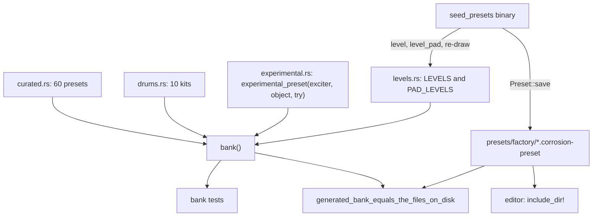

# Factory Bank

The 214 factory presets are not hand-edited files. They are built by Rust code in `src/presets/factory/`, levelled by offline renders, and written to [`presets/factory`](https://github.com/GerMP21/Corrosion-VST/tree/main/presets/factory) by the `seed_presets` binary. The reason is control: levels and character are measured, not guessed, so every preset sits at the same loudness, none drives the limiter when played hard, and each curated folder sounds like its name. Because the definitions are code, the bank tests check them without reading files, and one test checks that the files on disk still equal the code byte for byte.

How a preset file is read, migrated and loaded is on [Presets and Migrations](Presets-and-Migrations). How a drum kit plays is on [Kit Mode](Kit-Mode).

## What is in the bank

| Folder on disk | Count | Built by | Notes |
|---|---|---|---|
| `bass`, `lead`, `chords`, `drones`, `percussion` | 12 each (60) | `curated.rs`, by hand | `CURATED_FOLDERS`, `CURATED_FOLDER_SIZE` |
| `drums` | 10 kits | `drums.rs`, by hand | `DRUM_KIT_COUNT`; Kit mode, 12 pads each |
| `experimental/<exciter>/<object>` | 16 × 9 (144) | `experimental.rs`, seeded | one preset per exciter × object pair |

That is 204 playable presets plus 10 kits. The folder is the category: a preset file has no category field. A file's path is `<folder>/<slug>.corrosion-preset`, where `slug(name)` lowercases the name and joins its alphanumeric runs with `_` (`"Felt Cable Upright"` → `felt_cable_upright`). Experimental presets are named `"<Exciter> · <Object>"` (`"Bow · Taut Cable"`) and stored as `experimental/bow/taut_cable.corrosion-preset`.

The editor embeds the whole tree with `include_dir!` and shows the folders in this order: the curated folders, Drums, Experimental (its subfolders by exciter number), then User ([Presets and Migrations](Presets-and-Migrations#the-browser)).

## The pipeline



In words:

1. `curated_presets()`, `drum_kits()` and `experimental_entry(exciter, object, try_index)` build presets **unlevelled** (Output 1, every pad at 0 dB).
2. `bank()` assembles all 214 in a fixed order (curated folders, drum kits, then the grid by exciter and object) and applies the stored results from `levels.rs`: each preset's Output, each experimental preset's seed try, each drum pad's level. It renders nothing, so it is cheap and deterministic.
3. `seed_presets` is the only code that renders to choose levels. It writes the files and regenerates `levels.rs`, so `bank()` reproduces exactly what it wrote.
4. The tests build `bank()` and compare it with the files, check counts and determinism, and re-render every preset for the quality floor and the character checks.

## Curated presets (`curated.rs`)

Each folder is a function (`bass()`, `lead()`, `chords()`, `drones()`, `percussion()`) returning 12 presets made with `make(name, object, exciter, size, play_mode, edit)`. `make` starts from `base(name)`, which is `Preset::from_params(name, &CorrosionParams::default())`, so a preset only states what gives it its identity; a comment above each says what it is for. Output is never set by hand: levelling sets it.

The top of the file holds measured tuning notes, which are worth reading before designing a preset:

- A note's fundamental is roughly the key's frequency divided by Size, with an offset per object. The constants that put each object on the key are `PIPE_ON_KEY` 1.025, `PLATE_ON_KEY` 2.0, `SPRING_ON_KEY` 1.09, `BEAM_ON_KEY` 0.707, `SHEET_ON_KEY` 3.49 (Sheet Metal's pitch goes as Size^−0.75, so `SHEET_OCTAVE_UP` is 1.371 and `SHEET_OCTAVE_DOWN` 8.8), `TANK_ON_KEY` 0.333. A Taut Cable plays the key at Size 1.
- Every Space mode adds faint low partials of its own (98–144 Hz), and BODY adds resonances near 190 and 390 Hz, so the chord patches keep BODY at 0 and some stay dry.
- A Pipe adds a fixed mode between 800 and 1030 Hz, and a Coil Spring is inharmonic: neither suits the chord folder.
- Pipe, I-Beam and Taut Cable strikes ring for seconds; a strike that must decay on its own uses a Plate or a Chain, or heavy Rust and Sludge.

The objects are described on [Objects](Objects) and the exciters on [Exciters](Exciters).

## Drum kits (`drums.rs`)

Ten Kit-mode presets on the General MIDI drum layout: Foundry, Scrapyard, Pipe, Rust Belt, Boiler Room, Rail Yard, Wire, Sheet Storm, Clockwork and Junk Percussion. `kit(name, post, pads)` makes a preset with `play_mode` = Kit and BODY 0.4 (unless `post` changes it), lets `post` set the shared post chain, and stores each pad with `KitPad::from_params(key, &sound.into_params(), tune, 0.0)`.

Every kit has the same 12 pads, each a `sound(object, exciter, size, damping, brightness, edit)` with a short one-shot envelope (Sustain 0, Decay 0.3). Pads are tuned by role, because the engine's pitch follows key ÷ Size and a hat at its own key would ring at a few hundred hertz:

| Pad | Key | Tune (semitones) |
|---|---|---|
| Kick (`KICK`) | 36 | −12 |
| Side stick | 37 | +24 |
| Snare, clap | 38, 39 | +12 |
| Low, mid, high tom | 41, 45, 48 | 0 (they rise with the keys) |
| Closed hat, open hat | 42, 46 | +48 |
| Pedal hat | 44 | +43 |
| Crash, ride | 49, 51 | +36 |

`deaden` (Rust 2.0, Sludge 1.0) makes a strike that would ring for seconds die within one. A Hard Mallet's open hat is played with a Drumstick, because a hard mallet strike this high dies in 0.2 s whatever the damping.

## The experimental grid (`experimental.rs`)

One preset per exciter (1–16) × object (0–8) pair, drawn from a deterministic seed, so the grid explores the whole engine without anyone designing 144 presets.

- **Seed.** `pair_seed(exciter, object, try_index)` is SplitMix64 (`mix`) of `exciter << 32 | object << 16 | try_index`. Each parameter's draw is `unit(seed, draw_index(id))`, where `draw_index` is an FNV-1a hash of the parameter ID. Hashing by ID means adding a parameter doesn't change any other parameter's draw. No `rand` crate: the output is the same on every platform.
- **What is drawn.** The pair's own exciter slot parameters (`exciter_slot_ids(exciter)`) and object character parameters (`object_character_ids(object)`) from the inner 10–90 % of their normalized range (`SPECIFIC_RANGE`), and every shared voice and post-chain parameter from a playable range in `SHARED_RANGES` (for example Size 0.5–2.5 plain, Filter Cutoff 1.5–20 kHz geometric, Space Mode one of 0–3). Ranges are `Normalized`, `Plain`, `Log` or `Choice`; values are rounded to 4 significant digits so the files stay readable. Other exciters' and objects' own parameters keep their defaults, since they don't act on this pair.
- **What is fixed.** `EXPERIMENTAL_FIXED_IDS`, each with its reason: `output` (set by levelling), `quality_mode` (Normal), `limiter_mode` (Hard), `analog_ceiling` (default, so levels compare), `ui_scale` (an editor preference).
- **Play mode.** The continuous exciters (`CONTINUOUS_EXCITERS`: 1, 10, 11, 12, 13, 14, 16, that is Bow, Heavy Grinding, Corrugated Drag, Tension Rise, Pneumatic Jet, Electromagnetic Hum, Particle Rain) play in Drone mode when the seed's first draw is under 0.5; everything else is Tonal.
- **Writing values.** The generator serializes `base(name)` to JSON, writes each drawn value under its parameter ID (top level or `extra`, integers as integers), and parses the result with `Preset::from_json_str`, which clamps and sanitizes exactly as loading a file does.
- **Slot lists mirror the editor.** `exciter_slot_ids` and `object_character_ids` repeat the editor panels' controls (the generator can't depend on the GUI). The GUI-lane test `experimental_generator_varies_what_the_panels_show` in `src/gui/editor.rs` keeps the two equal.

## Levelling (`mod.rs`)

Every non-kit preset is levelled to `TARGET_RMS` = 0.13 (−17.7 dBFS), the RMS of both channels over the whole floor render. The value was chosen once as the median of the 60 curated presets at Output 0 dB (0.1254, printed by `seed_presets --target`), rounded.

The floor render is a held middle C (`FLOOR_NOTE` 60) at velocity 100 (`FLOOR_VELOCITY` = 100/127), 2 s (`FLOOR_SECONDS`), at 48 kHz, never released, through the plugin's real output path (`offline::PresetRenderer`, which runs `Corrosion::process_block` in 512-sample blocks).

`level(preset)`:

1. Sets Output to 1 and renders the floor note **before the limiter** (`render_preset_pre_limiter`). Output is applied before the limiter, so the pre-limiter level scales with Output and one render gives the gain: `TARGET_RMS / rms`, capped at `MAX_OUTPUT` = 100 (+40 dB, the parameter's top).
2. Renders the same note at full velocity (`HEADROOM_VELOCITY` = 1.0) and finds the level that only 1 % of its samples exceed (`allowed_peak`, the 99th percentile). The gain is capped at `HEADROOM_MARGIN` (0.995) × ceiling ÷ that level, so a hard-played note keeps at most 1 % of its samples at the ceiling.
3. Rounds Output to 4 significant digits and returns `measure_floor(preset)`.

The stored Outputs run from 0.2954 to the 100.0 cap (two experimental presets, `felt_mallet/i_beam` and `tension_snap/plate`, sit at the cap and still pass the floor).

### The quality floor

`measure_floor` renders the levelled preset and returns a `FloorReport`; `FloorReport::check` fails on any of:

| Check | Bound |
|---|---|
| Non-finite samples | none allowed |
| RMS of the limited output vs `TARGET_RMS` | within ±`FLOOR_TOLERANCE_DB` (6 dB) |
| Share of pre-limiter samples above the ceiling, velocity 100 | ≤ `MAX_CEILING_FRACTION` (1 %) |
| Pre-limiter RMS at full velocity vs `TARGET_RMS` | ≥ −`MAX_FULL_VELOCITY_DROP_DB` (−12 dB) |
| Share above the ceiling at full velocity | ≤ 1 % |

The full-velocity drop check rejects presets that go quiet when played hard.

### Level stability

`level_instability_db(preset)` re-measures the floor level after changing Size, Damage, Drive and Exciter Pressure by +0.01 % and −0.1 %, and returns the largest move. Some draws sit on a knife edge between two behaviours, which each platform's libm rounding can tip either way: `experimental/felt_mallet/tank`'s first draw measured 0 dB on Linux and −8 dB on Windows. The seeder rejects an experimental preset that moves more than `MAX_LEVEL_INSTABILITY_DB` (2 dB). `level_stability_rejects_a_knife_edge_preset` keeps that old draw as a test case.

### Drum pads (`level_pad`)

A kit is silent on middle C, so each pad is levelled alone: `pad_alone(preset, key)` keeps only that pad, and the floor note is held on the pad's key. The pad's gain comes before the shared post chain, which need not be linear, so `level_pad` corrects in up to 5 steps (stopping when a step is under 0.1 dB), applies the same headroom cap, clamps to `PAD_LEVEL_RANGE_DB` (−40…+60 dB) and rounds to 0.1 dB. One-shot hats put little energy into a 2 s window, so their levels are high: the stored pad levels run from +0.1 to +56.7 dB. A kit's own Output stays at 1.0.

## The seeder (`src/bin/seed_presets.rs`)

```bash
export CARGO_BUILD_TARGET=x86_64-unknown-linux-gnu   # on Linux; see Building-and-Bundling
cargo run --release --bin seed_presets               # level, check, write everything
cargo run --release --bin seed_presets -- --target   # print the curated median RMS, write nothing
```

It levels on every core (`parallel`, order kept):

- **Curated:** `level` then `check`. A failure is reported; it is fixed by hand.
- **Kits:** `level_pad` for every pad; each pad must pass the floor.
- **Experimental:** for `try_index` in 0..`MAX_SEED_TRIES` (8), draw, `level`, `check`, then the stability test; the first try that passes wins.

If **any** preset still fails, it prints the list and exits with status 1, **writing nothing**. Otherwise it prints the re-drawn seeds, deletes every `.corrosion-preset` file under `presets/factory/` (and folders left empty), writes every preset with `Preset::save`, and regenerates `src/presets/factory/levels.rs`:

- `LEVELS: &[(path, try_index, output)]`, one row per preset, kits included (Output 1.0), read by `stored(path)`;
- `PAD_LEVELS: &[(path, key, level_db)]`, one row per drum pad, read by `stored_pad(path, key)`.

`levels.rs` says "Do not edit". Rows are keyed by the file's relative path, so renaming a preset (which changes its slug) loses its level until the next reseed. Four experimental presets currently use a re-drawn seed: `bow/taut_cable` (try 1), `felt_mallet/tank` (1), `metal_chain/plate` (2) and `tension_snap/chain` (1).

Two ignored tests act as surgical tools when only a few presets move: `relevel_named_presets` (`RELEVEL=folder/slug,…`) prints new Outputs, and `redraw_named_preset` (`REDRAW=<exciter id>/<object slug>`) re-draws one experimental preset.

## Character checks (`character.rs`, `measure.rs`)

The floor proves a preset is loud enough and clean; the character checks prove each curated folder sounds like its name. `character::measure(folder, preset)` renders through `measure::render_held` (velocity 100, 48 kHz) and fills a `CharacterReport`; `check` compares it with the bounds:

| Folder | Measurement | Bound |
|---|---|---|
| bass | share of energy below 500 Hz, held C2, FFT from 50 ms | ≥ 70 % (`BASS_LOW_FRACTION`) |
| lead | strongest spectral peak of a held middle C | within 50 cents of C3, C4 or C5 (`PITCH_CENTS`) |
| chords | the lead check, plus: the first six partials (spectral peaks from 60 Hz to 20 kHz, within 40 dB of the strongest, each the largest within ±20 Hz), lowest first | each within 15 cents of a harmonic of the first (`PARTIAL_CENTS`) |
| chords | level at 2 s vs the peak, 3 s hold | ≥ −20 dB (`CHORD_SUSTAIN_DB`) |
| chords | largest spectral flatness of 8192-sample frames (frames 60 dB under the peak skipped) | < 0.1 (`CHORD_FLATNESS`) |
| drones | RMS of the 8th second vs the 2nd, 8 s hold | within ±6 dB (`DRONE_DRIFT_DB`) |
| percussion | level 1.5 s after the onset vs the peak, note held | ≤ −30 dB (`PERCUSSION_DECAY_DB`) |

`measure.rs` holds the shared tools: `render_held`, `mono`, RMS over windows of `LEVEL_WINDOW_SECONDS` (50 ms), `level_at`, `cents`, `note_hz`, a windowed FFT (`Spectrum::of`) with `fraction_below`, `strongest_peak`, `peaks`, `flatness` and `centroid`, and `decay_to_minus_30`.

The drum kits have their own character test, `drum_kits_have_drum_character`, on each pad held alone for 2 s: the kick has ≥ 70 % of its energy below 500 Hz and falls 30 dB under its loudest 50 ms window within 1.5 s (`decay_to_minus_30`); the snare decays within 1.5 s and has a higher spectral centroid than the kick; both hats have a centroid ≥ 2 kHz and ≤ 30 % below 500 Hz; the closed hat decays within 1.0 s and the open hat rings longer; the three toms rise in pitch.

## The bank tests

They live in `src/presets/factory/tests.rs` (module `presets::factory::tests`) and run in the CI test lane (`cargo test --workspace --no-default-features`). Most render dozens to hundreds of presets, so they take a while in debug builds.

| Test | Checks |
|---|---|
| `curated_folders_hold_twelve_presets`, `names_and_files_are_unique_within_a_folder` | counts, unique names and slugs |
| `experimental_grid_covers_every_pair_once` | the 16 × 9 grid |
| `regeneration_is_deterministic` | `bank()` twice gives identical JSON; seed tries differ |
| `generator_parameter_lists_name_real_parameters` | slot, character and fixed lists name real parameter IDs |
| `experimental_parameters_vary` | every slot parameter varies across its exciter's 9 presets, every character parameter across its object's 16, every other non-fixed parameter across the grid; it panics on a parameter ID that is not a numeric preset key |
| `generated_bank_equals_the_files_on_disk` | each file equals `serde_json::to_string_pretty` of its definition, with no file missing or extra |
| `every_factory_preset_meets_the_quality_floor` | the floor for all 204 non-kit presets, and the total of 214 |
| `the_quality_floor_rejects_silent_and_clipping_presets` | the floor fails on silent, quiet, clipping, hard-quiet and hard-clipping variants |
| `basses_sit_low`, `leads_are_pitched`, `chord_patches_are_pitched_harmonic_sustaining_and_clean`, `drones_sustain`, `percussion_decays` | each curated folder's character |
| `character_checks_reject_wrong_presets` | each check fails on a preset of the wrong kind |
| `the_drums_folder_holds_ten_kits`, `every_drum_pad_meets_the_quality_floor`, `drum_kits_have_drum_character` | the kits |
| `level_stability_*`, `the_felt_mallet_tank_in_the_bank_is_stable` | the stability measure |

Ignored tables, run with `-- --ignored --nocapture`: `curated_measurements_table` (per-preset Output, RMS, centroid, decay and character values), `drum_pad_measurements_table`, `print_velocity_sweep`, `print_experimental_level_instability`. In `src/lib.rs`, the ignored `preset_levels_are_sane` renders every non-kit factory file at full velocity and checks limiter hits and distance from the median.

## Changing a preset

1. Edit the preset in `curated.rs` or `drums.rs`, or the generator in `experimental.rs`. Never edit a file under `presets/factory/` or `levels.rs` by hand: the next reseed overwrites both, and `generated_bank_equals_the_files_on_disk` fails meanwhile.
2. Reseed: `cargo run --release --bin seed_presets`. It re-levels **every** preset, so it can change Outputs you didn't touch; read the diff of `levels.rs`.
3. Run the bank tests: `cargo test --no-default-features presets::factory`. For a curated change, `curated_measurements_table` shows the numbers worth recording.
4. The user Wiki's data lists the factory folders and presets, so run `cargo run --bin export_guide_data` too ([Site and User Wiki Tooling](Site-and-User-Wiki-Tooling)).

Traps:

- **Engine-wide changes move the bank.** A new stage, a gain change or an exciter fix shifts levels and timbre everywhere, which can push presets off the floor or out of character. Run the bank tests and reseed, and say what moved.
- **A schema change that adds a parameter needs a reseed**, so the files carry the new field; otherwise the byte-for-byte test fails.
- **Re-drawn seeds change the sound.** If a fix pushes an experimental preset off the floor, the seeder silently picks the next seed try and the preset becomes a different patch. The "Re-drawn seeds" printout says which.
- **Platform rounding.** Levels are measured on the machine that runs the seeder; the stability check exists so that the same files pass the floor on Linux, Windows and macOS libm.

## The legacy corpus

[`tests/fixtures/presets/legacy`](https://github.com/GerMP21/Corrosion-VST/tree/main/tests/fixtures/presets/legacy) holds the 50 presets of the old placeholder bank. They are not part of the factory bank. Tests that need one specific preset read them (the benchmark's and `render_presets`' default is `sheet_lightning`), and they double as a check that old files keep loading through the migrations. Don't regenerate them. See [Testing](Testing).

## Source files

- [`src/presets/factory/mod.rs`](https://github.com/GerMP21/Corrosion-VST/blob/main/src/presets/factory/mod.rs): `bank()`, `FactoryPreset`, `TARGET_RMS` and the floor constants, `level`, `level_pad`, `measure_floor`, `level_instability_db`
- [`src/presets/factory/curated.rs`](https://github.com/GerMP21/Corrosion-VST/blob/main/src/presets/factory/curated.rs): the 60 hand-designed presets and the tuning notes
- [`src/presets/factory/experimental.rs`](https://github.com/GerMP21/Corrosion-VST/blob/main/src/presets/factory/experimental.rs): the seeded 16 × 9 generator, its ranges and fixed parameters
- [`src/presets/factory/drums.rs`](https://github.com/GerMP21/Corrosion-VST/blob/main/src/presets/factory/drums.rs): the ten drum kits and their pad roles and tunes
- [`src/presets/factory/levels.rs`](https://github.com/GerMP21/Corrosion-VST/blob/main/src/presets/factory/levels.rs): generated `LEVELS` and `PAD_LEVELS`
- [`src/presets/factory/measure.rs`](https://github.com/GerMP21/Corrosion-VST/blob/main/src/presets/factory/measure.rs): renders, RMS windows, the FFT and spectral measures
- [`src/presets/factory/character.rs`](https://github.com/GerMP21/Corrosion-VST/blob/main/src/presets/factory/character.rs): the folder character checks and their bounds
- [`src/bin/seed_presets.rs`](https://github.com/GerMP21/Corrosion-VST/blob/main/src/bin/seed_presets.rs): the seeder that levels, re-draws and writes the bank and `levels.rs`
- [`src/presets/factory/tests.rs`](https://github.com/GerMP21/Corrosion-VST/blob/main/src/presets/factory/tests.rs): the bank tests
- [`src/offline/preset.rs`](https://github.com/GerMP21/Corrosion-VST/blob/main/src/offline/preset.rs): `PresetRenderer` and `render_preset_pre_limiter`, the renders levelling uses
- [`presets/factory`](https://github.com/GerMP21/Corrosion-VST/tree/main/presets/factory): the written bank, embedded in the editor
