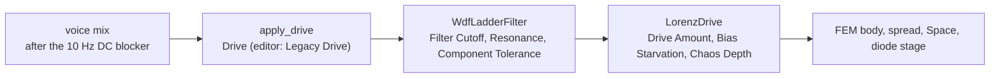
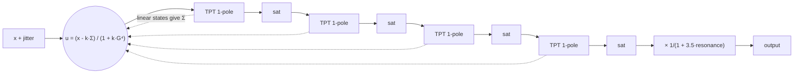
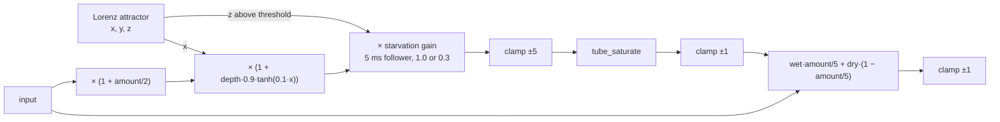

# Filter and Drive

Three stages colour the voice mix before the body and the room: the master drive on the voice mix, then, per channel inside the post chain, a four-pole ladder low-pass and a drive whose gain is modulated by a Lorenz attractor. All three run at the host rate, without oversampling. This page describes what each one computes, its constants and where it surprises people.

For the routing around them, see [Post Chain](Post-Chain).

## Where they sit

- `apply_drive` (`src/lib.rs`) runs on both channels of the voice mix, in `Corrosion::render_frame_unlimited`, before the post chain.
- `WdfLadderFilter` and `LorenzDrive` run per channel as the first two stages of `PostProcessingChain::process`: `drive_left.process(filter_left.process(left))`, and the same on the right.

## The ladder filter

`WdfLadderFilter` (`src/dsp/post_processing/wdf_filter.rs`) is a Moog-style four-pole low-pass. **Despite its name it is not a wave-digital filter** and solves no circuit: it is four cascaded TPT (topology-preserving transform, trapezoidal) one-pole stages with a transistor-style soft clip after each, and a resonance feedback solved without a sample of delay. The name stays for preset and ABI stability.

### Structure

Per sample, `process` does:

1. **Smoothers.** Cutoff and resonance move toward their targets by a one-pole step (τ 20 ms, `SMOOTHING_TAU_SECONDS`) while they are more than 0.005 Hz or 5e-4 away; then they stop.
2. **Drift.** If Component Tolerance is above 0, the drift noise advances (see [Component Tolerance](#component-tolerance)).
3. **Coefficients.** If the cutoff or resonance moved, or the drift is on, `update_coefficients` recomputes `g = tan(π·fc/fs)` and the output compensation.
4. **Input jitter.** With tolerance on and a non-zero input, `noise × tolerance × 0.001` is added to the input.
5. **Feedback solve.** With `G = g/(1 + g)` and `k = 4·resonance/0.9`, the linear cascade's last output is `y₄ = G⁴·u + Σ`, where `Σ` folds the four integrator states (`acc·G + (1 − G)·s`). Solving `u = x − k·y₄` gives `u = (x − k·Σ)/(1 + k·G⁴)`. No unit delay sits in the loop.
6. **Four stages.** Each stage is `v = (in − s)·G; y = v + s; s ← y + v`, a unity-DC-gain one-pole whose −3 dB point is at the cutoff. The integrator state keeps the linear `y`; only the value passed to the next stage goes through `transistor_saturate`, so the saturator can't latch the state.
7. **Output** is the fourth stage's saturated output times `g_comp = 1/(1 + 3.5·resonance)`.

### Cutoff mapping

| Step | Value |
|---|---|
| Parameter | Filter Cutoff, 20–20 000 Hz, skewed range (factor 0.5), default 20 000 Hz |
| Macro | × `2^(2·(Brightness − 0.5))` (`filter_cutoff_factor`), then clamped to 20–20 000 Hz in `apply_post_chain_params` |
| Filter clamp | `set_parameters` clamps to 20–20 000 Hz again |
| Drift | × `max(0.1, 1 + tolerance·0.3·drift)` when Component Tolerance is above 0 |
| Nyquist guard | `fc ≤ 0.49·fs` (`MAX_CUTOFF_RATIO`), applied in `update_coefficients`, so a later drop in sample rate is covered too |
| Prewarp | `g = tan(π·fc/fs)` |

The Brightness macro's factor ranges from ×0.5 to ×2, one octave each way. (The comments next to `filter_cutoff_factor` in `src/lib.rs` say ±2 octaves; the formula gives ±1.)

Because `g = tan(π·fc/fs)` is the bilinear prewarp and each stage has unity DC gain, the set cutoff is each stage's −3 dB frequency at every sample rate (`cutoff_tracks_displayed_frequency`: four stages at 1 kHz give (1/√2)⁴ ≈ 0.25, within 0.20–0.30), and the default 20 kHz is stable at 44.1 and 48 kHz (`default_cutoff_does_not_rail_at_48k`, `cutoff_sweep_through_quarter_sample_rate_is_stable`, `cutoff_above_nyquist_is_clamped`).

### Resonance

- `k = 4·resonance / SELF_OSCILLATION_RESONANCE` with `SELF_OSCILLATION_RESONANCE = 0.9`. A four-pole ladder self-oscillates exactly at `k ≥ 4`, so the filter rings forever from resonance 0.9 up, at every cutoff and rate, and every tail decays below that (`resonance_below_ninety_percent_decays`, `resonance_above_ninety_percent_self_oscillates`). The saturators bound the oscillation (`max_resonance_tail_stays_bounded_while_oscillating`).
- `g_comp = 1/(1 + 3.5·resonance)` lowers the whole pass band as resonance rises: −13 dB at resonance 1, even with the cutoff fully open. That is the usual ladder loss of bass under resonance, applied here as a fixed output gain.

### Saturation

`transistor_saturate` is linear up to ±0.7, then `0.7 + 0.3·(1 − e^(−2·(|x| − 0.7)))`, capped at 1. It sits after every stage, and the filter never bypasses, so **the filter is not transparent at its defaults**: any signal over about 0.7 peak is soft-clipped by it, at the host rate. This is the first nonlinearity inside the post chain.

### Component Tolerance

Component Tolerance (0–1, default 0) makes the components drift:

- **Drift.** `Noise::bipolar()` (uniform in −1..1) is smoothed by a one-pole with τ 0.3 s (`DRIFT_TAU_SECONDS`) and scaled by `drift_norm = √(3·(2 − k)/k)`, which brings the smoothed noise back to unit variance. The cutoff becomes `fc·max(0.1, 1 + tolerance·0.3·drift)` (`DRIFT_DEPTH` 0.3: one standard deviation moves the cutoff 30 % at full tolerance).
- **Jitter.** `noise × tolerance × 0.001` is added to the input, only while the input is non-zero, so silence stays silence (`tolerance_adds_nothing_to_silence`).
- At 0 the cutoff is exactly the set value. `component_tolerance_drifts_the_cutoff` checks that full tolerance widens the 50 ms level spread of noise through a resonant 1.5 kHz low-pass by at least 2 dB.
- The noise generator is seeded with 0 in `new()` and reseeded by `reset()`, so renders are deterministic, and both channels' filters draw the same drift sequence.

### Smoothing and reset

Cutoff and resonance glide (τ 20 ms); Component Tolerance jumps. The first `set_parameters` after `new()` or `reset()` snaps both smoothers (`settle`), so a preset loaded before playback starts at its cutoff (`mid_stream_cutoff_change_is_smoothed` checks that later changes ramp). `reset()` clears the integrators and the drift, reseeds the noise and re-primes the snap.

## The master drive

`apply_drive(sample, drive)` in `src/lib.rs` is the Drive parameter (0–5, default 0; the editor labels it **Legacy Drive**, the host shows "Drive"). It runs on both channels of the voice mix, before the post chain. The drive value comes from `drive_smoother` (τ 20 ms), whose target is `Drive + (Violence − 0.5)·1.0`, clamped to 0–5.

1. **Bypass.** At drive ≤ 0 the sample passes unchanged (the default patch is untouched).
2. **Shaper** (`drive_shape`): the input times `1 + 4·drive`, then an asymmetric curve:

   | Region | Positive half | Negative half |
   |---|---|---|
   | Linear | below 0.3 | below 0.25 |
   | Smoothstep knee | 0.3–0.8 | 0.25–0.7 |
   | Exponential tail | `0.8 + 0.2·(1 − e^(−t))` | `0.7 + 0.3·(1 − e^(−t))` |

   with `t = (|x| − hard threshold)/(1 + gain)`. The knee maps its band onto itself with `3t² − 2t³`, so the curve is continuous, but its slope drops from 1 to 0 at the knee's start, rises to 1.5 mid-knee and is 0 again at its end. Both tails approach 1.0, so the shaper never exceeds ±1. The constants `DRIVE_POS_CEILING` (1.2) and `DRIVE_NEG_CEILING` (1.1) cap values the tails never reach; their comments describe headroom above 1 that doesn't occur.
3. **Crossfade.** `shaped·w + sample·(1 − w)` with `w = min(drive, 1)`. Over the first unit of the knob the shaped share rises; above 1 only the shaper's input gain keeps rising, so more drive means more saturation, not more level.
4. **Guard.** The result is clamped to ±1.5 (`DRIVE_OUTPUT_CLAMP`), which matters only for inputs above ±1.

`tests/drive_dynamics.rs` checks that the drive keeps some dynamics (crest factor), stays bounded and is unity at 0.

## The Lorenz drive

`LorenzDrive` (`src/dsp/post_processing/lorenz_drive.rs`) is a soft tube curve whose input gain is modulated by a Lorenz attractor and can be starved. The attractor is a free-running chaotic oscillator: it doesn't read the audio. So Chaos Depth acts as a deterministic chaotic LFO on the drive gain, identical in both channels (both attractors start from the same state and advance in lockstep), not as a signal-dependent effect.

The same steps as a list, per sample (`process`):

1. The drive amount glides toward its target (τ 20 ms). If the smoothed amount is below 0.001 the input is returned unchanged and **the attractor doesn't advance**.
2. `driven = input·(1 + amount/2)`: ×1 to ×3.5 across Drive Amount 0–5.
3. The attractor takes one Euler step (below).
4. `chaos_mod = 1 + depth·0.9·tanh(0.1·x)` (`CHAOS_SPREAD` 0.1, `CHAOS_SWING` 0.9). At depth 1 the gain swings from about a tenth to nearly twice; at depth 0 it is exactly 1.
5. The starvation follower gives a gain between 0.3 and 1 (below).
6. `tube_in = clamp(driven·chaos_mod·starvation_gain, ±5)`.
7. `tube_saturate`, then clamp to ±1: the wet signal.
8. Crossfade: `wet·(amount/5) + input·(1 − amount/5)`, clamped to ±1. The weights sum to 1, so the mix adds no level of its own; a small signal's gain is `(1 − w) + w·(1 + amount/2)` with `w = amount/5`: 1.1 at amount 1, 1.625 at 2.5, 3.5 at 5 (`mix_is_a_crossfade`, `wet_share_spans_the_whole_amount_range`).

### The attractor

- Constants: σ = 10, ρ = 28, β = 8/3 (the classic chaotic set). Initial state `(0.1, 0, 0)`, restored by `reset()`.
- Integration: forward Euler with `dt = min(1/fs, 0.001)`. Above 1 kHz that is one unit of attractor time per second of audio, so the motion has the same speed at every common rate (the trajectory itself differs between rates, since Euler steps of different size diverge).
- Guards: `x` and `y` clamped to ±50, `z` to 0–100.
- After a reset, the attractor spirals around one lobe for several seconds with `z` between about 23 and 30 before it starts switching lobes (noted in the `starved_share` test helper).

### Bias Starvation

Bias Starvation (0–1, default 0) starves the drive's input gain while the attractor is high:

- The target gain is `STARVED_GAIN` 0.3 while `z > 38 − 22·starvation` (`STARVATION_Z_TOP`, `STARVATION_Z_SPAN`), else 1.0. At 0 the target is always 1.
- The threshold spans the attractor's `z` range: about its 99th percentile at a small starvation and its 5th at 1. So the starved share of time rises from about 5 % at 0.1 to about 87 % at 1, and the gate keeps switching at every value (`starvation_keeps_switching_across_its_range` checks 1–99 % over 60 s for 0.1–1; `more_starvation_starves_more_often` checks it rises).
- A one-pole follower (τ 5 ms, `STARVATION_TAU_SECONDS`) moves the gain toward the target, so a switch sags instead of clicking (`starvation_does_not_click` and `starvation_does_not_click_at_other_rates`: no step above 1.5× the unstarved one at 44.1, 48 and 96 kHz).
- Within 1e-4 of full gain the follower snaps to exactly 1.0, and while both the gain and the target are 1 it isn't touched. So at starvation 0, or once a starved passage has recovered, the output is bit-identical to a drive without the starvation stage (`starvation_off_is_bit_identical`, against the test-only switch `starvation_stage_enabled`).

### The tube curve

`tube_saturate` is linear below 0.5. Above it, it is `0.5 + u/(1 + u²)` with `u = |x| − 0.5`. That function peaks at `u = 1`, so the curve reaches 1.0 at `|x| = 1.5` and then **falls**: about 0.85 at 3 and 0.71 at the ±5 clamp. Hot inputs fold back down (louder in, quieter out), which adds upper harmonics. The input gets there easily: ×3.5 at Drive Amount 5, and the chaos can nearly double that. Whether this foldback is intended is not documented in the code; changing it would change every preset with a high Drive Amount.

### Clamps that act on the dry signal

The final clamp to ±1 applies to the crossfaded result, dry share included. So as soon as Drive Amount is above 0.001, any voice-mix sample above ±1 is hard-clipped here, at the host rate, before the diode stage sees it.

## Aliasing

None of these three stages is oversampled; only the diode stage is (see [Output Protection](Output-Protection#half-band-oversampling)). Their harmonics above Nyquist fold back and are part of the sound. The whole-chain aliasing harness (`offline::analyze_post_chain_aliasing`: Render quality, Drive Amount 2.5, Bias Starvation 0.35, Chaos 0.2, a 9 kHz tone at 0.85) therefore measures the Lorenz drive, not the clipper: `docs/ARCHITECTURE.md` records −20.5 dB, and `render_mode_alias_ratio_stays_within_budget` holds it under −18 dB.

## Traps

- **Component Tolerance costs a `tan` per sample per channel.** While it is above 0, `drifting` is true and `update_coefficients` runs every sample, though the drift has a 0.3 s time constant.
- **The filter shapes loud signals at its defaults.** Its saturators start at 0.7, and resonance lowers the pass band by `1/(1 + 3.5·res)`. Neither is a bypassable "off" state.
- **Chaos is not signal-dependent and not stereo.** Don't describe it as reacting to the input or decorrelating the channels.
- **The attractor only runs while the drive does.** Below Drive Amount 0.001 it is frozen, so turning the drive back up resumes the attractor where it stopped.
- **The macro offsets clamp.** Drive Amount and Chaos Depth get the Violence macro's ±0.2 offsets, and the master Drive its ±0.5, before clamping to their ranges; Bias Starvation has no macro.

*History:* the drive's crossfade and starvation rescale are explained in [the starvation and clipper change](https://github.com/GerMP21/Corrosion-VST/tree/main/openspec/changes/archive/2026-11-09-m06-m09-smooth-starvation-and-oversample-clipper) and [the ladder prewarp fix](https://github.com/GerMP21/Corrosion-VST/tree/main/openspec/changes/archive/2026-10-05-fix-ladder-filter-prewarp).

## Source files

- [`src/dsp/post_processing/wdf_filter.rs`](https://github.com/GerMP21/Corrosion-VST/blob/main/src/dsp/post_processing/wdf_filter.rs): `WdfLadderFilter`, the zero-delay ladder with saturators, drift and smoothing, and its tests.
- [`src/dsp/post_processing/lorenz_drive.rs`](https://github.com/GerMP21/Corrosion-VST/blob/main/src/dsp/post_processing/lorenz_drive.rs): `LorenzDrive`, the attractor, Chaos Depth, Bias Starvation, the tube curve and the crossfade, and their tests.
- [`src/lib.rs`](https://github.com/GerMP21/Corrosion-VST/blob/main/src/lib.rs): `apply_drive` and `drive_shape` (the master drive), the drive smoother, and the macro bias (`resolve_macro_bias`).
- [`src/dsp/utils/noise.rs`](https://github.com/GerMP21/Corrosion-VST/blob/main/src/dsp/utils/noise.rs): the deterministic `Noise` generator behind Component Tolerance.
- [`tests/drive_dynamics.rs`](https://github.com/GerMP21/Corrosion-VST/blob/main/tests/drive_dynamics.rs): the master drive's dynamics, bounds and unity at 0.
