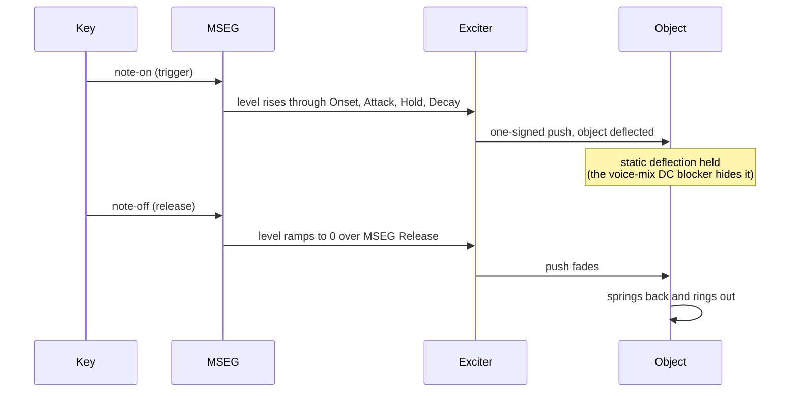

# Friction Exciters

The Friction family is everything that rubs, scrapes or pulls: Bow, Stiff Point Scrape, Heavy Grinding, Corrugated Drag and Tension Rise. They are continuous: they push for as long as their force envelope, the six-stage `MSEG`, is above zero, and the key being held is what keeps the MSEG up.

What they share with the other families (dispatch, drive levels, the governor, Speed and Roughness) is on [Exciters](Exciters). The MSEG itself, its loop and the Gesture Modifiers that only it obeys are on [Envelopes and Modulation](Envelopes-and-Modulation#friction-the-six-stage-mseg).

## Conventions on this page

- Steps and decays are per 48 kHz sample and converted with `dsp::utils::rate` at other rates ([Sample-Rate Rule](Sample-Rate-Rule)).
- `v` is `velocity / 127`. "Host range" is the parameter's range in the plugin; `set_parameters` clamps to a wider code range.
- The resonator's velocity `V` is in displacement per 48 kHz sample. On a held note it is tiny: 0.0002–0.007 on the default patch, against tool speeds near 1. That single fact explains most of this page: the friction laws almost never leave their sliding branch, so these models push the object **one way** with a nearly constant force plus a texture.

| Model | Reads | Force, in one line |
|---|---|---|
| Bow | `V`, previous sample | `2 · P · μ(|v_rel|) · sign(v_rel) · (1 + 0.3·grip·sin 2πx)` |
| Stiff Point Scrape | `V`, previous sample | `2 · ring + 0.3 · pressure · deflection / threshold` |
| Heavy Grinding | `ContactPrediction` (implicit) | `P · 0.4 · 3s · tanh((s − V(F)) / 0.05s) + tearing` |
| Corrugated Drag | `V`, previous sample | `(0.15 + bump) · sign(v_rel) · 3 · speed` |
| Tension Rise | `V`, previous sample | one-sample break spikes, nothing in between |

Bow, Stiff Point Scrape, Corrugated Drag and Tension Rise read the resonator explicitly (last sample's velocity): their laws aren't monotone in the force, which the implicit solver needs, and none of them runs away. Heavy Grinding's `tanh` law is monotone, so it is solved implicitly ([Interaction Bus and Contact](Interaction-Bus-and-Contact#implicit-contact)).

## Bow

A bow drawn across the object with a Stribeck friction curve: static friction below a small slip speed, falling smoothly to dynamic friction above it, plus a periodic ripple standing in for the rosin's texture.

| Control | Host range, default | Role |
|---|---|---|
| Bow Pressure | 0.2–2, 1.1 | normal force `P` |
| Bow Speed | 0.1–2, 1.05 | target bow speed (× Speed) |
| Rosin Grip | 0.05–1.5, 0.485 | the friction coefficients and the ripple depth (× Roughness) |
| Slip Curve | 0.05–1.5, 0.485 | width of the Stribeck transition and how far grip carries into sliding |

**At note-on** (`trigger`): target speed `speed · (0.5 + 0.5·v)`; the bow starts at a tenth of it and approaches it with a one-pole smoother (0.001 per sample, about 21 ms at 48 kHz).

**Per sample** (`process_sample`), with `v_rel = bow_velocity − V`:

- `μs = 0.4 + 0.3·grip`, `μd = 0.2 + 0.1·grip`, Stribeck speed `vs = 0.01 + 0.02 · speed · slip`.
- Below `vs`: `μ` falls from `μs` to `μd` along a smoothstep. Above it: `μ = μd + (μs − μd) · exp(−(|v_rel| − vs) · falloff)`, with `falloff = 10 · (0.485 / slip)²` (exactly 10 at the default Slip Curve).
- The bow position advances by the bow speed per sample and wraps at 1; the ripple is `1 + 0.3 · grip · sin(2π · position)`.
- Force `= P · μ · sign(v_rel) · ripple · 2`.

**What it really does.** `v_rel` is about 0.94 at velocity 100 and `V` hardly moves it, so the bow stays on the sliding branch and never sticks. At the default Slip Curve `exp(−9.2)` makes `μ ≈ μd` (0.2485); at Slip Curve 1.5 the falloff drops to about 1 and `μ` rises to about 0.36. So Slip Curve acts as a force level, and the sound is a steady push, shaped by the MSEG, with the ripple on top. A bow that really sticks and slips is an open item in `docs/BACKLOG.md`: seeing the resonator ×1000 makes it stick, but drives the bowed presets into a raucous regime.

**Trap: the ripple aliases, differently at each rate.** The ripple's phase advances by the bow speed per **48 kHz** sample (`rate::step`), so its true frequency is `bow_speed · 48 000` Hz, about 45 kHz on the default patch. Sampled at 48 kHz it folds to `(1 − 0.94) · 48 000 ≈ 3 kHz`; at 44.1 kHz it lands near 0.9 kHz; at 96 kHz it stays at 45 kHz, inaudible. Measured on the struct alone (default controls, velocity 100): 942 Hz at 44.1 kHz, 2 959 Hz at 48 kHz, 45 038 Hz at 96 kHz. The ripple is 14.5 % deep at the default Rosin Grip, so the bow's texture depends on the host rate; `every_exciter_has_the_same_level_at_any_sample_rate` checks level only and doesn't see it. Not documented in the code as intended.

`bow_controls_change_output` (in `src/voice/mod.rs`) and `tests/bow_exciter.rs` cover the basics.

## Stiff Point Scrape

A nail or awl dragged over metal: the stiff tip catches, winds up like a spring, slips past a threshold and rings, over and over. The slips set a chatter rate; the ring sets its pitch.

| Control | Host range, default | Role |
|---|---|---|
| Scrape Speed | 0.1–2.5, 0.82 | how fast the tip winds up (× Speed) |
| Point Pressure | 0.1–1.5, 0.8 | slip threshold `0.05 + 0.2·pressure`, and the strike and stick force |
| Chatter Pitch | 0.1–1.5, 0.52 | ring frequency `100 + 900·pitch` Hz (190–1 450 Hz in host range; capped at 0.45·fs) |
| Chatter Damping | 0.1–0.9, 0.66 | ring decay time `0.006 / damping` s (60 ms to 7 ms) |

**At note-on:** scrape speed × `(0.5 + 0.5·v)`; ring and deflection cleared.

**Per sample:**

1. Deflection grows by `(speed − V) · 0.001`.
2. Past the threshold, the tip slips: a strike of `sign · pressure` hits the ring, and the deflection drops to a tenth. `early`, the fraction of the step since the threshold was crossed, places the strike between samples: the ring adds the strike's value now and its virtual value one sample back, so the two-pole recursion carries it on at the right phase.
3. The ring is a two-pole resonator `r = exp(−1 / (decay · fs))`, at the chatter pitch.
4. Force `= CHATTER_RING_GAIN · ring + STICK_GAIN · pressure · deflection / threshold`, with gains 2 and 0.3.

On the default patch at velocity 100 a slip comes every ~258 samples, about 186 Hz, under a 568 Hz ring that decays in about 9 ms. The stick term is a sawtooth that is always positive, which is what deflects the object and makes the release snap. `chatter_pitch_raises_the_chatter` and `chatter_damping_shortens_the_ring` (in the module) check the two ring controls.

## Heavy Grinding

Coulomb friction against a rough surface, plus a tearing noise from asperities breaking off: concrete, sandpaper, a grinder.

| Control | Host range, default | Role |
|---|---|---|
| Grind Speed | 0.1–2.5, 0.82 | grinder speed `s` (× Speed) |
| Grind Pressure | 0.1–1.9, 1 | friction force, and tearing `× √(P / 1)` |
| Surface Grit | 0–1, 0.3 | tearing level (× Roughness) |
| Grit Color | 0–1, 0.3 | tearing noise colour |

**At note-on:** `s = grind_speed · (0.3 + 0.7·v)`; noise state cleared.

**Per sample:**

- **Tearing noise.** A leaky random walk (Brownian noise): step `±0.1·√ratio`, leak 0.99 per sample, clamped to ±1, so its level is the same at any rate. It goes through a one-pole **low-pass** whose coefficient is `clamp(cutoff / 10 000, 0.01, 0.99)` at 48 kHz, with `cutoff = 100 + 1900·c` below Grit Color 0.5 and `1000 + 6000·(c − 0.5)` above. The code comments call the upper half "HPF-ish", but it is the same low-pass with a higher coefficient: brighter, not high-passed. The "cutoff" is a coefficient, not a calibrated frequency.
- `tearing = noise · s · grit · 2 · 3s · √P`.
- **Friction**, solved implicitly: `F = P · 0.4 · 3s · tanh((s − V(F)) / max(0.05·s, 1e-4)) + tearing`. A smooth `tanh` instead of a sign flip, solved with the resonator's response, can't flip sign a sample late against a fast mode and pump it.

**Why the noise follows the grinder's own speed, not the slip.** Taking it from the slip let the resonator's motion modulate the noise force that drives it, which built a high-Q mode into a large limit cycle (Plate at C6). Its friction term is static and the voice-mix DC blocker removes what it does to the output, which is why Grind Pressure also scales the tearing: without it the pressure was not heard.

`mallet_and_grinder_contact_is_stable_far_above_default_drive` and `grind_pressure_shapes_the_heavy_grinding` (in `src/voice/mod.rs`) cover it.

## Corrugated Drag

A stick dragged over a ribbed surface: a constant Coulomb drag plus a bump each time the tip rides over a ridge, at a rate set by speed over ridge spacing.

| Control | Host range, default | Role |
|---|---|---|
| Drag Speed | 0.1–2.5, 0.82 | drag speed (× Speed) |
| Ridge Spacing | 0.01–0.2, 0.143 | distance between ridges |
| Ridge Depth | 0–2, 0.6 | bump force |
| Exciter Mass | 0.2–2, 1.1 | multiplies the bump |

**At note-on:** `speed = drag_speed · (0.3 + 0.7·v)`.

**Per sample:** `v_rel = speed − V`; position `+= v_rel · 0.01`; `bump = max(0, sin(2π · position / spacing)) · depth · mass`; force `= (0.5·0.3 + bump) · sign(v_rel) · speed · 3`.

The ridge rate is about `speed · 0.01 · 48 000 / spacing` Hz: 2.3 kHz on the default patch at velocity 100. **Trap:** at the extremes (Drag Speed 2.5, Ridge Spacing 0.01) that is 120 kHz, and the half-wave bumps alias. The force is one-signed, so Corrugated Drag has the largest release snap measured on the default patch (below).

## Tension Rise

Stress loading up in a beam or a cable until it gives: an integrate-and-fire model. Tension builds with the pull; past a (jittered) threshold it breaks with one spike, pauses, and starts again, which gives creaks and groans at a few tens of hertz.

| Control | Host range, default | Role |
|---|---|---|
| Pull Speed | 0.05–1.55, 0.8 | how fast tension builds (× Speed) |
| Break Threshold | 0.1–1.6, 0.85 | tension at which it breaks |
| Slip Stochasticity | 0–1, 0.3 | jitter of each threshold, `±0.3·stochasticity` (× Roughness) |
| Creak Sharpness | 0.2–1.4, 0.56 | spike size |

**At note-on:** pull × `(0.5 + 0.5·v)`; tension 0; the first threshold drawn.

**Per sample:** during the pause after a break (`recovery_frames`, 50 samples at 48 kHz) nothing happens. Otherwise tension `+= (pull − V) · 0.001`; past the threshold it emits a one-sample spike `tension · sharpness · 5 / ratio` (area kept at every rate), placed between samples with an `EventSplitter`, resets to 0 and draws the next threshold. The threshold is drawn **once per break**: drawing it every sample let a faster rate meet more draws on the way up and break earlier.

On the default patch at velocity 100 a cycle is about 1 189 + 50 samples, about 39 Hz. Every output is delayed one sample by the splitter. `tension_rise_break` in `event_timing_tests.rs` checks the spike's area and timing across rates.

## The release snap

The same, as a list:

1. While the key is held, Bow, Stiff Point Scrape and Corrugated Drag push the object with a force that has a large constant part. The modes settle around a deflected position; the held note sounds only the force's small varying part. The static part is DC at the output, removed by the voice-mix DC blocker ([Output Protection](Output-Protection)).
2. `Voice::note_off` releases the MSEG but leaves the exciter running, so the force fades over MSEG Release (minimum 0.01 s).
3. The object springs back from its deflection and rings freely: the release is louder than the held note. On the default patch it is up to +30 dB (Plate with Corrugated Drag: −48.1 → −17.6 dB); in the factory bank up to +37 dB (Bow on Taut Cable).

The maintainer keeps it as a feature. A longer MSEG Release turns the snap into a ramp, since the deflection is let go more slowly. A Release Snap control is proposed in `docs/BACKLOG.md`. Heavy Grinding's friction also has a constant part, but the snap is documented for these three only; its size for Heavy Grinding is not measured.

**Trap:** Env Amount scales the whole MSEG, so at Env Amount 0 the friction models make no sound at all (an open item in `docs/BACKLOG.md`). And in Tonal mode, with the loop off, a held friction note sits at MSEG Sustain with a nearly constant force: the object is held still and the note is quiet. Drone mode forces a Decay ↔ Sustain loop, so the force keeps moving ([Envelopes and Modulation](Envelopes-and-Modulation#drone-mode)).

## Source files

- [`src/dsp/exciters/bow.rs`](https://github.com/GerMP21/Corrosion-VST/blob/main/src/dsp/exciters/bow.rs): `BowExciter`, the Stribeck curve, Slip Curve's falloff and the ripple.
- [`src/dsp/exciters/stiff_point.rs`](https://github.com/GerMP21/Corrosion-VST/blob/main/src/dsp/exciters/stiff_point.rs): `StiffPointScrape`, wind-up, slip and the sub-sample ring.
- [`src/dsp/exciters/heavy_grinding.rs`](https://github.com/GerMP21/Corrosion-VST/blob/main/src/dsp/exciters/heavy_grinding.rs): `HeavyGrinding`, the implicit `tanh` friction and the tearing noise.
- [`src/dsp/exciters/corrugated_drag.rs`](https://github.com/GerMP21/Corrosion-VST/blob/main/src/dsp/exciters/corrugated_drag.rs): `CorrugatedDrag`, Coulomb drag over ridges.
- [`src/dsp/exciters/tension_rise.rs`](https://github.com/GerMP21/Corrosion-VST/blob/main/src/dsp/exciters/tension_rise.rs): `TensionRise`, integrate-and-fire breaks.
- [`src/dsp/envelopes/mod.rs`](https://github.com/GerMP21/Corrosion-VST/blob/main/src/dsp/envelopes/mod.rs): the `MSEG` these models are scaled by.
- [`tests/bow_exciter.rs`](https://github.com/GerMP21/Corrosion-VST/blob/main/tests/bow_exciter.rs): a held bow note sounds and differs from a strike.
- [`docs/BACKLOG.md`](https://github.com/GerMP21/Corrosion-VST/blob/main/docs/BACKLOG.md): the open items on Release Snap, Bow stick-slip and Env Amount.
