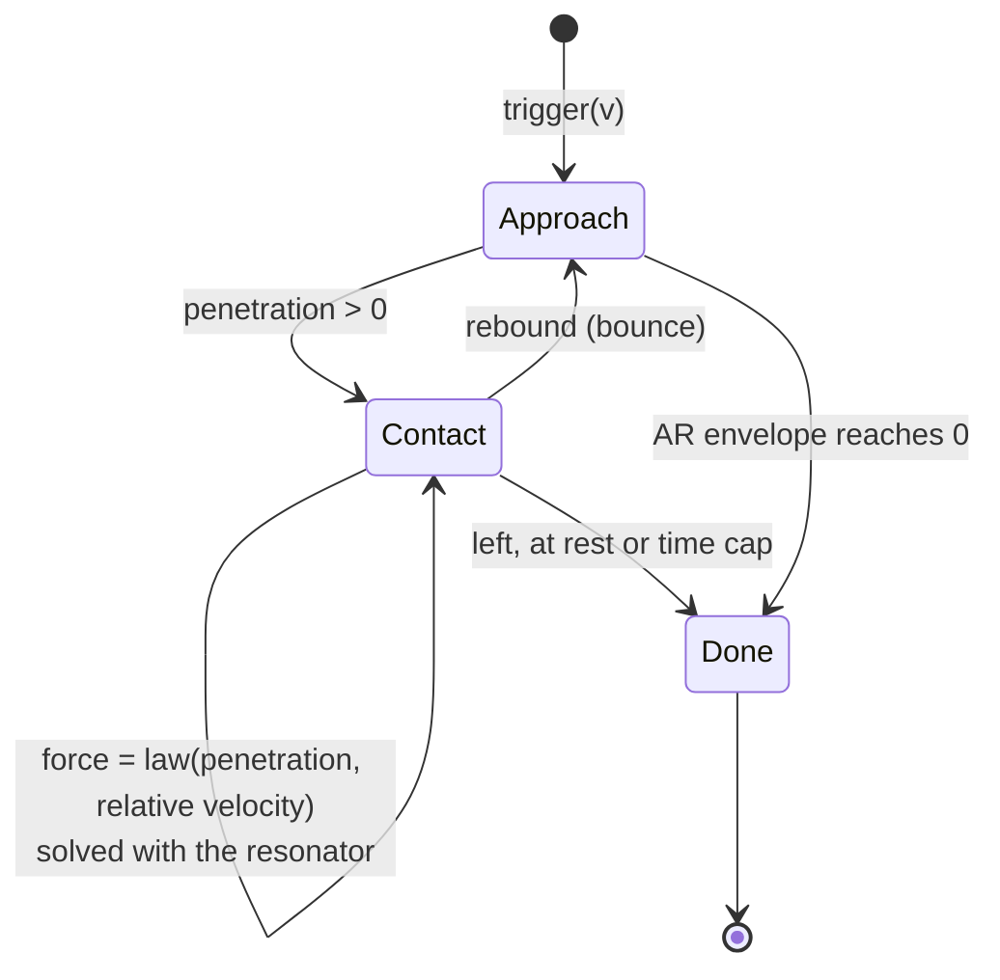
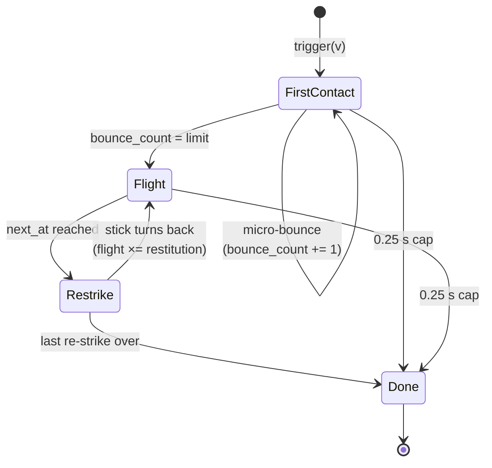

# Hit Exciters

The Hit family is everything that strikes: Hand Strike, Felt Mallet, Hard Mallet, Drumstick, Wire Brush, Metal Pipe and Metal Chain. Five of them are a body thrown at the surface whose contact force is solved against the resonator each sample; Wire Brush is a cloud of pre-scheduled impulses; Metal Chain is a set of falling links, each striking once.

What they share is on [Exciters](Exciters): the dispatch, the one-shot AR force envelope, drive levels and the governor. The contact solver and the "length units" trick are on [Interaction Bus and Contact](Interaction-Bus-and-Contact).

## Conventions on this page

- **Contact space.** Positions are in arbitrary units along the strike axis; the surface is the resonator's contact displacement `D` (a weighted sum of the modes, see [Interaction Bus and Contact](Interaction-Bus-and-Contact)). A body at position `x > D` is in the surface by `x − D` (the penetration). Positive velocity moves toward and into the surface.
- **Steps are per 48 kHz sample.** "Moves `0.001·v` per sample" means per 48 kHz sample; at other rates `rate::step` scales the step by `48 000 / fs`, `rate::decay` converts per-sample decays, and `rate::frames` converts sample counts ([Sample-Rate Rule](Sample-Rate-Rule)).
- **`v`** is the normalized note velocity, `velocity / 127`.
- **Ranges.** "Host range" is the parameter's range in the plugin ([Parameters](Parameters)); `set_parameters` clamps to a wider code range so presets and tests can go further.
- **The AR envelope gates every model.** Its force is multiplied by the linear one-shot rise (Attack, default 50 ms) and fall (Release, default 0.5 s); the strike stops when the envelope reaches 0, whatever the model is doing. See [Envelopes and Modulation](Envelopes-and-Modulation#hit-the-one-shot-ar).

## A thrown body, in general

The same, as a list: `trigger` places the body short of the surface with a speed set by velocity. Each sample it moves; when it penetrates, its contact law gives a force, solved together with this sample's response of the resonator (`contact::solve_force`). The force slows the body (and may throw it back for another contact). It ends when the model decides it has left or come to rest, when its own time cap runs out, or when the AR envelope reaches 0.

| Model | Contact law | Leaves when |
|---|---|---|
| Hand Strike | Kelvin–Voigt spring-damper, `(k·d + c·Δv)⁺` | its mute decay falls below 0.001 |
| Felt Mallet | felt plus core, `soft·d + hard·d^curve` | effectively never; the envelope ends it |
| Hard Mallet | Hunt–Crossley Hertzian, `k·d^1.5·(1 + λ·Δv)⁺` | it moves away with a gap over 0.02, or after 0.25 s |
| Drumstick | Hertzian, `k·d^1.5` | its bounces and re-strikes are done, or after 0.25 s |
| Metal Pipe | Hertzian, `k·d^1.5`, with a ringing pipe | it settles past position 0.5 |

`d` is the penetration, `Δv` the relative velocity, `(·)⁺` means clamped at 0 (a contact can only push).

## Hand Strike

A fleshy palm: a Kelvin–Voigt contact (a spring and a damper in parallel), with a mute that fades the hand's grip over a few milliseconds. The hand mass and Mute Decay decide whether it reads as a slap or a muted thump.

**Controls** (`HandStrike::set_parameters`):

| Control | Host range, default | Role |
|---|---|---|
| Hand Mass | 0.4–3, 1.7 | multiplies the force |
| Flesh Stiffness | 0.05–0.8, 0.425 | spring `k`; also what the hand keeps of its speed on landing |
| Flesh Damping | 0.3–1.8, 0.75 | damper `c` |
| Mute Decay | 0.85–0.999, 0.9245 | per-sample decay of the grip (`decay_state`) |

**Per sample** (`process_sample`):

1. The resonator is seen in hand units: `ContactPrediction::in_units(HAND_SCALE)` with `HAND_SCALE = 55.4`, which is also the hand's drive level (see [Exciters](Exciters#drive-levels)).
2. The force is taken at the middle of the step: velocity `vh·√decay` and position `x + ½·vh·0.01`, so the approach's area doesn't depend on where the sample grid falls.
3. Force `F = max(0, k·(x − D(F)) + c·(vh − V(F))) · mass · decay_state`, solved for `F`.
4. The hand moves `0.01·vh` per sample and its speed decays by 0.99 per sample.
5. When the hand passes the surface (`D − 0.01`): on the landing sample the force is scaled by the fraction of the step it was still approaching. The hand is then put on the surface with speed `0.5·V + keep·(vh − 0.5·V)`, where `keep = clamp(1 − k/0.425, −1, 1)`: at the default stiffness the hand just follows the surface, softer flesh keeps pressing in, stiffer flesh throws the hand back.
6. `decay_state *= Mute Decay`; below 0.001 the hand is inactive.

**Velocity:** start position `−0.1·v`, speed `2·v`.

**How long it lasts.** Mute Decay is the length of the contact window: at the default 0.9245 the grip falls to 0.001 in about 88 samples (1.8 ms at 48 kHz); at 0.999 in about 6 900 samples (144 ms), a palm left on the object.

## Felt Mallet

A soft mallet: felt that compresses linearly, over a hard core that takes over as the felt bottoms out. The core is what makes loud notes brighter.

| Control | Host range, default | Role |
|---|---|---|
| Mallet Mass | 0.4–3.5, 1.5 | multiplies the force (shared with Hard Mallet) |
| Felt Softness | 0.1–1.3, 0.94 | linear felt stiffness |
| Core Hardness | 0.5–4.5, 2.5 | core stiffness |
| Compression Curve | 2–5, 2.9 | the core's exponent |

**Per sample:**

1. The mallet moves `0.001·vm` per sample.
2. Compression `d = max(0, x − D(F))`; force `F = (soft·d + hard·d^curve)·mass`, solved for `F`.
3. When `d > 0.01` the mallet decelerates by `d · core_ratio · 0.5` per sample, where `core_ratio` is the felt-plus-core stiffness over the same with the default core (Core Hardness 2.5, Curve 2.9), with the core measured from `CORE_ONSET` (0.05): `core(h, c) = h · 0.05 · (d / 0.05)^c`. At the default core the ratio is exactly 1; a harder core stops the mallet sooner.
4. The mallet is pulled toward the surface by 0.01 per sample and its speed decays by 0.995.

**Velocity:** start position `−0.2 − 0.3·v`, speed `3·v + 1`.

**Trap: no real exit.** The only exit test is `position > 1` while still moving in, which a mallet slowed by its own felt doesn't reach in practice. The pull toward the surface brings it back after a rebound, so a felt mallet can press and bounce until the AR envelope ends the strike. Release is therefore part of this model's sound.

## Hard Mallet

A rigid mallet with a dissipative Hertzian (Hunt–Crossley) contact. It is thrown, strikes, rebounds and leaves.

| Control | Host range, default | Role |
|---|---|---|
| Mallet Mass | 0.4–3.5, 1.5 | force multiplier and inertia (the reaction divides by mass²) |
| Material Stiffness | 0.5–5, 2.75 | Hertz stiffness `k` |
| Impact Damping | 0.1–1.3, 0.46 | Hunt–Crossley damping, and how much rebound the contact gives back |

**Per sample:**

1. Until the first touch the mallet is pulled toward the surface (`+0.02` per sample) and slowed by the air (×0.98); after it, only the contact acts.
2. It moves `MALLET_STEP · vm` (0.0005) per sample.
3. Force `F = mass · k · d^1.5 · max(0, 1 + λ·(vm·0.0005 − V(F)))`, with `λ = damping · 0.1 / 0.0005`, solved and clamped to 0–100.
4. While in contact the mallet decelerates by `0.3·F / mass²` per sample. On the way out (speed below 0) that reaction is multiplied by `0.46 / damping`: a more damped mallet gets less push back, leaves later and sounds dead.
5. It leaves when it has touched, moves away and the free surface is more than `LEAVE_GAP` (0.02) behind it; or after `MAX_STRIKE_FRAMES` (12 000 at 48 kHz, 0.25 s); or when it is past −0.5 moving away.

**Velocity:** start position −0.3, speed `4·v + 2`.

`strikes_come_to_rest` checks that Hard Mallet leaves after its rebound and Drumstick goes inactive.

## Drumstick

A light wooden stick with a Hertzian tip. The first contact has micro-bounces (the moving surface throws the stick back and it lands again); then the stick comes back for a few separate re-strikes, each weaker and sooner than the last, like a stick bounced on a snare.

| Control | Host range, default | Role |
|---|---|---|
| Stick Mass | 0.05–1.25, 0.65 | force multiplier and inertia |
| Tip Stiffness | 0.8–6.8, 3.8 | Hertz stiffness `k` |
| Restitution Bounciness | 0.2–0.9, 0.41 | speed kept per bounce; scales the re-strike flights |
| Micro Bounce Limit | 2–8, 4 (rounded) | bounces in the first contact; also re-strikes = limit − 1 |

The same, as a list:

- **First contact.** The stick moves `0.0003·vs` per sample. Force `F = k · d^1.5 · mass`, solved; the stick decelerates by `0.1·F / mass²` per sample in contact and is pulled in by 0.05 per sample out of it; speed decays by 0.999 per sample. A micro-bounce is counted when the penetration shrinks while the stick moves out: its speed becomes `−vs · restitution + 0.3·V`, which sends it back in.
- **Re-strikes.** After `limit` bounces (`start_restrikes`), `limit − 1` re-strikes follow (none if the limit is 1). The first flight is `FIRST_FLIGHT_FRAMES` (1 920 at 48 kHz, 40 ms) × min(restitution, 1), and each next flight is shortened by the same factor. A re-strike lands **on the surface** at its scheduled frame with speed `initial · r^k` (`k` = re-strike number), and ends as soon as the stick turns back or the surface leaves it. Each is a real Hertzian contact solved like the first.
- **Cap.** The whole strike, re-strikes included, lasts at most 12 000 samples at 48 kHz (0.25 s).

**Velocity:** start position −0.15, speed `5·v + 3`.

**Why re-strikes are scheduled, not simulated.** A stick left to fall back freely came back every few milliseconds and damped the object like a stick resting on it (−50 dB in 100 ms). Landing re-strikes on the surface at a scheduled frame also makes their timing the same at any rate (a stick started above a moving surface chased it for milliseconds, by an amount that depended on the rate).

**Traps:**
- At the host maximum (Restitution 0.9, limit 8) the seven flights add up to about 188 ms, inside the 0.25 s cap. Raising either range in code can push re-strikes past the cap, where they are silently dropped.
- Re-strikes late in the strike are scaled down by the falling AR envelope, and a short Release removes them.
- `bounce_count()` reports micro-bounces plus re-strikes started.

## Wire Brush

A cloud of short impulses, like the wires of a brush hitting one after another. It is not a contact model: the impulses are scheduled at note-on and the object's motion has no effect on them (`process_sample` ignores its inputs).

| Control | Host range, default | Role |
|---|---|---|
| Wire Density | 10–130, 46 (rounded) | number of impulses `N` (code clamp 1–5 000) |
| Spread Duration | 10–250 ms, 130 | time over which they fall |
| Brush Wire Stiffness | 0–1, 0.3 | nominally a high-pass cutoff, `100 + 4000·stiffness` Hz; in effect a level (see the trap below) |
| Amplitude Randomization | 0–1, 0.3 | per-impulse amplitude spread |

Global Speed divides Spread Duration and Roughness multiplies Amplitude Randomization ([Exciters](Exciters#global-exciter-controls-pressure-speed-roughness)).

**At note-on** (`trigger`) the brush draws a Poisson process: `N` exponential intervals with rate `N / spread` per millisecond, stopping at the first one past the spread, so the count is close to but not always `N`. Each impulse gets amplitude `(0.5 + 0.5·v) · max(0.1, 1 + (u − 0.5)·2·randomization)`, `u` uniform. The list is kept in time order in a buffer preallocated to 5 000 entries; `trigger` clears and refills it without allocating.

**Per sample:** every impulse whose time has passed fires (a cursor, `next_impulse_index`, avoids rescanning); their amplitudes are summed and their amplitude-weighted fractional time becomes the `early` of a `rate::EventSplitter`. The sum goes through a one-pole filter meant as a high-pass, whose coefficient is derived at the 48 kHz step, is **half-wave rectified** (`max(0)`), and is scaled by `fs / 48 000` so each impulse keeps its area. The brush is done once the spread has passed and every impulse has fired.

**Trap: Brush Wire Stiffness is a level control, not a tone control.** The filter is `y = α·(y₋₁ + x − x₋₁)` with `α = dt / (RC + dt)`, the low-pass form of the coefficient (a high-pass at the cutoff would use `RC / (RC + dt)`). With so small an `α`, an impulse of size `A` comes out as one sample of `α·A` followed by negative samples, which the rectifier removes. `α` is 0.013 at stiffness 0, 0.145 at the default 0.3 and 0.349 at 1, so the control spans about 29 dB of level and leaves the impulse shape alone (measured on the struct: a single impulse gives 0.0129, 0.1454 and 0.3489). The code comment promises "brighter, sharper"; changing it to a real high-pass would change every brush preset's level and timbre. The output is also one-signed, so a dense brush pushes the object off its rest position a little.

## Metal Pipe

A metal pipe swung at the object: a Hertzian contact whose striking body rings at its own three modes, and that ringing wobbles the pipe in the contact. The pipe's ring doesn't reach the output directly; it reaches it through the contact force.

| Control | Host range, default | Role |
|---|---|---|
| Pipe Mass | 0.4–2.6, 1.5 | force multiplier and inertia |
| Metal Stiffness | 0.5–5.5, 3 | Hertz stiffness `k` |
| Pipe Pitch | 0.5–2.5, 1.1 | scales the pipe's modes, 800, 2 100 and 4 500 Hz (gains 1, ½, ⅓) |
| Pipe Ring Decay | 0.96–0.999, 0.9795 | per-48 kHz-sample decay of those modes |

**Per sample:**

1. The resonator is seen in pipe units (`in_units(PIPE_SCALE)`, 5.06).
2. The pipe moves `0.0005·vp` per sample; force `F = k · d^1.5 · mass`, solved.
3. `−F` drives the three two-pole pipe modes (`process_pipe_modes`). Their input gain is `(1 − decay)·ratio²`, so a force of a given area rings at the same amplitude at every rate.
4. The modes' sum feeds the pipe's speed (`+0.01·ring` per sample): the pipe vibrates in the contact.
5. In contact it decelerates by `0.05·F / mass`; out of it it is pulled in by 0.02 per sample; its speed decays by 0.995.
6. It is done when it is past position 0.5 and nearly still (|speed| < 0.01).

**Velocity:** start position −0.2, speed `4·v`. At velocity 0 the pipe still falls onto the object.

**Pipe Ring Decay as a time.** The decay's time constant is `−1 / ln(decay)` samples: about 48 samples (1 ms) at the default 0.9795 and about 1 000 samples (21 ms) at 0.999, so the pipe's own ring is short and acts as a buzz on the contact.

## Metal Chain

A dropped chain: several links fall, each strikes the object once with a Hertzian impact, and after the first links land a high-passed rattle noise adds the links knocking together.

| Control | Host range, default | Role |
|---|---|---|
| Link Count | 3–15, 9 (rounded) | number of links (code clamp 2–20) |
| Chain Mass | 0.2–1.4, 0.8 | each link's mass, and how deep it dents the surface |
| Drop Envelope Spread | 40–400 ms, 220 | when the last link drops (code clamp 50–1 000, so 40 acts as 50) |
| Internal Rattle | 0–1, 0.3 | level of the rattle noise |
| Rattle Color | 0–1, 0.3 | rattle high-pass cutoff, `200 + 3000·color` Hz |

Global Speed divides Drop Envelope Spread and Roughness multiplies Internal Rattle.

**At note-on** each link `i` of `N` gets, from the note's noise stream: a drop time `(i / N) · spread · (1 ± 0.1)`, a start position `−0.3 − 0.2·u`, a speed `v · (2 + u)` and a mass `chain_mass · (0.8 + 0.4·u)`. The buffer is preallocated to 20 links.

**Per sample:**

1. Each link follows its **exact** fall from its drop time (`ChainLink::fall`: constant acceleration of 0.03 per sample², position step `0.0005·speed`, in 48 kHz units), so when it reaches the surface doesn't depend on the sample grid.
2. A link strikes on the sample its tip passes the unloaded surface (`D(0)`). Its penetration is taken half a reference sample into the contact: `0.5 · travel · (chain_mass / 0.8) · IMPACT_DENT − push`, with `IMPACT_DENT` 3 and `push` the surface's own give under this sample's force. The impulse is `rate::impulse(IMPACT_STIFFNESS · pen^1.5 · link_mass)` with `IMPACT_STIFFNESS` 2·10⁵, and all links striking this sample are solved together with the resonator.
3. The impacts go through an `EventSplitter`, weighted by how early in the sample each link crossed the surface.
4. From `0.3 · spread` on, white noise `· rattle · 0.1` (rate-scaled with `white_noise`) goes through a one-pole high-pass (`OnePoleHighPass`, −3 dB at its cutoff) and is added.
5. The chain is done when every link has struck and `spread + 100 ms` has passed.

**Velocity:** only the links' starting speeds; at velocity 0 they still fall.

**Traps:**
- Each link strikes once; there is no bounce. The density comes from Link Count and the rattle.
- With the default AR envelope (Attack 50 ms, Release 0.5 s) a 400 ms spread puts the last links where the envelope is near 0.1 of its peak; a short Release cuts them off.

## Source files

- [`src/dsp/exciters/hand_strike.rs`](https://github.com/GerMP21/Corrosion-VST/blob/main/src/dsp/exciters/hand_strike.rs): `HandStrike`, the Kelvin–Voigt palm, and `HAND_SCALE`.
- [`src/dsp/exciters/felt_mallet.rs`](https://github.com/GerMP21/Corrosion-VST/blob/main/src/dsp/exciters/felt_mallet.rs): `FeltMallet`, felt plus core compression.
- [`src/dsp/exciters/hard_mallet.rs`](https://github.com/GerMP21/Corrosion-VST/blob/main/src/dsp/exciters/hard_mallet.rs): `HardMallet`, the Hunt–Crossley contact, rebound and exit.
- [`src/dsp/exciters/drumstick.rs`](https://github.com/GerMP21/Corrosion-VST/blob/main/src/dsp/exciters/drumstick.rs): `Drumstick`, micro-bounces and scheduled re-strikes.
- [`src/dsp/exciters/wire_brush.rs`](https://github.com/GerMP21/Corrosion-VST/blob/main/src/dsp/exciters/wire_brush.rs): `WireBrush`, the Poisson impulse cloud.
- [`src/dsp/exciters/metal_pipe.rs`](https://github.com/GerMP21/Corrosion-VST/blob/main/src/dsp/exciters/metal_pipe.rs): `MetalPipe`, the Hertzian contact with its own three modes, and `PIPE_SCALE`.
- [`src/dsp/exciters/metal_chain.rs`](https://github.com/GerMP21/Corrosion-VST/blob/main/src/dsp/exciters/metal_chain.rs): `MetalChain`, falling links and the rattle high-pass.
- [`src/voice/mod.rs`](https://github.com/GerMP21/Corrosion-VST/blob/main/src/voice/mod.rs): the Hit AR envelope, the dispatch, and the tests `strikes_come_to_rest` and `contact_control_tests`.
