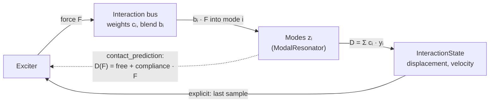

# Interaction Bus and Contact

An exciter and the object touch at one point. The force goes in there, and the object's motion there comes back to the exciter: a mallet is stopped by the surface it hits, a bow feels the string move under it. This page covers both directions: how the force is spread over the modes by the strike position (the interaction bus), what the exciter reads back, and how the exciters that depend on that reading solve their force together with the object's response in the same sample (implicit contact).

Why it matters: a one-directional model (force in, nothing back) can't make a mallet bounce or a contact stiffen. A two-directional model with a one-sample delay can, but above a small loop gain the delay turns damping into gain and the contact runs away. The bus provides the two-way link; the contact solver removes the delay.

## The loop

The same, as a list:

1. The voice asks the exciter for a force `F` (for contact exciters, after handing it a `ContactPrediction` of this sample's displacement as a function of `F`).
2. `ModalResonator::process_sample` adds `F · bᵢ` to each mode, where `bᵢ` blends the mode's strike weight `cᵢ` with 1 by Coupling Stiffness.
3. It sums each mode's output `yᵢ` weighted by `cᵢ` into the contact displacement `D`, takes its first difference as the velocity, and stores both in `InteractionState`.
4. Next sample, explicit exciters read those two values (`get_displacement`, `get_velocity`), and contact exciters get a fresh prediction.

## Strike weights: where the object is struck

`mode_coefficient_1d(n, P) = sin((n + 1)·π·P)` is the shape of mode `n` at position `P` on an ideal string or simple beam: 1 at an antinode, 0 at a node. Striking at the middle (`P` = 0.5) excites the odd modes and misses the even ones; striking near an end excites high modes relatively more.

- The same 1D shape is used for all nine objects, by the mode's **index in the bank** (`n` is the bank index, not a physical mode number). Plates, tanks and cogs have no 2D or circular shapes; the per-object generators make their own spectra, and the strike position only sets these weights.
- **Fundamental Anchor** (`fundamental_anchor`, 0–1, default 0.3): when above 0, `c₀ = max(c₀, anchor)`, so the first mode in the bank never vanishes and the note keeps its pitch even when struck at a node of it.
- The weights live in `BidirectionalInteractionBus::mode_coefficients`, a buffer preallocated to `MAX_MODES`. They are a pure function of (effective position, lock, lock minimum, mode count), cached in `cached_for`: the per-mode `sin` runs only when the position actually moves.

### The effective position

Every sample, `InteractionState::update_position` computes

`P = clamp(strike_position + envelope_offset + sin(phase) · wander, 0, 1)`

- `strike_position`: Strike Position (0–1, default 0.5).
- `envelope_offset`: `position_envelope · envelope · 0.5`, set by the voice each sample when Position Envelope is above 0 ([Envelopes and Modulation](Envelopes-and-Modulation#position-envelope)).
- `wander`: a sine drift, see [Envelopes and Modulation](Envelopes-and-Modulation#position-wander).

The update runs in the resonator's per-sample preparation (`prepare_sample`), once per sample, before the force is applied.

## Coupling Stiffness: how position-dependent the force is

Mode `i` receives `F · bᵢ` with `bᵢ = (1 − k) + k·cᵢ`, where `k` is Coupling Stiffness (0–1, default 1).

- At `k = 1` (the default) the force is spread by the mode shapes, the physical case.
- At `k = 0` every mode receives the full force wherever the object is struck ("feed-forward"): the strike position then changes only what the exciter reads back, not what it excites.
- In between it blends. `bᵢ` can be negative past a node, which flips that mode's phase.

The displacement read back always uses `cᵢ`, not `bᵢ`: `D = Σ cᵢ · yᵢ`. So the exciter feels the object at the strike point even when Coupling Stiffness is 0.

**Note-on level.** `ModalResonator::normalize_strike_level` scales the whole bank so a strike reaches `STRIKE_LEVEL_REF`, using the bus's weights and coupling **at note-on**. The bus is reset just before (`interaction_bus.reset`), so the normalization uses the default position (0.5) and coupling (1); the voice's `set_interaction_params` moves them right after. That is deliberate: a strike position away from the middle changes level and timbre, as it should. See [Modal Resonator](Modal-Resonator).

## What comes back: displacement and velocity

After each sample the resonator stores:

- `resonator_displacement = Σ cᵢ · yᵢ`, where `yᵢ` is each mode's output (its state's imaginary part times its band fade);
- `resonator_velocity = (D − D_previous) · fs / 48 000`, a first difference expressed **per 48 kHz sample**, the unit every exciter's law is tuned in, at any host rate.

Both are in `InteractionState` (`resonator_displacement`, `resonator_velocity`), read by `ModalResonator::get_displacement` and `get_velocity`. The exciter's force itself isn't stored: it goes straight into the modes.

Which exciters read what is listed on [Exciters](Exciters#the-16-models): nine solve contact implicitly, five read last sample's velocity, two (Wire Brush, Electromagnetic Hum) ignore the object.

## Implicit contact

### The prediction

A mode's state advances as `z' = p·z + g·F` (a complex one-pole; [Modal Resonator](Modal-Resonator)). This sample's output of the mode is therefore affine in this sample's force, and so is the contact displacement:

`D(F) = free + compliance · F`

`ModalResonator::contact_prediction` computes the two numbers, after running the sample's preparation:

- `free = Σ cᵢ · fadeᵢ · Im(pᵢ · zᵢ)`: where the object goes with no force this sample;
- `compliance = Σ cᵢ · bᵢ · fadeᵢ · Im(gᵢ)`: how far one unit of force moves it.

`ContactPrediction` carries these plus `previous` (last sample's `D`), `velocity_scale` (`fs / 48 000`) and `limit`. Its `displacement(F)` and `velocity(F)` give what the exciter will see if it pushes with `F`.

The voice adapts the prediction to the force the exciter actually produces (`Voice::contact_prediction`):

- `scaled(envelope · force_scale)`: the exciter returns a raw force that the voice multiplies by the envelope, the drive level, the governor gain and Pressure, so the compliance is multiplied by the same factor;
- `limited(cap)`: the drive governor's per-sample ceiling, so `displacement(F)` saturates at the force that will really be applied ([Exciters](Exciters#the-drive-governor)).

### The solver

With `D(F)` known, a contact law becomes a fixed-point equation `F = h(F)`, where `h` is the law evaluated at the predicted penetration or slip. `dsp::utils::contact::solve_force` solves it:

- **Assumption:** `h` does not increase with `F`. Pushing harder never increases the penetration (or the slip) that produces the force. Then `g(F) = F − h(F)` is increasing, there is exactly one root, and it lies between 0 and `h(0)`.
- **Method:** the Illinois variant of regula falsi on that bracket (no derivative, never leaves the bracket), falling back to a bisection step whenever an iteration fails to halve the bracket, which a stiff contact's kink needs. It stops when the bracket is under `1e-7` relative, or after `MAX_ITERATIONS` (40), returning the bracket's midpoint. `h(0) = 0` (no contact) or a non-finite `h(0)` returns 0 at once.
- Allocation-free; the closure captures only stack values.

Tests in `contact.rs` compare it with an f64 bisection for Hertzian contacts from soft to far stiffer than the resonator, for smooth friction laws, for a negative friction force and for no contact.

**Trap: a law that increases with `F` breaks the guarantee.** The solver then returns some point in the bracket, silently. That is why Bow, Stiff Point Scrape, Corrugated Drag, Tension Rise and Pneumatic Jet stay explicit (their laws aren't monotone), and why Tension Snap's law is written so the snap branch only applies above the threshold.

**Trap: one prediction per sample.** `contact_prediction` runs `prepare_sample` (strike weights, heat wander, dynamic retune) and sets `prepared`, which the next `process_sample` consumes. Calling it twice in a sample would advance the wander and the retune twice.

`contact_is_stable_without_the_governor` plays every exciter 12 dB over its drive with the governor off, to show the contact itself doesn't run away; `mallet_and_grinder_contact_is_stable_far_above_default_drive` pushes Hard Mallet and Heavy Grinding further.

### Length units

A body driven toward the surface can't push it further than its own travel. If an exciter's drive level is raised, the resonator moves more per unit of force, the body meets a surface that yields more, and the contact becomes displacement-limited: one or two samples of force whose size follows the sample grid. `ContactPrediction::in_units(scale)` divides `free`, `compliance` and `previous` by `scale`, so the exciter sees the object in its own length units and meets the surface it met at a lower drive:

| Exciter | Constant | Value | Effect |
|---|---|---|---|
| Hand Strike | `HAND_SCALE` | 55.4 | equal to its drive level, so the two cancel: same strike shape, 55.4× the force |
| Metal Pipe | `PIPE_SCALE` | 5.06 | its drive level is 0.541; through the scale it meets the surface it would meet at a drive of 0.107 |
| Particle Rain | `RAIN_SCALE` | 1000 | the particles meet an effectively rigid surface; otherwise the rain sat about 21 dB under the other models |

At their drive levels these contacts stay force-limited, so their output follows the drive.

### Why the contact is solved, not delayed

A one-sample-late feedback is enough for the explicit friction and flow laws, which never run away. For the contact laws it isn't: above a small loop gain the one-sample lag turns damping into gain and the contact runs away (the module comment of `contact.rs`). With the prediction the exciter sees its own force's effect in the same sample, the zero-delay feedback idea the ladder filter also uses ([Filter and Drive](Filter-and-Drive)), and strikes rebound and come to rest (`strikes_come_to_rest`).

*History:* [stabilize-mallet-and-grinding-contact](https://github.com/GerMP21/Corrosion-VST/tree/main/openspec/changes/archive/2026-11-08-stabilize-mallet-and-grinding-contact) introduced the prediction and the solver.

## Live changes

Strike Position, Coupling Stiffness, Position Wander, Wander Rate, Position Envelope and Fundamental Anchor are live: `Voice::update_live_controls` passes them to `ModalResonator::set_interaction_params` once per block for held notes (not released voices, not kit pads). The wander phase carries on; the weights are recomputed only if the position changed.

## Source files

- [`src/dsp/interaction.rs`](https://github.com/GerMP21/Corrosion-VST/blob/main/src/dsp/interaction.rs): `mode_coefficient_1d`, `InteractionState` (position, wander, envelope offset, fed-back displacement and velocity) and `BidirectionalInteractionBus` with its weight cache.
- [`src/dsp/utils/contact.rs`](https://github.com/GerMP21/Corrosion-VST/blob/main/src/dsp/utils/contact.rs): `solve_force`, the Illinois regula falsi for `F = h(F)`, and its tests.
- [`src/dsp/resonators/core.rs`](https://github.com/GerMP21/Corrosion-VST/blob/main/src/dsp/resonators/core.rs): `ContactPrediction`, `ModalResonator::contact_prediction`, `set_interaction_params` and where the bus weights enter the per-sample loop.
- [`src/voice/mod.rs`](https://github.com/GerMP21/Corrosion-VST/blob/main/src/voice/mod.rs): `Voice::contact_prediction`, which scales and caps the prediction.
