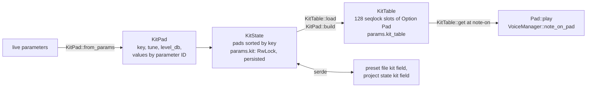

# Kit Mode

In Kit mode (Note Mode = Kit) every MIDI key can hold its own **pad**: a complete stored sound (exciter, object and every voice-level parameter) played at a fixed pitch, the key plus the pad's tune, at its own level. Keys without a pad are silent. The post chain (filter, drive, body, spread, Space, clipper, limiter) stays shared by the whole kit. This page covers the two forms a kit takes, how the audio thread reads pads without locks, how a pad voice starts and differs from a normal one, and how kits are saved and loaded. The code is `src/kit/mod.rs`; the editor's kit bar is described on [Editor](Editor).

## Two forms of a kit



The same flow, as a list:

- **`KitPad`** is a stored pad: `key` (0–127), `tune` (semitones, clamped to ±`MAX_TUNE` = 48), `level_db`, and `values`, the plain value of every pad parameter keyed by parameter ID.
- **`KitState`** is the whole kit: `pads`, sorted by key, at most one per key (`set` replaces, `clear` removes). It is `CorrosionParams::kit`, an `Arc<RwLock<KitState>>` with `#[persist = "kit"]`, so it is saved in the host's project. Only non-audio threads touch it.
- **`Pad`** is the audio-side form: plain `Copy` data with the `NoteSetup` built from the pad's values, the tune, and the level as a linear gain `10^(level_db/20)`.
- **`KitTable`** (`CorrosionParams::kit_table`, not persisted) holds one `Option<Pad>` per key in a seqlock slot. The audio thread reads it at note-on.

Turning a `KitPad` into a `Pad` (`KitPad::build`) allocates and runs the preset loader, so it only ever happens off the audio thread; the audio thread only copies finished `Pad`s.

## What a pad stores

Every parameter is a pad parameter except `NON_PAD_PARAMS`: the modes (`quality_mode`, `play_mode`, `limiter_mode`), the master section (`drive`, `output`, `width`, `body`), `ui_scale`, `sync_rate`, and every post-chain parameter (filter, Lorenz drive, chassis, spread, Space and its sub-parameters, `analog_ceiling`, `diode_softness`, `diode_asymmetry`). These act on the shared chain, so a pad can't have its own.

The four macros are stored (`PAD_MACRO_PARAMS`): their voice-side biases (masses, size, damping, brightness, rust, damage) are part of the pad's sound. The editor doesn't load them back when a pad is selected, because they also move the shared post chain.

- `KitPad::from_params(key, params, tune, level_db)` snapshots `modulated_plain_value()` of each pad parameter from `param_map()`.
- `KitPad::params()` rebuilds a full `CorrosionParams`: it serializes a default preset, overlays the stored values (rounding integers, mapping `object` through `Object`), skips IDs this build doesn't know, and parses the result with `Preset::from_json_str(...).into_params()`. Going through the preset loader clamps values exactly like a loaded file.
- `KitPad::build()` then calls `note_setup(&params, object, PlayMode::Kit)`, the same function a live note uses, so a pad and a live note can't drift apart. Because the mode passed is Kit, Drone's forced MSEG loop never applies to a pad.

## The seqlock table

The audio thread must read a pad at note-on without a lock and without seeing half a write, while the editor may assign a pad at any moment. `KitTable` is 128 `Slot`s, each a sequence counter plus the pad:

```rust
struct Slot {
    seq: AtomicU32,                                  // even: stable, odd: being written
    pad: UnsafeCell<MaybeUninit<Option<Pad>>>,
}
```

```mermaid
sequenceDiagram
    participant W as Writer (GUI, restore)
    participant S as Slot
    participant R as Reader (audio thread)
    W->>W: take the writer mutex
    W->>S: seq = seq + 1 (odd), release fence
    W->>S: volatile write of the pad
    W->>S: seq = seq + 2 (even), Release
    R->>S: before = seq (Acquire), retry if odd
    R->>S: volatile read of the pad
    R->>S: acquire fence, compare seq with before
    R->>R: equal: use the copy; else retry
```

In words:

- **Writers** (`set`, `load`) are serialised by a `Mutex` that the audio thread never takes. A write bumps the counter to odd, stores the pad with a volatile write, and bumps it to the next even value with `Release`.
- **The reader** (`get`) loads the counter with `Acquire`; if it is odd, it spins once and retries. Otherwise it copies the slot with a volatile read into a `MaybeUninit` (no validity assumed), fences, and keeps the copy only if the counter hasn't moved. It tries `READ_TRIES` = 4 times, then returns `None`: a note that races four writes in a row plays nothing rather than wait.
- `load(&KitState)` builds every pad first (allocating), then takes the mutex and rewrites all 128 slots, so keys without a pad become `None`.
- `generation()` sums the counters; it changes whenever any slot is written. The web editor uses it to notice that the kit changed and send it to its engine.
- `keys()` lists keys with a pad, through `get`.

`reads_never_see_a_torn_pad` hammers a slot from two threads; `pad_note_ons_are_alloc_free_while_pads_are_assigned` (`tests/no_alloc.rs`) checks the read path.

## How a pad plays

In Kit mode, `handle_note_event` does:

1. `kit_table.get(note)`; no pad means the note is silent.
2. `Pad::play(voices, address, key, velocity, mode_count_scale)`, with the mode-count scale from the **live** Quality Mode: quality sets CPU cost, not the pad's design.
3. `pitch_note(key)`: `key + tune`, or `None` (nothing plays) if that leaves 0..127.
4. `VoiceManager::note_on_pad` runs the same `start_voice` as a live note, with the pad's profile, size, rust, damage, exciter and controls, at `pitch_note`. The bank is built for that note, so a pad renders bit-identically to a live note at that pitch with the same parameters.
5. `Voice::mark_pad(key, gain)` then sets the voice's note back to the key, sets `pad_voice` and stores `pad_gain`.

A pad voice differs from a live one in three ways:

| | Live voice | Pad voice |
|---|---|---|
| Note it answers to | the key it sounds at | the key, while sounding at `key + tune` |
| Per-block live controls (damping, brightness, strike position, Pressure, …) | applied while held | skipped: `update_live_controls` returns early when `pad_voice` is set |
| Output gain | expression gain | expression gain × `pad_gain`, applied after the voice's ±1 clamp, in both the mono and stereo paths |

Because `pad_gain` comes after the clamp, a pad's level reaches the post chain as set. Pads loud enough to drive the diode clipper are compressed by its knee. Channel bend, pressure, the mod wheel, poly expression, note-offs and chokes reach pad voices as they do any voice ([Note Expression](Note-Expression)). A pad note-on costs about the same as a live one (0.89–0.97× in `print_pad_note_on_cost`).

## Loading and saving

| Path | How the kit travels |
|---|---|
| Host project | `kit` is a persisted field. After a restore, NIH-plug calls `initialize` again, and `Corrosion::prepare` rebuilds the table with `kit_table.load(&params.kit)`; nothing is deserialized on the audio thread. |
| Preset file | `Preset::from_params` writes the optional `kit` field only when the kit has pads; `into_params` loads it into both `params.kit` and `params.kit_table` (no field: no pads). Schema version stays "4". |
| Editor | Assign stores `KitPad::from_params` in `params.kit` and the built pad with `kit_table.set`; Clear removes both; loading a preset replaces both. |
| Web app | The editor sends the kit as JSON when `generation()` moves; the engine rebuilds its table. |
| Factory drum kits | `src/presets/factory/drums.rs` builds ten kits of 12 pads with `KitPad::from_params`; see [Factory Bank](Factory-Bank). |

**Migration.** Before pads existed, Kit mode mapped note ranges to objects. A preset (`migrate_old_kit_mode`) or project (`migrate_host_old_kit_mode`) in Kit mode with no `kit` field loads as Tonal, so it keeps sounding.

**Trap:** a preset saved in Kit mode with an empty kit writes no `kit` field (it is skipped when empty), so on loading, the same migration turns it into Tonal. A project is not affected: the persisted field is always written.

## Editor in brief

In Kit mode the editor shows a kit bar (key, Tune, Assign, Clear, Full keyboard), greys keys outside `KIT_ZONE` (36–59, the General MIDI drum zone) unless Full keyboard is on, and moves the computer keys to 36–48. Assign's tune is the last auditioned pitch minus the key. Selecting a pad loads its sound into the editor, except the macros. Details on [Editor](Editor).

## Source files

- [`src/kit/mod.rs`](https://github.com/GerMP21/Corrosion-VST/blob/main/src/kit/mod.rs): `KitPad`, `KitState`, `Pad`, `KitTable`, `NON_PAD_PARAMS`, `PAD_MACRO_PARAMS`, `KIT_ZONE`, `MAX_TUNE`.
- [`src/voice/manager.rs`](https://github.com/GerMP21/Corrosion-VST/blob/main/src/voice/manager.rs): `note_on_pad` and the shared `start_voice`.
- [`src/voice/mod.rs`](https://github.com/GerMP21/Corrosion-VST/blob/main/src/voice/mod.rs): `mark_pad`, `pad_gain`, the live-control skip.
- [`src/lib.rs`](https://github.com/GerMP21/Corrosion-VST/blob/main/src/lib.rs): the Kit branch of `handle_note_event`, `note_setup`, the table rebuild in `prepare`, `migrate_host_old_kit_mode`.
- [`src/presets/mod.rs`](https://github.com/GerMP21/Corrosion-VST/blob/main/src/presets/mod.rs): the preset's `kit` field and `migrate_old_kit_mode`.
