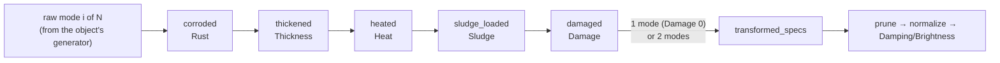

# Material Transformations

Rust, Damage, Heat, Thickness and Sludge describe the state of the metal rather than its shape. Each is a pure function from one mode spec (frequency, decay, gain) to a changed spec, applied to every mode of a freshly generated bank at note-on. Damage also adds noise in the voice while the note rings, and Heat adds a slow pitch warble. This page gives the exact formulas, the order, the bounds, and why the fundamental survives every setting.

Where this sits in the bank's construction is on [Modal Resonator](Modal-Resonator); the generators that produce the input modes are on [Objects](Objects).

## The chain



The same as a list. `ModalResonator::transform_algorithm_modes_into` runs, for each raw mode `i` of the generator's `N`:

1. `corroded(rust, i, N)`
2. `thickened(thickness, i)`
3. `heated(heat, i, N)`
4. `sludge_loaded(sludge)`
5. `damaged(damage, i, N)`, which yields one mode at Damage 0 and two otherwise

and pushes the result, stopping at `MAX_MODES`. Then the bank is pruned, normalized to one strike level, and given the live Damping and Brightness ([Modal Resonator](Modal-Resonator#building-the-bank-at-note-on)).

Points that follow from this:

- **Note-on only.** The transforms run when the bank is built. Turning Rust on a ringing note does nothing until the next note. Heat's warble is the one part that moves during the note.
- **Position weights come from the raw bank.** `w = i / (N − 1)` runs from 0 (the generator's first mode) to 1 (its last), before Damage doubles the count and before the prune. For most objects the first mode is the lowest; for Plate's grid and Tank's cavity-first list, "first" is the generator's order, not strictly the lowest frequency.
- **Every result is floored** at `f32::EPSILON` (frequency, decay and gain), so no transform produces a zero or a negative.

### Uniform gain changes are cancelled

Strike-level normalization rescales the whole bank to `STRIKE_LEVEL_REF` right after the transforms. A transform that multiplies every mode's gain by the same factor therefore has no effect on the result; only changes that differ between modes (a tilt) survive. This shapes the design:

- Rust and Heat darken by **tilting** gain towards the high modes, so the effect is kept.
- Sludge's `gain × (1 − 0.35·sludge)` is uniform, so it is cancelled. Sludge acts through pitch and decay only.
- Damage keeps notes at a comparable level for the same reason, and `quality_mode_and_damage_do_not_change_loudness` holds it within 2 dB.
- Decay changes are not cancelled: a note that dies faster is quieter over time, which is why the level sweeps below measure RMS over 2 s.

## Ranges and the bounded types

`src/dsp/transforms.rs` holds one small type per control. Each sanitizes its input once (clamp, and a non-finite value becomes the neutral one), so the transforms can trust it:

| Type | Control | Range | Neutral | Note |
|---|---|---|---|---|
| `SizeScale` | Size | ≥ 0.05 (no upper clamp in the type; the parameter stops at 10) | 1.0 | used by the generators, see [Objects](Objects#size-and-pitch) |
| `RustAmount` | Rust | 0–5 | 0 | |
| `DamageAmount` | Damage | 0–10 | 0 | the voice also clamps to 0–10 |
| `ThicknessAmount` | Thickness | 0–1 | **0.5** | 0.5 is "no change" |
| `HeatAmount` | Heat | 0–1 | 0 | |
| `SludgeAmount` | Sludge | 0–1 | 0 | |

The macros reach these before note-on (`resolve_macro_bias` in `src/lib.rs`): Corrosion adds `2·(c − 0.5)` to Rust (±1), Violence adds `4·(v − 0.5)` to Damage (±2), and Mass scales Size. The results are clamped to the parameter ranges again.

## Rust

`ModalModeSpec::corroded` models corrosion as extra damping that bites hardest on the high modes:

```text
decay ÷ (1 + rust · (0.2 + 0.54·w²))
gain  ÷ (1 + rust · 0.6·w^1.5)
frequency unchanged
```

| Rust | Fundamental (w = 0) decay | Top mode (w = 1) decay | Top mode gain |
|---|---|---|---|
| 1 | ÷ 1.2 | ÷ 1.74 | ÷ 1.6 (−4.1 dB) |
| 5 | ÷ 2 | ÷ 4.7 | ÷ 4 (−12 dB) |

- **The fundamental always rings:** its gain divisor is exactly 1 and its decay at most halves, so the low thud survives the whole 0–5 range while the highs die first.
- **Divisors, not subtractions.** Rust used to multiply by `1 − rust·k`, written for a 0–1 range; with the 0–5 range that reached zero (the top mode at Rust 1.3, the fundamental at 3.3) and silenced notes. A divisor of the form `1 + rust·k` can't reach zero.
- The fundamental's term is 0.2 (not a smaller value first designed) so that Rust audibly shortens the low modes too: removing only the highs made a note relatively *longer*.

Measured on all nine objects (C4, HandStrike, velocity 100, 2 s RMS against Rust 0): the worst change at Rust 5 is −2.84 dB (Plate), with no fundamental shift.

## Thickness

`thickened` stiffens (or softens) the walls, which spreads the partials:

```text
s     = max(0.25, 1 + (thickness − 0.5) · 0.15 · n²)     n = i + 1
freq × √s
```

- At the neutral 0.5 nothing changes.
- **Thicker (above 0.5)** pushes the upper modes sharp, progressively more with `n²`: at Thickness 1 the first mode rises by √1.075 (+63 cents) and the eighth by √5.8 (×2.41).
- **Thinner (below 0.5)** pulls them flat, but the clamp at 0.25 stops the fall at half the frequency: at Thickness 0 every mode from the fourth up is exactly halved, and the first drops by √0.925 (−68 cents).
- Thickness moves the first mode too, by up to about two thirds of a semitone either way.

## Heat

Hot metal softens. `heated` lowers the pitch slightly and darkens the spectrum:

```text
freq  × max(0.5, 1 − 0.05·heat)            (−89 cents at Heat 1)
decay ÷ (1 + heat · 0.5·w)
gain  ÷ (1 + heat · 2·w^1.5)              (top mode −9.5 dB at Heat 1)
```

Heat's darkening used to be a uniform gain cut, which the bank normalization cancelled; the tilt is what makes it audible. At Heat 1 every object's top mode is at least 6 dB further below its fundamental than at Heat 0 (`heat_darkens_the_spectrum`), and the level moves by at most −0.07 dB.

### The thermal warble

Heat also makes the pitch wander. At note-on, `rebuild_in_place` sets `heat_wander_depth = heat · HEAT_WANDER_DEPTH` (0.0046). Every sample the resonator multiplies its pitch factor by:

```text
1 + depth · (0.6·sin(2π·φ₁) + 0.4·sin(2π·φ₂))
```

with two LFO phases advancing at `HEAT_WANDER_RATES_HZ` = 0.37 and 0.83 Hz (incommensurate, so the wander doesn't sound periodic). The peak excursion is ±0.46 % at Heat 1, about ±8 cents; over 3 s the Pipe's fundamental wanders 14.4 cents peak to peak (`heat_makes_the_pitch_wander` requires at least 4, and exactly 0 at Heat 0).

Cost: any heated note takes the dynamic-retune path (`has_dynamics()` is true while the depth is above 0), which retunes the bank whenever the factor has moved by more than 0.05 cents. A Heat 1 Plate costs about 1.19× a Heat 0 Plate (16 Render voices, median of three runs), inside the 1.6× accepted for pitch dynamics. `advance_heat_wander` is `#[cold] #[inline(never)]` so unheated notes don't carry it in the hot path. See [Modal Resonator](Modal-Resonator#retuning-pitch-bend-and-dynamics).

## Sludge

`sludge_loaded` adds mass (lower pitch) and broadband loss:

```text
freq  × √(1 / (1 + sludge))      (×0.707, −6 semitones at Sludge 1)
decay × max(0.1, 1 / (1 + 1.5·sludge))      (÷2.5 at Sludge 1)
gain  × max(0.1, 1 − 0.35·sludge)           (uniform: cancelled by normalization)
```

Sludge moves pitch the most of all the transforms: half an octave at full. It treats every mode alike, so it doesn't change the timbre's balance, only its pitch and how long it rings.

## Damage

`damaged` splits each mode into a detuned primary and a quieter, shorter companion, the sound of a cracked or dented object. It returns a fixed-size iterator (`Take<array::IntoIter<_, 2>>`) rather than a `Vec`, so note-on doesn't allocate.

### The saturating amount

Damage (0–10) drives everything through:

```text
s = 3 · (1 − e^(−damage/3))
```

`s` equals `damage` near 0 (light damage keeps its original character), is 1.70 at Damage 2.5 and approaches 3 (2.89 at Damage 10). The detunes are therefore bounded, so the fundamental keeps its note, and no decay factor reaches zero.

### The split

With `p = w` (mode position, 0 to 1), `low = 1 − p`, and a direction `d` of −1 for even `i` and +1 for odd `i`:

| | Frequency | Decay | Gain |
|---|---|---|---|
| primary | `f · (1 + s·(0.004 + 0.018·p)·d)` | `decay / (1 + s·(0.04 + 0.08·low))` | `gain · (1 + s·(0.05 + 0.12·p))` |
| companion | `f · (1 − s·(0.010 + 0.030·p)·d)` | `decay · (0.28 + 0.18·low)` | `min(gain · s·(0.16 + 0.20·p), primary gain)` |

At the maximum (`s` = 2.89):

- the fundamental's primary moves by 1.2 % (about 20 cents) and its companion by 2.9 % the other way; the top mode's primary by 6.4 % and its companion by 11.6 %. Alternating directions keep neighbouring modes from all drifting the same way.
- the fundamental's primary decay drops to 0.74 of its value; companions ring 0.28–0.46 as long as the original, so the split is most audible in the attack.
- the companion's gain is capped at the primary's, so a companion never dominates.

Any Damage above 0 doubles the mode count (`damage_splits_modes`), which is why `MAX_MODES` is twice `MAX_RAW_MODES`. Measured on all nine objects: the worst level change over Damage 1–10 is −3.23 dB (Industrial Cog at 10), and the largest fundamental shift 0.55 semitones (`damage_keeps_the_note` allows 1 semitone and 6 dB).

### The rattle

Damage is the only transform with a per-sample part, and it lives in the voice, not the resonator. `Voice::rattle_noise(level)` adds white noise gated by the resonator's output level:

```text
d         = min(damage, 1)
threshold = 0.02 + (1 − d) · 0.15
rattle    = 0                                       if level < threshold
          = 0.5 · noise · d · (level − threshold) · 0.08   otherwise
```

- The noise is the voice's `rattle_noise` generator (xorshift32, reseeded per note with salt 0; see [DSP Utilities](DSP-Utilities#noise)) through `rate::white_noise`, so its level in the audible band doesn't depend on the sample rate.
- It saturates at Damage 1: higher Damage changes the split, not the rattle.
- The same value goes to both channels and then through the voice's brightness high-pass and clamp. Decorrelating or filtering it was deliberately not done, since it would change the sound.

`tests/damage_rattle.rs` checks that heavy damage adds energy, that Damage 0 adds none, and that the rattle follows the signal.

## Why the fundamental survives

Each transform protects the first mode by construction:

| Transform | What keeps the fundamental |
|---|---|
| Rust | gain divisor is 1 at w = 0; decay divisor at most 2 |
| Thickness | `n² = 1`, so the first mode moves at most about ±65 cents |
| Heat | gain and decay divisors are 1 at w = 0; pitch −5 % at most |
| Sludge | same factor on every mode, so the lowest stays lowest |
| Damage | saturating amount; first-mode detunes ≤ 1.2 % / 2.9 %; decay ≥ 0.74× |

The tests in `src/voice/mod.rs` (`material_transform_tests`) sweep each control on all nine objects with a HandStrike C4 at velocity 100 and fail if a render goes silent, its lowest mode moves more than a semitone, or its 2 s RMS falls more than 6 dB below the control at 0:

- `rust_never_silences_or_loses_the_fundamental` (Rust 1–5)
- `rust_shortens_high_modes_more`
- `damage_keeps_the_note` (Damage 1–10)
- `damage_splits_modes`
- `heat_darkens_the_spectrum`
- `heat_makes_the_pitch_wander`

Older checks render the legacy table path: `rust_*` and `damage_*` in `src/dsp/tests.rs`, `tests/plugin_metrics.rs` (more Rust → less brightness, more Damage → more roughness), and the unit tests in `src/dsp/profile.rs`. The golden fixture builds every bank with Rust 0.4, Heat 0.2, Thickness 0.3 and Sludge 0.1, so any change to these formulas changes all 108 hashes ([Modal Resonator](Modal-Resonator#the-golden-mode-bank-fixture)).

*History:* [`openspec/changes/archive/2026-11-09-fix-rust-damage-heat-response`](https://github.com/GerMP21/Corrosion-VST/tree/main/openspec/changes/archive/2026-11-09-fix-rust-damage-heat-response) has the before and after measurements per object.

## Source files

- [`src/dsp/transforms.rs`](https://github.com/GerMP21/Corrosion-VST/blob/main/src/dsp/transforms.rs): the bounded control types `SizeScale`, `RustAmount`, `DamageAmount`, `ThicknessAmount`, `HeatAmount` and `SludgeAmount`.
- [`src/dsp/profile.rs`](https://github.com/GerMP21/Corrosion-VST/blob/main/src/dsp/profile.rs): the transforms themselves, as `ModalModeSpec` methods (`corroded`, `thickened`, `heated`, `sludge_loaded`, `damaged`).
- [`src/dsp/resonators/core.rs`](https://github.com/GerMP21/Corrosion-VST/blob/main/src/dsp/resonators/core.rs): the order they run in (`transform_algorithm_modes_into`) and Heat's warble (`HEAT_WANDER_DEPTH`, `heat_wander_factor`).
- [`src/voice/mod.rs`](https://github.com/GerMP21/Corrosion-VST/blob/main/src/voice/mod.rs): the Damage rattle and the transform sweep tests.
- [`src/lib.rs`](https://github.com/GerMP21/Corrosion-VST/blob/main/src/lib.rs): the macro offsets on Size, Rust and Damage (`resolve_macro_bias`).
- [`tests/damage_rattle.rs`](https://github.com/GerMP21/Corrosion-VST/blob/main/tests/damage_rattle.rs): the rattle tests.
