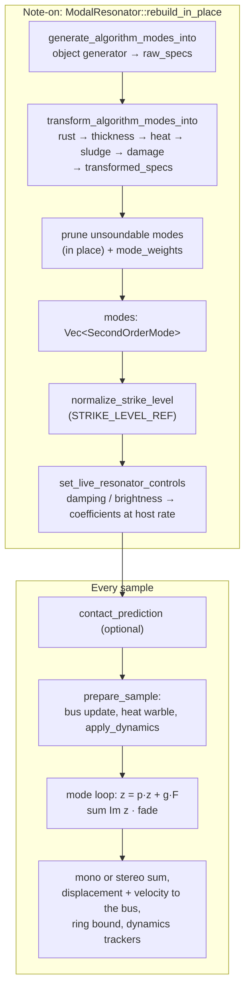

# Modal Resonator

Every note in Corrosion rings through a `ModalResonator`: a bank of damped two-pole resonators ("modes"), one per partial of the struck object. The exciter pushes a force into the bank each sample, every mode rings at its own frequency and decay, and the sum is the voice's dry signal. This page covers how the bank is built at note-on, how it runs per sample, and the rules that keep it allocation-free, cheap and stable.

Which modes an object gets (frequencies, decays, gains) is the subject of [Objects](Objects); how Rust, Damage, Heat and the other material controls bend them is [Material Transformations](Material-Transformations). The force path in and the displacement path out are described on [Interaction Bus and Contact](Interaction-Bus-and-Contact).

## Overview



The same flow as a list:

1. **Note-on** (`ModalResonator::rebuild_in_place`, called from `Voice::note_on_with_controls`):
   1. The object's generator writes raw mode specs into `raw_specs`.
   2. The material transforms run per mode into `transformed_specs`; Damage can double the count.
   3. Modes that can never sound are dropped in place; each kept mode records its brightness weight in `mode_weights`.
   4. `modes` is refilled with one `SecondOrderMode` per kept spec.
   5. The whole bank is scaled to one strike level (`normalize_strike_level`).
   6. Live Damping and Brightness are applied and the coefficients are built once, at the voice's sample rate.
2. **Per sample** (`ResonatorCore::process_sample` or `process_sample_stereo`):
   1. Optionally, an exciter asks for `contact_prediction` first (contact exciters only).
   2. `prepare_sample` runs once: the interaction bus updates its strike weights, the heat warble advances, and `apply_dynamics` retunes the modes if the pitch factor moved.
   3. The mode loop advances every mode by one sample and sums the outputs.
   4. Displacement and velocity go back to the bus; the ring bound and the dynamics trackers update.

## One mode: `SecondOrderMode`

### The coupled form

Each mode is a complex one-pole filter, which is the same thing as a damped two-pole resonator written as a rotation:

```text
z[n] = p·z[n−1] + g·x[n]          output = fade · Im z[n]
p = r·e^{iω}                       ω = 2π·f / fs
g = b0·(sin ω / ω)·(cot ω + i)     r = exp(−1 / (τ·fs))
b0 = gain · (48 000 / fs)²
```

`f` is the mode's frequency in hertz, `τ` its `decay_seconds` (a 1/e time constant, so T60 ≈ 6.9·τ), `gain` its spec gain. `CoupledCoefficients::with_phasor` computes all of this in `f64` and rounds once to the `f32` fields `pole_re`, `pole_im`, `gain_re`, `gain_im`. `SecondOrderMode::process` is then four multiply-adds:

```rust
let z_re = c.pole_re * self.z_re - c.pole_im * self.z_im + c.gain_re * excitation;
let z_im = c.pole_re * self.z_im + c.pole_im * self.z_re + c.gain_im * excitation;
```

Why this form rather than a direct-form biquad (`ResonatorCoefficients`, still used by the legacy body resonator on [DSP Utilities](DSP-Utilities)):

- **Retuning can't pump energy in.** Changing `ω` rotates the state `z` without changing its magnitude. The sheet-metal warp, the cable's tension drop and pitch bend all retune modes every sample; in direct form the sheet warp diverged.
- **Low modes stay accurate in `f32`.** The frequency is carried by `r·sin ω` rather than by `a1 = −2r·cos ω ≈ −2`, which loses its low bits for long, low modes at high sample rates. The test `sustained_level_does_not_depend_on_sample_rate` runs up to 192 kHz because the old form cost Tank's long cavity mode about 1.5 dB there.

### Level that doesn't depend on the rate

The impulse response is `(b0/ω)·rⁿ·sin(ω(n+1))`: the direct-form biquad's response times `sin ω / ω`. The ring amplitude is therefore `b0/ω`, the continuous oscillator's, instead of the discrete `b0/sin ω`, which grew without bound near Nyquist.

The `(48 000 / fs)²` input scale exists because each mode stands in for a force-driven oscillator, whose discretized force term scales with `dt²`. Without it a force lasting a fixed time rang the mode at a level proportional to `fs²` (+12 dB at 96 kHz). At 48 kHz the factor is exactly 1 (`REFERENCE_SAMPLE_RATE` = 48 000), which `input_gain_is_unchanged_at_48k` checks bit for bit. See [Sample Rate Rule](Sample-Rate-Rule).

### The top of the band

`band_fade(frequency_hz, sample_rate)` weights each mode's output:

| Region | Weight |
|---|---|
| below `0.9 · top` | 1 |
| between `0.9 · top` and `top` | raised cosine from 1 to 0 |
| at or above `top` | 0 |

`top = min(BAND_TOP_HZ, 0.45 · fs)`, with `BAND_TOP_HZ` = 20 000 Hz: 18–20 kHz at 48 kHz, 17.86–19.85 kHz at 44.1 kHz. The fade is evaluated from the mode's *current* frequency, so a mode bent across the top fades instead of clicking (`a_mode_swept_through_the_top_of_the_band_does_not_click` sweeps one from 16 to 22 kHz), and nothing near Nyquist is heard as an alias.

### What a mode stores

`SecondOrderMode` holds:

| Field | Purpose |
|---|---|
| `spec: ModalModeSpec` | current frequency, decay and gain |
| `base_frequency_hz` | note-on frequency; every retune scales from it, so pitch effects never compound |
| `base_decay_seconds`, `base_gain` | note-on values before Damping and Brightness, so live automation re-derives rather than compounds |
| `coefficients: CoupledCoefficients` | pole, input gain, `fade`, plus `gain_norm` (`|g|`) and `highpass_response` for the ring bound |
| `cached_sample_rate` | the rate the coefficients were built for |
| `z_re`, `z_im` | the state |

### `ensure_rate` and its cold rebuild

`process` calls `ensure_rate(sample_rate)` first, for every mode, every sample. Only the comparison is inlined:

```rust
#[inline]
fn ensure_rate(&mut self, sample_rate: u32) {
    if self.cached_sample_rate != Some(sample_rate) {
        self.rebuild_for_rate(sample_rate);
    }
}

#[cold]
#[inline(never)]
fn rebuild_for_rate(&mut self, sample_rate: u32) { /* CoupledCoefficients::for_mode */ }
```

The rebuild is kept out of line on purpose. When it was inlined into the per-sample loops, its size (which changes with any edit to the coefficient code) moved plain notes by up to 30 % in the benchmarks with bit-identical output: pure code placement. Since the voices are rated for the host rate before they play (see [Sample Rate Rule](Sample-Rate-Rule)), the rebuild branch normally never runs during a note.

**Trap:** don't add work to `ensure_rate`'s hot side, and keep any new rare branch in the mode loop `#[cold] #[inline(never)]`. Compare an output hash of the benchmark scenario before and after when a benchmark moves without a reason; see [Benchmarks and Performance](Benchmarks-and-Performance).

## The per-sample loop

`process_sample` (mono) and `process_sample_stereo` share one structure. For mode `i` with strike-position coefficient `c_i` (from the interaction bus) and Coupling Stiffness `k`:

```text
force_i   = x·(1 − k) + x·c_i·k          (blend of feed-forward and position-weighted force)
y_i       = mode_i.process(force_i)
mono      = Σ y_i
displacement = Σ y_i · c_i               (what the exciter sees)
velocity  = (displacement − previous) · fs / 48 000
```

Velocity is reported in displacement per 48 kHz sample, the unit the exciters' contact laws assume, and exactly the plain difference at 48 kHz.

In stereo, each mode is panned by its index: `pan = clamp(width · i/N · (±1), −1, 1)` with the sign alternating between even and odd modes, and gains `0.5·(1 − pan)` and `0.5·(1 + pan)`. The two gains sum to 1, so `left + right` is the mono sum. A bank with no modes returns silence.

The loop also does three optional jobs, each behind a flag so a plain note pays nothing for them:

- **Dynamics trackers** (only when `has_dynamics()`): `Σ|y_i|` and the sum of the three lowest modes feed one-pole trackers (`dyn_amplitude`, pole 0.99; `dyn_lf_displacement`, pole 0.95, per 48 kHz sample) that drive the cable and sheet pitch effects. `track_dynamic_state` keeps the exact literals `0.01` and `0.05` at 48 kHz (`1 − 0.99` isn't exactly `0.01` in `f32`) and converts the poles with `rate::decay` elsewhere.
- **Ring bound** (only while the voice's drive governor needs it, `set_ring_tracking`): see below.
- **Velocity and displacement** for the bus, always.

The `match self.profile` at the end of `process_sample` returns the same `mode_sum` for every object; it is a leftover hook with no per-object behaviour.

### Why the loop's data is kept small

`SecondOrderMode` is iterated for every mode of up to 16 voices every sample, and that working set sits near the size of the L1 cache. Anything a mode needs only occasionally lives in a parallel `Vec` on `ModalResonator`, indexed like `modes`:

| Parallel `Vec` | Holds | Used when |
|---|---|---|
| `mode_weights` | each mode's brightness weight from the *unpruned* bank (0 for the first, 1 for the last) | live Damping/Brightness changes |
| `retune_cache` | one `RetuneCache` per mode: pole radius, `b0`, `ω`, `2π/fs`, `1/ω`, `sin ω`, `cos ω`, a rotation counter and the angle the ring-bound terms were computed at | pitch bend and dynamics retunes |

**Trap:** adding a field to `SecondOrderMode` makes every mode of every voice bigger in the hottest loop of the engine. Put it in a parallel `Vec` unless the loop reads it every sample.

### Contact prediction and the ring bound

Two queries let other parts of the voice look one sample ahead without running the loop twice:

- **`contact_prediction`** returns a `ContactPrediction`: this sample's contact displacement as an affine function of this sample's force, `D = free + compliance·F`, with `free = Σ w_i·fade_i·Im(p_i·z_i)` and `compliance = Σ w_i·b_i·fade_i·gain_im_i`. It runs `prepare_sample` and sets `prepared`, so `process_sample` doesn't prepare the same sample twice. Contact exciters solve their contact with it; see [Interaction Bus and Contact](Interaction-Bus-and-Contact).
- **`ring_bound`** returns a `RingBound { level, per_force }`. Each mode rings at `|z_i|` and reaches the output through its fade and the voice's brightness high-pass boost, so `level = Σ fade_i·(1 + boost·|H(ω_i)|)·|z_i|` bounds every later sample without new force, and `per_force` is how much one unit of force can raise it. The exact sum (a square root per mode) runs on one sample in `RING_EXACT_INTERVAL` = 8; in between, the bound grows by `per_force·|force|`, which stays an upper bound because the modes only decay. The voice's drive governor uses it to cap the force; see [Exciters](Exciters). Over a 27-note sweep the bound is 1.0–1.5× the actual peak for most notes and at most about 3× (code comment on `RingBound`).

`OUTPUT_HIGHPASS_POLE` (0.8 at 48 kHz) is shared with the voice so the bound weights each mode by the same high-pass the voice applies before its clamp.

## Building the bank at note-on

### Buffer sizes: MAX_MODES and MAX_RAW_MODES

Note-on runs on the audio thread, so it must not allocate. Every buffer is sized once for the worst case:

| Constant | Value | Meaning |
|---|---|---|
| `MAX_BASE_MODE_COUNT` | 12 | the largest profile table (Industrial Cog), computed at compile time from `ALL_PROFILES` |
| `MAX_MODE_COUNT_SCALE_INT` | 4 | upper clamp on the quality multiplier (an integer, so the bound is exact) |
| `MAX_RAW_MODES` | 48 | `12 × 4`: most modes a generator may emit |
| `MAX_MODES` | 96 | `48 × 2`: Damage can add a companion to every mode |

`ModalResonator::with_note_capacity` reserves `MAX_MODES` for `modes`, `raw_specs`, `transformed_specs`, `mode_weights`, `retune_cache` and the interaction bus's coefficient buffer. A `debug_assert!` in `rebuild_in_place` fires if a generator exceeds `MAX_RAW_MODES`, and `transform_algorithm_modes_into` stops at `MAX_MODES` so a buffer never grows. `note_on_banks_fit_max_modes` checks the generators' raw counts and the untruncated damage expansion at extreme character values and scales up to 100 (truncation would make a check of the final bank pass vacuously). `tests/no_alloc.rs` checks note-on end to end; see [Real Time Safety](Real-Time-Safety).

### Mode count and quality

The generator is asked for `round(base × scale)` modes, where `base` is the object's profile-table length (`ModalProfile::mode_count`) and `scale` is the quality mode's multiplier, clamped to 0.25–4:

| Quality mode | `mode_count_scale` (`quality_mode_count_scale` in `src/lib.rs`) |
|---|---|
| Eco | 0.5 |
| Normal | 1.0 |
| High | 1.5 |
| Render | 2.0 |

The scale is captured at note-on; a held note keeps its bank when the quality changes. Two objects don't follow the multiplier fully (see [Objects](Objects)): Industrial Cog always builds 6 split pairs (12 modes) at Eco through Render, and Pipe's decay formula leaves at most 9 soundable modes, so its High and Render banks are the same size.

### `rebuild_in_place`

`rebuild_in_place` takes the profile, Size, the five material amounts, the target frequency (`midi_to_hz(note)`), Damping, Brightness, the `CharacterParams`, the mode-count scale and the sample rate. Besides the steps in the overview it resets the per-note state: interaction bus, ring tracking, dynamics trackers, pitch-bend factor (back to 1; the voice re-applies the channel bend right after), heat warble depth and phases, `applied_factor`, and `retune_cache_rate = 0` so the retune cache is rebuilt on first use.

`with_algorithm_controls_and_note` builds a fresh resonator through the same function, and `rebuilding_a_reused_resonator_matches_a_fresh_one` checks that one long-lived resonator, rebuilt for every object, quality and damage case in turn, matches a fresh build exactly.

There is a second, older constructor path, `ModalResonator::from_profile` (`with_profile`, `with_profile_and_size`, `with_profile_size_and_rust`, …). It builds the bank from the static profile tables with `ModalProfile::scaled_mode_specs_extended`. The plugin only uses it to create a voice's initial (silent) resonator; the offline comparison renders in `src/offline/mod.rs` and some tests in `src/dsp/tests.rs` still render through it. New code should use the algorithmic path.

**Stale fields:** `ModalResonator` still carries `size_scale`, `rust_amount`, `damage_amount`, `thickness_amount`, `heat_amount` and `sludge_amount` (`#[allow(dead_code)]`). `rebuild_in_place` resets them to their defaults rather than recording the note's values, so don't read them.

### Pruning unsoundable modes

After the transforms and before the bank is filled, every mode that can never be heard is dropped (`mode_can_sound`):

- its frequency is at or above `PRUNE_MAX_FREQUENCY_HZ` = 80 000 Hz: the band top (20 kHz) at the lowest pitch a note can be tuned to (×0.25, −24 semitones). Object dynamics only raise pitch, so such a mode can't reach the band during the note. The limit is in hertz, so the bank is the same at every sample rate;
- or its decay is under `PRUNE_MIN_DECAY_SECONDS` = 0.1 ms, gone within about five samples at 48 kHz. Pipe's decay formula `1.5 − 0.15·n` goes negative from the 10th mode on, and the transforms' `max(f32::EPSILON)` rescue lands such modes here.

The prune compacts `transformed_specs` in place. Each kept mode keeps its brightness weight from the full bank (`brightness_weight(index, full_count)` into `mode_weights`), so dropping modes doesn't re-tilt the ones that stay. A pitch bend never rebuilds the bank, so a bent note keeps every mode it started with (`retuning_down_keeps_the_bank`).

At Size 1, measured over C2/C4/C6, every quality and Damage 0 and 1, only Pipe (27 of 270 modes, its dead decays) and Sheet Metal (36 of 360, its `n²` series) lose modes; the other objects only reach 80 kHz at small sizes (at Size 0.05, C6, Render, Plate keeps 2 of 16). `print_unsoundable_mode_counts` (ignored) prints the table; `every_bank_has_only_soundable_modes` and `small_high_pipe_has_only_soundable_modes` guard the rule. The prune changed note levels by at most +0.003 dB.

`prune_enabled` is a test-only switch to compare with the full bank.

*History:* [`openspec/changes/archive/2026-11-08-h11-prune-unsoundable-modes`](https://github.com/GerMP21/Corrosion-VST/tree/main/openspec/changes/archive/2026-11-08-h11-prune-unsoundable-modes).

### Strike-level normalization

Every note-on bank is scaled so its estimated strike level equals `STRIKE_LEVEL_REF` = 0.594 266 06, the level of the default patch's bank (Pipe, C4, default controls, after the transforms). Objects, pitches, quality modes, Damage and character settings then all strike at one level, while the relative mode gains, and so the timbre, are kept.

`strike_level_estimate` computes, at 48 kHz:

```text
A_i  = | w_i · fade_i · gain_i / ω_i |        (mode i's ring amplitude under a unit impulse)
level = ‖A‖_1.3 = (Σ A_i^1.3)^(1/1.3)
```

`w_i = (1 − k) + c_i·k` is the same force weight the loop applies. The true peak of the sum lies between the incoherent `‖A‖₂` and the fully coherent `‖A‖₁`; p = 1.3 tracks the measured peak within about 4.3 dB over every object, C2–C6, Eco–Render and Damage 0–1. It is O(modes) and allocation-free. `normalize_strike_level` then multiplies every mode's `gain` and `base_gain` by `STRIKE_LEVEL_REF / level` (skipped if the level isn't finite and positive).

Consequences worth knowing:

- Normalization runs before live Damping and Brightness and at the note-on strike position, so those controls (and a later strike-position change) still change the level, as they should.
- **A transform that scales every mode by the same factor is cancelled.** Only gain changes that differ between modes (a tilt) survive. That is why Heat darkens with a tilt instead of a uniform cut, and why Sludge's uniform gain loss has no effect on level; see [Material Transformations](Material-Transformations).

Guards: `loudness_does_not_depend_on_pitch` (C2 and C6 within 3 dB of C4), `objects_are_comparably_loud` (all nine objects within 6 dB), `quality_mode_and_damage_do_not_change_loudness` (Render vs Eco and Damage 1 vs 0 within 2 dB).

### Live Damping and Brightness

`set_live_resonator_controls(damping, brightness, sample_rate)` runs at note-on and once per buffer for held notes (`Corrosion::begin_block` → `VoiceManager::update_live_controls` → `Voice::update_live_controls`, which skips released voices and kit pads, so tails keep the timbre they had). For each mode, `SecondOrderMode::set_damping_brightness` re-derives from the base values:

```text
decay = base_decay · max(0.1, 1 + (0.5 − damping)·1.2)          (×1.6 at 0, ×1 at 0.5, ×0.4 at 1)
gain  = base_gain  · max(0.1, 1 + (brightness − 0.5)·(0.5 + w))  (w = mode_weights[i])
```

and rebuilds the coefficients (one `exp` and one `sin_cos` per mode). It also marks the retune cache's radii stale. It mirrors `ModalModeSpec::adjusted_for_controls`, so automating a held note matches capturing the same values at note-on.

## Retuning: pitch bend and dynamics

Three things change a ringing bank's pitch:

- **pitch bend and per-note tuning:** `set_pitch_bend_factor(factor)` from `Voice::apply_pitch`, clamped to 0.25–4 (±24 semitones); see [Note Expression](Note-Expression);
- **object dynamics:** Taut Cable's tension drop and Sheet Metal's warp (the `Dynamics` enum, kept from the generator);
- **Heat's thermal warble:** two slow LFOs, see [Material Transformations](Material-Transformations).

`target_pitch_factor()` multiplies all three. `has_dynamics()` is true for a dynamic object, a bend factor away from 1, or a heated note; only then does `prepare_sample` call `apply_dynamics` and the loop run the trackers.

### `apply_dynamics`

`apply_dynamics` is `#[inline(never)]`: it only runs for bent or dynamic notes, and inlined into the per-sample path it slowed plain notes by about 25 %. Each call:

1. computes the target factor;
2. **skips** if it is within `RETUNE_TOLERANCE` = 2.8 × 10⁻⁵ of `applied_factor`, the factor the coefficients were last built for (just under 0.05 cents, leaving room for `f32` rounding). A held bend gives the same factor every sample, so it costs nothing after the first;
3. otherwise refreshes `retune_cache` if needed and calls `retune_incremental(base × factor)` on every mode.

`retune_incremental` avoids transcendental calls:

- The angle is recomputed exactly from the frequency (`f · 2π/fs`), so it never drifts.
- Its sine and cosine are **rotated** by the angle step with a fifth-order Taylor rotation (error about 1e-24 at the largest allowed step), and `1/ω` is updated to second order, with no division (the reciprocals `1/6`, `1/20`, `1/24` are constants: a float division by a constant isn't turned into a multiplication).
- An exact `sin_cos` refresh runs every `RETUNE_EXACT_EVERY` = 256 rotations, or when the step exceeds `RETUNE_MAX_ROTATION` = 1e-3 rad (a fast bend).
- Only the pole, input gain and band fade are rewritten. `|g|` and the high-pass response feed only the ring bound, so they are recomputed once the angle has moved by `RETUNE_BOUND_REFRESH` (6 × 10⁻⁴, about 1 cent) since they were last computed; a bound that stale is far inside the governor's 10 % margin.

`set_pitch_bend_factor` instead uses `retune_exact`, which reuses the cached radius but calls `sin_cos`, and is bit-identical to building the coefficients from scratch. `refresh_retune_cache` rebuilds the whole cache for a new bank or rate, or only the radii and input gains after live damping.

Measured cost (median of 5 within-run ratios, `scripts/bench_ratios.py`): a held +2-semitone bend costs 1.019× a plain note (bound 1.1×; it was about 5× before the skip), and Taut Cable dynamics cost 1.535× its static twin (bound 1.6×). A Heat 1 Plate costs about 1.19× Heat 0.

`retune_skip_enabled` is a test-only switch that restores rebuilding every mode every sample. Tests:

- `held_bend_is_bit_identical_to_rebuilding_every_sample`: every static object, and Taut Cable with no tension drop.
- `moving_dynamics_stay_in_tune`: every mode of Taut Cable and Sheet Metal stays within 0.05 cents of `base × factor` at every sample, both in its spec and in the angle of the `f32` pole it actually rings at.

*History:* [`openspec/changes/archive/2026-11-08-h12-skip-redundant-mode-retunes`](https://github.com/GerMP21/Corrosion-VST/tree/main/openspec/changes/archive/2026-11-08-h12-skip-redundant-mode-retunes).

## The golden mode-bank fixture

`mode_banks_match_golden_fixture` pins the note-on banks. It builds 108 banks, 9 objects × 4 quality scales (0.5, 1, 1.5, 2) × Damage 0, 0.5 and 1, each at C4 (261.63 Hz) with Size 1.2, Rust 0.4, Thickness 0.3, Heat 0.2, Sludge 0.1, Damping 0.45 and Brightness 0.6 so every transform reaches the hash. Each line of [`tests/fixtures/mode_bank_hashes.txt`](https://github.com/GerMP21/Corrosion-VST/blob/main/tests/fixtures/mode_bank_hashes.txt) is the case, its mode count and an FNV-1a hash of every mode's spec and base values:

```text
Pipe scale=1 damage=0 modes=6 0x447e9824ddc65b36
```

- **Regenerate it only for an intended sound change:** `CORROSION_UPDATE_GOLDEN=1 cargo test mode_banks_match_golden`, then add the reason to the doc comment above the test in `src/dsp/resonators/core.rs` (it lists every past re-capture).
- The hashes come from the platform's libm (`sin`, `exp`, `powf`). gnu and musl agree; macOS rounds differently, so the test is ignored off Linux.
- A changed mode count with an unchanged frequency formula usually means the prune or `MAX_MODES` moved.

## Source files

- [`src/dsp/resonators/mod.rs`](https://github.com/GerMP21/Corrosion-VST/blob/main/src/dsp/resonators/mod.rs): the resonator module's exports (`ModalResonator`, `SecondOrderMode`, `ResonatorCore`, the generators).
- [`src/dsp/resonators/core.rs`](https://github.com/GerMP21/Corrosion-VST/blob/main/src/dsp/resonators/core.rs): `ModalResonator`, `SecondOrderMode`, the coupled coefficients, `rebuild_in_place`, the prune, normalization, retuning, contact prediction, the ring bound and their tests.
- [`src/dsp/resonators/basic.rs`](https://github.com/GerMP21/Corrosion-VST/blob/main/src/dsp/resonators/basic.rs): the `ResonatorAlgorithm` trait every generator implements, and the Pipe, Plate, Tank and Chain generators.
- [`tests/fixtures/mode_bank_hashes.txt`](https://github.com/GerMP21/Corrosion-VST/blob/main/tests/fixtures/mode_bank_hashes.txt): the golden note-on bank hashes.
- [`src/dsp/profile.rs`](https://github.com/GerMP21/Corrosion-VST/blob/main/src/dsp/profile.rs): `ModalModeSpec` and the profile tables whose length sets the base mode count.
- [`src/voice/mod.rs`](https://github.com/GerMP21/Corrosion-VST/blob/main/src/voice/mod.rs): `Voice::note_on_with_controls`, the caller of `rebuild_in_place`, and the governor that reads the ring bound.
- [`openspec/changes/archive/2026-11-08-h12-skip-redundant-mode-retunes/design.md`](https://github.com/GerMP21/Corrosion-VST/blob/main/openspec/changes/archive/2026-11-08-h12-skip-redundant-mode-retunes/design.md): the retune benchmark measurements quoted above.
