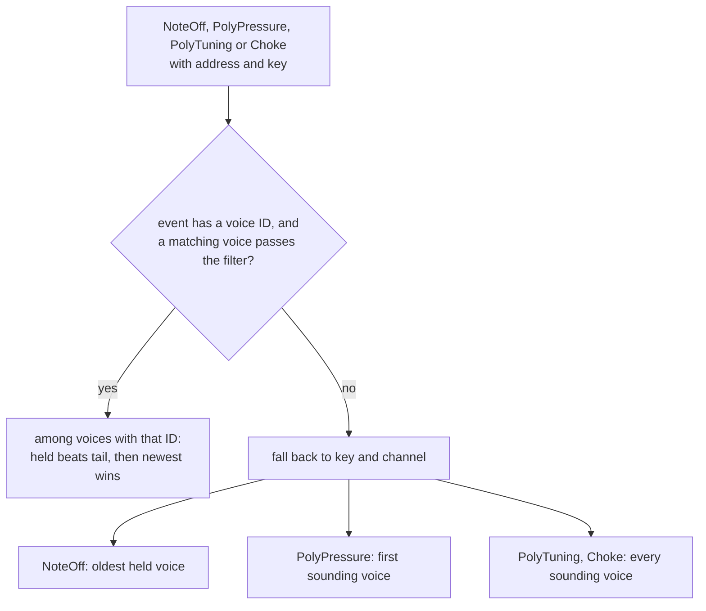

# Note Expression

Besides note-on and note-off, a host can shape a note while it plays: channel pitch bend, channel and per-note pressure, the mod wheel, per-note tuning (CLAP and VST3 note expressions, MPE-style hosts) and a choke that silences one note. This page explains how Corrosion finds the voice an event is meant for, and what each kind of expression does to it.

The code is in `VoiceManager` (`src/voice/manager.rs`), the voice's expression fields (`src/voice/mod.rs`) and the event routing in `handle_note_event` (`src/lib.rs`).

## Addressing a voice

Several notes can share a key: a repeated note whose first instance is still ringing, two channels playing the same pitch, a kit pad and its tail. A per-note event must reach the right one. Hosts that support per-note expression give each note a **voice ID** (CLAP note IDs, VST3 note IDs); plain MIDI gives only the key and channel. NIH-plug passes both in each `NoteEvent`, and Corrosion bundles them as:

```rust
pub struct NoteAddress {
    pub voice_id: Option<i32>,
    pub channel: u8,
}
```

At note-on, `VoiceManager::note_on_addressed` starts a voice and calls `Voice::set_address(voice_id, channel)`; the voice keeps both for its whole life. Later events find their voice with one rule:



The same rule, as steps:

1. **By voice ID.** `voice_with_id` looks for voices whose stored ID equals the event's, among those that pass a filter (held voices for a note-off; sounding voices for the others). If several match, the held one wins over a tail, then the newest (`max_by_key((is_active, start_frame))`).
2. **By key and channel**, when the event has no ID or no voice carries it:

| Event | Voices it reaches by key and channel |
|---|---|
| `NoteOff` | the oldest held, non-pedal-held voice on that key and channel (first in, first out) |
| `PolyPressure` | the first sounding voice on that key and channel |
| `PolyTuning` | every sounding voice on that key and channel |
| `Choke` | every sounding voice on that key and channel |

**Why "held beats tail":** Corrosion sends no voice-terminated event back to the host, so a host may reuse a voice ID while the old note's tail still rings. The note the host means is the held one (`reused_id_addresses_the_held_note_not_the_tail`).

**Plain MIDI.** With no IDs, a note-off matches key and channel. A note on channel 3 is not released by a note-off on channel 0. Notes played from the editor's keyboard are channel 0 with no ID.

**Kit pads** sound at `key + tune` but store the key as their note (`Voice::mark_pad`), so note-offs and expression on the key reach them.

## Channel expression

Channel-wide messages are stored in the manager, applied to every sounding voice, and given to each new voice at note-on (`apply_channel_expression_to`), so a note started while the wheel is up or the bend is held starts with them.

| Message | Range in | Stored as | Effect on the voice |
|---|---|---|---|
| Pitch bend (`MidiPitchBend`) | 0..1, 0.5 centre | `(v − 0.5)·2·2` semitones (`PITCH_BEND_RANGE_SEMITONES` = 2) | retunes the mode bank (below) |
| Channel pressure (`MidiChannelPressure`) | 0..1 | clamped 0..1 | output gain (below) |
| Mod wheel (CC1) | 0..1 | clamped 0..1 | output gain (below) |

Channel MPE (one channel per note, with bend and pressure per channel) is not supported: channel bend, pressure and CC1 are global to the plugin, whatever channel they arrive on. Per-note control goes through voice IDs and the per-note events.

## Pitch: bend plus per-note tuning

Each voice holds `pitch_bend_semitones` (the channel's) and `note_tuning_semitones` (its own, from `PolyTuning`). `Voice::apply_pitch` adds them and converts:

```text
factor = 2^(clamp(bend + tuning, −24, +24) / 12)
```

(`pitch_bend_semitones_to_factor`), then `ModalResonator::set_pitch_bend_factor(factor)`:

- the factor is clamped to 0.25..4 (±24 semitones);
- a factor within 1e-6 of the current one returns at once, so a held bend or a repeated tuning value costs nothing;
- otherwise every mode is retuned from its base frequency (`retune_exact`), rotating its complex state without changing its magnitude, so a bend can't pump energy into the mode ([Modal Resonator](Modal-Resonator)).

The bank is never rebuilt by a bend: the modes a note started with are the modes it keeps. A `PolyTuning` with a non-finite value is ignored. Tuning resets to 0 at each note-on; the bend does not (it is the channel's).

Tests: `tuning_retunes_only_the_addressed_note`, `tuning_adds_to_the_channel_bend`, `tuning_by_id_moves_one_of_two_same_key_notes` in `src/lib.rs`.

## Pressure and mod wheel

Pressure and the mod wheel scale a voice's output after its ±1 clamp (`Voice::expression_gain`):

```text
gain = 1 + 0.5·max(channel pressure, poly pressure) + 0.3·mod wheel
```

- Full pressure is ×1.5 (+3.5 dB), the full wheel ×1.3 (+2.3 dB), both ×1.8 (+5.1 dB).
- Taking the maximum of channel and poly pressure lets classic aftertouch and per-note pressure reach the same destination without adding up.
- Applied after the clamp, the gain lets a note swell without distorting the resonator path; the clipper and limiter downstream take any excess.
- Poly pressure resets to 0 at each note-on; channel pressure and the wheel persist.

This is separate from the **Pressure parameter** (`exciter_pressure`), which scales the exciter's force before the resonator and is a host parameter, not MIDI ([Exciters](Exciters)).

## Choke

A host `Choke` stops a note fast, for example a closed hi-hat cutting an open one. `Voice::choke`:

1. Does nothing if the voice is idle or already choking.
2. Calls `note_off` (not through the pedal, so a down pedal doesn't hold it).
3. Sets `choke_remaining` to `CHOKE_FADE_FRAMES`: 96 at 48 kHz, converted with `rate::frames`, so it is 2 ms at any rate (88 at 44.1 kHz), at least 1.

Every following sample, the voice's frame is scaled by `choke_gain`: the counter drops by one and the gain is `remaining / total`, linear from just under 1 to exactly 0 on the last sample, after which the voice resets to idle. `choke_gain` is `#[cold]` and `#[inline(never)]` because it runs only for 2 ms after a choke; the hot loop pays one comparison. The fade applies after the voice's own tail tracking.

Tests: `choke_fades_within_two_ms_and_frees_the_voice`, `choke_without_matching_id_chokes_the_key`, `choke_by_id_stops_one_of_two_same_key_notes`.

## What is not handled

`handle_note_event` ignores the other CLAP note expressions NIH-plug delivers (`PolyVolume`, `PolyPan`, `PolyVibrato`, `PolyExpression`, `PolyBrightness`), poly modulation, program changes, and every CC except 1, 64, 120, 121 and 123 ([Plugin Lifecycle](Plugin-Lifecycle)).

## Source files

- [`src/voice/manager.rs`](https://github.com/GerMP21/Corrosion-VST/blob/main/src/voice/manager.rs): `NoteAddress`, `voice_with_id`, `note_off_addressed`, `for_addressed_voices`, `set_note_tuning`, `choke`, `set_poly_pressure_addressed`, the channel expression setters.
- [`src/lib.rs`](https://github.com/GerMP21/Corrosion-VST/blob/main/src/lib.rs): `handle_note_event`, the bend conversion, and `note_expression_tests`.
- [`src/voice/mod.rs`](https://github.com/GerMP21/Corrosion-VST/blob/main/src/voice/mod.rs): `apply_pitch`, `pitch_bend_semitones_to_factor`, `expression_gain`, `choke` and `choke_gain`.
- [`src/dsp/resonators/core.rs`](https://github.com/GerMP21/Corrosion-VST/blob/main/src/dsp/resonators/core.rs): `set_pitch_bend_factor`, the retune.
