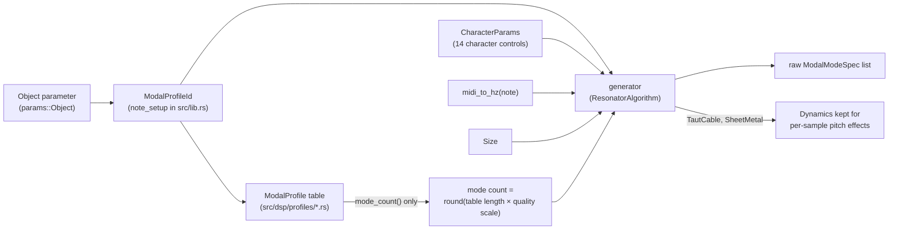

# Objects

The Object control picks what the exciter hits: one of nine metal objects. Each object is a recipe for a bank of modes (frequency, decay time, gain per partial), generated at note-on for the played key. This page explains what a "profile" still is, how each of the nine objects computes its modes, where the per-object code lives, and what in the numbers makes each object sound like itself.

How a bank is then run, pruned and level-normalized is on [Modal Resonator](Modal-Resonator). The material controls applied after the generator (Rust, Damage, Heat, Thickness, Sludge) are on [Material Transformations](Material-Transformations).

## From the Object control to a bank



As a list:

1. `note_setup` (`src/lib.rs`) maps `params::Object` to `ModalProfileId` one to one.
2. The static profile table for that id contributes only its **length**, the base mode count, which the quality mode scales (Eco 0.5, Normal 1, High 1.5, Render 2).
3. The object's **generator**, a type implementing `ResonatorAlgorithm`, gets the key's frequency (`midi_to_hz(note)`), Size, the mode count and the object's character controls, and writes the raw `ModalModeSpec` list.
4. Taut Cable and Sheet Metal also hand back a copy of their generator as a `Dynamics` value, which the resonator keeps for per-sample pitch effects.

## What a profile is now

A `ModalProfile` (`src/dsp/profile.rs`) is `{ id: ModalProfileId, modes: &'static [ModalModeSpec] }`, one `const` table per object in `src/dsp/profiles/`. A `ModalModeSpec` is a mode's `frequency_hz`, `decay_seconds` (a 1/e time constant) and `gain`.

The tables are fixed frequencies in hertz from an earlier design. **They no longer shape the sound.** What they still do:

- Their length is each object's base mode count (`ModalProfile::mode_count`), and `MAX_BASE_MODE_COUNT` (12, Industrial Cog's) sizes the preallocated buffers; see [Modal Resonator](Modal-Resonator#buffer-sizes-max_modes-and-max_raw_modes).
- `ModalProfile::scaled_mode_specs_extended` builds a bank straight from the table (Size scaling, then the transforms). Only the legacy `ModalResonator::from_profile` constructors use it: a voice's initial silent resonator, the offline Rust and Damage comparison renders in `src/offline/mod.rs`, and tests.
- The budget estimates in `src/dsp/utils/budget.rs` count them; see [DSP Utilities](DSP-Utilities#budget-estimates).

| Object | Table | Base modes | Table's lowest mode |
|---|---|---|---|
| Pipe | `PIPE_MODAL_PROFILE_MODES` | 6 | 220 Hz |
| Plate | `PLATE_MODAL_PROFILE_MODES` | 8 | 286 Hz |
| Tank | `TANK_MODAL_PROFILE_MODES` | 8 | 96 Hz |
| Chain | `CHAIN_MODAL_PROFILE_MODES` | 10 | 74 Hz |
| I-Beam | `IBEAM_MODAL_PROFILE_MODES` | 8 | 55 Hz |
| Taut Cable | `TAUTCABLE_MODAL_PROFILE_MODES` | 8 | 110 Hz |
| Coil Spring | `COILSPRING_MODAL_PROFILE_MODES` | 10 | 80 Hz |
| Sheet Metal | `SHEETMETAL_MODAL_PROFILE_MODES` | 8 | 60 Hz |
| Industrial Cog | `COG_MODAL_PROFILE_MODES` | 12 | 200 Hz |

**Trap:** changing a table's length changes that object's mode count, its CPU cost, `MAX_MODES`, and every golden bank hash. Changing a table's values changes only the legacy path.

## The generators

`ResonatorAlgorithm` (`src/dsp/resonators/basic.rs`) has one method that matters:

```rust
fn generate_modes_into(&self, fundamental_hz: f32, mode_count: usize,
                       size_scale: SizeScale, out: &mut Vec<ModalModeSpec>);
```

It appends to a preallocated buffer, so the note-on path doesn't allocate. `generate_modes` is an allocating wrapper for offline and test callers. The trait's other methods (`update_dynamic_frequencies`, `apply_warping`, `get_coupling`) are not called by the engine: the per-sample effects go through `TautCableResonator::dynamic_pitch_factor` and `SheetMetalResonator::warp_factor` instead.

`ModalResonator::generate_algorithm_modes_into` builds each generator from `CharacterParams`, the 14 character controls snapshotted at note-on. Only the active object's fields are read. Parameters a generator has but the user can't reach are fixed there (Pipe's `sustain_time` 1.0, Tank's `wall_thickness` 0.5, Chain's `friction_decay` 2.0, and so on, listed per object below).

Where each generator lives:

| Object | Generator | Module | Per-sample dynamics |
|---|---|---|---|
| Pipe | `PipeResonator` | `basic.rs` (shared) | no |
| Plate | `PlateResonator` | `basic.rs` (shared) | no |
| Tank | `TankResonator` | `basic.rs` (shared) | no |
| Chain | `ChainResonator` | `basic.rs` (shared) | no |
| I-Beam | `IBeamResonator` | `ibeam.rs` | no |
| Taut Cable | `TautCableResonator` | `taut_cable.rs` | yes: tension drop |
| Coil Spring | `CoilSpringResonator` | `coil_spring.rs` | no |
| Sheet Metal | `SheetMetalResonator` | `sheet_metal.rs` | yes: buckling warp |
| Industrial Cog | `IndustrialCogResonator` | `industrial_cog.rs` | no |

The five dedicated modules hold nothing but the generator (and, for the cable and the sheet, the pitch-factor function the resonator calls every sample). Their doc comments and `basic.rs`'s header describe richer physics ("Gaussian Orthogonal Ensemble", "dispersive phase offsets", "comb-filter pickup structure") than the code implements; the formulas below are what runs.

### Size and pitch

Every generator divides the key's frequency by `size_scale.factor()` (Size, 0.05–10, default 1; the Mass macro scales it by `1 + 0.5·(mass − 0.5)` before note-on). So pitch goes as 1/Size for every mode. In the live path Size changes nothing else: the decay lengthening and gain tilt of `ModalModeSpec::scaled_for_size` belong to the legacy table path only.

Each object places its lowest mode at a different ratio to the key. The table gives the ratio computed from the code at Size 1 and default character, and the heard offset the factory bank's tuning notes measured on held notes (top of `src/presets/factory/curated.rs`, with the Size constants such as `PIPE_ON_KEY` that put each object on the key):

| Object | Lowest mode at Size 1 (from the code) | Measured heard pitch (`curated.rs`) |
|---|---|---|
| Pipe | 1.0247 × key (+42 cents) | 42 cents sharp; Size 1.025 plays the key |
| Plate | 2 × key (an octave up) | an octave up; Size 2 plays the key |
| Tank | 1/3 × key (−19.02 semitones), the cavity mode | 19 semitones down; Size 0.333 |
| Chain | 1 × key | not listed |
| I-Beam | 0.707 × key (−6 semitones) | a tritone down; Size 0.707 |
| Taut Cable | 1.0015 × key (+2.6 cents) | +3–10 cents (the tension drop raises it while loud) |
| Coil Spring | 1.093 × key (+153 cents) | 148 cents sharp; Size 1.09 |
| Sheet Metal | 2.16 × key (+13.3 semitones) | 425 cents up, moving as Size^−0.75; Size 3.49 plays the key |
| Industrial Cog | 0.146 × key (−33.3 semitones), a split pair | not listed |

Sheet Metal is the odd one: its generator scales every mode exactly as 1/Size, yet the measured pitch neither sits on the lowest mode nor follows 1/Size. The code doesn't explain the difference; treat the measured value as what a listener hears.

## The nine objects

In the formulas, `f` is `key_hz / Size`, `n` counts modes from 1 and `N` is the mode count.

### Pipe

`PipeResonator { tube_diameter, sustain_time = 1.0 }`, a stiff one-dimensional tube:

```text
f_n   = n · f · √(1 + B·n²),   B = 0.1 · Pipe Diameter
decay = 1.5 − 0.15·n   (s)
gain  = 0.02 / n
```

- **What you hear:** a nearly harmonic series stretched upwards by stiffness (at the default diameter 0.5: 1.025, 2.19, 3.61, 5.37 × key). A wider pipe stretches more and sounds more bell-like.
- **Pitch offset:** `√(1 + B)`, so even the first mode is sharp (+42 cents at the default).
- **Long ring:** the low modes ring for over a second (1.35 s time constant for the first).
- **Mode cap:** the decay formula reaches 0 at n = 10. Those modes get `f32::EPSILON` decay from the transforms and are pruned, so Pipe has at most 9 soundable modes and High and Render build the same bank.

### Plate

`PlateResonator { aspect_ratio, metal_stiffness }`, a Kirchhoff plate's `(m, n)` grid:

```text
K       = Plate Stiffness · f,   Lx = 1,   Ly = 1 / max(Plate Aspect, 0.1)
f_{m,n} = K · (m² + (n·Plate Aspect)²)
decay   = 0.4 − 0.02·(m + n)
gain    = 0.008 / (m + n)
```

The grid is `ceil(√N)` on a side, filled row by row until `N` modes are written.

- **What you hear:** an inharmonic cluster (2, 5, 8, 10, 13 × K on a square plate) that dies fast (0.30–0.36 s time constants): a clang rather than a tone.
- **Degenerate pairs:** at Plate Aspect 1, `(m, n)` and `(n, m)` land on the same frequency, so a square plate rings pairs of coincident modes. Other aspects split them apart.
- **Plate Stiffness transposes:** it multiplies every frequency by the same factor (0.25–3), so it moves the pitch without changing the mode ratios. Only Plate Aspect changes the spacing.
- **Pitch offset:** the lowest mode is `K·(1 + aspect²)`: 2 × key at the defaults.

### Tank

`TankResonator { tank_volume, wall_thickness = 0.5, cavity_mix }`, a closed vessel: one cavity (Helmholtz) mode plus shell modes.

```text
cavity:  f = 0.5·f / (1 + Tank Volume),  decay = 2.5·(1 + Tank Volume),  gain = 0.05 · Cavity Mix
shell n: f = f·(0.8 + 0.6·n),            decay = 1.5·(1 + 0.1·n),        gain = 0.015·(1 − Cavity Mix) / n
```

- **What you hear:** a deep, long boom (the cavity, 1/3 of the key at the default volume, ringing with a 3.75 s time constant) under evenly spaced shell modes from 1.4 × key upwards, every 0.6 × key.
- **The cavity follows the key** (it was once a fixed frequency); a larger Tank Volume pushes it further below the key and makes it ring longer.
- **Cavity Mix** trades the boom against the shell: at 1 the shell gains are 0 and only the cavity sounds; at 0 the cavity is silent. Strike-level normalization then rescales the whole bank, so Cavity Mix changes balance, not loudness.

### Chain

`ChainResonator { link_mass, chain_length = N, instability, friction_decay = 2.0 }`, a cluster of loosely related link resonances:

```text
base  = f / (0.5 + Link Mass)
f_i   = base · (1 + 0.15·i + frac(i · 1.618034) · Instability)     for i = 0 … N−1
decay = 0.4 / 2.0 = 0.2 s   (every mode)
gain  = 0.018               (every mode)
```

- **What you hear:** a dense, equal-level cluster of short (0.2 s) modes starting on the key, spaced 0.15 × base apart with a golden-ratio scatter (`GOLDEN_STEP`) that Instability scales. It reads as a jangle, not a pitch.
- **Link Mass transposes** the whole cluster by `1 / (0.5 + mass)` (range 0.1–1: from 1.67 × down to 0.67 × the key).
- The first mode has no scatter (`frac(0) = 0`), so it sits exactly on `base`.
- Nothing couples the modes at run time: `get_coupling` is never called.

### I-Beam

`IBeamResonator { beam_mass = 1.0, shear_density, rigidity_damping = 0.7 }` in `ibeam.rs`, a thick (Timoshenko-style) beam:

```text
f_n   = f · n² / √(1 + C·n²),   C = 2 · Shear Density
decay = 1.5 − 0.56 · n/N
gain  = 0.02 / n
```

- **What you hear:** at Shear Density 0 the series is `n²` (1, 4, 9, 16 × f), the bright, widely spaced partials of a thin bending bar. Shear compresses the upper modes towards a linear spacing of `f/√C`: at the default (C = 1) the series is 0.71, 1.79, 2.85, 3.88, 4.90 × key, close to harmonic above the first mode.
- **Pitch offset:** `1/√(1 + C)`, a tritone below the key at the default.
- **Long ring:** decays from 1.43 s down to 0.94 s across the bank.

### Taut Cable

`TautCableResonator { cable_tension = 0.5, braid_stiffness, tension_drop }` in `taut_cable.rs`, a stiff string whose pitch rises with its amplitude:

```text
f0    = f · (0.8 + 0.4 · 0.5) = f
B     = Braid Stiffness · 0.01 · (Braid Stiffness / 0.3)        (square law)
f_n   = n · f0 · √(1 + B·n²)
decay = 2.0 − 0.5 · n/N
gain  = 0.025 / (0.5·n² + 0.5)
```

- **What you hear:** the most string-like object: a nearly harmonic series on the key with a steep gain roll-off (the second mode is 8 dB under the first) and long decays (1.5–1.9 s).
- **Braid Stiffness** stretches the partials quadratically. The square law keeps the default (0.3) where it was and makes the top of the range clearly inharmonic: `stiff_braid_stretches_the_partials` requires the third partial's stretch to grow by more than 5 % from braid 0 to 1. (Linear, it moved the second partial 2 % at most.)
- **Tension drop (dynamic).** Every sample, `TautCableResonator::dynamic_pitch_factor` returns `clamp(1 + Tension Drop · A · 0.1, 0.25, 4)`, where `A` is the resonator's smoothed `Σ|mode output|` (`dyn_amplitude`, a one-pole at 0.99 per 48 kHz sample). A hard strike stretches the cable sharp and the pitch falls back as the ring decays: the "boing". The clamp keeps the feedback (louder → higher → different level) from running away.

### Coil Spring

`CoilSpringResonator { coil_length = 0.5, dispersion_chirp, spring_slosh }` in `coil_spring.rs`, a dispersive helix:

```text
α      = 0.5 + 0.5 · 0.5 = 0.75
f_n    = f · (n^0.75 + frac(1.618·n) · Spring Slosh · 0.5)
decay  = 1.0 + 0.5 · n/N
gain   = max(0.001, (0.02 / n) · |cos(n · Dispersion Chirp · π)|)
```

- **What you hear:** a compressed, inharmonic series (partials closer together than harmonics, since `n^0.75` grows slower than `n`) with decays that grow slightly up the bank.
- **Spring Slosh** detunes each mode by a golden-ratio scatter (here the literal 1.618, not `GOLDEN_STEP`), so modes beat against each other.
- **Dispersion Chirp is a gain comb, not a time chirp:** it sets which modes are loud via `|cos(n·chirp·π)|`. At the default 0.5, every odd mode (including the first) falls to the 0.001 floor and the even modes carry the sound; at 0 every mode keeps its `0.02/n`. The frequencies don't depend on it.
- **Pitch offset:** the first mode is `1 + frac(1.618)·slosh·0.5`, +153 cents at the defaults.

### Sheet Metal

`SheetMetalResonator { sheet_size = 0.5, metal_thinness, edge_damping = 0.3 }` in `sheet_metal.rs`, a thin panel that buckles when driven hard:

```text
base  = f / (0.5)                          = 2f
f_n   = base · n² · (1 + 0.2 · Metal Thinness)
decay = 1.7 · (1 + n/N)                    (1.9 s → 3.4 s, rising up the bank)
gain  = 0.03 / n
```

- **What you hear:** very widely spaced partials (`n²`: 1, 4, 9, 16 …) in which the **upper modes ring longer** than the lower ones, the opposite of every other object, which gives the shimmering, thundery tail. At C4 and Size 1 only the first five modes are below 20 kHz; the rest are faded out, and at Render the top ones are pruned above 80 kHz.
- **Buckling warp (dynamic).** Every sample, `SheetMetalResonator::warp_factor` returns `clamp(1 + Metal Thinness · D² · 10, 0.25, 4)`, where `D` is the smoothed sum of the three lowest modes' outputs (`dyn_lf_displacement`, a one-pole at 0.95 per 48 kHz sample). Big low-frequency excursions push every mode sharp, so a hard hit roars and wobbles. Being squared, the warp only ever raises pitch.
- Because the warp moves every sample, Sheet Metal is the one object `held_bend_is_bit_identical_to_rebuilding_every_sample` skips; `moving_dynamics_stay_in_tune` covers it instead.

### Industrial Cog

`IndustrialCogResonator { blade_radius = 0.5, tooth_dissonance, blade_thickness = 0.5 }` in `industrial_cog.rs`, a free circular plate whose modes split into pairs:

```text
scale = f / (0.5 + 0.5) = f
for the first min(N, 6) roots r_i of BESSEL_ROOTS = [3.83, 7.02, 10.17, 13.32, 16.47, 19.64]:
    b_i = scale · r_i² · 0.01
    ε_i = Tooth Dissonance · 0.03 · (i + 1)
    primary:   f = b_i·(1 − ε_i),  decay = 1.25 s,   gain = 0.015 / (i + 1)
    companion: f = b_i·(1 + ε_i),  decay = 1.125 s,  gain = 0.012 / (i + 1)
```

- **What you hear:** six pairs of close modes that **beat** against each other (the metallic wobble), at 0.147, 0.49, 1.03, 1.77, 2.71 and 3.86 × key. Tooth Dissonance widens the split, more so on the higher pairs.
- **Pitch offset:** the lowest pair sits at 0.146 × key, about 33 semitones under it. With mode amplitudes going as `gain/ω`, that pair dominates the ring; the third pair is the one near the key (+58 cents).
- **Fixed size:** it always emits 6 pairs (12 modes) once `N ≥ 6`, which every quality mode gives (Eco asks for 6). Quality modes change nothing for the cog, as the golden fixture shows (the same hash at all four scales).

## What changes when you edit a generator

- Every bank hash in the golden fixture changes; regenerate it only for an intended sound change and say why (see [Modal Resonator](Modal-Resonator#the-golden-mode-bank-fixture)).
- The factory presets' levels and character can move: run the bank tests and reseed ([Factory Bank](Factory-Bank)).
- A generator must stay within `MAX_RAW_MODES` (48) modes, checked by `note_on_banks_fit_max_modes` and a `debug_assert!`.
- Keep the defaults reachable: the character controls' defaults in `params.rs` match `CharacterParams::default`, and some formulas (Braid Stiffness's square law) were shaped to keep the default bit-identical.
- The User Wiki describes these objects too; a sound change must update it ([Site and User Wiki Tooling](Site-and-User-Wiki-Tooling)).

## Source files

- [`src/dsp/profile.rs`](https://github.com/GerMP21/Corrosion-VST/blob/main/src/dsp/profile.rs): `ModalModeSpec`, `ModalProfileId`, `ModalProfile` and the legacy table path (`scaled_mode_specs_extended`).
- [`src/dsp/profiles/mod.rs`](https://github.com/GerMP21/Corrosion-VST/blob/main/src/dsp/profiles/mod.rs): the profile-table modules.
- [`src/dsp/profiles/pipe.rs`](https://github.com/GerMP21/Corrosion-VST/blob/main/src/dsp/profiles/pipe.rs): Pipe's table (6 modes).
- [`src/dsp/profiles/plate.rs`](https://github.com/GerMP21/Corrosion-VST/blob/main/src/dsp/profiles/plate.rs): Plate's table (8 modes).
- [`src/dsp/profiles/tank.rs`](https://github.com/GerMP21/Corrosion-VST/blob/main/src/dsp/profiles/tank.rs): Tank's table (8 modes).
- [`src/dsp/profiles/chain.rs`](https://github.com/GerMP21/Corrosion-VST/blob/main/src/dsp/profiles/chain.rs): Chain's table (10 modes).
- [`src/dsp/profiles/ibeam.rs`](https://github.com/GerMP21/Corrosion-VST/blob/main/src/dsp/profiles/ibeam.rs): I-Beam's table (8 modes).
- [`src/dsp/profiles/taut_cable.rs`](https://github.com/GerMP21/Corrosion-VST/blob/main/src/dsp/profiles/taut_cable.rs): Taut Cable's table (8 modes).
- [`src/dsp/profiles/coil_spring.rs`](https://github.com/GerMP21/Corrosion-VST/blob/main/src/dsp/profiles/coil_spring.rs): Coil Spring's table (10 modes).
- [`src/dsp/profiles/sheet_metal.rs`](https://github.com/GerMP21/Corrosion-VST/blob/main/src/dsp/profiles/sheet_metal.rs): Sheet Metal's table (8 modes).
- [`src/dsp/profiles/industrial_cog.rs`](https://github.com/GerMP21/Corrosion-VST/blob/main/src/dsp/profiles/industrial_cog.rs): Industrial Cog's table (12 modes, the largest).
- [`src/dsp/resonators/basic.rs`](https://github.com/GerMP21/Corrosion-VST/blob/main/src/dsp/resonators/basic.rs): `ResonatorAlgorithm` and the Pipe, Plate, Tank and Chain generators.
- [`src/dsp/resonators/taut_cable.rs`](https://github.com/GerMP21/Corrosion-VST/blob/main/src/dsp/resonators/taut_cable.rs): the Taut Cable generator and its tension-drop pitch factor.
- [`src/dsp/resonators/ibeam.rs`](https://github.com/GerMP21/Corrosion-VST/blob/main/src/dsp/resonators/ibeam.rs): the I-Beam generator.
- [`src/dsp/resonators/sheet_metal.rs`](https://github.com/GerMP21/Corrosion-VST/blob/main/src/dsp/resonators/sheet_metal.rs): the Sheet Metal generator and its buckling warp factor.
- [`src/dsp/resonators/coil_spring.rs`](https://github.com/GerMP21/Corrosion-VST/blob/main/src/dsp/resonators/coil_spring.rs): the Coil Spring generator.
- [`src/dsp/resonators/industrial_cog.rs`](https://github.com/GerMP21/Corrosion-VST/blob/main/src/dsp/resonators/industrial_cog.rs): the Industrial Cog generator and its Bessel roots.
- [`src/dsp/resonators/core.rs`](https://github.com/GerMP21/Corrosion-VST/blob/main/src/dsp/resonators/core.rs): `CharacterParams`, `generate_algorithm_modes_into` and the `Dynamics` the cable and sheet keep.
- [`src/presets/factory/curated.rs`](https://github.com/GerMP21/Corrosion-VST/blob/main/src/presets/factory/curated.rs): the measured per-object pitch offsets and the Size constants that put each object on the key.
