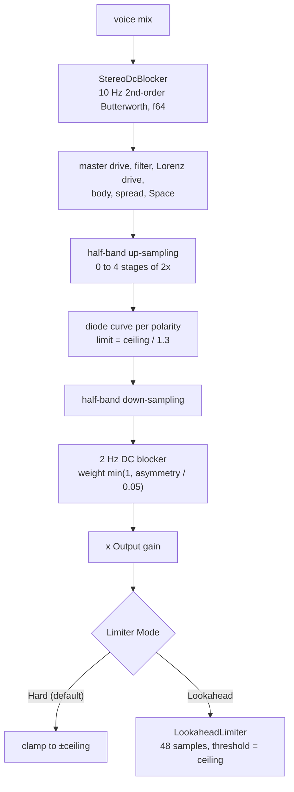

# Output Protection

What keeps Corrosion's output centred and under its ceiling: a DC blocker on the voice mix, the diode stage at the end of the post chain (an asymmetric soft clipper, oversampled through half-band IIR filters), and the output limiter after the Output gain. The ceiling is one parameter, Analog Ceiling, which every stage here reads. For the routing around these stages, see [Post Chain](Post-Chain).

## The layers in order

The same layers as a list:

1. **Voice-mix DC blocker** (`dsp::StereoDcBlocker`, 10 Hz): removes the voices' static offset before any nonlinear stage.
2. **Diode stage** (`OversampledClipper`), the post chain's last stage: up-sample, curve, down-sample, then a 2 Hz DC blocker that fades in with Diode Asymmetry. In Eco the curve runs at the host rate with no filters.
3. **Output gain** (Output, smoothed).
4. **Output limiter**: Hard is a per-sample clamp to ±ceiling (`apply_output_limiter`); Lookahead is `LookaheadLimiter` with the ceiling as its threshold. Either way, no output sample exceeds the ceiling.

## Analog Ceiling

Analog Ceiling (0.5–1.0, default 0.9661 = `LIMITER_THRESHOLD`, about −0.3 dBFS) is the output's ceiling. The diode stage clamps it to 0.5–1.0 and limits at ceiling ÷ 1.3; `configure_output_limiters` (once per block) clamps it to 0.1–1.0 and gives it to both limiters. Offline tools and tests that render without the parameter use `LIMITER_THRESHOLD`.

## The voice-mix DC blocker

**Why.** Each mode of a modal resonator has a non-zero gain at 0 Hz, so a one-signed force (a bow's pressure, a felt mallet's long contact) leaves a static deflection under the ringing. Fed into the asymmetric drives and the diode curve, that offset would clip one side first and shift the sound. Removing it from the voices' sum, before the master drive, gives every nonlinear stage a centred signal. DC that the later stages create themselves (the asymmetric drive curves, the diode curve) is theirs to handle.

**What.** `StereoDcBlocker` (`src/dsp/utils/dc_blocker.rs`) is a second-order Butterworth high-pass (Q = 1/√2) with RBJ-cookbook coefficients: bilinear transform with the cutoff prewarped, so it is −3 dB at 10 Hz at every sample rate (`cutoff_is_the_same_in_hertz_at_every_rate`). Direct form I, `b2 = b0`.

- **`f64` coefficients and state.** At 10 Hz the poles sit about 0.001 inside the unit circle, where an `f32` direct form would amplify its own rounding noise by about 10⁶ at DC.
- **Cost to the signal.** 2nd-order Butterworth at 10 Hz: about −0.05 dB at 30 Hz.
- **Rating and state.** `set_sample_rate` is a no-op unless the rate changed (the rebuild is `#[cold] #[inline(never)]`); it is called in `Corrosion::prepare` and every `begin_block`. `reset()` and the end of an All Sound Off fade clear it.
- The cutoff is `VOICE_MIX_DC_CUTOFF_HZ` in `src/lib.rs`. The test-only flag `Corrosion::mix_dc_blocker_enabled` bypasses it for comparisons.

## Half-band oversampling

The diode stage generates harmonics far above Nyquist. Running the curve at 4×, 8× or 16× the host rate and filtering before coming back down keeps most of them from folding into the audible band. `src/dsp/post_processing/half_band.rs` provides the filters.

### Design

Each 2× stage is the classic two-path polyphase all-pass half-band (as in Laurent de Soras' HIIR): `H(z) = ½·(A0(z²) + z⁻¹·A1(z²))`, where `A0` and `A1` are chains of first-order all-pass sections `(c + z⁻¹)/(1 + c·z⁻¹)` running at the low rate, with the coefficients alternating between the two paths.

- `HalfBandCoefs::design(attenuation_db, transition)` computes the elliptic design in `f64` (`transition_params`, `filter_order`, `coefficient`) and stores at most `MAX_COEFS` = 12 `f32` coefficients. It runs once in `OversampledClipper::new()`, off the audio thread, and panics if a design needs more than 12.
- The filter is power-complementary around a quarter of its high rate: flat to `0.25 − transition`, rejecting from `0.25 + transition` (fractions of the high rate). It is not linear-phase: low frequencies are delayed by a few samples.
- `HalfBandState` holds one stage's all-pass memory (`x`, `y` per coefficient) for one channel and one direction. `upsample` feeds the input to both paths and returns two high-rate samples; `downsample` feeds the two high-rate samples to the two paths and averages them.

### The clipper's stages

The diode stage designs four stages, each for at least `STAGE_ATTENUATION_DB` = 90 dB, with the pass edge fixed at `PASS_EDGE` = 22/48 of the host rate (22 kHz at 48 kHz). Stage `i` (from 1) has `transition = 0.25 − (22/48)/2^i`, so later stages, at higher rates, get ever wider transitions and need fewer coefficients:

| Stage | Rates (× host) | Coefficients | Pass to | Rejects from (48 kHz host) |
|---|---|---|---|---|
| 1 | 1 → 2 | 9 | 22 kHz | 26 kHz |
| 2 | 2 → 4 | 5 | 22 kHz | 74 kHz |
| 3 | 4 → 8 | 4 | 22 kHz | 170 kHz |
| 4 | 8 → 16 | 4 | 22 kHz | 362 kHz |

`clipper_stage_sizes` pins the counts 9, 5, 4, 4; `each_stage_is_flat_in_its_pass_band_and_rejects_its_stop_band` checks each stage is within 0.001 dB in its pass band and at least 90 dB down in its stop band, up and down. `docs/ARCHITECTURE.md` records 93–107 dB of actual stop-band rejection.

Normal uses stages 1–2 (4×), High 1–3 (8×), Render 1–4 (16×). Up-sampling goes through the stages in order, down-sampling in reverse, each with its own state per channel (`up` and `down`, `[[HalfBandState; 4]; 2]`). Work buffers are two stack arrays of 16 samples.

### Delay

The half-bands delay low frequencies by about 4–5 host samples: 4.2 (Normal), 4.7 (High) and 5.0 (Render) samples at 1 kHz, as recorded in `docs/ARCHITECTURE.md` (measured with `offline::measure_clipper_response`). This delay is **not reported to the host** as latency.

## The diode stage

`OversampledClipper` (`src/dsp/post_processing/oversampled_clipper.rs`) models a pair of clipping diodes: a soft knee per polarity, with the negative half able to conduct earlier (one diode against two in series). The curve, its headroom and its DC removal are the same in every quality mode; quality only changes how much the clipping aliases.

### Signal flow per channel

`process_channel(input, channel)`:

1. With 0 stages (Eco): curve, then DC removal, at the host rate.
2. Otherwise: up-sample through `stages` half-bands to `2^stages` samples; run `clip_and_meter` on every high-rate sample; down-sample back through the stages in reverse; `remove_dc` on the single result.

`process_stereo` advances the control smoothers once per frame, then runs the left channel (0) and the right (1). The two channels share the curve and the meter but not the filter or DC memory.

### The curve

For one polarity with limit `L` and knee width `w` (`Knee`):

- below `K = L·(1 − w)`: `y = x` (linear, slope 1);
- above it: `y = K + (L − K)·tanh((x − K)/(L − K))`: slope 1 at `K`, approaching `L` and never past it.

A hard knee has `w = 0`, so `y = min(x, L)`. `diode_clip` uses the positive knee for `x ≥ 0` and the negative knee on `−x` for `x < 0`.

### Limit and headroom

`L = ceiling / CEILING_HEADROOM`, with `CEILING_HEADROOM = 1.3`, in every mode, Eco included: 0.743 (−2.6 dBFS) at the default ceiling. The down-sampling filters remove harmonics that were holding the clipped peaks down, so a band-limited clipped wave overshoots the curve's limit; the DC blocker's tilt adds a little more. The 1.3 margin keeps those overshoots under the output limiter in normal use: `peaks_stay_under_the_ceiling` drives a 5 kHz sine at twice the ceiling through every mode at Asymmetry 0, 0.25 and 1 and checks no output exceeds the ceiling. No fixed margin covers everything: `docs/ARCHITECTURE.md` notes that with extreme drive in the top octaves peaks reach 1.7× the curve's limit, and then the output limiter clips them.

### Diode Softness

Diode Softness (0–1, default 0.5) sets `w = KNEE_WIDTH × softness` with `KNEE_WIDTH = 0.8`. The knee starts at `L·(1 − w)`:

| Softness | Knee start (positive half) |
|---|---|
| 0 | at `L`: a hard clip |
| 0.5 (default) | 0.6·L, 4.4 dB under the limit |
| 1 | 0.2·L, 14 dB under the limit |

Softer knees add fewer high harmonics (`softer_knees_add_fewer_high_harmonics`) and compress earlier (`wide_knee_at_one`); Softness 0 passes a sine at 0.9·L unchanged (`hard_knee_at_zero`).

### Diode Asymmetry

Diode Asymmetry (0–1, default 0.25, `DEFAULT_DIODE_ASYMMETRY`) changes the negative half only:

- negative limit `L₋ = L·2^(−a)`: 1.5 dB lower at 0.25, 6 dB lower at 1;
- negative knee width `w·(1 − a/2)`: a firmer knee.

At the defaults the negative half starts bending at about 0.41 (against 0.45 for the positive half) and limits at 0.625. Clipping one half harder adds even harmonics: the 2nd harmonic is at least 60 dB down at Asymmetry 0 and rises with it (`even_harmonics_follow_asymmetry`). `limits_per_polarity` checks the peak-to-peak span equals `L·(1 + 2^(−a))` within 2 % in Eco.

### The 2 Hz DC blocker

An asymmetric curve produces a DC offset, which `remove_dc` removes after down-sampling:

- `hp = y − x₁ + pole·hp₁`, a one-zero (at DC), one-pole high-pass with `pole = e^(−2π·2/fs)` (`DC_CUTOFF_HZ` 2.0), per channel.
- Output `y + weight·(hp − y)`, with `weight = min(1, a / 0.05)` (`DC_FULL_ASYMMETRY`): fully in from Asymmetry 0.05, faded in below.
- At Asymmetry 0 the weight is 0, the blocker is out of the path and its memory is cleared, so a symmetric curve is bit-identical to the stage without it in every mode (`symmetric_curve_is_unfiltered`, against the test-only flag `dc_stage_enabled`).
- The cutoff is low on purpose: a high-pass tilts the flat tops of a clipped wave, and at 2 Hz a hard-clipped 200 Hz tone spans 1.4 % more than the curve's limits (3.4 % at 5 Hz). Asymmetric clipping stays centred within 0.1 % of the ceiling (`asymmetric_clipping_is_centred`).
- It filters the whole signal, so it also removes DC that the asymmetric drives earlier in the chain leave behind.

### Smoothing and settings

- `set_parameters(ceiling, softness, asymmetry)` is called once per block. The ceiling applies at once; Softness and Asymmetry glide toward their targets with τ 20 ms (`CONTROL_TAU_SECONDS`), one step per host sample, snapping when within 1e-5 (`CONTROL_SNAP`).
- `update_curve` (both knees and the DC weight) runs on each `set_parameters` and on each sample while a control is still moving, never once settled.
- Until the first sample is processed (`primed`), settings snap; `reset()` also snaps them. So a preset loaded before playback doesn't glide in, and jumps during playback don't click (`asymmetry_jumps_do_not_click`).

### The tanh table

`table_tanh` replaces libm's `tanh` with linear interpolation in a 513-point table on [0, 8] (`TANH_TABLE_POINTS`, `TANH_TABLE_MAX`; past 8 it returns `tanh(8) = 1 − 2.3e-7`). The table is a `static OnceLock<[f32; 513]>`, filled from `f64` in `OversampledClipper::new()`, so the audio thread never builds it and nothing touches the heap. Error is under 2.5e-5 and the result is monotonic (`table_tanh_is_accurate_and_monotonic` asserts under 1e-4 on a dense sweep). It gives the same result on every libm (gnu, musl, wasm) and took 0.63× libm's time for the clipper alone at 16×.

### Changing the quality mode

`set_oversample_factor(factor)` clamps to 1–16 and rounds down to a power of two. When the number of stages changes, it clears all half-band and DC memory (`clear_filters`), which gives a short discontinuity if audio is playing. Below the curve's knee, the stage is transparent in every mode: sines at 0.3 come out within 0.1 dB from 100 Hz to 18 kHz (`clipper_is_transparent_below_its_threshold`), and Eco keeps Render's tone at a 200 Hz clip (`eco_sounds_like_render`: fundamental within 0.1 dB, 2nd and 3rd harmonics within 0.5 dB).

### Aliasing

From the tests in `src/offline/mod.rs` (`analyze_clipper_aliasing`: a sine near 5 kHz at twice the ceiling through the clipper alone, 48 kHz): the alias ratio must be at most −40 dB in Normal and −60 dB in Render, also through the hard clamp, at the defaults and at Softness 0 / Asymmetry 0 (`clipper_alias_bounds_hold`, `clipper_alias_bounds_hold_through_the_hard_clamp`), and must fall with quality (`clipper_fold_back_falls_with_quality`). `docs/ARCHITECTURE.md` records the measured values: −19.7 dB Eco, −67.0 Normal, −94.2 High, −105.0 Render at the defaults; −50.7 Normal and −75.5 Render at Softness 0. The stages before the clipper are not oversampled (see [Filter and Drive](Filter-and-Drive#aliasing)).

### The diode meter

The editor's Brickwall Limiter panel has a red dot that lights when the diode stage is working.

- `clip_and_meter` tracks the peaks of the curve's input and output (absolute, high-rate samples, both channels).
- `take_block_reduction_db` returns `20·log10(peak_in / peak_out)` (0 when the input stayed under the knee) and clears the peaks. `PostProcessingChain::take_clipper_reduction_db` forwards it.
- `Plugin::process` publishes it once per block to `DiodeMeter`, an `AtomicU32` holding the bits of a non-negative `f32`. For non-negative floats the bit patterns order like the values, so `fetch_max` keeps the largest reduction since the editor last called `take` (a `swap(0)`). Relaxed atomics, no lock, no allocation.
- The editor (`advance_diode_dot` in `src/gui/editor.rs`) takes it every frame: the dot rests at 30 % brightness under 0.1 dB, reaches full `DANGER_RED` at 6 dB, rises at once and falls at 20 dB/s.
- **Web app.** `WebEngine::process` calls `process_block` directly, and nothing on that path calls `take_clipper_reduction_db`; `WebEngine::report` reads `plugin.diode_meter.take()`. As the code stands, the engine never publishes to that meter, so the web report's `diode_reduction_db` stays 0 (see [Web App](Web-App)).

## The output limiter

After the Output gain, `Corrosion::limit_frame` applies the Limiter Mode chosen for the block.

### Hard (default)

`apply_output_limiter(sample, ceiling)` is `sample.clamp(−ceiling, ceiling)`, per channel, with no latency. Every output sample is at most the ceiling (`hard_mode_stays_under_a_low_ceiling`; `tests/limiter.rs`). At the default ceiling a preset's output is bit-identical to a fixed 0.9661 clamp (`factory_preset_is_bit_identical_at_the_default_ceiling`). Because the diode stage limits 2.3 dB lower, the clamp only acts on half-band overshoot and on Output gains above about +2.3 dB.

### Lookahead

`LookaheadLimiter` (`src/dsp/post_processing/lookahead_limiter.rs`), one per channel and **not stereo-linked**:

- a fixed 48-sample delay line (`LOOKAHEAD_SAMPLES`): 1 ms at 48 kHz, 0.5 ms at 96 kHz, the same count at every rate;
- per sample: output the oldest sample, write the new one, scan the 48 buffered samples for their peak;
- target gain `threshold / peak` when the peak exceeds the threshold, else 1; **instant attack** (a lower target is taken at once), one-pole **release** with τ 50 ms (`RELEASE_SECONDS`);
- output `delayed × gain`, clamped to ±threshold.

The window holds the 48 newest inputs, not the sample being output: that sample's gain was set while it was still in the window, one call earlier, and may have released by a sliver since. The final clamp removes that sliver and is the actual guarantee. Both modes reach the same ceiling (`both_limiter_modes_reach_the_same_ceiling`: peak within 0.65–0.7 at a ceiling of 0.7 and Output ×4).

- **Latency.** The 48 samples are reported to the host while Lookahead is selected (`Corrosion::latency_change`); see [Post Chain](Post-Chain#latency).
- **State.** The limiters run only while Lookahead is selected, and nothing clears them on a mode switch, so the first 48 samples after switching back to Lookahead are what the line held when it was last used. `reset()` and the end of an All Sound Off fade clear them.

## Traps

- **Don't treat the in-stage clamps as protection.** The filter's saturators, the drives' ±1 and ±1.5 clamps, the body's ±1 and the spread's ±1.5 are guards that shape loud signals; the diode stage and the limiter are the protection.
- **Changing `CEILING_HEADROOM`** moves every preset's level and its alias figures: the factory bank is levelled through this path (see [Factory Bank](Factory-Bank)).
- **Migrated state uses a hard knee.** Presets and projects saved before Diode Asymmetry existed load with Softness 0 and Asymmetry 0 (`migrate_diode_stage`, `migrate_host_diode_stage`); see [Presets and Migrations](Presets-and-Migrations).
- **The half-band delay is unreported.** A host aligning tracks sees Corrosion 4–5 samples late in Normal to Render.

*History:* the diode stage's design and measurements are in [its change](https://github.com/GerMP21/Corrosion-VST/tree/main/openspec/changes/archive/2026-11-10-add-asymmetric-diode-stage), the voice-mix DC blocker's in [this one](https://github.com/GerMP21/Corrosion-VST/tree/main/openspec/changes/archive/2026-11-10-block-voice-mix-dc).

## Source files

- [`src/dsp/post_processing/half_band.rs`](https://github.com/GerMP21/Corrosion-VST/blob/main/src/dsp/post_processing/half_band.rs): the elliptic half-band design and the polyphase all-pass up- and down-samplers, with their tests.
- [`src/dsp/post_processing/oversampled_clipper.rs`](https://github.com/GerMP21/Corrosion-VST/blob/main/src/dsp/post_processing/oversampled_clipper.rs): `OversampledClipper` (the diode curve, headroom, smoothing, tanh table, 2 Hz DC blocker) and `DiodeMeter`.
- [`src/dsp/post_processing/lookahead_limiter.rs`](https://github.com/GerMP21/Corrosion-VST/blob/main/src/dsp/post_processing/lookahead_limiter.rs): `LookaheadLimiter` and `LOOKAHEAD_SAMPLES`.
- [`src/dsp/utils/dc_blocker.rs`](https://github.com/GerMP21/Corrosion-VST/blob/main/src/dsp/utils/dc_blocker.rs): `StereoDcBlocker`, the 10 Hz voice-mix high-pass.
- [`src/lib.rs`](https://github.com/GerMP21/Corrosion-VST/blob/main/src/lib.rs): `LIMITER_THRESHOLD`, `VOICE_MIX_DC_CUTOFF_HZ`, `apply_output_limiter`, `configure_output_limiters`, `limit_frame`, the meter publishing and the limiter tests.
- [`src/offline/mod.rs`](https://github.com/GerMP21/Corrosion-VST/blob/main/src/offline/mod.rs): the clipper aliasing and response analyzers and their bound tests.
- [`tests/limiter.rs`](https://github.com/GerMP21/Corrosion-VST/blob/main/tests/limiter.rs): the hard clamp and the −0.3 dBFS threshold.
- [`tests/post_chain_default_dc.rs`](https://github.com/GerMP21/Corrosion-VST/blob/main/tests/post_chain_default_dc.rs): the default post chain is bounded and returns to zero after a note.
