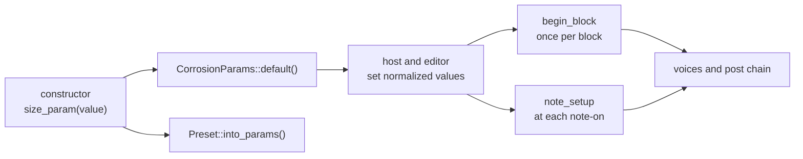

# Parameters

Every control a host can automate is a field of `CorrosionParams` in `src/params.rs`: 149 parameters, plus two persisted fields that are not parameters and the kit's audio-side table. This page explains how a parameter is declared and built, how IDs, names, ranges and display work, where smoothing happens, which controls act live and which only at note-on, and how the integer enums map to models and modes.

## One parameter's path



As steps:

1. A constructor function, `<id>_param(value)` (for example `size_param`, `filter_cutoff_param`, `output_param`), sets the parameter's display name, range, clamp and formatters.
2. `CorrosionParams::default()` calls it with the default; `Preset::into_params` (and `PresetParameters::apply_to`) calls the same function with the preset's value. So a parameter built from a preset displays exactly like the live one (`preset_built_parameters_display_like_the_live_ones` in `tests/preset_roundtrip.rs`).
3. The host, the editor (through NIH-plug's `ParamSetter`) and preset loading change values.
4. The audio thread reads plain values with `.value()`: once per block in `begin_block`, or at note-on in `note_setup` (`src/lib.rs`).

## Declaring a parameter

`#[derive(Params)]` on `CorrosionParams` generates NIH-plug's `Params` impl. Each parameter field carries `#[id = "..."]`:

```rust
#[id = "size"]
pub size: FloatParam,
```

- **The ID is the contract.** Hosts store automation and project state by ID, and preset files store values by the same names. Never rename an ID; change a meaning only with migrations (see [Plugin Lifecycle](Plugin-Lifecycle#filter_state-migrating-saved-projects) and [Presets and Migrations](Presets-and-Migrations)).
- **Display names are unique.** Hosts list parameters by name; `parameter_names_are_unique` fails on a duplicate. Shared labels in the editor (two "Brightness" knobs) get distinct host names: "Resonator Brightness" and "Macro Brightness", "Brush Wire Stiffness" and "Spring Wire Stiffness", "Onset Time" and "Onset Level".
- **Field order is `param_map()` order.** The browser engine addresses parameters by index in that order, so the web engine and editor must be built from the same source (they always are).
- There are no `#[nested]` groups; the editor's panels are defined in `src/gui/controls.rs`, not here.

There are exactly 149 constructor functions, one per parameter. Adding a parameter means, at least:

1. a constructor in `params.rs` and a field with `#[id]`, built in `Default`;
2. a field in the preset format (`PresetParameters` in `src/presets/mod.rs`), set in `from_params` and `apply_to`;
3. reading it where it acts: a `VoiceControls` field filled in `note_setup`, or a setter in `begin_block` / `apply_post_chain_params`;
4. an editor control (`editor_covers_every_parameter` fails otherwise; `HOST_ONLY_PARAMS` in `src/gui/editor.rs`, empty today, lists exceptions with reasons) and its ⓘ help in `help_for`;
5. a decision for kits: post-chain and master parameters go in `NON_PAD_PARAMS` (`src/kit/mod.rs`);
6. the user Wiki data and clip plan ([Site and User Wiki Tooling](Site-and-User-Wiki-Tooling)), and a factory reseed for the schema ([Factory Bank](Factory-Bank)).

## Ranges, units and display

Most parameters are linear `FloatParam`s shown through `significant_display`: five significant digits, trailing zeros removed (`significant_text`). Five, not seven, leaves room for the normalized-to-plain round trip, so text read back shows the same text; clap-validator's `param-conversions` checks exactly that, and `parameter_text_round_trips` repeats it over 20 000 values per parameter. Parameters with their own formatting:

| Parameter | Stored | Shown | Notes |
|---|---|---|---|
| Output (`output`) | linear gain 0 to `db_to_gain(40)` | dB, `-inf` at 0 | `FloatRange::Skewed` with `gain_skew_factor(-60, 40)`: −10 dB at mid travel, 0 dB at about 57 %, −20..+6 dB over about 19 %. Parsed from typed dB. |
| Pressure (`exciter_pressure`) | 0..1 | dB of `2^((p − 0.5)·4)`, −12..+12 | Typing "6 dB" or a plain 0–1 value both parse. |
| Speed (`exciter_speed`) | 0..1 | `×` of `2^((s − 0.5)·2)`, ×0.5..×2 | Accepts "×1.5", "x1.5" or 0–1. |
| Roughness (`exciter_roughness`) | 0..1 | `×` of `r / 0.3`, ×0..×3.33 | Neutral at 0.3, not 0.5. |
| Wander Rate (`position_wander_rate`) | 0.1..5 Hz | Hz, 2 decimals | Skewed (`skew_factor(-1.5)`): slow rates get more travel. |
| Sync Rate (`sync_rate`) | 0..1 | "Off" below 0.05, then six equal bands 1/16, 1/8, 1/4, 1/2, 1/1, 2/1 | `sync_division` serves both the echo and the display, so the display names what plays. Typing a division picks its band's middle. |
| Filter Cutoff (`filter_cutoff`) | 20..20 000 | number | Skewed, factor 0.5. |
| Exciter, Object, Quality Mode, Note Mode, Limiter Mode, UI Scale | integers | names | See [the enums](#enums-and-their-integers). |
| Space Mode, Loop Mode, Loop Start/End Stage | integers | the integer | No formatter: hosts show 0..3, 0..2, 0..5. The editor shows names. |

Every constructor clamps its value into range, so a hand-edited preset can't create an out-of-range parameter.

## Smoothing

No parameter uses NIH-plug's smoothers: `.value()` is the raw value, read at block start. Smoothing lives in the DSP, where the stage knows what it needs:

| What | Where | Time constant |
|---|---|---|
| Drive (with the Violence bias) | `drive_smoother`, `src/lib.rs` | 20 ms |
| Output | `output_gain_smoother` | 20 ms |
| Pressure | per voice, `PRESSURE_SMOOTHING_S` | 10 ms |
| Body mix | `PostProcessingChain` | 20 ms |
| Filter cutoff and resonance | `WdfLadderFilter` | about 20 ms, first value snaps |
| Drive Amount | `LorenzDrive` | about 20 ms, first value snaps |
| Machinery Movement | `FactoryEcho` | 20 ms |
| Diode Softness and Asymmetry | `OversampledClipper` | 20 ms, snap on the first sample and on reset |

Everything else steps at block boundaries. The first-value snaps mean a preset loaded before playback doesn't glide in.

## Live controls and note-on controls

A voice copies most parameters into a `VoiceControls` snapshot at note-on, so a knob move doesn't reach notes already sounding. A few are re-sent every block. The rule by group:

| Acts | Parameters |
|---|---|
| **Every block, on all sound** | Drive, Output, Width (voice pan spread, passed every sample to every sounding voice, tails included), Body, Limiter Mode, Analog Ceiling, all post-chain parameters (filter, Lorenz drive, chassis, spread, Space and its sub-parameters, Sync Rate, Delay Time, diode), the macros' Violence and Brightness biases on the post chain |
| **Every block, on held voices only** | Resonator Damping, Resonator Brightness (both with the Corrosion and Brightness macro biases), Strike Position, Coupling Stiffness, Position Wander, Wander Rate, Position Envelope, Fundamental Anchor, Pressure. Sent by `VoiceManager::update_live_controls` to voices that are `is_active()` and not kit pads. Released tails keep their note-on values, so they decay with the timbre they had. |
| **At note-on** | Exciter, Object, Note Mode, Size, Rust, Damage, Thickness, Heat, Sludge, the 14 object character parameters, every exciter model control, Speed, Roughness, all envelope parameters and the Gesture Modifiers, the Mass and Corrosion macros' voice-side biases |
| **Both** | Quality Mode: the clipper's oversampling changes at once; the mode count (Eco 0.5×, Normal 1×, High 1.5×, Render 2×) is taken at note-on into `VoiceControls::mode_count_scale` |
| **Editor only** | UI Scale |

The Gesture Modifiers (Env Amount, Velocity To Peak, Global Time Scale, Velocity To Level, Velocity To Time, Curve Tension) and the MSEG parameters only configure the friction MSEG; Hit exciters use Attack and Release, Specialty exciters Attack, Decay, Sustain and Release ([Envelopes and Modulation](Envelopes-and-Modulation)). The macro routing is tabled on [Signal Chain](Signal-Chain#macros-where-they-enter-the-chain).

## Persisted state that is not a parameter

| Field | Attribute | Type | What |
|---|---|---|---|
| `editor_state` | `#[persist = "editor-state"]`, `gui` feature only | `Arc<EguiState>` | The window size, default 810×630 (75 % of the 1080×840 base). |
| `kit` | `#[persist = "kit"]` | `Arc<RwLock<KitState>>` | Kit mode's pads, saved with the project; touched only off the audio thread. |
| `kit_table` | none (not saved) | `Arc<KitTable>` | The audio thread's lock-free copy of the pads, rebuilt from `kit` in `initialize`. See [Kit Mode](Kit-Mode). |

## Enums and their integers

Integer parameters map to enums with `from_int` / `to_int`. Out-of-range integers (a hand-edited preset) fall back to a default rather than failing the load.

| Parameter (ID) | Range | Mapping | Fallback |
|---|---|---|---|
| Exciter (`exciter`) | 1..16 | 1 Bow, 2 Hand Strike, 3 Felt Mallet, 4 Hard Mallet, 5 Drumstick, 6 Wire Brush, 7 Metal Pipe, 8 Metal Chain, 9 Stiff Point Scrape, 10 Heavy Grinding, 11 Corrugated Drag, 12 Tension Rise, 13 Pneumatic Jet, 14 Electromagnetic Hum, 15 Tension Snap, 16 Particle Rain | Hand Strike (also the default) |
| Object (`object`) | 0..8 | 0 Pipe, 1 Plate, 2 Tank, 3 Chain, 4 I-Beam, 5 Taut Cable, 6 Coil Spring, 7 Sheet Metal, 8 Industrial Cog | Pipe |
| Note Mode (`play_mode`, enum `PlayMode`) | 0..2 | 0 Tonal, 1 Kit, 2 Drone | Tonal |
| Quality Mode (`quality_mode`) | 0..3 | 0 Eco, 1 Normal, 2 High, 3 Render | Normal |
| Limiter Mode (`limiter_mode`) | 0..1 | 0 Hard, 1 Lookahead | Hard |
| Space Mode (`space_mode`) | 0..3 | 0 Off, 1 Factory, 2 Spring, 3 Echo (mapped in `apply_post_chain_params`) | Off |
| Loop Mode (`loop_mode`) | 0..2 | 0 Off, 1 Forward, 2 PingPong | Off |
| UI Scale (`ui_scale`) | 0..20 | `UI_SCALE_CHOICES`: indices are stable, not in size order (0 = 50 %, 1 = 75 %, 2 = 100 %, 3 = 125 %, 4 = 150 %, 5–8 = 80–95 %, 9–20 the other 5 % steps) | shown as 100 % |

- `ExciterType::family()` groups the exciters: Hit (2–8), Friction (1, 9–12), Specialty (13–16). The family picks the force envelope.
- The exciter IDs are not in the editor's order: `exciter_model_items()` lists Hand Strike first and Bow after Metal Chain. IDs are what presets and projects store; never renumber them.
- Drone mode forces the MSEG to loop stages 3 → 4 (Forward) at note-on, so friction exciters sustain; other families are unchanged.

## Parameter reference

Ranges and defaults as the code builds them (the user Wiki's `web/guide/src/data/parameters.json`, written by `export_guide_data`, holds the same data and is checked against the code). "When" uses the classes above: B = every block on all sound, H = held voices, N = note-on.

**Master and modes**

| ID | Name | Range | Default | When |
|---|---|---|---|---|
| `exciter` | Exciter | 1..16 | 2 (Hand Strike) | N |
| `object` | Object | 0..8 | 0 (Pipe) | N |
| `quality_mode` | Quality Mode | 0..3 | 1 (Normal) | B and N |
| `play_mode` | Note Mode | 0..2 | 0 (Tonal) | N |
| `limiter_mode` | Limiter Mode | 0..1 | 0 (Hard) | B |
| `size` | Size | 0.05..10 | 1 | N |
| `rust` | Rust | 0..5 | 0 | N |
| `damage` | Damage | 0..10 | 0 | N |
| `drive` | Drive | 0..5 | 0 | B |
| `output` | Output | 0..+40 dB | 0 dB | B |
| `width` | Width | −2..3 | 0.5 | B |
| `body` | Body | 0..5 | 2.62 | B |
| `ui_scale` | UI Scale | 0..20 | 1 (75 %) | editor |
| `macro_mass`, `macro_corrosion`, `macro_violence`, `macro_brightness` | Mass, Corrosion, Violence, Macro Brightness | 0..1 | 0.5 | see the macro table |

**Envelopes and gesture**

| ID | Name | Range | Default |
|---|---|---|---|
| `env_attack` | Attack | 0.001..2 s | 0.05 |
| `env_decay` | Decay | 0.01..5 s | 0.3 |
| `env_sustain` | Sustain | 0..1 | 0.7 |
| `env_release` | Release | 0.01..5 s | 0.5 |
| `mseg_onset` | Onset Time | 0.001..1 s | 0.01 |
| `mseg_onset_level` | Onset Level | 0..1 | 0.01 |
| `mseg_attack` | MSEG Attack | 0.001..2 s | 0.05 |
| `mseg_hold` | Hold | 0..2 s | 0.02 |
| `mseg_decay` | MSEG Decay | 0.01..5 s | 0.3 |
| `mseg_sustain` | MSEG Sustain | 0..1 | 0.5 |
| `mseg_release` | MSEG Release | 0.01..5 s | 0.1 |
| `loop_mode`, `loop_start_stage`, `loop_end_stage` | Loop Mode, Loop Start Stage, Loop End Stage | 0..2, 0..5, 0..5 | 0, 3, 4 |
| `env_amount` | Env Amount | 0..1 | 1 |
| `velocity_to_peak` | Velocity To Peak | 0..1 | 0.5 |
| `global_time_scale` | Global Time Scale | 0.1..10 | 1 |
| `velocity_to_level` | Velocity To Level | 0..1 | 1 |
| `velocity_to_time` | Velocity To Time | 0..1 | 0.15 |
| `curve_tension` | Curve Tension | −1..1 | 0 |

All are note-on.

**Global exciter controls:** `exciter_pressure` (0..1, default 0.5, H), `exciter_speed` (0..1, 0.5, N), `exciter_roughness` (0..1, 0.3, N). See [Exciters](Exciters).

**Exciter model controls** (all note-on; ranges in `parameters.json`):

| Exciter | Parameter IDs |
|---|---|
| Bow | `bow_pressure`, `bow_speed`, `rosin_grip`, `slip_curve` |
| Hand Strike | `hand_mass`, `flesh_stiffness`, `flesh_damping`, `mute_decay` |
| Felt Mallet | `mallet_mass`, `felt_softness`, `core_hardness`, `compression_curve` |
| Hard Mallet | `mallet_mass`, `material_stiffness`, `impact_damping` |
| Drumstick | `stick_mass`, `tip_stiffness`, `restitution_bounciness`, `micro_bounce_limit` (rounded) |
| Wire Brush | `wire_density` (rounded), `spread_duration`, `brush_wire_stiffness`, `amplitude_randomization` |
| Metal Pipe | `pipe_mass`, `metal_stiffness`, `pipe_pitch`, `pipe_ring_decay` |
| Metal Chain | `link_count` (rounded), `chain_mass`, `drop_envelope_spread`, `internal_rattle`, `rattle_color` |
| Stiff Point Scrape | `scrape_speed`, `point_pressure`, `chatter_pitch`, `chatter_damping` |
| Heavy Grinding | `grind_speed`, `grind_pressure`, `surface_grit`, `grit_color` |
| Corrugated Drag | `drag_speed`, `ridge_spacing`, `ridge_depth`, `drag_exciter_mass` |
| Tension Rise | `pull_speed`, `break_threshold`, `slip_stochasticity`, `creak_sharpness` |
| Pneumatic Jet | `air_pressure`, `nozzle_width`, `turbulence_chaos` |
| Electromagnetic Hum | `mains_frequency`, `coil_proximity`, `voltage_sag` |
| Tension Snap | `pull_distance`, `hook_stiffness`, `snap_force` |
| Particle Rain | `flow_rate`, `particle_mass`, `mass_variance` |

`mallet_mass` is shared by both mallets. The rounded ones are float parameters turned into counts at note-on.

**Resonator, materials and linkage**

| ID | Range | Default | When |
|---|---|---|---|
| `res_damping` (Damping) | 0..1 | 0.5 | H |
| `res_brightness` (Resonator Brightness) | 0..1 | 0.5 | H |
| `thickness`, `heat`, `sludge` | 0..1 | 0.5, 0, 0 | N |
| `strike_position` | 0..1 | 0.5 | H |
| `coupling_stiffness` | 0..1 | 1 | H |
| `position_wander` | 0..1 | 0 | H |
| `position_wander_rate` | 0.1..5 Hz | 0.1 | H |
| `position_envelope` | 0..1 | 0 | H |
| `fundamental_anchor` | 0..1 | 0.3 | H |
| `pipe_diameter`, `tank_volume`, `chain_link_mass` (0.1..1), `beam_shear`, `spring_dispersion` | 0..1 | 0.5 | N |
| `plate_aspect` (0.1..4), `plate_stiffness` (0.25..3) | | 1, 1 | N |
| `tank_cavity_mix`, `chain_instability`, `cable_braid`, `cable_tension_drop`, `spring_slosh`, `sheet_thinness`, `cog_dissonance` | 0..1 | 0.6, 0.3, 0.3, 0.4, 0.3, 0.4, 0.1 | N |

The character parameters reach the object's generator through `CharacterParams` ([Objects](Objects)).

**Post chain** (all B)

| ID | Range | Default |
|---|---|---|
| `filter_cutoff` | 20..20 000 Hz | 20 000 |
| `filter_resonance`, `component_tolerance` | 0..1 | 0, 0 |
| `drive_amount` | 0..5 | 0 |
| `bias_starvation`, `chaos_depth` | 0..1 | 0, 0 |
| `spread_width`, `listener_proximity` | 0..1 | 0.5, 0.5 |
| `chassis_material`, `chassis_volume` | 0..1 | 0.5, 0.5 |
| `space_mode` | 0..3 | 0 |
| `space_amount` | 0..1 | 0 |
| `factory_size`, `machinery_clutter`, `wall_impedance` | 0..1 | 0.5, 0.3, 0.5 |
| `spring_tension`, `wire_stiffness`, `spring_tank_size` | 0..1 | 0.5 each |
| `sync_rate` | 0..1 | 0 (Off) |
| `delay_time`, `machinery_movement`, `high_frequency_damping` | 0..1 | 0.25, 0, 0.5 |
| `analog_ceiling` | 0.5..1 | 0.9661 (≈ −0.3 dBFS) |
| `diode_softness`, `diode_asymmetry` | 0..1 | 0.5, 0.25 |

## Source files

- [`src/params.rs`](https://github.com/GerMP21/Corrosion-VST/blob/main/src/params.rs): `CorrosionParams`, the 149 constructors, the enums, `SYNC_DIVISIONS`, `UI_SCALE_CHOICES` and the display tests.
- [`src/lib.rs`](https://github.com/GerMP21/Corrosion-VST/blob/main/src/lib.rs): where parameters are read (`note_setup`, `begin_block`, `apply_post_chain_params`) and the macro biases.
- [`src/presets/mod.rs`](https://github.com/GerMP21/Corrosion-VST/blob/main/src/presets/mod.rs): `Preset::into_params` and `PresetParameters::apply_to`, which build parameters with the same constructors.
- [`web/guide/src/data/parameters.json`](https://github.com/GerMP21/Corrosion-VST/blob/main/web/guide/src/data/parameters.json): the exported table of every parameter's range, default and help.
