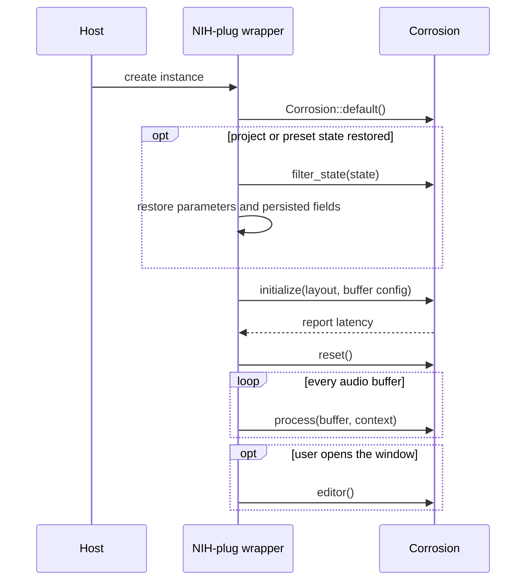
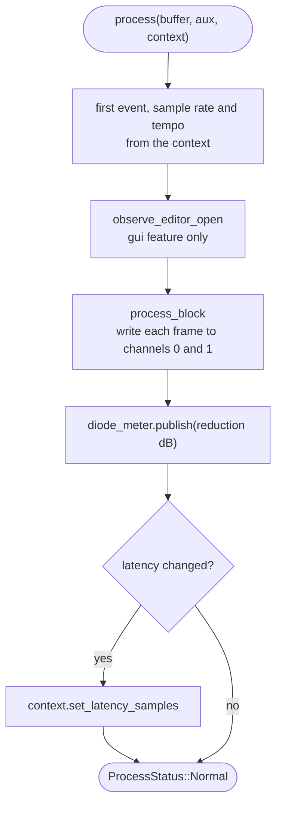
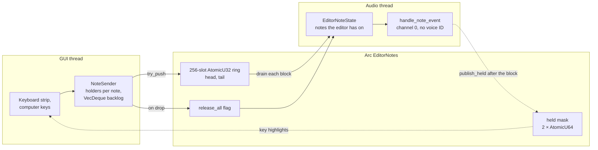

# Plugin Lifecycle

Corrosion is a NIH-plug plugin. NIH-plug wraps one Rust struct, `Corrosion` in `src/lib.rs`, as a CLAP and a VST3 plugin; the host talks to the wrapper, and the wrapper calls a handful of trait methods. This page goes through those methods in the order a host uses them: construction, state restore (`filter_state`), `initialize`, `reset`, the `process` loop with its MIDI and CC handling, the editor's note path, and the export details.

## The lifecycle at a glance



In words:

1. The wrapper builds the plugin with `Corrosion::default()`. All memory the plugin will ever use on the audio thread is allocated here.
2. When the host restores a saved project, the wrapper first passes the raw state to `filter_state`, which migrates old projects, then restores parameters by ID and the persisted fields (`editor-state`, `kit`).
3. `initialize` rates the voices for the host's sample rate, reports the latency of the restored Limiter Mode and rebuilds the kit's pad table. The code relies on NIH-plug calling `initialize` again after a later state restore (see [Kit Mode](Kit-Mode)).
4. `reset` clears all sound state in place. Hosts may call it on the audio thread.
5. `process` runs once per audio buffer.
6. `editor` creates the egui window when the user opens it (only with the `gui` feature).

## Plugin metadata

| Item | Value | Notes |
|---|---|---|
| `NAME` | `"Corrosion"` | |
| `VENDOR` | `"Corrosion Contributors"` | `plugin_vendor_is_corrosion_contributors` pins it. |
| `URL`, `EMAIL` | empty | |
| `VERSION` | `env!("CARGO_PKG_VERSION")` | 0.2.0 today, from `Cargo.toml`. |
| `AUDIO_IO_LAYOUTS` | one layout: no main input, 2 output channels, no aux ports | An instrument. |
| `MIDI_INPUT` | `MidiConfig::MidiCCs` | Notes plus CCs, pitch bend, channel and poly pressure. |
| `SysExMessage`, `BackgroundTask` | `()` | No SysEx, no background tasks. |

The plugin doesn't override `SAMPLE_ACCURATE_AUTOMATION`, so NIH-plug doesn't split blocks at parameter changes: parameters are read once per block (see [Parameters](Parameters)).

## Construction

`Corrosion::default()` builds:

| Field | What it is |
|---|---|
| `params` | `Arc<CorrosionParams>`, shared with the editor and the wrapper. |
| `voice_manager` | `VoiceManager::new()`: 16 voices, each owning one resonator preallocated to its largest bank and an instance of all 16 exciters. |
| `post_chain` | `PostProcessingChain::new()`, with the Space buffers sized for 192 kHz (`space::MAX_SAMPLE_RATE`). |
| `drive_smoother`, `output_gain_smoother` | `OnePoleSmoother`s (20 ms) starting at the Drive and Output values. |
| `lookahead_left`, `lookahead_right` | Two `LookaheadLimiter`s at `LIMITER_THRESHOLD` (0.9661). |
| `reported_latency_samples` | 0, the last latency reported to the host. |
| `panic_gain`, `panic_step` | 1 and 0: no All Sound Off in progress. |
| `diode_meter` | `Arc<DiodeMeter>`: the clipper's reduction for the editor's limiter dot. |
| `editor_notes` | `Arc<EditorNotes>`: the editor keyboard's 256-slot note ring, allocated once. |
| `editor_note_state` | `EditorNoteState`: which notes the editor has on, as the audio thread sees it. |
| `mix_dc_blocker` | `StereoDcBlocker` at 10 Hz, rated for 48 kHz until `initialize`. |
| `mix_dc_blocker_enabled` | `true`; a test-only switch to bypass the blocker. |

Nothing here is resized later. That is the base of the real-time contract: `process()` and note-on never allocate ([Real-Time Safety](Real-Time-Safety)).

## filter_state: migrating saved projects

A DAW project stores the plugin's state as parameter values by ID plus persisted fields. When it reopens, NIH-plug restores that state directly, never through the preset loader, so the preset migrations in `presets::migrate_preset_json` don't run. `Plugin::filter_state(state: &mut PluginState)` is NIH-plug's hook to rewrite the state before it is applied. Corrosion runs four migrations, in this order:

| Function | Triggers when | Writes |
|---|---|---|
| `migrate_host_wander_rate` | no `position_wander_rate`, and `position_envelope` is present | `position_wander_rate = presets::legacy_wander_rate(position_envelope)` (`0.1 + envelope·4.9`) and `position_envelope = 0`. Position Envelope used to set the wander's rate. |
| `migrate_host_onset_level` | no `mseg_onset_level`, and `mseg_onset` is present | `mseg_onset_level = presets::legacy_onset_level(mseg_onset)`. Onset Time used to set the level too. |
| `migrate_host_diode_stage` | the state has parameters but no `diode_asymmetry` | `diode_softness = 0`, `diode_asymmetry = 0`: a hard, symmetric knee, the closest to the old clipper. An empty state (nothing saved) is left to the defaults. |
| `migrate_host_old_kit_mode` | no persisted `kit` field, and `play_mode` is Kit (1) | `play_mode = Tonal` (0). The old Kit mode mapped note ranges to objects; without pads, the project would be silent. |

Each migration is a no-op on state that already has its field, so it is safe to run on every restore. `host_state_tests` in `src/lib.rs` cover each one in both directions.

**Trap:** host automation recorded against an old meaning can't be migrated, because it never passes through `filter_state`. A change of meaning is BREAKING for automation, and must be called out as such. A new migration for a changed parameter needs both paths: `migrate_preset_json` for preset files ([Presets and Migrations](Presets-and-Migrations)) and a `migrate_host_*` function here.

## initialize

```rust
fn initialize(&mut self, _layout: &AudioIOLayout, buffer_config: &BufferConfig,
              context: &mut impl InitContext<Self>) -> bool
```

It calls `Corrosion::prepare(buffer_config.sample_rate)` and reports the returned latency with `context.set_latency_samples`. It always returns `true`. `prepare` is the host-independent part, which the browser engine also calls:

1. **Rate the voices.** `VoiceManager::set_sample_rate` rates every voice, idle ones included, so a note-on builds its mode bank once, at the host rate, and its exciter starts at that rate. Without it the first note after a rate change would be built at the old rate and retuned.
2. **Rate the voice-mix DC blocker.**
3. **Record the latency.** `LOOKAHEAD_LIMITER_SAMPLES` (48) if the restored Limiter Mode is Lookahead, else 0, stored in `reported_latency_samples`. It is reported here, before the host's delay compensation is settled, rather than left to the first `process()` call; `process()` reports only later changes. `lookahead_latency_is_reported_at_initialization` checks it.
4. **Rebuild the kit table.** `params.kit_table.load(&params.kit)` turns the restored `KitState` into ready-to-play pads. This allocates, which is fine here: `initialize` runs off the audio thread, and the code comments that NIH-plug holds the plugin lock, so `process` can't run at the same time.

The post chain isn't rated here; `begin_block` sets its rate at the start of every block.

## reset

NIH-plug calls `reset()` after `initialize` and whenever the host asks for a reset (the code's own comment says "when playback starts/stops"). Hosts may call it on the audio thread, so it must not allocate. It:

- resets every voice and the channel expression (`VoiceManager::reset`: bend, pressure, mod wheel to 0, the sustain pedal up, the frame counter to 0);
- clears the voice-mix DC blocker, the post chain and both lookahead limiters in place;
- rebuilds the two smoothers at their targets. The drive smoother starts at Drive plus the Violence bias, where `begin_block` aims it, so the first note after a reset isn't driven by a ramp from the unbiased value;
- cancels any panic fade.

Because the frame counter restarts at 0 and each note's noise is seeded from its note, velocity and start frame, a render from a reset is deterministic. `plugin_reset_with_sounding_space_is_alloc_free_and_silent` checks the reset.

## process



Step by step:

1. **Read the context.** The first queued event (`context.next_event()`), the sample rate (`transport().sample_rate`, cast to `u32`) and the tempo (`transport().tempo`, `None` if the host gives none; it drives the echo's tempo sync).
2. **Watch the editor window** (`gui` feature only). NIH-plug keeps the editor state after the window closes, so the audio side detects a close itself: `EditorNoteState::observe_editor_open` compares `editor_state.is_open()` with last block's value and, on the open-to-closed edge, asks for a release of every note the editor started.
3. **Render.** `process_block(block_len, rate, tempo, &mut next_event, fetch_next, write)`, the whole audio path (described on [Signal Chain](Signal-Chain)). The `write` closure stores each limited frame into output channel 0 (left) and 1 (right). `process_block` returns the block's `BlockSetup` (rate, Width, limiter mode and threshold).
4. **Publish the diode meter.** `post_chain.take_clipper_reduction_db()` gives the largest reduction of the block in dB; `DiodeMeter::publish` keeps the maximum since the editor last read it, in an `AtomicU32` (non-negative float bits order like the values, so `fetch_max` works).
5. **Report latency changes.** `latency_change(limiter_mode)` returns `Some(samples)` only when the target latency differs from `reported_latency_samples`; only then is `set_latency_samples` called, because hosts may renegotiate their buses on every call. `mode_change_while_playing_is_reported_once` checks this.
6. **Return `ProcessStatus::Normal`.** The plugin never asks to be suspended; idle voices already cost nothing.

### Inside process_block

`process_block` is generic over the event source and the output sink, so `process()`, the offline renderer (`offline::PresetRenderer`, 512-sample blocks) and the browser engine (`WebEngine`) share it:

1. `begin_block(sample_rate, tempo)`: re-rate voices if the rate changed, set the DC blocker's rate, the drive and output-gain smoother targets, configure the limiters, push post-chain parameters (with macro biases and the tempo-synced echo time), and send live controls to held voices.
2. `handle_editor_notes()`: drain the editor's note ring.
3. For each sample: `process_pending_events` handles every event with `timing() <= sample` through `handle_note_event`, then `render_frame_unlimited` and `limit_frame` make the frame, and `write(index, limited, unlimited)` stores it. The unlimited frame (after output gain, before the limiter) lets level measurements count limiter hits.
4. After the loop, `editor_notes.publish_held(voice_manager.active_notes())` publishes the held notes as a 128-bit mask for the editor's key highlights.

## MIDI and CC handling

`handle_note_event(plugin, event)` is one `match` on NIH-plug's `NoteEvent`. Every arm is allocation-free.

| Event | Action |
|---|---|
| `NoteOn` | Velocity converted from NIH-plug's 0..1 to the voices' 0..127 scale (`note_event_velocity_to_voice_velocity`). In Kit mode: the key's pad from `kit_table.get(note)` plays, or nothing if the key has none ([Kit Mode](Kit-Mode)). In Tonal and Drone: `note_setup` snapshots the live parameters for the Object parameter's profile, and `VoiceManager::note_on_addressed` starts a voice that remembers the event's voice ID and channel. |
| `NoteOff` | `note_off_addressed`: the held voice with the event's voice ID, else the oldest held voice on that key and channel. A down sustain pedal holds it instead of releasing it. |
| `PolyTuning` | `set_note_tuning`: semitones added to the channel bend on the addressed voice(s). |
| `Choke` | `choke`: the addressed voice(s) fade out in 2 ms and are freed. |
| `PolyPressure` | `set_poly_pressure_addressed`: per-note pressure on the addressed voice. |
| `MidiPitchBend` | Normalized 0..1 (0.5 is centre) to `(value − 0.5)·2·PITCH_BEND_RANGE_SEMITONES`, ±2 semitones, on every sounding voice and stored for new notes. |
| `MidiChannelPressure` | Channel pressure on every sounding voice, stored for new notes. |
| `MidiCC` 1 | Mod wheel, stored and sent to every sounding voice. |
| `MidiCC` 64 | Sustain pedal: down when the normalized value is 0.5 or more (MIDI 64 and up). Lifting it releases every pedal-held note. |
| `MidiCC` 123 | All Notes Off: every held key is released as if lifted, so a down pedal still holds them (MIDI 1.0 behaviour). |
| `MidiCC` 120 | All Sound Off: `start_panic`, a 5 ms fade, then every voice, tail, the post chain and the limiters are cleared. Controllers keep their values. |
| `MidiCC` 121 | Reset All Controllers: pedal up, mod wheel, pitch bend and channel pressure to 0. |
| anything else | Ignored, including other CCs and the other CLAP note expressions (volume, pan, vibrato, brightness, expression). |

The voice-side details (addressing rules, stealing, the pedal and the panic) are on [Voices and Polyphony](Voices-and-Polyphony) and [Note Expression](Note-Expression). `midi_control_tests` in `src/lib.rs` covers the CCs, including `controller_messages_are_alloc_free`.

## The editor's note path

The editor's on-screen keyboard and computer keys play notes on the GUI thread; the voices live on the audio thread. `src/gui_notes.rs` connects them without locks on the audio side and without any GUI dependency, so the CI lane tests it.



The same path as a list:

- **`EditorNotes`** (shared through an `Arc`): a ring of `QUEUE_CAPACITY` = 256 `AtomicU32` slots with `head` and `tail` counters, a `release_all` flag and the held-note mask (two `AtomicU64`, 128 bits).
  - Each event packs into one word: bit 16 set for a note-on, velocity (1–127) in bits 8–14, the note in bits 0–6.
  - `try_push` (GUI) takes a producer mutex, refuses when `head − tail ≥ 256`, stores the word and publishes `head` with `Release`. The mutex only serialises producers (a host may briefly hold two editor instances); the audio thread never takes it.
  - `drain` (audio) reads `head` with `Acquire`, hands each word to the handler oldest first, and advances `tail`.
- **`NoteSender`** (GUI side) tracks why each note is held, as bits per note (`NoteSource::Mouse`, `NoteSource::Key`), so a note held by both the mouse and a key stops only when both let go. Events that don't fit in the ring wait in a `VecDeque` backlog and are retried on every press, release and frame, so none is lost. Computer keys `A W S E D F T G Y H U J K` map to notes from `key_base` (C4 = 60, or C2 = 36 in Kit mode); a key's release stops the note its press started even if the base moved. Dropping the sender (the window closing) releases what it holds and sets `release_all`.
- **`EditorNoteState`** (audio side, a `Copy` value inside `Corrosion`) mirrors which notes the editor turned on. `drain` updates that mask for each event and passes the event on; if `release_all` was set, it then sends a note-off for every note in the mask and clears it. Host notes are not in the mask, so a release-all leaves them alone.
- **`handle_editor_notes`** turns each event into a `NoteEvent` on channel 0 with no voice ID and timing 0, and calls `handle_note_event`. Editor notes therefore play at the block's first sample, after `begin_block` and before the host's events of that block.

**Trap:** an editor note-off is a plain-MIDI note-off (key and channel 0), so it releases the oldest held voice on that key and channel. If a host note on channel 0 started earlier on the same key, that one is released first. `editor_note_drain_is_alloc_free` (in `tests/no_alloc.rs`) covers the drain's real-time safety; `editor_keyboard_tests` in `src/lib.rs` covers ordering and release-all.

## The editor

`Plugin::editor` returns `gui::create_editor(params, editor_state, diode_meter, editor_notes)` with the `gui` feature, else `None`. The editor reads parameters through the `Arc`, writes them through NIH-plug's `ParamSetter`, writes the kit (`params.kit` and `params.kit_table`) directly, pushes notes into `editor_notes`, and takes the diode meter each frame. See [Editor](Editor).

## CLAP and VST3 export

```rust
impl ClapPlugin for Corrosion { /* CLAP_ID "com.corrosion.corrosion", features Instrument, Synthesizer */ }
#[cfg(not(target_arch = "wasm32"))]
impl Vst3Plugin for Corrosion { /* VST3_CLASS_ID *b"CorrosionAudio01", subcategories Instrument, Synth */ }
```

- `CLAP_ID` is `"com.corrosion.corrosion"`, with description "Industrial physical modeling synthesizer" and no manual or support URL.
- `VST3_CLASS_ID` is the 16 bytes `b"CorrosionAudio01"`. **Never change it, nor `CLAP_ID`:** hosts identify the plugin in saved projects by these IDs, and a new ID orphans every project that uses Corrosion. That holds even when other metadata, such as `VENDOR`, changes.
- `nih_export_clap!(Corrosion)` and `nih_export_vst3!(Corrosion)` produce the entry points, both under `#[cfg(not(target_arch = "wasm32"))]`: the browser build has no plugin host.
- The VST3 export sits in a private module, `vst3_export`, with `#[allow(semicolon_in_expressions_from_non_local_macros)]`. NIH-plug's VST3 macro trips that future-incompatibility lint on Rust 1.99+, and an `allow` on the macro call itself is ignored. The entry point is `#[no_mangle]`, so the module path doesn't change the exported symbol.

How the library becomes `.clap` and `.vst3` bundles is on [Building and Bundling](Building-and-Bundling).

## Which thread calls what

| Thread | Calls |
|---|---|
| Host main thread (through the wrapper) | `default`, `filter_state`, `initialize`, `editor`, parameter changes from the host |
| Audio thread | `process`, and `reset` when the host calls it there |
| Editor (GUI) thread | parameter changes through `ParamSetter`, `KitTable::set` and `load`, `NoteSender` pushes, `DiodeMeter::take` |

The audio thread shares state with the others only through atomics (`EditorNotes`, `DiodeMeter`, the `KitTable` seqlock, NIH-plug's parameter atomics) and the `RwLock<KitState>` that only `prepare` reads, outside `process`.

## Source files

- [`src/lib.rs`](https://github.com/GerMP21/Corrosion-VST/blob/main/src/lib.rs): `Corrosion`, the `Plugin`, `ClapPlugin` and `Vst3Plugin` impls, `filter_state` and the `migrate_host_*` functions, `prepare`, `process_block`, `handle_note_event`, the exports.
- [`src/gui_notes.rs`](https://github.com/GerMP21/Corrosion-VST/blob/main/src/gui_notes.rs): `EditorNotes`, `NoteSender`, `EditorNoteState` and the key mapping.
- [`src/offline/preset.rs`](https://github.com/GerMP21/Corrosion-VST/blob/main/src/offline/preset.rs): `PresetRenderer`, the offline caller of `process_block`.
- [`src/presets/mod.rs`](https://github.com/GerMP21/Corrosion-VST/blob/main/src/presets/mod.rs): `legacy_wander_rate` and `legacy_onset_level`, shared by the preset and host migrations.
