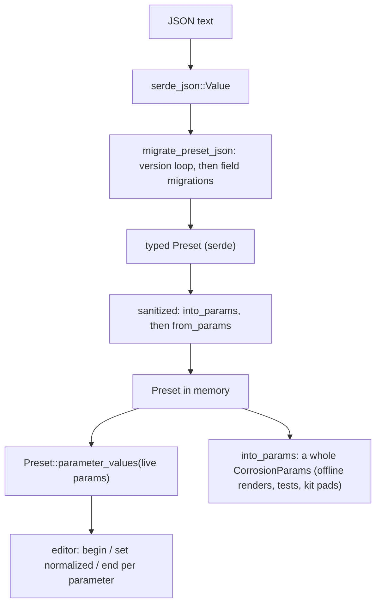
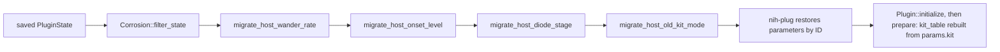
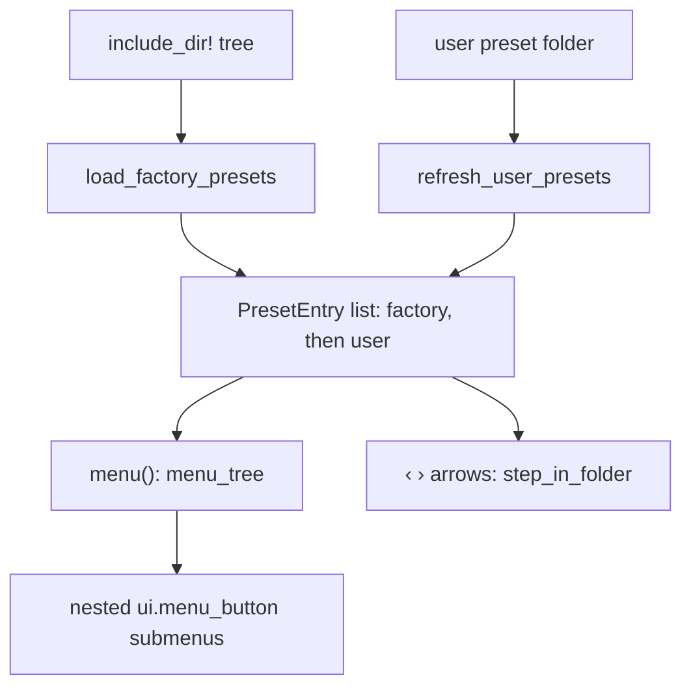
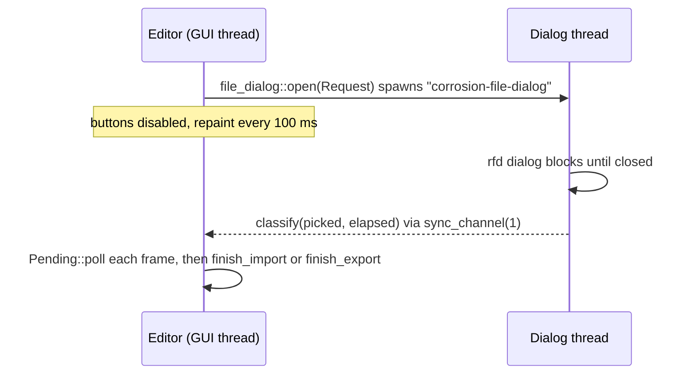

# Presets and Migrations

A Corrosion sound is stored in two places that never share code at load time: **preset files** (`.corrosion-preset`, read by the editor's browser, Import, the web app and the tests) and **host state** (a saved DAW project, restored by nih-plug parameter by parameter). Both must keep old sounds sounding the same after a parameter changes meaning, so every migration exists twice: once on the preset JSON, once on the host state. This page covers the file format, how a file becomes parameter values, the two migration paths, the user preset folder, the editor's browser, and Import/Export.

The factory bank's files are written by code; see [Factory Bank](Factory-Bank). The parameters themselves are on [Parameters](Parameters), the kit inside a preset on [Kit Mode](Kit-Mode), the browser's widgets on [Editor](Editor), and the web app's preset store on [Web App](Web-App).

## The file format

A preset is pretty-printed JSON (`serde_json::to_string_pretty`) with the extension `PRESET_EXTENSION` = `"corrosion-preset"`, factory and user alike. The Rust shape is `presets::Preset`:

```json
{
  "name": "Bowed Cable Sub",
  "version": "4",
  "object": "TautCable",
  "exciter": 1,
  "size": 1.0, "rust": 0.0, "damage": 0.0, "drive": 0.0,
  "output": 7.686, "width": 0.5, "body": 1.0,
  "quality_mode": 1,
  "play_mode": 0,
  "extra": { "env_attack": 0.03, "...": "..." },
  "kit": { "pads": [ { "key": 36, "tune": -12, "level_db": 23.2, "values": { "...": 0.0 } } ] }
}
```

- **Every host parameter is a key.** There are 149 parameters. Eleven sit at the top level (`object`, `exciter`, `size`, `rust`, `damage`, `drive`, `output`, `width`, `body`, `quality_mode`, `play_mode`); the other 138 sit under `extra` (`PresetParameters`). The key is the parameter's nih-plug ID, so code can write a value "by ID" by looking for the key at the top level, then under `extra`. The experimental generator and `KitPad::params` both rely on that.
- **Values are plain values**, not normalized ones. `output` is the linear gain (0 to 100, which is +40 dB), not dB. `object` is the `Object` variant name in PascalCase (`"TautCable"`, `"IBeam"`): renaming a variant breaks every file that names it.
- **Required keys.** `name`, `object`, `exciter`, `size`, `rust`, `damage`, `drive`, `output`, `width` and `body` have no serde default; a file without one of them fails to parse. `version` is required by the struct, but the migration inserts it when missing.
- **Optional keys.** `quality_mode` defaults to 1 (Normal), `play_mode` to 0 (Tonal), `extra` to the plugin's defaults, and `kit` to none (`skip_serializing_if = "Option::is_none"`, so a preset with an empty kit has no `kit` key). `PresetParameters` has a container-level `#[serde(default)]` whose `Default` is `PresetParameters::from_params(&CorrosionParams::default())`, so any missing `extra` field takes the plugin's default. Two exceptions with their own field defaults: the four macros (`macro_mass`, `macro_corrosion`, `macro_violence`, `macro_brightness`) default to 0.5, and `limiter_mode` to 0 (Hard).
- **Unknown keys are ignored** (no `deny_unknown_fields`), so a retired field such as `complex_algo` loads silently.
- **`ui_scale` is saved but never loaded.** It is in `extra` because it is a parameter, but `PRESET_SKIPPED_PARAMS` = `["ui_scale"]` keeps a preset from resizing the editor.

### The schema version

`PRESET_VERSION` is `"4"`. The history, from the doc comment in `src/presets/mod.rs`:

| Version | What it added |
|---|---|
| none, `"1"`, `"2"` | Legacy files without `extra` |
| `"3"` | The algorithmic resonator engine, character parameters, quality mode |
| `"4"` | Macros, `play_mode`, `limiter_mode` |

The version is bumped only for a change that serde defaults and a field migration can't express. An optional, additive field keeps the version at `"4"`; every field added since (Wander Rate, Onset Level, Diode Asymmetry, the kit) did exactly that, and its migration keys on the field being **absent**, not on the version.

## From file to parameters



The same flow as a list:

1. `Preset::load(path)` reads the file and calls `Preset::from_json_str`.
2. `from_json_str` parses to an untyped `serde_json::Value` and runs `migrate_preset_json` on it. Working on the raw value is what lets a migration rename keys or rewrite values the typed struct no longer has.
3. The migrated value is deserialized into `Preset`.
4. `Preset::sanitized` round-trips it through the parameters: `into_params()` builds a `CorrosionParams` (each constructor clamps its value to the parameter's range), and `from_params` reads it back. The original `version` and `object` are kept; `exciter` takes the parameter's value, so an out-of-range exciter (0, 17, −3) loads as Hand Strike (2). Every preset in memory is therefore already in range.
5. To play it, the editor calls `apply_preset`, which loads the kit into `params.kit` and `params.kit_table`, then takes `Preset::parameter_values(&live)` and sends each value to the host as one `raw_begin_set_parameter` / `raw_set_parameter_normalized` / `raw_end_set_parameter` gesture, so the host records and can undo it.

### `into_params` and `parameter_values`

`Preset::into_params(self) -> CorrosionParams` starts from `CorrosionParams::default()` and replaces each parameter with one built by the same constructor the live plugin uses (`crate::params::size_param`, `env_attack_param`, `output_param`, …), with the preset's value as the default. One constructor per parameter means a preset-built parameter has the live one's name, range, unit and formatter; `preset_built_parameters_display_like_the_live_ones` in `tests/preset_roundtrip.rs` checks every parameter of every factory preset. `into_params` also loads the kit into the new instance's `kit_table`, so the result is ready to render.

`Preset::parameter_values(&self, live)` converts that into what the editor needs: for every parameter in `live.param_map()` except the skipped ones, `(id, normalized)`, where the plain value comes from `into_params()` and is normalized by the **live** parameter of the same ID (`preview_normalized`). It is driven by the parameter map, so a new parameter can't be forgotten by the loader.

### Adding a parameter

A new parameter needs a field in `PresetParameters` (or `Preset`), a line in `PresetParameters::from_params`, a line in `apply_to` calling its shared constructor, and the constructor in `src/params.rs`. The factory bank test `experimental_parameters_vary` reads almost every parameter ID (all but `exciter`, `object` and the generator's fixed ones) as a preset key and panics on one that is not. Old files without the field get the struct default (the plugin's default); if that doesn't reproduce the old sound, the field also needs a migration on both paths (below), and the factory bank must be reseeded so its files carry the field ([Factory Bank](Factory-Bank)).

## Migrating preset files

`migrate_preset_json(value) -> value` runs in two stages.

**Version loop.** It reads `version` and steps it forward until it equals `PRESET_VERSION`:

| Read | Action |
|---|---|
| missing or `""` | set `"1"` |
| `"1"` or `"2"` | insert `"extra": {}` if missing, set `"3"` |
| `"3"` | set `"4"` (v4's new fields all have serde defaults) |
| anything else | stop (a newer or unknown version is left for serde to accept or reject) |

**Field migrations.** Then, whatever the version, four functions run on the value. Each is keyed on a field being absent and writes that field, so a file saved by the current plugin is never touched and running the migration twice changes nothing (`migration_idempotent_on_current_version`).

| Function | Trigger | What it writes | Why |
|---|---|---|---|
| `migrate_wander_rate` | `extra` has no `position_wander_rate` | `position_wander_rate = legacy_wander_rate(position_envelope)` = `0.1 + clamp(envelope, 0, 1) · 4.9` Hz (envelope taken as 0 when absent), and `position_envelope = 0` | Position Envelope used to set the strike-position wander's rate and nothing else; it now moves the strike position over the note, so an old value must not leak into its new meaning |
| `migrate_onset_level` | `extra` has `mseg_onset` but no `mseg_onset_level` | `mseg_onset_level = legacy_onset_level(mseg_onset)` = `clamp(onset, 0, 1)` | Onset used to set both the friction MSEG's onset time and its level |
| `migrate_diode_stage` | `extra` has no `diode_asymmetry` | `diode_softness = 0`, `diode_asymmetry = 0`, whatever the old Softness | The old clipper had a hard, symmetric knee; 0/0 is the closest setting of the new diode stage ([Output Protection](Output-Protection)) |
| `migrate_old_kit_mode` | no `kit` key and `play_mode` = Kit (1) | `play_mode = 0` (Tonal) | Old Kit mode mapped keys to objects in 10-note slots; an empty per-key kit would be silent, so the preset plays as Tonal instead |

The first three need an `extra` object to act on. A v1 or v2 file always has one after the version loop; a v3 or v4 file without `extra` skips them and gets the defaults.

The kit's pads are not migrated field by field: `KitPad::params` overlays a pad's stored values on a freshly serialized default preset (current version, every field present), so none of the migrations triggers, a value for a parameter this build doesn't have is skipped, and a parameter the pad lacks takes the default. See [Kit Mode](Kit-Mode).

*History:* the reasoning for each migration is in [`docs/ARCHITECTURE.md`](https://github.com/GerMP21/Corrosion-VST/blob/main/docs/ARCHITECTURE.md).

## Migrating saved projects (`filter_state`)

A DAW project doesn't hold a preset. nih-plug saves a `PluginState`: a map of parameter ID to `ParamValue` (`F32`, `I32`, …) plus the `#[persist]` fields (`"kit"`, and `"editor-state"` with the `gui` feature). On load the host restores those values by ID, never through `migrate_preset_json`. So `Plugin::filter_state(state)` in `src/lib.rs`, which nih-plug calls before it applies a saved state, repeats each migration on the state:



In order: wander rate, onset level, diode stage, old Kit mode; then nih-plug restores the values, and `initialize` calls `prepare`, which rebuilds `kit_table` from the restored kit.

| Host function | Trigger | What it writes |
|---|---|---|
| `migrate_host_wander_rate` | no `position_wander_rate`, and `position_envelope` is an `F32` | the same `legacy_wander_rate` rule, Position Envelope 0 |
| `migrate_host_onset_level` | no `mseg_onset_level`, and `mseg_onset` is an `F32` | `legacy_onset_level(onset)` |
| `migrate_host_diode_stage` | the parameter map is **not empty** and has no `diode_asymmetry` | Softness 0, Asymmetry 0 |
| `migrate_host_old_kit_mode` | no `"kit"` persist field, and `play_mode` is `I32(1)` | `play_mode = 0` |

The rules are shared, not copied: `legacy_wander_rate` and `legacy_onset_level` are public functions of `presets` called by both paths. The two paths differ in small ways: the host wander migration needs `position_envelope` in the state (the preset one treats it as 0), and the host diode migration leaves an empty state alone, so a host that restores nothing gets the new defaults (Asymmetry 0.25) instead of 0/0. The host-side tests are in `src/lib.rs` (they call `Corrosion::filter_state` on hand-built states); `src/kit/tests.rs` covers the old Kit project.

**Host automation can't be migrated.** An automation lane records normalized values over time; nothing passes through `filter_state`. A change that alters what an automated value means (Output's taper, Diode Softness's knee) is BREAKING for automation, and the change's proposal must say so.

**When you change a parameter's meaning:** add a field-presence migration to `migrate_preset_json`, the same rule to `filter_state`, put the rule in one shared function, and test both paths (`tests/preset_roundtrip.rs` has a "without the field keeps its sound" and a "with the field keeps both" test per migration).

## The user preset folder

`user_preset_dir()` finds the folder from environment variables only (no `dirs` crate), through `user_preset_dir_for(os, env)` so the rule is testable on any platform:

| OS | Folder |
|---|---|
| Windows | `%APPDATA%\Corrosion\Presets` |
| macOS | `$HOME/Library/Application Support/Corrosion/Presets` |
| others | `$XDG_DATA_HOME/corrosion/presets`, else `$HOME/.local/share/corrosion/presets` |

An empty or unset variable gives `None`; the editor then disables Open folder and Import with a tooltip saying why, and Save answers "No user preset folder on this system". The folder may not exist; saving, importing or Open folder creates it.

- **Listing.** `list_user_presets(dir)` walks the folder and its subfolders up to `USER_FOLDER_DEPTH` = 4 levels, skips hidden entries (names starting with `.`) and files without the extension, loads each file through `Preset::load` (so migrations run), and counts files that fail. It returns `UserPreset { path, folder, preset }`, sorted root first, then by folder and name ignoring case. `list_user_folders(dir)` returns the same walk's folders, root (`""`) first. A missing folder is simply empty.
- **Folder names.** `user_subfolder(dir, folder)` turns a `/`-separated folder into a path and refuses anything that would leave `dir`: more than 4 parts, an empty part, a leading dot, `\` or `:`, or any path component that is not a plain name (`..`). Save and Import go through it, so they can never write into the factory bank or outside the user folder.
- **File names.** `sanitize_file_name(name)` makes a name safe on every platform: `/ \ : * ? " < > |` become `_`, control characters are dropped, leading and trailing spaces and dots are trimmed, Windows device names (`CON`, `NUL`, `COM1`…`COM9`, `LPT1`…) get a `_` prefix, the result is at most 100 characters, and an empty result is `Untitled`.
- **Saving.** `save_user_preset(dir, folder, name, params, overwrite)` trims the name (empty is an error), builds `<folder>/<sanitized name>.corrosion-preset`, and returns `SaveOutcome::NeedsConfirmation(path)` without writing if the file exists and `overwrite` is false. The editor then shows "Replace "…"?" with Replace and Cancel. `Preset::save` creates the parent folders.
- **Open folder.** `open_folder(path)` creates the folder and runs `open_folder_command(os, path)` (`explorer` on Windows, `open` on macOS, `xdg-open` elsewhere) detached, with null stdio, never waiting on its exit status, so a slow file manager can't block the editor.

All of this is file I/O and runs on the GUI thread only, never on the audio thread ([Real-Time Safety](Real-Time-Safety)).

## The browser

The editor's PRESET BANK row (in `src/gui/editor.rs`) is one list of `PresetEntry { name, folder, source }`: the factory presets first, then the user presets. `selected_factory_preset` is an index into that combined list despite its name.

**Factory presets are embedded.** `static FACTORY_PRESETS_DIR: Dir = include_dir!("$CARGO_MANIFEST_DIR/presets/factory")` compiles the whole [`presets/factory`](https://github.com/GerMP21/Corrosion-VST/tree/main/presets/factory) tree into the binary, so the plugin needs no files beside it. `load_factory_presets` walks it when the editor state is created, parses every `.corrosion-preset` (a file that doesn't parse is silently left out; `factory_preset_loader_finds_factory_bank` checks none are), and keeps the JSON as `PresetSource::Factory(&'static str)`. Loading a factory preset parses that JSON again. Folder slugs become display folders: the curated folders in `CURATED_FOLDERS` order (Bass, Lead, Chords, Drones, Percussion), then Drums, then Experimental, whose subfolders are named and ordered by exciter number (`exciter_folder`); presets sort by name within a folder. User presets appear under a **User** folder that is always present, even when empty.



- `menu_tree(&[(display folder, index)])` is a pure function: each folder becomes a `MenuNode::Folder` at its first appearance, and presets at a level follow that level's submenus. `render_preset_menu` draws it as nested `ui.menu_button`s.
- The ‹ and › arrows call `step_in_folder(index, ±1)`: they move to the previous or next preset **in the current preset's folder**, wrapping around, never into another folder.
- The user list is re-read (`refresh_user_presets_keeping_selection`) when the preset menu or the Save folder selector opens, because files may have changed in the file manager and the editor state outlives the window. It is also re-read after a save or an import. A count of unreadable files shows on the message line.
- The Save row's folder selector lists only `user_folders`, so the factory bank is never a target.
- In the web build (`wasm32`) the same code reads `presets::browser` instead of a folder (below), and Open folder, Import… and Export… aren't drawn.

## Import and Export

Import… and Export… sit next to Open folder (plugin only; the `gui` feature). Both open the system file dialog through `gui::file_dialog`, which uses `rfd` 0.18 with only the `xdg-portal` feature: on Linux it asks the XDG desktop portal, then zenity, and links no GTK.



As steps:

1. A click calls `file_dialog::open(Request::Import)` or `open(Request::Export { file_name })`. It creates a one-slot `mpsc::sync_channel` and a closure that times the dialog and sends `classify(picked, elapsed)`.
2. On Windows and Linux the closure runs on its own short-lived thread named `corrosion-file-dialog`, so the editor keeps drawing. On macOS AppKit needs its dialogs on the main thread, where the editor already runs, so the closure runs in place and the dialog is modal. Audio never waits in either case.
3. The editor stores the `Pending` and calls `Pending::poll()` (a `try_recv`) every frame, requesting a repaint every 100 ms while it waits. Both buttons are disabled while a dialog is open. A dialog thread that died, or failed to spawn, drops its sender; `poll` reads the disconnection as `Answer::Unavailable`.
4. `classify` turns the raw result into an `Answer`: any non-empty pick is `Picked`; an empty answer faster than `UNSEEN_DIALOG` (250 ms) is `Unavailable`, because no person cancels a dialog that fast and `rfd` returns nothing (after logging an error) when neither the portal nor zenity answers; a slower empty answer is `Cancelled`.

**Import** (`finish_import` → `presets::import_preset_files(paths, dir, save_folder)`) copies each picked file that parses as a preset into the Save row's folder. The file is copied **unchanged**, so its migrations keep running at every load. It is named after the preset's `name` (sanitized), not the file name; `free_preset_path` adds ` (2)`, ` (3)`, … when the name is taken, comparing without case as Windows and macOS do, so nothing is overwritten. Files that don't parse are counted in `ImportReport::skipped`. The editor reports the result on the message line, re-reads the folder, selects the last imported preset and loads it. Import needs a user folder.

**Export** (`finish_export` → `presets::export_preset(name, params, path)`) writes exactly what Save writes (`Preset::from_params`) to the chosen path, adding `.corrosion-preset` when the path lacks it. The preset's name is the chosen file's stem (`export_name`), and the dialog proposes the typed Save name, else the selected preset's name. Export doesn't need a user folder. Zenity ignores the proposed name.

**No dialog.** `Unavailable` puts a message on the line instead: "copy preset files into Open folder instead" for Import, "Save the preset, then find it with Open folder" for Export.

## The web app's preset store

The browser build has no file system. `src/presets/browser.rs` keeps user presets in memory: a process-global `Mutex<Vec<BrowserPreset { folder, file, json }>>`. The page fills it from IndexedDB at start with `replace_all`, and persists what the editor saves by draining `take_saved()`. `list()` parses each entry with `Preset::from_json_str` (so migrations run, and unparseable entries are counted) and sorts them like `list_user_presets`; `folders()` lists the folders in use, root first. `save` follows the disk rules: `user_subfolder_name` validates the folder, the key is folder plus sanitized file name compared without ASCII case, and an existing entry is replaced only with `overwrite`. `import(json)` adds a file the visitor opened to the root, replacing one with the same name. See [Web App](Web-App).

## Source files

- [`src/presets/mod.rs`](https://github.com/GerMP21/Corrosion-VST/blob/main/src/presets/mod.rs): `Preset`, `PresetParameters`, `PRESET_VERSION`, `migrate_preset_json` and the field migrations, `into_params`, `parameter_values`, the user folder, Save, Import and Export
- [`src/presets/browser.rs`](https://github.com/GerMP21/Corrosion-VST/blob/main/src/presets/browser.rs): the web app's in-memory user preset store
- [`src/gui/file_dialog.rs`](https://github.com/GerMP21/Corrosion-VST/blob/main/src/gui/file_dialog.rs): the Import and Export dialogs on their own thread, `classify` and the 250 ms rule
- [`src/lib.rs`](https://github.com/GerMP21/Corrosion-VST/blob/main/src/lib.rs): `Plugin::filter_state` and the `migrate_host_*` functions
- [`src/gui/editor.rs`](https://github.com/GerMP21/Corrosion-VST/blob/main/src/gui/editor.rs): the embedded factory bank, the browser menu, arrows, Save row, Open folder, Import… and Export…, `apply_preset`
- [`src/params.rs`](https://github.com/GerMP21/Corrosion-VST/blob/main/src/params.rs): the shared parameter constructors `into_params` uses, and the `#[persist = "kit"]` field
- [`tests/preset_roundtrip.rs`](https://github.com/GerMP21/Corrosion-VST/blob/main/tests/preset_roundtrip.rs): round trips, migrations of old files, display of preset-built parameters, out-of-range exciters
- [`presets/factory`](https://github.com/GerMP21/Corrosion-VST/tree/main/presets/factory): the factory files embedded with `include_dir!`
