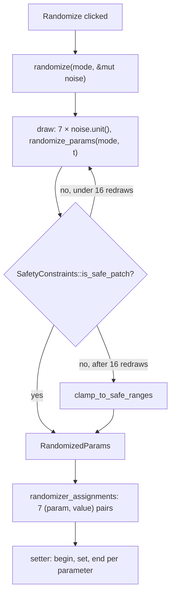

# Randomizer

The Randomize button in the editor's PRESET BANK panel draws a new value for seven top-level controls: Size, Rust, Damage, Drive, Width, BODY and Output. It is a quick way to hear variations of the current patch, so it deliberately leaves alone the object, the exciter, its slot parameters, the envelopes and the post chain. The mode menu next to it chooses the ranges. All the logic is in `src/randomizer/mod.rs`; the editor only seeds it, calls it and sends the results to the host.

## How a click becomes parameter changes

The same steps as a list:

1. `render_preset_loader` in `src/gui/editor.rs` draws a `ComboBox` with the four `RandomizerMode`s and the Randomize button.
2. A click calls `crate::randomizer::randomize(state.randomizer_mode, &mut state.randomizer_noise)`.
3. `randomize` draws seven uniform values `t` in `[0, 1)` from the noise source and maps each through the mode's range with `random_value(min, max, t) = min + t · (max − min)` (`randomize_params`).
4. If the patch fails `SafetyConstraints::is_safe_patch`, it draws again, up to `MAX_REDRAWS` = 16 more times. If the last draw still fails, `clamp_to_safe_ranges` clamps it.
5. `randomizer_assignments` pairs the seven `FloatParam`s with the drawn values, and the editor sends each as one `begin_set_parameter` / `set_parameter` / `end_set_parameter` gesture. The values are plain values, the host records them as ordinary edits, and host undo applies.

Nothing here touches the audio thread directly: the parameters change like any automation and are smoothed or picked up at note-on as usual ([Parameters](Parameters)).

## Modes and ranges

`ranges_for_mode(mode)` returns a `ParamRanges` with a `(min, max)` pair per control. A pair with min = max sets that value outright. All values are plain parameter values; Output is the linear gain the Output parameter stores (0.5 is −6.0 dB, 0.7 is −3.1 dB, 1.0 is 0 dB).

| Control (parameter range) | Safe | Object | Damage | Full |
|---|---|---|---|---|
| Size (0.05–10) | 0.5–1.5 | 0.25–2.0 | 0.8–1.2 | 0.25–2.0 |
| Rust (0–5) | 0–0.5 | **0** | 0–1.0 | 0–1.0 |
| Damage (0–10) | 0–0.5 | **0** | 0–1.0 | 0–1.0 |
| Drive (0–5) | 0–0.5 | **0** | 0–0.3 | 0–1.0 |
| Width (−2–3) | 0.3–0.8 | **0.5** | **0.5** | 0–1.0 |
| BODY (0–5) | 0–2.5 | **0** | **0** | 0–5.0 |
| Output, linear gain | 0.5–1.0 | **0.7** | **0.7** | 0.5–1.0 |

What each mode is for:

- **Safe** (the default) nudges every control within gentle ranges.
- **Object** varies only Size, so it explores the object's pitch and scale; it also **resets** the other six to a clean patch (no Rust, Damage, Drive or BODY, Width 0.5, Output −3.1 dB). It does not change the Object parameter.
- **Damage** keeps Size near 1 and explores Rust and Damage with a little Drive, resetting Width, BODY and Output.
- **Full** draws all seven over wide ranges.

A control with a fixed value in a mode is overwritten with that value, not left as it was: the randomizer never reads the current patch. (`mutate_value(current, amount, t)`, which jitters a value around its current one, exists in the module but nothing calls it.)

## Safety constraints

`SafetyConstraints::is_safe_patch` rejects a patch when:

- Output is under 0.01 (nearly silent);
- Damage > 0.8 **and** Drive > 0.8 at once;
- Size is outside 0.1–3.0.

With the current ranges only the second rule can fire, and only in Full mode (Damage and Drive both reach 1.0 there): about 4 % of Full draws, so a redraw is common and needing all 16 is practically impossible (about 0.04^17). The fallback `clamp_to_safe_ranges` clamps each control into the widest ranges (Size 0.25–2.0, Rust, Damage, Drive and Width 0–1, BODY 0–5, Output 0.1–1.2), which does not separate Damage and Drive; it only guarantees a finite, in-range patch if the ranges ever change. `full_mode_patches_are_safe` draws 1000 Full patches and checks each.

If you widen a range, check that the constraints still hold the line you intend, and that `clamp_to_safe_ranges` still contains the mode's ranges.

## The seed

Every draw comes from one `dsp::utils::noise::Noise` held in the editor state (`randomizer_noise`), the engine's xorshift32 generator ([DSP Utilities](DSP-Utilities)). `Noise::new(seed)` mixes the seed first, so nearby seeds give unrelated sequences, and avoids the zero state. The same seed always gives the same sequence of patches, which is what the tests use (`Noise::new(7)`, `Noise::new(11)`, `Noise::new(3)`).

- **In the plugin**, `clock_seed()` seeds it from the system clock (sub-second nanoseconds XOR seconds) when the editor state is created, so each instance draws its own sequence.
- **In the web app**, `std::time::SystemTime::now` panics on `wasm32-unknown-unknown`, so `clock_seed()` returns a constant 1 there, which would make every visitor's first click identical. The page therefore passes a seed in: `web/www/app.js` takes `crypto.getRandomValues(new Uint32Array(1))[0] | 1` and hands it to `editor.start`, and `WebEditor::new(params, …, seed)` builds `Noise::new(seed.max(1))`. See [Web App](Web-App).

The mode and the noise state are editor state: they are not parameters, not saved in presets or projects, and the mode starts at Safe whenever the editor state is created.

## Tests and other users

| Test | Where | Checks |
|---|---|---|
| `safe_mode_stays_in_its_ranges` | `src/randomizer/mod.rs` | 100 Safe draws stay in the Safe ranges |
| `full_mode_patches_are_safe` | `src/randomizer/mod.rs` | 1000 Full draws pass `is_safe_patch` |
| `draws_differ` | `src/randomizer/mod.rs` | two consecutive Full draws differ |
| `randomize_sets_only_its_seven_parameters` | `src/gui/editor.rs` (GUI lane) | the assignments map to exactly `body`, `damage`, `drive`, `output`, `rust`, `size`, `width` |

The user Wiki's generated data lists the four modes: `src/guide/mod.rs` exports them as `randomizer_modes` ([Site and User Wiki Tooling](Site-and-User-Wiki-Tooling)). `RandomizerMode::from_int` and `to_int` (0 Safe, 1 Object, 2 Damage, 3 Full; anything else reads as Safe) give the modes stable numbers.

## Source files

- [`src/randomizer/mod.rs`](https://github.com/GerMP21/Corrosion-VST/blob/main/src/randomizer/mod.rs): modes, ranges, `randomize`, the safety constraints and their tests
- [`src/gui/editor.rs`](https://github.com/GerMP21/Corrosion-VST/blob/main/src/gui/editor.rs): the mode menu and button, `clock_seed`, `randomizer_assignments`, `WebEditor::new`'s seed
- [`src/dsp/utils/noise.rs`](https://github.com/GerMP21/Corrosion-VST/blob/main/src/dsp/utils/noise.rs): the xorshift32 `Noise` the draws come from
- [`web/www/app.js`](https://github.com/GerMP21/Corrosion-VST/blob/main/web/www/app.js): the web page's random seed
- [`src/guide/mod.rs`](https://github.com/GerMP21/Corrosion-VST/blob/main/src/guide/mod.rs): exports the mode list to the user Wiki
