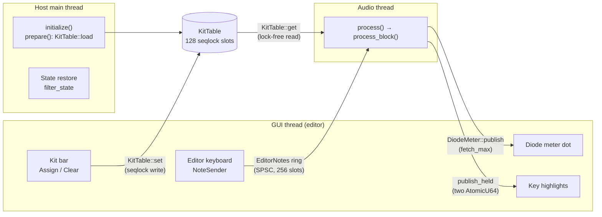

# Real Time Safety

The host calls `process()` on its audio thread with a hard deadline: at 48 kHz and a 128-sample buffer, Corrosion has 2.67 ms to produce the block, every block, forever. A heap allocation can take the global allocator's lock, page in memory or call into the kernel, and any of those can take longer than the whole block. The result is a dropout, and it happens rarely enough that nobody notices until a user's mix crackles. So Corrosion keeps one contract on the audio thread, and a test suite that fails the build when the contract breaks:

- **No allocation and no freeing** in `process()`, in note-on, note-off, voice stealing, live control changes, MIDI expression, `reset()` and a sample-rate change.
- **No locks.** The audio thread never waits on another thread. Shared state goes through atomics, a lock-free ring and a seqlock.
- **Bounded work.** Every loop on the audio thread has a fixed bound: 16 voices, at most `MAX_MODES` modes per voice, fixed-size delay lines.

This page explains how each part keeps the contract, how `tests/no_alloc.rs` checks it, and the performance rules for the per-sample loops that grew out of the same discipline. The CPU side of those rules is measured on [Benchmarks and Performance](Benchmarks-and-Performance).

## What runs where



The same in words:

| Shared state | Writer | Reader | Mechanism | Audio side |
|---|---|---|---|---|
| Editor notes (`EditorNotes`) | GUI thread (`try_push`) | Audio thread (`drain`) | Single-producer single-consumer ring of 256 `AtomicU32` slots | Lock-free, allocation-free |
| Release-all flag | GUI thread, or the audio thread when it sees the editor close | Audio thread (`take_release_all`) | `AtomicBool` | Lock-free |
| Held-note mask | Audio thread (`publish_held`, once per block) | GUI thread (`held`) | Two `AtomicU64` words, one bit per MIDI note | Lock-free |
| Kit pads (`KitTable`) | GUI thread, `initialize()` (`set`, `load`) | Audio thread (`get`) | One seqlock per key, writers serialised by a mutex the audio thread never takes | Lock-free, gives up after 4 tries |
| Diode meter (`DiodeMeter`) | Audio thread (`publish`, once per block) | GUI thread (`take`) | One `AtomicU32` holding `f32` bits, `fetch_max` | Lock-free |

Everything else the audio thread touches belongs to it alone: the `Corrosion` struct's `VoiceManager`, post chain, smoothers and limiters are owned by the plugin instance and only `process()`, `reset()` and `initialize()` (which the host never runs concurrently with `process()`) touch them. Parameters are read through nih-plug's atomics. The flow of a block is on [Plugin Lifecycle](Plugin-Lifecycle).

## Preallocation: where the memory comes from

Nothing on the audio thread grows a buffer. Every buffer that the audio thread fills is sized for the worst case when its owner is built, on the host's main thread.

### Voices

`VoiceManager::new` builds all 16 voices (`MAX_VOICES`, `src/voice/manager.rs`) as a fixed array (`std::array::from_fn`). Each `Voice` owns one instance of every exciter model, so switching exciter is a `match` on an integer: no trait objects and no boxing at note-on. A new note reuses a voice slot; it never creates one. See [Voices and Polyphony](Voices-and-Polyphony).

### The mode bank: `MAX_MODES` and `rebuild_in_place`

A note-on builds a new modal bank: the object's mode table scaled by Size and quality, transformed by Rust, Damage and Heat, and pruned of modes that can never sound. The bank's length changes with every note. To build it without allocating, `ModalResonator` keeps every vector at the worst-case capacity from birth (`ModalResonator::with_note_capacity`, `src/dsp/resonators/core.rs`):

| Constant | Value | How it is derived |
|---|---|---|
| `MAX_BASE_MODE_COUNT` | 12 | The longest object mode table, computed at compile time over all nine profiles (Industrial Cog has 12) |
| `MAX_MODE_COUNT_SCALE_INT` | 4 | Upper clamp on the quality mode's `mode_count_scale` (Render uses 2.0) |
| `MAX_RAW_MODES` | 48 | `MAX_BASE_MODE_COUNT × MAX_MODE_COUNT_SCALE_INT`: the most modes a generator can emit |
| `MAX_MODES` | 96 | `MAX_RAW_MODES × 2`: Damage can add one companion mode per mode |

The vectors held at `MAX_MODES` capacity are `modes`, the interaction bus's per-mode coefficients, the scratch buffers `raw_specs` and `transformed_specs`, `mode_weights` and `retune_cache`.

`ModalResonator::rebuild_in_place` is the note-on path. It generates the raw specs into `raw_specs`, transforms them into `transformed_specs`, prunes in place (compacting kept modes to the front and truncating), then clears `modes` and refills it. `clear()` and `truncate()` keep capacity, and a refill below capacity never reallocates. Two guards keep it that way:

- a `debug_assert!` in `rebuild_in_place` fails if a generator ever emits more than `MAX_RAW_MODES`;
- `transform_algorithm_modes_into` stops at `MAX_MODES`, and the unit test `note_on_banks_fit_max_modes` checks the generators' raw counts and the untruncated damage expansion over every profile, extreme character settings and scales up to 100, because checking the truncated bank would pass vacuously.

`rebuilding_a_reused_resonator_matches_a_fresh_one` checks that a long-lived resonator rebuilt in place, growing and shrinking, produces exactly the bank a freshly built one does.

**Trap:** adding a mode table longer than 12 modes is safe (the constant follows the tables), but a generator that emits more modes than its table times the scale, or a transform that adds more than one companion per mode, breaks the bound. The debug assert and `note_on_banks_fit_max_modes` catch it; release builds would silently truncate.

### Streaming exciters

Exciters that keep a list of events preallocate it to the clamp of their density control: Wire Brush holds up to `MAX_WIRE_DENSITY` = 5000 impulses, Metal Chain up to `MAX_LINKS` = 20 links, Particle Rain up to `MAX_PARTICLES` = 64 particles (`src/dsp/exciters/`). Hard Mallet bounds its strike at `MAX_STRIKE_FRAMES` = 12 000 frames. See [Exciters](Exciters).

### Post chain buffers sized for 192 kHz

Delay lines are defined in time, so their length in samples grows with the sample rate. The Space section and the stereo spread size theirs for the highest rate they support, `space::MAX_SAMPLE_RATE` = 192 000 Hz, when the chain is built (`src/dsp/post_processing/space.rs`):

- Space delays are tuned in samples at 48 kHz (`REFERENCE_RATE`) and scaled by `sample_rate / 48 000`. `capacity_for` sizes each buffer as `max_samples_at_48k × 4 + 8`, and `delay_buffer` allocates it as a `Box<[f32]>` once. `delay_samples` clamps every delay to `1..capacity`, so a host rate above 192 kHz shortens delays instead of overrunning.
- The HRTF spread's mid delay holds up to 1 ms. `DELAY_CAPACITY` is 256 samples, a fixed array inside `HrtfSpread` (1 ms at 192 kHz is 192 samples).

A host sample-rate change (`VoiceManager::set_sample_rate` and the chain's `set_sample_rate`) only recomputes coefficients; it doesn't resize anything. The test `rate_change_and_retrigger_are_alloc_free` checks that.

### Resetting in place

`Plugin::reset` may be called on the audio thread, so it clears state without freeing: `VoiceManager::reset`, the voice-mix DC blocker, `PostProcessingChain::reset` and both lookahead limiters zero their state in place. The All Sound Off fade (`panic_frame`, `src/lib.rs`) ends with the same in-place clears. Smoothers are rebuilt as plain values (`OnePoleSmoother::new`), which is a struct copy, not an allocation.

### What may allocate, and where it runs

| Allocates | Runs on | Why it's safe |
|---|---|---|
| `VoiceManager::new`, `PostProcessingChain::new`, Space and HRTF buffers | Plugin construction | Before any audio |
| `EditorNotes::new` (the 256-slot ring), `KitTable::new` (128 slots) | Plugin construction | Before any audio |
| `KitTable::load` (builds a `Vec` of pads) | `initialize()` via `prepare()`, and state restores | nih-plug calls `initialize()` off the audio thread, after a state restore |
| `NoteSender`'s backlog (`VecDeque`) | GUI thread | The editor's side of the ring |
| Editor, preset browser, file dialogs | GUI thread | Never on the audio thread |

## Hot-loop rules

The real-time contract is about worst-case latency. The per-sample loops also have to be fast on average: 16 voices × up to 96 modes × 48 000 samples a second. The rules below come from measurements; the numbers are on [Benchmarks and Performance](Benchmarks-and-Performance#code-layout-and-cold-paths).

### Keep the per-mode data small

`SecondOrderMode` is visited for every mode of every voice on every sample, and that working set sits near the size of the L1 data cache. It holds only what the per-sample update needs: the spec, the base frequency, decay and gain, the coefficients (`CoupledCoefficients`: pole, input gain, fade, two ring-bound terms), the cached sample rate and the complex state `z_re`, `z_im`.

Data a mode needs only occasionally lives in parallel vectors on `ModalResonator`, in mode order:

- `mode_weights`: each mode's brightness weight from before pruning, read when Damping or Brightness move;
- `retune_cache` (`RetuneCache`): pole radius, input gain, angle with its sine, cosine and reciprocal, read only when a pitch bend or an object's pitch dynamics retune the bank.

**Trap:** adding a field to `SecondOrderMode` slows every note, including notes that never use it. Put it in a parallel `Vec` instead.

### Keep cold paths out of line

A branch that almost never runs still costs time if the compiler inlines its body into the loop: the loop gets bigger, and its placement in memory changes. So:

- `SecondOrderMode::ensure_rate` is `#[inline]` and only compares the cached rate. The rebuild is `rebuild_for_rate`, `#[cold] #[inline(never)]`.
- `ModalResonator::apply_dynamics` (per-sample retuning for bent notes and for objects with pitch dynamics) is `#[inline(never)]`. It runs only when `has_dynamics()` says so, and skips work when the pitch factor has moved by no more than `RETUNE_TOLERANCE` (2.8 × 10⁻⁵) since the last retune.
- `advance_heat_wander` is `#[cold] #[inline(never)]`.
- `Voice::choke_gain` (a 2 ms fade after a choke) and `Corrosion::panic_frame` (the All Sound Off fade) are `#[cold] #[inline(never)]`.

### No float division by a constant

`x / 6.0` compiles to a division: the compiler won't turn it into `x * (1.0 / 6.0)`, because the two can round differently. Divisions are several times slower than multiplications. Hot code multiplies by a precomputed reciprocal instead: `retune_incremental` uses `const SIXTH: f64 = 1.0 / 6.0` and friends for its Taylor series, `RetuneCache` keeps `inv_omega` and `omega_per_hz` so a small retune needs no division at all, and the diode curve keeps `inv_span` (`src/dsp/post_processing/oversampled_clipper.rs`).

### Numerical hygiene

- **Denormals.** nih-plug's `process_wrapper` turns on the CPU's flush-to-zero flag for the duration of each `process()` call. Each voice also adds and subtracts `DENORMAL_FLUSH` (10⁻²⁰) on its output (`src/voice/mod.rs`).
- **Non-finite values.** Each voice replaces a non-finite resonator sample, or one below 10⁻³⁰, with zero before the rest of the voice (rattle, high-pass boost, clamp to ±1) sees it, so one unstable voice can't poison the mix. Voice stealing sorts a non-finite `peak_hold` as the quietest voice (`comparable_peak_hold`, `src/voice/manager.rs`), so a corrupted voice is reclaimed instead of panicking a comparison.

## The checking allocator

Nothing in Rust's type system stops an allocation, so the contract is checked at run time by the `assert_no_alloc` crate (the `feature/nested-permit-forbid` branch of nih-plug's author's fork, `https://github.com/robbert-vdh/rust-assert-no-alloc`). It provides:

- `AllocDisabler`, a global allocator that wraps the system allocator and checks a thread-local flag on every `alloc`, `dealloc` and `realloc`;
- `assert_no_alloc(|| …)`, which sets that flag for the closure. An allocation inside the closure aborts the process.

nih-plug installs `AllocDisabler` as the `#[global_allocator]` when its `assert_process_allocs` feature is on **and** `debug_assertions` is on, and wraps every `process()` call in `assert_no_alloc`. In a release build the allocator isn't installed and the check costs nothing; a release test run therefore passes vacuously. That is why the real-time tests run in debug only.

Which builds have it:

| Build | `assert_process_allocs` | Why |
|---|---|---|
| Linux, macOS (any build of the crate, tests included) | On, from `Cargo.toml`'s `[target.'cfg(not(any(target_os = "windows", target_arch = "wasm32")))'.dependencies]` | |
| Windows | Off in `Cargo.toml` | nih-plug refuses to compile the feature on `x86_64-pc-windows-gnu` in debug (a `compile_error!` naming an upstream issue), and the feature once hung nih-plug's test setup on Windows. CI turns it on for the `no_alloc` test alone on MSVC with `--features nih-plug/assert_process_allocs` |
| wasm32 | Off | The web engine's own `web/engine/tests/no_alloc.rs` runs natively and links Corrosion, which installs it |

The test crate's `assert_no_alloc` (a dev-dependency) and the one nih-plug's allocator uses must be the same crate instance, or the flag the test sets is not the flag the allocator reads. `Cargo.lock` resolves both to one package from the same git branch. If that ever split, every check would pass vacuously; `the_checker_is_armed` (below) is what would catch it.

## What `tests/no_alloc.rs` exercises

Each test sets up outside the checked zone (building a `VoiceManager` allocates), then runs the audio-thread operation inside `assert_no_alloc`. A violation aborts the whole test process, not just one test, so a failure shows as a crashed test binary.

| Test | What runs inside the checked zone |
|---|---|
| `process_callback_is_alloc_free` | 10 s at 48 kHz of a full 16-voice pool |
| `note_on_is_alloc_free_for_every_object_and_quality` | A note-on and 64 samples for each of the 9 objects × 4 quality scales (0.5, 1, 1.5, 2) × Damage 0 and 1 |
| `note_on_is_alloc_free_for_every_exciter` | All 16 exciters at Render's scale, 0.1 s each, so streaming exciters (Particle Rain, Wire Brush, Metal Chain) reach steady state |
| `note_off_and_tail_are_alloc_free` | Releasing bowed and struck Pipe notes and rendering until every tail deactivates (the test asserts that they did, so deactivation is really exercised) |
| `voice_stealing_is_alloc_free` | 16 new notes into a full pool of small Eco banks; each steals a voice and grows its bank to Industrial Cog at Render with Damage 1 |
| `live_expression_is_alloc_free` | Pitch bend over ±24 semitones, channel and poly pressure, mod wheel and every live control (`update_live_controls`) |
| `note_expression_is_alloc_free` | Voice-ID addressed tuning, pressure, note-offs, chokes (including an unknown ID) and an addressed note-on |
| `plugin_reset_is_alloc_free` | `Corrosion::reset()` on a default plugin |
| `reset_with_sounding_voices_is_alloc_free_and_silent` | `VoiceManager::reset` with 16 sounding voices, then 0.1 s that must be exactly zero |
| `rate_change_and_retrigger_are_alloc_free` | Sample-rate changes to 96, 44.1 and 48 kHz, each followed by a retrigger of all 16 exciters |
| `editor_note_drain_is_alloc_free` | Draining the editor ring (note-ons, a note-off, a release-all), playing them and publishing the held mask |
| `pad_note_ons_are_alloc_free_while_pads_are_assigned` | 200 rounds of Kit pad note-ons read from a `KitTable` while another thread keeps assigning and clearing a pad |
| `allocation_aborts_under_the_checker` | Ignored. Allocates on purpose; only `the_checker_is_armed` runs it |
| `the_checker_is_armed` | Runs the test binary again as a child process with only `allocation_aborts_under_the_checker`, and requires the child to die |

`the_checker_is_armed` is the test that makes the others mean something: without it, a build where the allocator isn't installed passes every test. On Windows it is skipped unless `CORROSION_EXPECT_ALLOC_CHECKER` is set, which CI's Windows step does.

Two unit tests in `src/lib.rs` cover the plugin's own block path in a checked zone: `controller_messages_are_alloc_free` renders `process_block` through the sustain pedal, All Notes Off, All Sound Off and Reset All Controllers, and `plugin_reset_with_sounding_space_is_alloc_free_and_silent` resets two legacy presets while their notes ring through Echo and Spring, and requires exact silence afterwards. Unit tests elsewhere use the same allocator (it is installed in every test binary on Linux and macOS).

Run them:

```bash
CARGO_BUILD_TARGET=x86_64-unknown-linux-gnu cargo test --no-default-features --test no_alloc
```

No `--release`. The test lanes are on [Testing](Testing#test-lanes).

**When you add audio-thread code:** add its operation to `tests/no_alloc.rs` (or a checked zone in a unit test), and confirm the new test fails if you add a `Vec::new()` with capacity, or a `Box`, in the path.

## Lock-free structures in detail

### The editor note ring (`src/gui_notes.rs`)

`EditorNotes` carries notes from the editor's on-screen keyboard and computer keys to the audio thread.

- `slots` is a boxed slice of `QUEUE_CAPACITY` = 256 `AtomicU32`. An event packs into one word: bit 16 marks a note-on, bits 8–15 the velocity (1–127), bits 0–6 the note.
- `head` counts events written and `tail` events read; both only grow (wrapping). The ring is full when `head − tail ≥ 256`.
- `try_push` (GUI): takes the `producer` mutex, stores the slot with `Relaxed`, then publishes `head` with `Release`. It returns `false` when the ring is full; `NoteSender` keeps a backlog and retries, so no event is lost.
- `drain` (audio): loads `head` with `Acquire`, reads each slot, advances `tail` with `Release`. No lock.

The `producer` mutex only serialises producers (a host may briefly hold two editor instances); the audio thread never takes it, so the consumer side stays lock-free. `EditorNoteState` is the audio thread's bookkeeping: a `NoteMask` of the notes the editor turned on, so a release-all sends note-offs only for those. The audio thread requests a release-all itself when `editor_state.is_open()` falls, because a closed editor can't release its own keys.

### The kit seqlock (`src/kit/mod.rs`)

In Kit mode each key plays its own pad (see [Kit Mode](Kit-Mode)). `KitTable` holds 128 slots, each a `seq: AtomicU32` and a `pad: UnsafeCell<MaybeUninit<Option<Pad>>>`. `Pad` is `Copy`, so a slot is plain data.

- **Write** (`set`, `load`; GUI or main thread): take the `writer` mutex, bump `seq` to odd, release fence, `write_volatile` the pad, bump `seq` to even with `Release`.
- **Read** (`get`; audio thread): load `seq` with `Acquire`; if odd, spin once and retry. Otherwise `read_volatile` the slot into a `MaybeUninit`, acquire fence, and keep the copy only if `seq` is unchanged. After `READ_TRIES` = 4 failed tries it returns `None` and the note plays nothing, rather than wait.

The copy stays `MaybeUninit` until the sequence check proves no write overlapped it, so a torn read is never interpreted as a `Pad`. `KitTable::generation()` sums the slots' counters; the web editor uses it to notice a changed kit.

### The diode meter (`src/dsp/post_processing/oversampled_clipper.rs`)

The red dot on the editor's brickwall panel shows how hard the diode clipper worked. `DiodeMeter` is one `AtomicU32` holding the bits of a non-negative `f32` in dB. Non-negative floats order the same as their bit patterns, so `publish` can use `fetch_max` to keep the largest reduction since the GUI last looked, and `take` swaps in 0. The audio thread publishes once per block, after `process_block`. See [Output Protection](Output-Protection).

## Source files

- [`tests/no_alloc.rs`](https://github.com/GerMP21/Corrosion-VST/blob/main/tests/no_alloc.rs): the allocation checks on the audio-thread paths, and `the_checker_is_armed`
- [`Cargo.toml`](https://github.com/GerMP21/Corrosion-VST/blob/main/Cargo.toml): where `assert_process_allocs` is turned on per target, and the `assert_no_alloc` dev-dependency
- [`src/dsp/resonators/core.rs`](https://github.com/GerMP21/Corrosion-VST/blob/main/src/dsp/resonators/core.rs): `MAX_MODES`, `rebuild_in_place`, `SecondOrderMode`, `RetuneCache`, `ensure_rate`, `apply_dynamics`
- [`src/voice/manager.rs`](https://github.com/GerMP21/Corrosion-VST/blob/main/src/voice/manager.rs): the fixed 16-voice array and NaN-safe stealing
- [`src/voice/mod.rs`](https://github.com/GerMP21/Corrosion-VST/blob/main/src/voice/mod.rs): the voice's output guards and the cold choke path
- [`src/dsp/post_processing/space.rs`](https://github.com/GerMP21/Corrosion-VST/blob/main/src/dsp/post_processing/space.rs): `MAX_SAMPLE_RATE` and the Space delay buffers
- [`src/dsp/post_processing/hrtf_spread.rs`](https://github.com/GerMP21/Corrosion-VST/blob/main/src/dsp/post_processing/hrtf_spread.rs): the spread's fixed delay buffer
- [`src/gui_notes.rs`](https://github.com/GerMP21/Corrosion-VST/blob/main/src/gui_notes.rs): the editor note ring and the held-note mask
- [`src/kit/mod.rs`](https://github.com/GerMP21/Corrosion-VST/blob/main/src/kit/mod.rs): the `KitTable` seqlock
- [`src/dsp/post_processing/oversampled_clipper.rs`](https://github.com/GerMP21/Corrosion-VST/blob/main/src/dsp/post_processing/oversampled_clipper.rs): `DiodeMeter`
- [`src/lib.rs`](https://github.com/GerMP21/Corrosion-VST/blob/main/src/lib.rs): `process`, `reset`, `prepare`, `panic_frame`, and the checked-zone unit tests
- [`web/engine/tests/no_alloc.rs`](https://github.com/GerMP21/Corrosion-VST/blob/main/web/engine/tests/no_alloc.rs): the same check for the web engine
