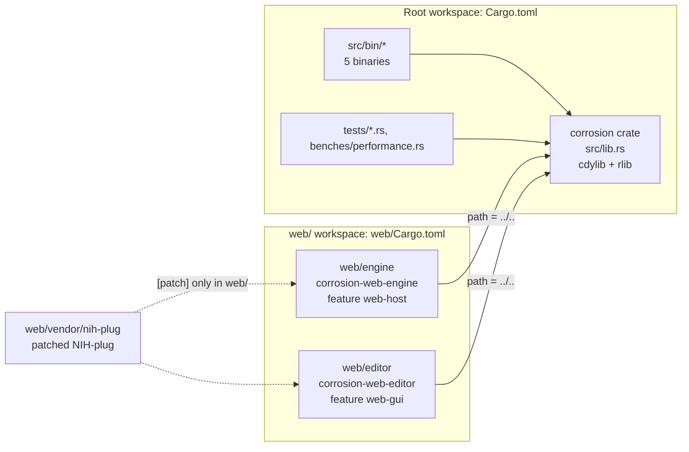

# Repository Layout

Corrosion is one Rust crate that builds a VST3 and CLAP plugin, five command-line tools, and (through a second Cargo workspace) a browser build. Around the crate sit the tests, benchmarks, scripts, the factory presets, the website and two sets of documents: the OpenSpec change records and this wiki. This page says where everything is and how the builds are wired, so the rest of the wiki can name files without explaining them.

## Two Cargo workspaces



The same structure as a list:

- **Root workspace** (`Cargo.toml`, lockfile `Cargo.lock`). It has no `[workspace]` table, so it is a single-package workspace: the `corrosion` crate.
  - The library is built as `cdylib` (the plugin binary a host loads) and `rlib` (what the binaries, integration tests, benchmarks and the web crates link against).
  - The five binaries in `src/bin/`, the integration tests in `tests/` and the Criterion benchmark `benches/performance.rs` all use the `rlib`.
- **Web workspace** (`web/Cargo.toml`, lockfile `web/Cargo.lock`), members `engine` and `editor`.
  - Both members depend on the root crate by path (`corrosion = { path = "../.." }`) with `default-features = false`.
  - `web/engine` turns on `web-host`; `web/editor` turns on `web-gui`.
  - Its `[patch."https://github.com/robbert-vdh/nih-plug"]` points NIH-plug at `web/vendor/nih-plug`, a copy that `web/scripts/fetch-nih-plug.sh` fetches at the revision `Cargo.lock` pins and patches with `web/nih-plug-public-setters.patch`. That patch makes the parameter setters public, which the browser host needs. The plugin builds never see it, which is why the browser features only build inside `web/`.

Why two workspaces: a `[patch]` applies to a whole workspace. Keeping the patched NIH-plug in its own workspace means the shipped plugin is built against upstream NIH-plug, and the web build can still poke parameters directly. The [Web App](Web-App) page covers the browser build itself.

## The root Cargo.toml

**Package.** `corrosion` 0.2.0, edition 2021, `GPL-3.0-or-later`. The version is what the plugin reports to hosts (`Plugin::VERSION` is `env!("CARGO_PKG_VERSION")`).

**Dependencies that matter for the build:**

| Dependency | How it is used |
|---|---|
| `nih-plug` (git, upstream) | The plugin framework. Declared three times with target conditions: default features (VST3 wrapper) on every non-wasm target; `default-features = false` on `wasm32` (no VST3, no host); and `assert_process_allocs` added on every target that is neither Windows nor wasm, which makes NIH-plug panic on an allocation inside `process()` in debug builds. |
| `nih_plug_egui` (git, optional) | The editor's window. `default-features = false, features = ["opengl"]`, so egui's default fonts are not pulled in. |
| `egui` `=0.31.1` (optional) | Plain egui for the browser editor, the version `nih_plug_egui` uses, without default fonts. |
| `rfd` 0.18 (optional) | Native file dialogs for preset Import and Export. `xdg-portal` on Linux, so the bundle links no GTK. |
| `clap` 4 | Argument parsing for the binaries in `src/bin/`. |
| `serde`, `serde_json` | Presets, kits and the guide data. |
| `include_dir` 0.7 | Embeds `presets/factory/` into the editor (`src/gui/editor.rs`). |

**Features:**

| Feature | Turns on | Meaning |
|---|---|---|
| `default` | `gui` | A normal plugin build has an editor. |
| `gui` | `nih_plug_egui`, `rfd` | The egui editor in its own window, plus the file dialogs. CI's main test lane runs with `--no-default-features`, so it never compiles this. |
| `web-host` | nothing | The `web` module (`src/web/`): `WebEngine`, the command protocol. Builds only in `web/`. |
| `web-gui` | `web-host`, `egui` | `src/gui/editor.rs` compiled on plain egui, with no window of its own. Builds only in `web/`. |

**Dev-dependencies:** `assert_no_alloc` (git branch `feature/nested-permit-forbid`, the checking allocator behind `tests/no_alloc.rs`) and `criterion` 0.5 (the benchmark, declared with `harness = false`).

**Profiles and patches:**

- `[profile.test]` sets `opt-level = 1`. Debug test runs render many seconds of audio; level 1 keeps debug assertions and overflow checks while cutting run time several-fold.
- `[patch.crates-io]` replaces `nih_log` with `vendor/nih_log`, which drops the unmaintained `atty` crate.
- `[patch."https://github.com/BillyDM/egui-baseview.git"]` replaces `egui-baseview` with `vendor/egui-baseview`, which removes `default_fonts` from its default features. `nih_plug_egui` would otherwise always turn that feature on, and a dependent crate can't turn off a transitive default feature.

There is no `[profile.release]` in the root manifest; release builds use Cargo's defaults. The web workspace sets its own (`opt-level = 3`, `lto = true`, `codegen-units = 1`, `panic = "abort"`).

## .cargo/config.toml: the default target trap

`.cargo/config.toml` is written for the maintainer's Windows machine:

```toml
[build]
target = "x86_64-pc-windows-gnu"
target-dir = "../corrosion-target"
```

- **Default target.** A bare `cargo build` or `cargo test` on Linux cross-compiles for Windows GNU and fails to link (or tries to run a `.exe`). On Linux, always set a host target: `export CARGO_BUILD_TARGET=x86_64-unknown-linux-gnu`.
- **Output directory.** Build output goes to `../corrosion-target`, a sibling of the checkout, not `target/`. Paths in Cargo config are relative to the directory that holds `.cargo/`, so this is the same place whatever directory you run Cargo from. `scripts/bundle.sh` looks for the library there unless `CARGO_TARGET_DIR` is set.
- **Linkers.** `x86_64-unknown-linux-musl` links with `rust-lld` and `-C link-self-contained=yes` (CI's test target); `x86_64-unknown-linux-gnu` with `gcc`; `x86_64-pc-windows-gnu` with `x86_64-w64-mingw32-gcc`.
- **The web workspace** inherits this file (Cargo reads config from parent directories) but overrides the output directory in `web/.cargo/config.toml` (`target-dir = "target"`, so `web/target/`). `web/scripts/build.sh` always passes `--target wasm32-unknown-unknown`, so the Windows default never applies there.

The toolchain must be Rust 1.99 or newer: `src/lib.rs` allows the `semicolon_in_expressions_from_non_local_macros` lint on the module that expands NIH-plug's VST3 export, and older compilers reject that lint name under `-D warnings`. [Building and Bundling](Building-and-Bundling) has the full build recipe.

## The binaries in src/bin

All five are thin command-line wrappers around library code, so tests can call the same code.

| Binary | Run as | What it does |
|---|---|---|
| `render` | `cargo run --bin render -- --suite family\|rust\|damage\|all\|aliasing` | Deterministic offline comparison renders (`offline::OfflineRenderer`) into `output/offline` by default; `--suite aliasing` measures alias-like residual energy in the post chain. |
| `render_presets` | `cargo run --release --bin render_presets` | Renders presets to stereo WAVs plus a manifest, through `offline::render_preset`, the plugin's own output path. |
| `seed_presets` | `cargo run --release --bin seed_presets` | Levels the factory bank built in `src/presets/factory/`, writes `presets/factory/` and `src/presets/factory/levels.rs`. See [Factory Bank](Factory-Bank). |
| `export_guide_data` | `cargo run --bin export_guide_data` | Writes the user Wiki's `parameters.json` and `models.json` from the parameters, control tables and models. |
| `render_guide_clips` | run by `scripts/build-guide-clips.sh` | Renders the user Wiki's audio clips and `clips.json`. See [Site and User Wiki Tooling](Site-and-User-Wiki-Tooling). |

## The source tree

`src/lib.rs` is the crate root: it declares the modules, holds the `Corrosion` plugin struct and its `Plugin`, `ClapPlugin` and `Vst3Plugin` impls, MIDI routing, the master drive and the output limiter. The modules:

| Path | Contents | Wiki page |
|---|---|---|
| `src/lib.rs` | Plugin struct, `process_block`, MIDI and CC routing, macros, master drive, host-state migrations, exports | [Plugin Lifecycle](Plugin-Lifecycle), [Signal Chain](Signal-Chain) |
| `src/params.rs` | `CorrosionParams` (149 parameters), one constructor per parameter, `ExciterType`, `Object`, `PlayMode`, `QualityMode` | [Parameters](Parameters) |
| `src/voice/` | `Voice` (one note) and `VoiceManager` (16-voice pool) | [Voices and Polyphony](Voices-and-Polyphony), [Note Expression](Note-Expression) |
| `src/kit/` | Kit mode's pads and the lock-free `KitTable` | [Kit Mode](Kit-Mode) |
| `src/gui_notes.rs` | Editor keyboard to audio thread: a lock-free note ring | [Plugin Lifecycle](Plugin-Lifecycle) |
| `src/dsp/` | Everything that makes sound: exciters, resonators, profiles, envelopes, the interaction bus, transforms, the post chain, utilities | [Modal Resonator](Modal-Resonator), [Exciters](Exciters), [Post Chain](Post-Chain) and the other Engine and Post chain pages |
| `src/gui/` | The egui editor, control tables, palette, fonts, file dialogs | [Editor](Editor) |
| `src/presets/` | Preset files, migrations, user presets, the factory bank in code | [Presets and Migrations](Presets-and-Migrations), [Factory Bank](Factory-Bank) |
| `src/offline/` | Offline renderers that drive the real plugin | [Testing](Testing) |
| `src/guide/` | The user Wiki's data exporter, clip plan, control-response measurement | [Site and User Wiki Tooling](Site-and-User-Wiki-Tooling) |
| `src/randomizer/` | Patch randomizer | [Randomizer](Randomizer) |
| `src/web/` | Browser host (`web-host` / `web-gui` only) | [Web App](Web-App) |
| `src/bin/` | The five binaries above | this page |

## Top-level directories

| Directory | What it holds |
|---|---|
| `src/` | The crate (table above). |
| `tests/` | Integration tests (`no_alloc.rs`, `preset_roundtrip.rs`, `internals_wiki.rs`, …), fixtures in `tests/fixtures/` (the golden mode-bank hashes, the legacy preset corpus), and REAPER smoke scripts in `tests/daw/`. See [Testing](Testing). |
| `benches/` | `performance.rs`, the Criterion harness. See [Benchmarks and Performance](Benchmarks-and-Performance). |
| `scripts/` | Bundling (`bundle.sh`, `check_bundle.sh`), validation (`validate-plugins.sh`), the local CI mirror (`verify-local.sh`), WAV checks, benchmark ratios, the third-party notices generator, the guide clip build and the wiki publisher. Old scripts live in `scripts/archive/`. |
| `web/` | The web workspace (`engine/`, `editor/`), the page that hosts them (`www/`), the site's home and 404 (`site/`), shared design tokens (`theme/`), the user Wiki (`guide/`, an Astro Starlight project), build and test scripts (`scripts/`), the Cloudflare config (`wrangler.toml`) and the NIH-plug patch. `dist/`, `target/` and `vendor/` are build products, not in git. |
| `presets/` | The factory bank on disk, `presets/factory/<folder>/…`, written by `seed_presets` and embedded into the editor. |
| `docs/` | `ARCHITECTURE.md` (the as-built record), `BACKLOG.md`, `PRD.md`, `REAPER_TESTING.md`, the aspirational DSP notes in `original-specs/`, old reviews in `archive/`, and this wiki in `internals/`. |
| `openspec/` | OpenSpec: `specs/` holds the requirements of every archived change, `changes/` the open changes and `changes/archive/` the closed ones, each with its proposal, design (with measurements) and tasks. |
| `vendor/` | Patched third-party crates used by both workspaces: `nih_log` and `egui-baseview`, each with a `PATCHED.md`. |
| `assets/` | The editor's fonts (`assets/fonts/`: Inter, IBM Plex Sans, their licenses and a README). |
| `output/` | Audition WAVs written by the renderers. Some are committed. |
| `.github/workflows/` | `ci.yml` (checks, bundles, nightly, web, guide) and `wiki.yml` (publishes this wiki). See [CI and Releases](CI-and-Releases). |
| `.claude/`, `.opencode/` | The OpenSpec skills and commands for coding assistants. |

Files at the root: `README.md` (the sound surface for users), `CLAUDE.md` (working rules for coding assistants and contributors), `CONTRIBUTING.md`, `CODE_OF_CONDUCT.md`, `LICENSE` (GPLv3), `THIRD-PARTY-NOTICES.md` (partly generated by `scripts/third_party_notices.py`) and the current code review.

## Source files

- [`Cargo.toml`](https://github.com/GerMP21/Corrosion-VST/blob/main/Cargo.toml): the root package, its dependencies, features, test profile and patches.
- [`.cargo/config.toml`](https://github.com/GerMP21/Corrosion-VST/blob/main/.cargo/config.toml): the Windows-GNU default target, the `../corrosion-target` output directory and the per-target linkers.
- [`web/Cargo.toml`](https://github.com/GerMP21/Corrosion-VST/blob/main/web/Cargo.toml): the web workspace and its NIH-plug patch (the Web App page covers it in full).
- [`src/lib.rs`](https://github.com/GerMP21/Corrosion-VST/blob/main/src/lib.rs): the crate root and its module declarations.
- [`src`](https://github.com/GerMP21/Corrosion-VST/tree/main/src): the crate's source.
- [`src/bin`](https://github.com/GerMP21/Corrosion-VST/tree/main/src/bin): the five binaries.
- [`tests`](https://github.com/GerMP21/Corrosion-VST/tree/main/tests): integration tests and fixtures.
- [`benches`](https://github.com/GerMP21/Corrosion-VST/tree/main/benches): the Criterion benchmark.
- [`scripts`](https://github.com/GerMP21/Corrosion-VST/tree/main/scripts): build, check and publishing scripts.
- [`web`](https://github.com/GerMP21/Corrosion-VST/tree/main/web): the browser build, the site and the user Wiki.
- [`presets`](https://github.com/GerMP21/Corrosion-VST/tree/main/presets): the factory bank on disk.
- [`docs`](https://github.com/GerMP21/Corrosion-VST/tree/main/docs): architecture record, backlog, specs and this wiki.
- [`openspec`](https://github.com/GerMP21/Corrosion-VST/tree/main/openspec): change records and requirements.
- [`vendor`](https://github.com/GerMP21/Corrosion-VST/tree/main/vendor): the patched `nih_log` and `egui-baseview`.
- [`assets`](https://github.com/GerMP21/Corrosion-VST/tree/main/assets): the editor's fonts.
- [`web/.cargo/config.toml`](https://github.com/GerMP21/Corrosion-VST/blob/main/web/.cargo/config.toml): the web workspace's own output directory.
