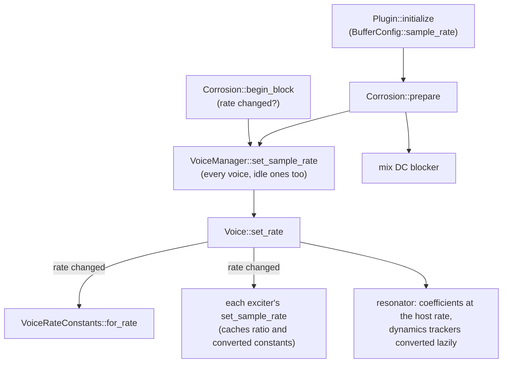

# Sample Rate Rule

Much of Corrosion's per-sample code (exciter integrators, smoothers, decays, envelopes followers) was tuned by ear at 48 kHz, in "per sample" units. Run unchanged at 96 kHz, a decay of `0.99` per sample would die twice as fast in seconds, an integration step would move twice as far per second, and a one-sample force spike would carry half the energy. The rule that prevents this:

> **Every per-sample constant is written as its 48 kHz value and converted to the host rate with `crate::dsp::utils::rate`. Each conversion is exactly the identity at 48 kHz**, so 48 kHz output stays bit-identical when code adopts it.

## How the rate reaches the code

As a list:

1. `Plugin::initialize` calls `Corrosion::prepare(sample_rate)`, which calls `VoiceManager::set_sample_rate`. Every voice, idle ones included, is rated before it plays, so a note-on builds its bank's coefficients once at the host rate and its exciter starts at that rate. `begin_block` repeats this when the host rate changes.
2. `Voice::set_rate` (also called at the top of every `Voice::process_sample`, where it is a cheap comparison) rebuilds `VoiceRateConstants` and calls `set_sample_rate` on all 16 exciters when the rate changed.
3. Each exciter caches `ratio` and its converted constants in `set_sample_rate`, so the per-sample code reads plain fields.
4. The resonator builds its coefficients from seconds and hertz, so it needs no conversion beyond its input gain; see [Modal Resonator](Modal-Resonator).

Each exciter's `trigger` also restarts its per-note state, so a note doesn't depend on what the voice played before.

## The conversions

`ratio(fs) = REFERENCE_RATE / fs`, with `REFERENCE_RATE` = 48 000: how many 48 kHz samples one host sample spans (0.5 at 96 kHz, 1.088 at 44.1 kHz).

| Helper | Converts | Formula | At 48 kHz |
|---|---|---|---|
| `rate::decay(c, r)` | a per-sample decay or one-pole pole `c` | `c^r` | returns `c` |
| `rate::smoother(k, r)` | a smoother step `x += (t − x)·k` | `1 − (1 − k)^r` | returns `k` |
| `rate::step(s, r)` | an integration step, acceleration, rate or phase increment | `s · r` | `s · 1.0` (exact) |
| `rate::frames(n, r)` | a count of 48 kHz samples | `max(1, round(n / r))` | returns `n` |
| `rate::impulse(a, r)` | a one-sample force spike | `a / r` (keeps force × time) | returns `a` |
| `rate::white_noise(a, r)` | per-sample white noise | `a / √r` (keeps the audible-band density as the band widens) | returns `a` |

The identity at 48 kHz is not a coincidence of the maths: each helper (except `step`, where `× 1.0` is exact anyway) tests `ratio == 1.0` and returns its input untouched, because `c.powf(1.0)` or `1 − (1 − k)` are not guaranteed to round back to the same bits.

### Sub-sample events: `EventSplitter`

Short events (an impulse, an impact, a spawn) happen between samples. Rounding them to the sample grid makes a train of events sound different at each rate. `rate::EventSplitter` puts an event of size `A` that happened `early` (0–1) of a sample before the end of the current sample as `early·A` now and `(1 − early)·A` on the next sample (`add`, then `take` once per sample). Its area is exact and its centre of mass sits one sample after the true time at every rate.

Users: Wire Brush impulses, Metal Chain impacts, Tension Rise spikes, and Tension Snap and Particle Rain in `other_specialty.rs`. Hand Strike scales its landing sample by the part of the step it was still in contact instead, and the Hit envelope's attack is sampled at sample centres. See [Exciters](Exciters).

## Where the rule is applied

| Code | What is converted |
|---|---|
| Exciters (`src/dsp/exciters/*.rs`) | velocity decays, integration steps, smoothing, strike frame limits, impact spikes, noise; each caches them in `set_sample_rate` ([Exciters](Exciters)) |
| `VoiceRateConstants` (`src/voice/mod.rs`) | brightness high-pass pole and gain (`decay`), peak decay (`decay`), tail and choke frame counts (`frames`), governor attack and release and Pressure smoothing (`smoother` of a 48 kHz one-pole coefficient) |
| Voice rattle | `white_noise` on the Damage rattle |
| `ModalResonator::track_dynamic_state` | the cable and sheet trackers' poles 0.99 and 0.95 (`decay`), cached in `dyn_rate` |
| `FemBodyResonator` (`src/dsp/post_processing/fem_body.rs`) | per-mode damping (`smoother`) and the force gain (`× r²`) |

Code that works in seconds and hertz directly needs no conversion and doesn't use `rate`: the resonator's poles (`r = exp(−1/(τ·fs))`, `ω = 2πf/fs`), the voice-mix DC blocker (prewarped cutoff), the post chain's filters, Space and spread (sized in `new()` for up to 192 kHz).

### Rate-dependent units elsewhere

- **Resonator input gain.** `b0 = gain · (48 000/fs)²`: each mode is a force-driven oscillator, whose discrete force term scales with `dt²`. Exactly 1 at 48 kHz.
- **Velocity units.** The resonator reports velocity in displacement per 48 kHz sample (`× fs/48 000`), and `ContactPrediction::velocity_scale` carries the same factor, because the exciters' contact laws were written for it.

## Traps

- **Keep the exact literal at 48 kHz when the converted form would round differently.** `1.0 − 0.8` isn't exactly `0.2` in `f32`, so `VoiceRateConstants` uses the literal `HIGHPASS_GAIN` at 48 kHz and `1 − decay(pole)` elsewhere; `track_dynamic_state` keeps `0.01` and `0.05` at 48 kHz for the same reason; the FEM body keeps `0.05` for its force gain.
- **Pick the right helper.** A pole and a smoother step are not the same thing: `decay` on a smoother coefficient, or `smoother` on a pole, is wrong at every rate but 48 kHz, and the identity there hides the mistake. Converting a spike with `step` instead of `impulse` changes its energy with the rate.
- **Cache, don't recompute.** `powf` per sample is expensive; convert in `set_sample_rate` (or once per rate, as `dyn_rate` does).
- **New per-sample code follows the rule.** A constant written per sample without a conversion will pass every 48 kHz test.

## The tests that guard it

Bit-exactness at 48 kHz:

- `rate::tests::every_conversion_is_exact_at_48k`: every helper returns its input's exact bits for ten values, and `frames` returns 4 800 and 50 unchanged.
- `input_gain_is_unchanged_at_48k` (`src/dsp/resonators/core.rs`): `b0` equals each mode's gain bit for bit at 48 kHz, for every object.
- Ignored hash printers for before/after comparisons on one machine (hashes depend on libm, so they aren't asserted): `print_48k_exciter_render_hashes` (`src/voice/mod.rs`), `print_48k_body_render_hash` (`fem_body.rs`).

Same behaviour at other rates:

- `rate::tests::conversions_keep_the_per_second_effect`: two 96 kHz samples equal one 48 kHz sample for each helper.
- `rate::tests::event_splitter_keeps_area_and_centre_of_mass`.
- `dsp::exciters::event_timing_tests` (`wire_brush_impulse`, `tension_rise_break`, `tension_snap_release`, `metal_chain_impacts`, `particle_rain_spawns`, `hand_strike_contact`): area within 2 % and centre of mass within one 44.1 kHz sample plus 10 µs, at 44.1, 48 and 96 kHz.
- `every_exciter_has_the_same_level_at_any_sample_rate` (`src/voice/mod.rs`): all 16 exciters within 1.5 dB of 48 kHz at 44.1 and 96 kHz. It compares mean power over velocities 40, 70, 100 and 127 and 32 note seeds each, since a noise-driven exciter's single note varies by several dB with its seed alone.
- `struck_attack_timing_does_not_depend_on_sample_rate` (exciters 2–5, attack peak within 10 %), `struck_tail_ends_at_the_same_time_at_any_sample_rate` (within 10 %), `hit_attack_has_the_same_area_at_every_rate`.
- Resonator: `short_strike_level_does_not_depend_on_sample_rate` and `sustained_level_does_not_depend_on_sample_rate` (within 0.5 dB up to 192 kHz), `a_high_mode_keeps_its_level_at_every_sample_rate` (a 15 kHz mode within 1 dB).
- `body_sounds_the_same_at_any_sample_rate` (FEM body: peak within 1 dB, ring within 10 %).
- `protection_window_is_one_hundred_milliseconds_at_any_rate` (voice stealing, `src/voice/manager.rs`).
- `bend_before_first_sample_tunes_the_poles_for_the_host_rate` and `bend_before_first_sample_uses_the_host_rate` (`src/lib.rs`): a note bent before its first sample rings at the host rate's pole angles (within 0.05 cents at 44.1 kHz).
- `cutoff_is_the_same_in_hertz_at_every_rate` for the voice-mix DC blocker ([DSP Utilities](DSP-Utilities)).

*History:* [`openspec/changes/archive/2026-10-07-fix-sample-rate-time-constants`](https://github.com/GerMP21/Corrosion-VST/tree/main/openspec/changes/archive/2026-10-07-fix-sample-rate-time-constants) introduced the helpers; [`openspec/changes/archive/2026-11-09-m03-m20-start-at-host-rate-and-report-latency`](https://github.com/GerMP21/Corrosion-VST/tree/main/openspec/changes/archive/2026-11-09-m03-m20-start-at-host-rate-and-report-latency) rates voices before they play.

## Source files

- [`src/dsp/utils/rate.rs`](https://github.com/GerMP21/Corrosion-VST/blob/main/src/dsp/utils/rate.rs): `REFERENCE_RATE`, the conversion helpers, `EventSplitter` and their tests.
- [`src/voice/mod.rs`](https://github.com/GerMP21/Corrosion-VST/blob/main/src/voice/mod.rs): `VoiceRateConstants`, `Voice::set_rate` and the per-rate level and timing tests.
- [`src/voice/manager.rs`](https://github.com/GerMP21/Corrosion-VST/blob/main/src/voice/manager.rs): `VoiceManager::set_sample_rate`, rating every voice.
- [`src/dsp/exciters/event_timing_tests.rs`](https://github.com/GerMP21/Corrosion-VST/blob/main/src/dsp/exciters/event_timing_tests.rs): the sub-sample event tests.
- [`src/dsp/post_processing/fem_body.rs`](https://github.com/GerMP21/Corrosion-VST/blob/main/src/dsp/post_processing/fem_body.rs): the FEM body's converted damping.
