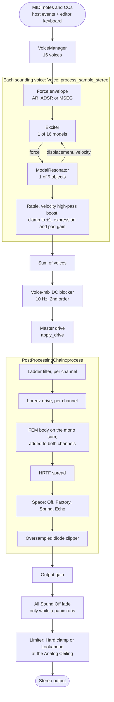
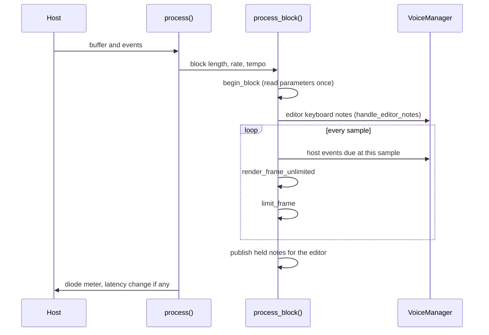

# Signal Chain

This page follows one sample from a MIDI note to the plugin's output. It names every stage in order, says what each does and why it sits where it does, and then opens up the per-voice loop that runs inside the first stage. Each stage has its own page with the details; this one is the map.

The whole audio path is per sample. The exciter and the resonator push on each other every sample (a two-way interaction, see [Interaction Bus and Contact](Interaction-Bus-and-Contact)), so the voice can't be processed in blocks, and the post chain runs per sample too for simplicity. Parameters, by contrast, are read once per host block; stages that need smooth changes glide between block values at audio rate.

## The chain at a glance

The same chain, as a list:

1. **MIDI in.** Host note events and CCs, plus notes from the editor's on-screen keyboard, go to `handle_note_event` in `src/lib.rs`, which starts, releases or modulates voices in the `VoiceManager`.
2. **Voices.** Each of the 16 voices that is sounding runs its own loop: force envelope → exciter ⇄ resonator → damage rattle → velocity high-pass boost → clamp to ±1 → expression gain and kit-pad gain. Details [below](#the-per-voice-loop).
3. **Sum.** `VoiceManager::process_sample_stereo` adds the voices. The sum is not normalized.
4. **Voice-mix DC blocker.** `dsp::StereoDcBlocker`, a 10 Hz second-order Butterworth high-pass per channel.
5. **Master drive.** `apply_drive`, the Drive knob (plus the Violence macro), smoothed per sample.
6. **Post chain.** `PostProcessingChain::process`: ladder filter and Lorenz drive per channel, the FEM body on the mono sum added to both channels, HRTF spread, Space, then the oversampled diode clipper.
7. **Output gain.** The Output parameter, smoothed per sample.
8. **Panic fade.** Only while an All Sound Off (CC120) is running.
9. **Limiter.** A hard clamp to ±Analog Ceiling, or the Lookahead limiter with the same ceiling.

## Where the chain runs

The host calls `Plugin::process` once per buffer. Everything below the host API is one function, `Corrosion::process_block`, which the offline renderer (`offline::PresetRenderer`, in 512-sample blocks) and the browser engine also call. So tests, preset renders and the web app hear exactly what the plugin outputs.

As steps:

1. `begin_block` reads every parameter once: it re-rates the voices if the host rate changed, sets the smoother targets for drive and output gain, configures both limiters, pushes the post-chain parameters (with macro biases) and sends the live controls to held voices. These setters recompute coefficients (filter `tan`, body frequencies, reverb delays) that must not run per sample.
2. `handle_editor_notes` plays what the editor keyboard queued, as channel-0 notes at the block's first sample, before the host's events.
3. Per sample: `process_pending_events` handles every host event whose timing is at or before this sample (sample-accurate notes), then `render_frame_unlimited` makes one frame (steps 2 to 8 of the chain) and `limit_frame` applies the limiter.
4. After the block, the held notes are published for the editor's key highlights; `process()` then publishes the diode meter and reports a latency change if the Limiter Mode changed.

Parameter changes are not sample-accurate: the plugin doesn't set NIH-plug's `SAMPLE_ACCURATE_AUTOMATION`, so a change lands at the start of the next block. The [Plugin Lifecycle](Plugin-Lifecycle) page covers `process()` in full.

## Stage by stage

### Voices and their sum

Up to 16 voices (`MAX_VOICES`) sound at once. Only voices with `is_rendering()` true are processed, so idle voices cost nothing. Each returns a stereo pair; the manager adds them with no normalization, so one voice is not turned down when others play. A single voice's output is clamped to ±1 before its expression gain, which can raise it to 1.8 (pressure plus mod wheel), and a kit pad's level multiplies it further. Dense chords can therefore sum well past 1.0; the clipper and the limiter at the end of the chain handle that.

The voices also hold the voice-level stereo image: the resonator pans its modes alternately left and right by the **Width** parameter (see [the voice loop](#the-per-voice-loop)). This is separate from the post chain's HRTF spread.

### Voice-mix DC blocker

Each mode of the resonator responds to a constant force with a constant deflection. A one-signed force, such as a bow's pressure or a felt mallet's long contact, therefore leaves a static offset under the ringing. `dsp::StereoDcBlocker` removes it from the stereo sum before anything nonlinear sees it:

- second-order Butterworth high-pass, cutoff `VOICE_MIX_DC_CUTOFF_HZ` = 10 Hz, bilinear with a prewarped cutoff;
- coefficients and state in `f64`: at 10 Hz the poles sit about 0.001 inside the unit circle, where an `f32` direct form would amplify its own rounding noise;
- rated in `prepare` (from `initialize`) and in every `begin_block` (a no-op when the rate is unchanged), cleared by `reset()` and at the end of a panic.

**Why here:** the master drive, the Lorenz drive and the diode clipper are all asymmetric. Fed an offset, they would shift their operating point and change the sound with the offset rather than with the music. Blocking it first keeps every nonlinearity centred. DC that later stages create (the asymmetric curves) is theirs to handle; the diode clipper has its own 2 Hz blocker. `Corrosion::mix_dc_blocker_enabled` is a test-only switch to compare with the unblocked path.

### Master drive

`apply_drive(sample, drive)` runs on each channel with the drive from `drive_smoother`, a `OnePoleSmoother` with a 20 ms time constant (`TAU_SECONDS`). Its target is Drive plus the Violence macro's offset (`(v − 0.5)·1.0`), clamped to 0..5.

- The shaper scales the input by `1 + 4·drive` (`DRIVE_GAIN_SCALE` = 4), then applies an asymmetric soft-knee curve: linear below 0.3 (positive) or 0.25 (negative), a smoothstep knee up to 0.8 or 0.7, then an exponential approach capped at 1.2 or 1.1.
- The output is a crossfade: shaped share `min(drive, 1)`, dry share the rest. Above 1 only the input gain keeps rising, so more drive means more saturation, not more level. The result is clamped to ±1.5 (`DRIVE_OUTPUT_CLAMP`).
- At drive 0 the function returns the input unchanged.

`reset()` starts the smoother at its biased target, so the first note after a reset isn't driven by a ramp.

### Post chain

`PostProcessingChain::process` runs six stages per frame. Every quality mode runs every stage; quality changes only the clipper's oversampling (and, in the voices, the number of modes). See [Post Chain](Post-Chain) for routing and quality modes.

| Order | Stage | Signal | What it does | Page |
|---|---|---|---|---|
| 1 | `WdfLadderFilter` ×2 | per channel | Four-pole ladder low-pass with soft saturation between stages; cutoff and resonance glide at audio rate. Cutoff is the parameter times the Brightness macro's factor `2^((b − 0.5)·2)`, clamped to 20 Hz–20 kHz. | [Filter and Drive](Filter-and-Drive) |
| 2 | `LorenzDrive` ×2 | per channel | Soft tube curve whose gain a Lorenz attractor modulates; Drive Amount, Bias Starvation, Chaos Depth (Violence adds to the first and last). | [Filter and Drive](Filter-and-Drive) |
| 3 | `FemBodyResonator` | mono sum `(L + R)/2` | Eight modal body resonators. The result times the body mix (`Body / 5`, smoothed with a 20 ms time constant) is added to both channels, in parallel with the dry signal. | [Body, Spread and Space](Body-Spread-and-Space) |
| 4 | `HrtfSpread` | stereo | Delays the mid signal by up to 1 ms with Spread Width, shapes it with proximity filters, adds the side back, crossfeeds. | [Body, Spread and Space](Body-Spread-and-Space) |
| 5 | Space | stereo | Off; Factory (a Schroeder reverb fed `(L + R)/2`, same wet on both sides); Spring (one tank per channel); Echo (stereo delay). The wet signal times Space Amount is added to the dry. | [Body, Spread and Space](Body-Spread-and-Space) |
| 6 | `OversampledClipper` | stereo | The diode stage: a tanh knee per polarity limited at Analog Ceiling ÷ 1.3, oversampled 1×/4×/8×/16× by quality mode through half-band IIR filters, with a 2 Hz DC blocker. | [Output Protection](Output-Protection) |

**Why this order:**

- Filter and drive come first and stay per channel, so the voices' stereo image survives them (`hard_left_input_stays_left` in `post_chain.rs` checks this).
- The body is a property of the whole instrument, not of one channel, so it runs once on the mono sum and is added back in parallel. At Body 0 the chain equals the chain without the body (`body_zero_matches_chain_without_body`).
- Spread and Space come after the body, so the body's resonance is placed and reverberated with the rest.
- The clipper is last in the chain: it is the stage that bounds the level, and its limit is set under the ceiling so the down-sampling filters' overshoot still lands under the limiter.

### Output gain

The Output parameter stores a linear gain from 0 to +40 dB (shown in dB, see [Parameters](Parameters)). `output_gain_smoother` (20 ms) follows it per sample. It comes after the clipper and before the limiter: Output can make the plugin quieter or louder, and whatever it does, the limiter still holds the ceiling. The clipper limits at the ceiling ÷ 1.3, so above roughly +2.3 dB of Output (20·log10 1.3) clipped peaks reach the limiter.

### All Sound Off fade

When a CC120 arrives, `start_panic` sets a linear fade over `PANIC_FADE_SECONDS` = 5 ms (240 samples at 48 kHz). `render_frame_unlimited` checks `panic_step > 0.0` and only then calls `panic_frame`, a `#[cold]`, `#[inline(never)]` function, so the normal path pays one comparison. At the end of the fade it clears the voices (`VoiceManager::silence`), the DC blocker, the post chain and both lookahead limiters in place, and outputs exactly zero. Details on [Voices and Polyphony](Voices-and-Polyphony).

### Limiter

`limit_frame` applies the Limiter Mode, both at the Analog Ceiling (parameter 0.5–1.0, default 0.9661 ≈ −0.3 dBFS; the code clamps it to 0.1–1.0):

- **Hard** (0, default): `apply_output_limiter`, a clamp to `±ceiling`. No latency.
- **Lookahead** (1): one `LookaheadLimiter` per channel, unlinked. Each delays its input by `LOOKAHEAD_SAMPLES` = 48 samples (1 ms at 48 kHz; the count is fixed, so it is 0.5 ms at 96 kHz), takes the peak of its window, attacks instantly to `ceiling / peak`, releases with a 50 ms one-pole, and clamps the result to the ceiling as a last guard. The 48 samples are reported to the host as latency.

Either way no output sample exceeds the ceiling. [Output Protection](Output-Protection) covers both limiters and the clipper.

## Macros: where they enter the chain

The four macros (Mass, Corrosion, Violence, Macro Brightness, each 0..1, neutral at 0.5) don't have a stage of their own. `resolve_macro_bias` turns them into offsets and factors that act at several points of the chain. With `m`, `c`, `v`, `b` the macro values minus 0.5:

| Target | Bias | Applied |
|---|---|---|
| Exciter masses (Hand, Mallet, Stick, Pipe, Chain, drag Exciter, Particle) | × `max(1 + m, 0.1)` | note-on (`apply_macro_bias_to_controls`) |
| Size | × `max(1 + 0.5·m, 0.1)`, then clamped to 0.05–10 | note-on |
| Resonator damping | + `0.4·c`, clamped 0–1 | note-on and live on held notes |
| Resonator brightness | + `−0.4·c + 0.6·b`, clamped 0–1 | note-on and live on held notes |
| Rust | + `2·c`, clamped 0–5 | note-on |
| Damage | + `4·v`, clamped 0–10 | note-on |
| Master drive | + `v`, clamped 0–5 | per block, smoothed |
| Drive Amount (Lorenz) | + `0.4·v`, clamped 0–5 | per block |
| Chaos Depth | + `0.4·v`, clamped 0–1 | per block |
| Filter cutoff | × `2^(2·b)` (±2 octaves), clamped 20–20 000 Hz | per block |

At 0.5 every bias is exactly neutral (`neutral_macros_produce_neutral_bias`). The mass factors are not clamped to the exciter parameters' ranges.

## The per-voice loop

`Voice::process_sample_stereo(sample_rate, width)` is called once per sample for every rendering voice. It is the hottest code in the plugin after the resonator's mode loop. In order:

1. **Gate.** Return `(0, 0)` at once if the voice isn't rendering.
2. **Rate check.** `set_rate` compares the rate with the cached one; only a change re-derives the per-sample constants (`VoiceRateConstants`) and re-rates all 16 exciters.
3. **Exciter force** (`process_exciter`):
   - Move the smoothed Pressure gain toward its target (10 ms time constant, `PRESSURE_SMOOTHING_S`). At rest this adds exactly zero.
   - If the key is up and every envelope is idle, return 0: nothing excites the object any more.
   - Read the resonator's displacement and velocity from the last sample.
   - Advance the force envelope of the exciter's family: one-shot AR for Hit exciters, ADSR for Specialty, the 6-stage MSEG for Friction (see [Envelopes and Modulation](Envelopes-and-Modulation)).
   - If Position Envelope is on, move the strike position with the envelope before the resonator prepares this sample.
   - Turn on the resonator's ring-bound tracking while the envelope is above 0 (the drive governor needs it). An envelope at 0 returns 0.
   - Dispatch on `exciter_type` (a `match` on 1..16, no trait objects). Position-driven exciters get a `ContactPrediction` (this sample's displacement as `free + compliance·F`) and solve their contact implicitly; Bow, Stiff Point, Corrugated Drag, Tension Rise and Pneumatic Jet read the resonator's velocity; Wire Brush and Electromagnetic Hum read its displacement.
   - Multiply by the envelope and `force_scale()` (the exciter's `EXCITER_DRIVE_LEVEL`, the test-only `drive_scale`, the governor gain and the Pressure gain), then cap the force so the resonator's ring bound can't pass 0.9 (`GOVERNOR_CEILING`).
4. **Resonator.** `ModalResonator::process_sample_stereo(force, rate, width)` spreads the force over the modes by the strike-position weights and the coupling blend, advances every mode, and pans each mode by `width · index / count`, alternating sides between even and odd modes (gains `0.5·(1 ∓ pan)`, so left plus right is the mono sum). It also stores the displacement and velocity the exciter reads next sample. See [Modal Resonator](Modal-Resonator).
5. **Governor.** `update_governor` follows the ring bound (1 ms attack, 200 ms release) and above 0.7 sets the force gain to `(0.7 / level)^8` for the next sample.
6. **Sanitize.** A non-finite sample, or one smaller than 1e-30, becomes 0, per channel.
7. **Damage rattle.** `rattle_noise` adds white noise, the same value to both channels, when Damage is above 0 and the mono level `(L + R)/2` is above `0.02 + (1 − min(damage, 1))·0.15`. See [Material Transformations](Material-Transformations).
8. **Velocity high-pass boost.** A one-pole low-pass (pole 0.8 at 48 kHz, corner near 1.7 kHz) runs on the mono signal plus rattle; the difference (a high-pass) times `1.5 · velocity / 127` is added to both channels. Harder notes come out brighter.
9. **Clamp.** Each channel is clamped to ±1. The largest value before the clamp is kept in `pre_clamp_peak` for tests.
10. **Expression and pad gain.** Multiply by `1 + 0.5·max(channel pressure, poly pressure) + 0.3·mod wheel` (up to 1.8) and by the kit pad's gain (1 for a normal voice). See [Note Expression](Note-Expression) and [Kit Mode](Kit-Mode).
11. **Denormal flush.** `x + 1e-20 − 1e-20` on each channel.
12. **Peak and tail tracking.** `peak_hold` takes the larger clamped channel and decays by 0.999 per sample at 48 kHz (a time constant of about 21 ms). When the key is up and `peak_hold` stays under `TAIL_ENERGY_THRESHOLD` = 1e-4 for `TAIL_DEACTIVATE_FRAMES` (4800 at 48 kHz, 100 ms), the voice stops rendering. `peak_hold` also ranks voices for stealing.
13. **Choke fade.** If a host choke is running, the frame is scaled by the choke's linear ramp (`choke_gain`, out of line), and the voice resets to idle on its last sample.

`Voice::process_sample(sample_rate)` is the mono twin, used by tests and benchmarks through `VoiceManager::process_sample`. It is the same loop without per-mode panning: the resonator returns the full mode sum, so its level is the sum of the stereo pair, not either channel.

**Traps:**

- The per-mode work in step 4 dominates CPU. Data a mode needs only occasionally must not go into `SecondOrderMode`; see [Modal Resonator](Modal-Resonator) and [Benchmarks and Performance](Benchmarks-and-Performance).
- Steps 10 and 11 come after the clamp, so the voice output is not bounded by 1. Code that assumes it is (a meter, a test bound) must account for the expression and pad gains.
- The rattle and the high-pass act on the mono signal and add the same value to both channels, so they are centred whatever Width does.

## Source files

- [`src/lib.rs`](https://github.com/GerMP21/Corrosion-VST/blob/main/src/lib.rs): `process_block`, `begin_block`, `render_frame_unlimited`, `limit_frame`, the master drive, the macro biases, the panic fade.
- [`src/voice/mod.rs`](https://github.com/GerMP21/Corrosion-VST/blob/main/src/voice/mod.rs): `Voice::process_sample_stereo` and `process_sample`, the force envelopes, the governor, the expression gain.
- [`src/voice/manager.rs`](https://github.com/GerMP21/Corrosion-VST/blob/main/src/voice/manager.rs): the voice sum.
- [`src/dsp/mod.rs`](https://github.com/GerMP21/Corrosion-VST/blob/main/src/dsp/mod.rs): the DSP module's re-exports (`PostProcessingChain`, `StereoDcBlocker`, `LookaheadLimiter`, `LOOKAHEAD_LIMITER_SAMPLES`, the exciters and resonators).
- [`src/dsp/post_processing/post_chain.rs`](https://github.com/GerMP21/Corrosion-VST/blob/main/src/dsp/post_processing/post_chain.rs): the post chain's stage order and body mix.
- [`src/dsp/utils/dc_blocker.rs`](https://github.com/GerMP21/Corrosion-VST/blob/main/src/dsp/utils/dc_blocker.rs): the voice-mix DC blocker.
- [`src/dsp/post_processing/lookahead_limiter.rs`](https://github.com/GerMP21/Corrosion-VST/blob/main/src/dsp/post_processing/lookahead_limiter.rs): the Lookahead limiter.
- [`src/dsp/resonators/core.rs`](https://github.com/GerMP21/Corrosion-VST/blob/main/src/dsp/resonators/core.rs): `ModalResonator::process_sample_stereo` and its per-mode panning.
