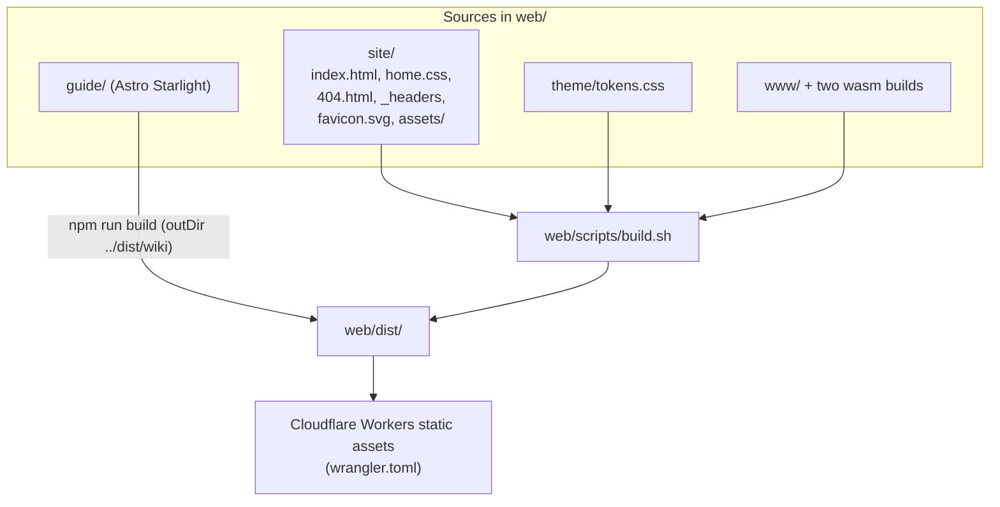
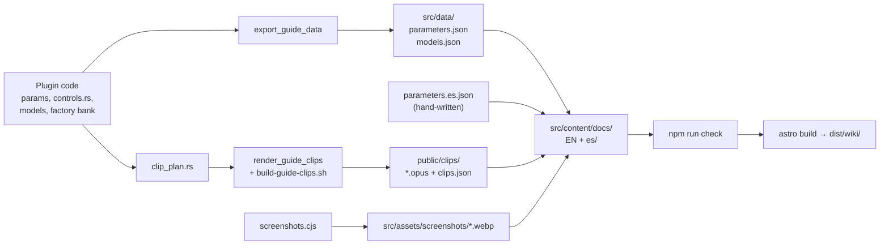
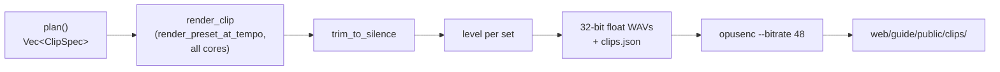

# Site and User Wiki Tooling

`https://corrosion-vst.org` is a static site with three parts: a home page, the [web app](Web-App) at `/play/`, and the user-facing Corrosion Wiki (the user guide) at `/wiki/`. This page covers how they are built and served, and the tooling that keeps the user Wiki tied to the plugin: data exported from the code, audio clips rendered by the engine, a check that every control is audible, and screenshots taken from the real editor.

The user Wiki is not this Internals wiki. In the code its names stay `guide` (`src/guide/`, `web/guide/`); readers see "Corrosion Wiki" / "Wiki de Corrosion".

## Site layout

| URL | Built from | What |
|---|---|---|
| `/` | `web/site/index.html`, `home.css`, `assets/editor.webp` | Home page: three calls to action (Play, Download, Wiki), a tour, five demo clips, requirements. |
| `/play/` | `web/www/` plus `corrosion_web_engine.wasm` and the wasm-bindgen output of the editor | The web app. Its asset paths are relative, so it works under any prefix. |
| `/wiki/`, `/wiki/es/` | `web/guide/` | The user Wiki in English and Spanish, with its own `wiki/404.html`. |
| `/theme/tokens.css` | `web/theme/tokens.css` | Design tokens shared by all three. |
| any other path | `web/site/404.html` | Themed 404 ("This part has rusted away.") linking home and to `/play/`. |

The home page's demo buttons play `/wiki/clips/demos/<folder>.opus` (generated clips, below) through one shared `Audio` element with `preload = "none"`, so nothing downloads before a click.

## Build

`web/scripts/build.sh` assembles `web/dist/`:

1. `fetch-nih-plug.sh` (the patched NIH-plug the web workspace needs; see [Web App](Web-App#the-web-workspace-and-the-patched-nih-plug)).
2. `cargo build --release --target wasm32-unknown-unknown -p corrosion-web-engine -p corrosion-web-editor`, with `RUSTFLAGS` plus `-C target-feature=+simd128`.
3. `dist/` from scratch: `site/` at the root, `theme/*` under `theme/`, `www/*` under `play/`, the engine wasm copied as is (the worklet loads it with no glue), and `wasm-bindgen --target web --no-typescript` on the editor wasm into `play/`.
4. The short commit hash replaces `dev` in `index.html`, `404.html` and `play/index.html`.
5. In `web/guide/`: `npm ci`, `npm run check`, `npm run build` (Astro writes `dist/wiki/` itself).

It needs the `wasm32-unknown-unknown` target, `wasm-bindgen-cli` at the version `web/Cargo.lock` pins (the CLI and the library must match exactly), and Node at the version `web/guide/package.json` requires (`>=22.23.4`).

`web/scripts/cloudflare-build.sh` is the deploy build command. The host's build image has no Rust, so it installs what's missing into `web/.tools/`: a minimal stable rustup toolchain and the `wasm32-unknown-unknown` target; the prebuilt `wasm-bindgen` release (musl x86_64) at the version read from `web/Cargo.lock`, unless the installed one matches; Node 22.23.4 when the image's is older. Then it runs `build.sh`. CI's `web` job runs this same script, so CI builds what the host deploys.

## Hosting

`web/wrangler.toml` configures a Cloudflare Worker named `corrosion-vst` that only serves static assets (no server code):

- `routes`: the custom domain `corrosion-vst.org`. It is the site's only domain; the old `preview.corrosion-vst.org` is no longer a Worker domain and is redirected to `https://corrosion-vst.org/play/` by a rule in the host's dashboard, outside the repository.
- `[assets] directory = "./dist"`.
- `html_handling = "auto-trailing-slash"`: a directory without its slash redirects to it (`/play` → `/play/`), and `/x/` serves `/x/index.html`.
- `not_found_handling = "404-page"`: an unknown path gets the nearest `404.html`, searching from its directory up, with status 404. That is how `/wiki/…` gets the Wiki's own 404 and everything else the site's.

`web/site/_headers` applies to every path: `Cache-Control: public, max-age=3600, must-revalidate` (file names aren't hashed, so caches revalidate after an hour and a deploy is seen within it), `X-Content-Type-Options: nosniff`, `Referrer-Policy: strict-origin-when-cross-origin`.

The host deploys from `main` only; on `dev` and on pull requests from `dev` its deploy check fails or is skipped, which is expected. CI's `web` job builds every branch.

`web/scripts/serve.cjs` is a small Node static server that follows the same two rules (trailing-slash redirect with a 307, nearest `404.html`, plus `x` → `x.html`), so CI and local checks see what the host serves: `node web/scripts/serve.cjs web/dist 8787`.

## Theme

`web/theme/tokens.css` is one `:root` block, dark only (`color-scheme: dark`):

- **Palette**: one custom property per constant of `src/gui/palette.rs`, same name in kebab case (`--charcoal: #0D0D0D` … `--thumb-border: #666666`). `gui::palette::tests::site_theme_matches_editor_palette` (CI lane) fails, naming the colour, when the file and the palette differ (see [Editor](Editor#palette)).
- **Roles** built on them: `--bg`, `--surface`, `--recessed`, `--line`, `--text`, `--muted`, `--accent`, `--on-accent`, `--warn`, `--danger`, `--control`, `--control-border`, `--control-hover`.
- **Type**: `--font` (system UI stack), `--font-mono`, `--tracking-caps`.
- **Spacing**: `--space-1` … `--space-8` (4–72 px), `--radius`, `--page-max`.

The home page, the app's chrome and the Wiki use only these. The site uses system fonts; the editor's Inter and IBM Plex Sans are drawn inside the canvas only.

## The user Wiki (`web/guide/`)

An [Astro](https://astro.build) project with the Starlight documentation theme, pinned exactly in `package.json` and `package-lock.json` (`astro`, `@astrojs/starlight`, `starlight-links-validator`, `js-yaml`).

| Input | Produced by | Committed | Drift guard |
|---|---|---|---|
| `src/data/parameters.json`, `models.json` | `cargo run --bin export_guide_data` | yes | `guide_data_equals_the_files_on_disk` (CI lane) |
| `src/data/parameters.es.json` | hand | yes | `npm run check` (every ID and text has a Spanish twin) |
| `public/clips/**.opus`, `public/clips/clips.json` | `scripts/build-guide-clips.sh` | yes | `guide_clip_manifest_is_complete_and_audible` (fingerprint, files, silence) |
| `src/assets/screenshots/*.webp` | `node web/scripts/screenshots.cjs` | yes | none: rerun by hand after an editor change |
| `src/content/docs/**` | hand | yes | `npm run check`, link validator at build |

**Configuration** (`astro.config.mjs`): `site: 'https://corrosion-vst.org'`, `base: '/wiki'`, `outDir: '../dist/wiki'`, `trailingSlash: 'always'`. Title `{ en: 'Corrosion Wiki', es: 'Wiki de Corrosion' }`; English is the root locale, Spanish under `es`. Custom CSS is `../theme/tokens.css` then `src/styles/guide.css`, which maps Starlight's `--sl-*` variables onto the tokens. Pagefind search is on (per language). `starlight-links-validator` with `errorOnLocalLinks` fails the build on a broken internal link.

**Dark only.** Three component overrides: `ThemeProvider` → `DarkThemeProvider.astro` (an inline script that sets `data-theme="dark"` before paint and stubs Starlight's theme pickers), `ThemeSelect` → `NoThemeSelect.astro` (empty), `SocialIcons` → `SiteLinks.astro` (header links Home and Play).

**Content.** English pages in `src/content/docs/`, Spanish twins in `src/content/docs/es/` with the same paths: 74 pages per language, plus the English-only `404.md` that becomes `wiki/404.html`. `sidebar.mjs` is the sitemap: groups that autogenerate from a directory (`getting-started`, `exciters`, `objects`, `output-chain`, `note-modes`, `presets`, `midi`, `reference`) and single pages, each group with its Spanish label. UI strings of the Wiki's own components are in `src/content/i18n/en.json` and `es.json`.

**`covers:` front matter.** `src/content.config.ts` extends Starlight's schema with an optional, strict `covers` object: `exciters`, `objects`, `modes` (by kind), `folders`, `features`, `panels`. A page declares what it documents; the check below uses it for coverage.

**Components** (`src/components/`):

| Component | Renders |
|---|---|
| `ParamReference` | One panel of the parameter reference from `parameters.json` and `parameters.es.json`: a card per parameter, grouped by editor section, anchored by parameter ID (`/wiki/reference/<panel>/#<id>`). |
| `Clips` | A row of buttons over one shared `<audio preload="none">` per page. `param="rust"` plays a parameter's Min/Mid/Max; `set="exciters" item="Bow"` one item of a set; `set="kits"` every item. Captions and button values come from `src/lib/clip-labels.mjs`. |
| `ModelControls` | The controls a model shows, as links to their reference cards, from `src/lib/model-controls.mjs` (the same list the check requires a model page to link). |
| `Data` | A number from the generated data (`src/lib/data-values.mjs`), so prose follows the plugin; an unknown name throws and fails the build. |
| `Screenshot` | An editor screenshot with numbered callouts drawn over it as fractions of the image, so one image serves both languages. |
| `Flow` | A signal-flow diagram of labelled boxes and arrows (a two-way arrow for the exciter–object loop). |
| `Stub` | Placeholder for an unwritten page. |

### `npm run check`

`scripts/check.mjs` runs before every build and fails, naming each problem, when:

1. a page has no twin in the other language, or the twins' heading levels differ in sequence (`404` is the only single-language page);
2. a model, mode, factory folder, feature or reference panel has no page declaring it in `covers:` in either language, or `covers:` names something that doesn't exist;
3. `parameters.json` and `parameters.es.json` have different IDs, or a Spanish entry lacks a text the English one has;
4. a page references a clip missing from `clips.json` or from disk, a clip row has no caption, two rows on one page share a caption but play different clips, or a parameter clip has no value to show;
5. with `--complete`, a page still has `<Stub />`;
6. an exciter or object page lacks the seven model sections in order, its Listen section lacks the model's clips, or its Controls section doesn't link every control the model shows.

It also warns about a bare number next to a parameter's name (a value that should come from `<Data>`). `npm test` runs `node --test` on `check.test.mjs` (each model-page rule against a copied page set with one page broken), `clips.test.mjs` (captions and button values) and `data.test.mjs` (the `<Data>` values).

CI's `guide` job (Node 22.23.4): `npm ci`, `npm run check -- --complete`, `npm test`, `npm run build`. It has no Rust: the data and clips are committed, and their drift tests run in the Rust lanes.

## Generated data

`src/guide/mod.rs` builds two JSON files from the plugin; `src/bin/export_guide_data.rs` writes `guide::guide_files()` to disk relative to the repository root.

- **`parameters.json`** (`parameters_json()`): every host parameter (149 today), in the editor's order, panel by panel, with a model's slots after its panel's first section; any parameter the editor doesn't draw would follow, marked `hidden` (none today). Each entry has `id`, `name`, `panel`, `group`, `kind`, `min`, `max`, `default` and `unit` as display strings from the parameter's own formatter, then either
  - `controls` (a fixed control: label, section, when shown, and its `help_for` text), or
  - `slots` (one per model that shows it: model, panel title, label, slider range, help).

  Selectors carry `options` (value, name, and `selector_help` text when it differs) instead of `min`/`max`.
- **`models.json`** (`models_json()`): exciters (value, name, family), objects, Space, quality, note, limiter and randomizer modes, the factory folders with their presets, the drum kits with their pad counts, and kit facts (`zone`, `max_tune`, which parameters a pad stores and which stay global).

Both are pretty-printed with sorted keys (`serde_json`'s map is a `BTreeMap`) and end in a newline, so the output is deterministic. The exporter reads the control tables in `src/gui/controls.rs`, which have no egui dependency, so `cargo run --bin export_guide_data` and the tests work in the `--no-default-features` lane.

Tests in `src/guide/tests.rs`: `guide_data_equals_the_files_on_disk` (fails on drift and names the first differing path, so the message points at the parameter), `guide_data_lists_every_host_parameter`, `guide_data_lists_every_model_and_mode`.

**When to rerun.** After changing a parameter (range, default, name, unit), a control label or help text, a model, a mode or the factory bank. Then add or fix the parameter's Spanish entry in `parameters.es.json` by hand; `npm run check` fails until it exists.

## Audio clips

Every control in the user Wiki has examples rendered by the plugin itself. `src/guide/clip_plan.rs` decides what to render; `render_guide_clips` renders and levels; `scripts/build-guide-clips.sh` encodes.

### The plan

A `ClipSpec` is one clip: `reference` (what pages cite: `param:<id>:<point>` or `set:<set>:<item>`), `file` (path under `public/clips/`, no extension), `set` (clips that share one gain), `is_reference` (the clip a set is levelled by), `source` (a description for the manifest), the `Preset` to play, the `OfflineNote`s, the length, an optional tempo, and an optional quiet reason.

The fixed context:

| Constant | Value |
|---|---|
| `SAMPLE_RATE` | 48 000 Hz, Render quality |
| `NOTE`, `VELOCITY` | 48 (C3), 100 |
| `SECONDS`, `NOTE_OFF` | 3 s clip, note-off at 2 s |
| `RELEASE_TAIL`, `DEMO_RELEASE_TAIL` | every clip renders at least 2 s past its last note-off (4 s for the home demos) |
| `SILENCE_BELOW_PEAK_DB`, `TRIM_FADE` | tail cut 60 dB under the clip's peak, 50 ms fade |
| `TARGET_RMS` | the factory bank's `TARGET_RMS` (0.13) |
| `PEAK_CEILING_DB` | −1 dBFS |
| `SILENCE_DB` | −60 dBFS RMS counts as silent |
| `COMPARISON_OBJECT`, `COMPARISON_EXCITER` | Tank, Felt Mallet |

`guide_base_patch()` is the default patch (Hand Strike) on Plate, Space off, Render quality. `with_values(preset, values)` sets parameters by ID through the preset loader, so values clamp as a loaded file's do.

The sets, 511 clips in all:

| Set | Clips | How |
|---|---|---|
| `params/<id>/{min,mid,max}` | 3 per sound-shaping parameter (142 × 3) | Over the base patch, at the parameter's host-range ends and middle in normalized travel, or a slot's slider range. The Mid clip is the set's reference. |
| `exciters/` | 16 | Each exciter on Tank. |
| `objects/` | 9 | Each object with Felt Mallet. |
| `exciter-presets/`, `object-presets/` | 16, 9 | A representative factory preset per model: the first curated preset using it, else an experimental-grid entry; levelled one by one. |
| `kits/` | 10 | Each drum kit's pads in turn, a quarter second apart. |
| `recipes/<slug>/{before,after}` | 2 per recipe (10 recipes) | A factory preset before and after the recipe's changes (`RECIPES`), in one set so they share a gain. `check_recipe` refuses a recipe whose preset, parameter or value doesn't exist. |
| `demos/` | 5 | `HOME_DEMOS`: one preset per curated folder, played as notes (root, fifth, octave, fifth), triads, or a held note. |

`parameter_plans()` gives each host parameter a `Demo`:

- `Excluded { reason }` for the 7 that don't shape a note's sound (`EXCLUDED`: UI Scale, quality mode, note mode, limiter mode, exciter, object, Space mode); the Wiki shows the reason;
- `VelocityPair` (a soft then a hard note) for the velocity controls;
- `LongNote` (5 s) for Position Wander and its rate;
- `Tempo { bpm: 120 }` for Echo Sync;
- `Triplet` otherwise.

A parameter's `setup` puts it where it is heard: its model for a slot (`slot_of`), the family's exciter for envelope controls, the Space mode for Space controls, the loop on for loop stages. `QUIET` lists points expected to be near silent, with the reason (Air Pressure at minimum, Output at minimum, Coil Proximity at minimum).

**Fingerprint.** `fingerprint()` is a 64-bit FNV-1a hash over every clip's reference, file, set, reference flag, notes, length, tempo and preset JSON. It is stored in `clips.json`; when the plan changes, the manifest test fails until the clips are regenerated. **It can't see engine changes**: after a change that moves the sound engine-wide (the kind that also reseeds the factory bank), regenerate the clips by hand.

### Rendering, trimming and levelling

`src/bin/render_guide_clips.rs` (flags `--out`, `--commit`, `--only <prefix>`, `--candidates`):

1. Renders every clip with `render_clip`, which calls `offline::render_preset_at_tempo`: the plugin's whole output path, post chain and limiter included, at 48 kHz. Clips are spread over all cores with scoped threads.
2. `trim_to_silence` cuts each clip after its last sample louder than 60 dB under its peak, plus a 50 ms linear fade (a silent clip is cut to the fade's length). So releases are heard and long silences dropped.
3. `level` gives each set one gain: its reference clip brought to `TARGET_RMS`, then lowered until every clip of the set peaks at or under −1 dBFS. One gain per set keeps the comparison inside a set fair (a Min clip stays quieter than a Max clip when the control makes it so).
4. Writes each clip as a 32-bit float stereo WAV and `clips.json`: `fingerprint`, `generator_commit`, `sample_rate`, and per clip `ref`, `file` (`.opus`), `set`, `source`, `gain_db`, `rms_db`, `peak_db`, `seconds`, and `quiet` when declared.

`--candidates` renders the listening sets that were used to choose the base patch and the comparison sets instead (`BASES`, `PROBES`).

`scripts/build-guide-clips.sh` builds and runs it in release with `--no-default-features` for the host triple (unless `CARGO_BUILD_TARGET` is set), into a temporary directory, then replaces `web/guide/public/clips/` with each WAV encoded by `opusenc --quiet --bitrate 48` and copies `clips.json`. It needs `opusenc` (opus-tools). CI and the deploy never run it: the clips are committed (about 16 MB).

**Tests** (`src/guide/clip_plan/tests.rs`, CI lane):
- `guide_clip_plan_covers_every_parameter`: every host parameter has exactly one plan entry, every exclusion and quiet point has a reason, every planned parameter has its three clips;
- `guide_clip_manifest_is_complete_and_audible`: the manifest's fingerprint matches the plan, every planned clip is in the manifest with a file on disk, and none is under −60 dBFS RMS unless declared quiet;
- `home_demos_cover_each_curated_folder_once`, `every_clip_renders_its_release_before_trimming`, and others.

## Control response: every control changes its note

`src/guide/control_response.rs` checks something the clips rely on: each sound-shaping control actually changes the sound. It measures, it doesn't listen.

For each planned parameter not in `NOT_SOUND` (UI Scale, quality, note and limiter modes), `measure_points` renders a note at the parameter's Min, Mid and Max on its clip patch plus a `context(id)` it needs to act: the friction exciter (Bow) for the gesture modifiers and MSEG Release, Pneumatic Jet for envelope Release, the drive engaged for Bias Starvation and Chaos, the chain driven into the diode for Softness and Asymmetry, the echo on for its controls, two velocities (0.25 and 1.0) for velocity-sensitive controls, a 3 s hold for Position Wander, 120 BPM for Sync.

`features` measures each render: RMS level; ring length (time within 40 dB of the loudest 10 ms window); nine octave-band levels of the first second (FFT, bands from 44 Hz doubling); stereo width (side over mid, dB); and the 10 ms level envelope. `compare` turns two renders into a `Response`, and `response` takes the largest over all pairs of points (with two velocities, also the change in the soft-to-hard gap). A control **acts** when any measure reaches its floor:

| Measure | Floor |
|---|---|
| Level | `LEVEL_FLOOR_DB` 1 dB |
| Ring length | `RING_FLOOR` 10 % |
| Band shape beyond the level change | `BANDS_FLOOR_DB` 1 dB |
| Stereo width | `WIDTH_FLOOR_DB` 1 dB |
| Envelope beyond the level change | `ENVELOPE_FLOOR_DB` 1 dB (catches controls that only move the sound in time) |

Three points, not two, because a control can be symmetric: Strike Position's ends are mirror images with the same modes.

`every_sound_shaping_control_changes_its_note` (about 70 s in the test profile) fails, naming each control and its measures, when one stays under every floor. `UNDER_FLOOR` lists the accepted exceptions with their reasons: High Frequency Damping (it darkens echo repeats but the dry note keeps its highs) and Diode Softness (it acts only while the diode clips). `print_control_responses` (ignored; `CONTROLS=id,id` narrows it) prints the table.

## Screenshots

`web/scripts/screenshots.cjs` takes the user Wiki's editor images from the local web app, so the colours are the real ones (the REAPER screenshot build differs; see `docs/REAPER_TESTING.md`). Usage: `node web/scripts/screenshots.cjs http://localhost:8787/ [out-dir]` against `web/dist` served by `serve.cjs`; it needs Playwright's Chromium and ImageMagick's `convert`, and takes about three minutes.

- A 3200 × 3000 window at device scale 1 gives a 2560 px editor (80 % of the width), twice the 1280 px the regions are measured at. A 1600 px window at device scale 2 doesn't work: the web editor sizes its canvas for a device pixel ratio of 1 and is cut off.
- `REGIONS` holds the crops (whole editor, header, macros, exciter, resonator, processing, keyboard) in CSS pixels of a 1280 px editor, measured on the default patch; then it opens the preset browser, the randomizer's menu, and loads the `foundry_kit` factory kit for the kit bar.
- Each PNG becomes WebP (`-strip -quality 86`) in `web/guide/src/assets/screenshots/`.

After an editor layout change, rerun it and check that the `<Screenshot>` callouts still point at the right parts: nothing tests that.

`web/scripts/home-screenshot.cjs` captures the whole editor for the home page the same way (`/tmp/editor.png`), then `convert … -resize 1600x -strip -quality 86 web/site/assets/editor.webp`.

## Other scripts in `web/scripts/`

| Script | Does |
|---|---|
| `build.sh`, `cloudflare-build.sh` | The build and the deploy build, above. |
| `fetch-nih-plug.sh` | The patched NIH-plug ([Web App](Web-App)). |
| `serve.cjs` | Static server with the host's redirect and 404 rules. |
| `site.cjs` | Headless check of the site shell: the three calls to action visible at 1280 × 720 and resolving, `/play` redirecting to `/play/`, an unknown path giving the themed 404 that links home, no sideways scroll at phone width. External links only checked with `CHECK_EXTERNAL=1`. |
| `smoke.cjs`, `features.cjs` | Headless checks of the web app ([Web App](Web-App#tests)). |
| `screenshots.cjs`, `home-screenshot.cjs` | Screenshots, above. |
| `bench-engine.mjs`, `bench-presets.mjs` | The engine wasm's cost per 128-frame block in Node's V8, by quality and voice count, or for named presets with held chords. |

The browser checks use Playwright (`require("playwright")`); `web/` has no `package.json` of its own, so CI installs `playwright@1.63.0` with `npm install --no-save` before running them. Each takes the site's base URL. CI's `web` job runs `site.cjs`, `smoke.cjs` and `features.cjs` against `serve.cjs` (see [CI and Releases](CI-and-Releases)).

*History:* [openspec/changes/archive/2026-11-15-add-site-shell](https://github.com/GerMP21/Corrosion-VST/tree/main/openspec/changes/archive/2026-11-15-add-site-shell), [openspec/changes/archive/2026-11-15-add-user-guide](https://github.com/GerMP21/Corrosion-VST/tree/main/openspec/changes/archive/2026-11-15-add-user-guide), [openspec/changes/archive/2026-11-15-fix-inert-controls](https://github.com/GerMP21/Corrosion-VST/tree/main/openspec/changes/archive/2026-11-15-fix-inert-controls).

## Source files

- [`web/site`](https://github.com/GerMP21/Corrosion-VST/tree/main/web/site): home page, its CSS and image, the themed 404, `_headers`, favicon.
- [`web/theme`](https://github.com/GerMP21/Corrosion-VST/tree/main/web/theme): `tokens.css`, the shared design tokens.
- [`web/guide`](https://github.com/GerMP21/Corrosion-VST/tree/main/web/guide): the user Wiki (Astro Starlight): config, sidebar, pages, components, data, clips, checks.
- [`web/scripts`](https://github.com/GerMP21/Corrosion-VST/tree/main/web/scripts): build, deploy build, static server, browser checks, screenshots, benchmarks.
- [`web/wrangler.toml`](https://github.com/GerMP21/Corrosion-VST/blob/main/web/wrangler.toml): the Worker that serves `web/dist` as static assets.
- [`src/guide/mod.rs`](https://github.com/GerMP21/Corrosion-VST/blob/main/src/guide/mod.rs): `parameters.json` and `models.json` from the plugin.
- [`src/guide/clip_plan.rs`](https://github.com/GerMP21/Corrosion-VST/blob/main/src/guide/clip_plan.rs): the clip plan, base patch, trimming, fingerprint, `render_clip`.
- [`src/guide/control_response.rs`](https://github.com/GerMP21/Corrosion-VST/blob/main/src/guide/control_response.rs): the measurement behind "every sound-shaping control changes its note".
- [`src/guide/tests.rs`](https://github.com/GerMP21/Corrosion-VST/blob/main/src/guide/tests.rs): the exported data's drift and coverage tests.
- [`src/guide/clip_plan/tests.rs`](https://github.com/GerMP21/Corrosion-VST/blob/main/src/guide/clip_plan/tests.rs): plan coverage and manifest tests.
- [`src/guide/control_response/tests.rs`](https://github.com/GerMP21/Corrosion-VST/blob/main/src/guide/control_response/tests.rs): the control-response test and table.
- [`src/bin/export_guide_data.rs`](https://github.com/GerMP21/Corrosion-VST/blob/main/src/bin/export_guide_data.rs): writes the generated data files.
- [`src/bin/render_guide_clips.rs`](https://github.com/GerMP21/Corrosion-VST/blob/main/src/bin/render_guide_clips.rs): renders, trims and levels the clips, writes WAVs and `clips.json`.
- [`scripts/build-guide-clips.sh`](https://github.com/GerMP21/Corrosion-VST/blob/main/scripts/build-guide-clips.sh): runs the renderer and encodes Opus at 48 kbps.
- [`src/offline/preset.rs`](https://github.com/GerMP21/Corrosion-VST/blob/main/src/offline/preset.rs): `render_preset_at_tempo`, the render path the clips use.
