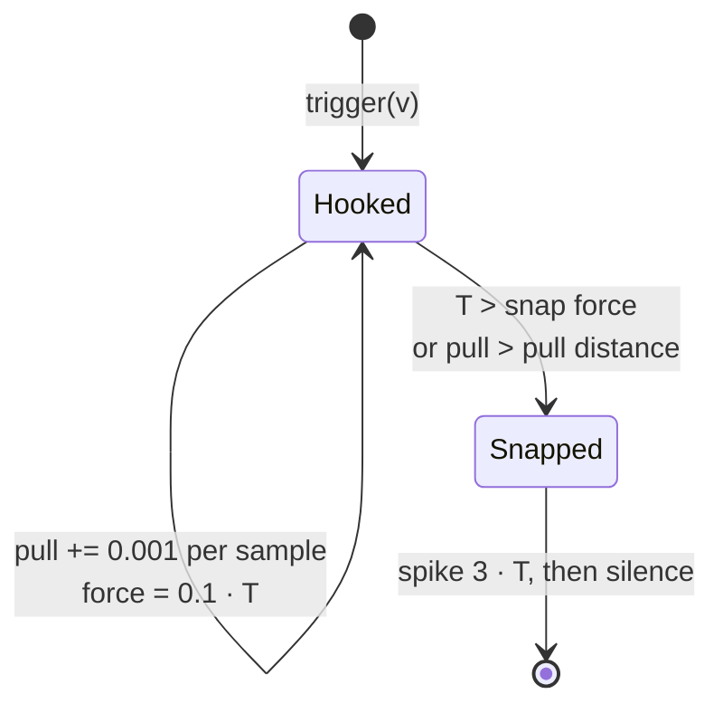

# Specialty Exciters

The Specialty family is the four models that are neither a strike nor a rub: Pneumatic Jet (air through a valve), Electromagnetic Hum (a transformer or motor buzzing against the object), Tension Snap (a hooked wire pulled until it breaks) and Particle Rain (sand, gravel or debris pouring onto the object). All four live in one file, `src/dsp/exciters/other_specialty.rs`, and all four are scaled by a linear ADSR force envelope (Attack, Decay, Sustain, Release).

The shared machinery is on [Exciters](Exciters); the ADSR, including a trap that leaves a voice stuck on, is on [Envelopes and Modulation](Envelopes-and-Modulation#specialty-the-linear-adsr).

Conventions as on the other family pages: steps are per 48 kHz sample and rate-converted ([Sample-Rate Rule](Sample-Rate-Rule)), `v = velocity / 127`, "host range" is the plugin parameter's range.

| Model | Reads | Character | Drive level |
|---|---|---|---|
| Pneumatic Jet | `V`, previous sample | band-shaped noise whose level follows a saturating air-flow law | 5.9898e-3 |
| Electromagnetic Hum | nothing (open loop) | three sine harmonics at mains frequency | 3.2879e-3 |
| Tension Snap | `ContactPrediction` (implicit) | a slow pull, then one snap | 0.62745 |
| Particle Rain | `ContactPrediction` (implicit, `RAIN_SCALE` units) | thousands of tiny spring impacts per second | 4.4103e-2 |

## Pneumatic Jet

Air blown past the object: white noise, scaled by a saturating function of the air's speed relative to the surface, then shaped by a crude band filter.

| Control | Host range, default | Role |
|---|---|---|
| Air Pressure | 0.1–2.1, 1.1 | air speed, and the output's final gain |
| Nozzle Width | 0.1–1.6, 0.85 | filter coefficient and how much of the low band is subtracted |
| Turbulence Chaos | 0–2, 0.6 | the cubic term of the saturation (× Roughness) |

**At note-on:** air pressure × `(0.3 + 0.7·v)`; filter state cleared.

**Per sample:**

1. `v_rel = air − V`.
2. Saturation: `v_sat = min(v_rel, knee)`, `s = max(0, v_sat² − chaos · v_sat³)`, with `knee = 2 / (3·chaos)` (infinite at chaos 0).
3. `raw = white_noise · s` (rate-scaled noise).
4. A one-pole low-pass follows `raw` with coefficient `rate::smoother((500 + 2000·width) / 10 000)`; the output is `clamp(raw − q·lowpass, −2, 2) · air`, with `q = 0.5 + 4·width`. So Nozzle Width both moves the low band and how much of it is subtracted; the "center frequency" is a coefficient, not a calibrated frequency.

### Why the saturation holds above the knee

`v² − chaos·v³` is the jet's turbulence law. It peaks at `v = 2/(3·chaos)` with the value `4 / (27·chaos²)`, then falls, and reaches zero at `v = 1/chaos`. Left alone, a harder note or more Air Pressure pushed the jet past its peak and **silenced** it. `saturation_knee` (computed in `set_parameters`) clamps the air speed at the peak, so above it the jet holds its loudest value: more air never makes it quieter. On the default patch (velocity 100: air 0.94, knee 1.11) the clamp doesn't act, so default notes are unchanged by it.

`harder_playing_never_silences_the_jet` and `print_jet_default_notes` (in `src/voice/mod.rs`) cover it; `a_longer_release_keeps_the_jet_blowing` checks that Release reaches the jet.

*History:* [the saturation fix](https://github.com/GerMP21/Corrosion-VST/tree/main/openspec/changes/archive/2026-11-10-fix-pneumatic-jet-saturation).

**Trap:** for negative `v_rel` (the surface moving faster than the air) the cubic term adds instead of subtracting. With the resonator's velocity in the 0.0002–0.007 range and the air at 0.1 or more this doesn't happen in the host ranges.

## Electromagnetic Hum

Mains hum coupled into the object: a fundamental at the mains frequency and two odd harmonics. It doesn't read the object at all (the voice passes it the displacement and a zero, and it ignores both), so it is a pure drive.

| Control | Host range, default | Role |
|---|---|---|
| Mains Frequency | 40–120 Hz, 80 | fundamental |
| Coil Proximity | 0–2, 1 | level |
| Voltage Sag | 0–2, 0.6 | level of the 3rd harmonic (and half of it on the 5th) |

**At note-on:** proximity × `(0.3 + 0.7·v)`; phase reset to 0, so every note starts the same.

**Per sample:** `(sin φ + sag·sin 3φ + 0.5·sag·sin 5φ) · proximity · 2`, with `φ` advancing at `2π · mains / fs`. The phase uses the host rate (`set_sample_rate`), so the pitch is right at every rate.

Global Speed and Roughness don't touch it. Because it is an open-loop sine, the object rings mainly where its modes sit near 40–600 Hz.

## Tension Snap

A hook pulling a wire: tension rises as the hook moves, the wire pulls the object a little, and when the tension passes the snap force (or the hook passes its pull distance) the wire breaks with one spike. One snap per note; after it the exciter is silent and the object rings out.

| Control | Host range, default | Role |
|---|---|---|
| Pull Distance | 0.1–1.5, 0.8 | hook travel at which it snaps regardless of tension |
| Hook Stiffness | 0.2–2.2, 1.2 | tension per unit of stretch |
| Snap Force | 0.1–2, 0.67 | tension at which it snaps (× `0.5 + 0.5·v`) |

The same, as a list:

- **Hooked.** The hook moves 0.001 per sample. Tension `T = stiffness · max(0, pull − D(F))`, where `D(F)` is the object's response to this sample's force. While `T` is under the snap force the output is `0.1·T`, a slow pull. The law is solved implicitly; the snap branch outputs more than the pull branch, but only above the threshold, so the law stays non-increasing in `F`, which the solver needs.
- **Snap.** The sample `T` crosses the threshold (or the pull passes Pull Distance) the output is `3·T / ratio`, a one-sample spike with constant area, placed between samples at the threshold crossing with an `EventSplitter`. The hook is then off (`hooked = false`) and only the splitter's pending half comes out.

On the default patch at velocity 100 the snap force is 0.599, reached after about 499 samples (10 ms); the 0.8 Pull Distance is a backstop at 800 samples. A higher Hook Stiffness snaps sooner; a higher velocity raises the snap force, so a harder note snaps later and louder.

**Trap:** because the snap happens once, the ADSR's Decay, Sustain and Release only shape that first 10–20 ms of pull and the spike; a long Attack scales the spike down (it comes while the envelope is still rising). `tension_snap_release` in `event_timing_tests.rs` checks the spike across rates.

## Particle Rain

Grains poured onto the object. Particles spawn at a steady rate; each falls into the surface, pushes it with a small spring force for a few dozen samples, and is dropped. Many overlapping pushes make a granular hiss whose pitch is the object's.

| Control | Host range, default | Role |
|---|---|---|
| Flow Rate | 0.1–3.1, 1.6 | particles per sample `0.1·flow` (× Speed) |
| Particle Mass | 0.05–1, 0.525 | force per particle |
| Mass Variance | 0–2, 0.6 | per-particle mass spread `mass · (1 ± variance)`, at least 0.01 (× Roughness) |

**At note-on:** flow × `(0.3 + 0.7·v)`; particles cleared (`clear` keeps the preallocated capacity of `MAX_PARTICLES`, 64).

**Per sample:**

1. A spawn accumulator gains `0.1·flow` per sample; each time it passes 1 a particle is born, unless 64 are alive. A newborn is aged by the fraction of the sample since its spawn, so spawns aren't rounded to the grid.
2. Each particle starts at velocity −0.5 and gains 0.05 per sample; its age grows 0.001 per sample. It is dropped when its velocity reaches 1.0 (after 30 samples) or its age 0.1.
3. The surface is seen in rain units (`in_units(RAIN_SCALE)`, 1000): through it the particles meet an effectively rigid surface, so their force follows their own motion rather than the object's give. Without it, the rain was displacement-limited, about 21 dB under the other models whatever its drive, and its level followed the sample grid.
4. Force `= 0.99 · Σ mass · max(0, velocity · 0.01 − D(F)) · 10` over the live particles, solved implicitly. A particle pushes from sample 10 (when its velocity turns positive) to sample 30.

On the default patch at velocity 100 the flow is 1.36, so 0.136 particles per sample, about 6 500 per second at 48 kHz, with about 4 alive at a time. The flow is clamped to 20 in code, which spawns at most 2 per sample; with a 30-sample life that is 60 particles, under the 64 buffer.

`particle_rain_spawns` in `event_timing_tests.rs` checks spawn timing across rates.

## Source files

- [`src/dsp/exciters/other_specialty.rs`](https://github.com/GerMP21/Corrosion-VST/blob/main/src/dsp/exciters/other_specialty.rs): `PneumaticJet` and its saturation knee, `ElectromagneticHum`, `TensionSnap` and `ParticleRain` with `RAIN_SCALE`.
- [`src/voice/mod.rs`](https://github.com/GerMP21/Corrosion-VST/blob/main/src/voice/mod.rs): the Specialty ADSR, the dispatch, and the jet and release tests.
