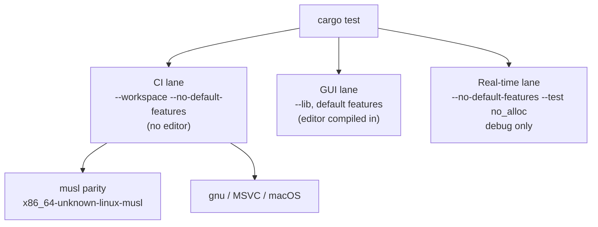
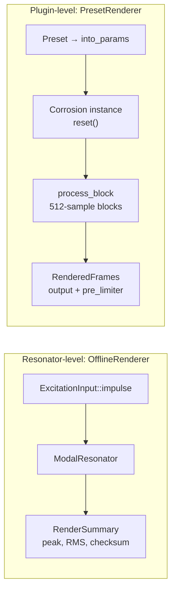

# Testing

Corrosion is an instrument, so most of what can go wrong is audible rather than a crash: a control that does nothing, a preset that went quiet, a click, a DC offset that eats headroom, an allocation that will one day drop out in someone's session. The test suite turns those into numbers. It renders audio in-process, measures it (level, brightness, roughness, DC, aliasing, hashes) and asserts bounds, so a regression fails `cargo test` instead of waiting for someone to hear it.

This page maps the suite: the lanes it runs in, what each integration test under `tests/` checks, where the large unit-test modules live, the ignored measurement tests, the golden fixtures, how to prove that a change leaves the sound unchanged, the offline renderers and WAV scripts, and the test that keeps this wiki honest.

## Test lanes

The same tests run in different configurations because some code only exists with some features or targets.



| Lane | Command | Builds | Runs where |
|---|---|---|---|
| CI lane | `cargo test --workspace --no-default-features` | The library without the `gui` feature, every unit test outside `src/gui/`, every integration test under `tests/` | CI on all three platforms; on Linux with `CARGO_BUILD_TARGET=x86_64-unknown-linux-musl` |
| GUI lane | `cargo test --lib` | The library with default features (`gui`): adds the editor's tests in `src/gui/` (layout, interaction and hover, driven headlessly) | CI on all three platforms, on the native target. Needs the X11 and GL development packages on Linux |
| musl parity | `CARGO_BUILD_TARGET=x86_64-unknown-linux-musl cargo test --workspace --no-default-features` | The CI lane against musl's libm | CI's Linux job (it is the CI lane there). Locally needs `rustup target add x86_64-unknown-linux-musl`; `.cargo/config.toml` links musl with `rust-lld` |
| Real-time | `cargo test --no-default-features --test no_alloc` | `tests/no_alloc.rs` in a **debug** build, where the checking allocator exists | CI on every platform; on Windows with `--features nih-plug/assert_process_allocs` and `CORROSION_EXPECT_ALLOC_CHECKER=1`. See [Real-Time Safety](Real-Time-Safety#the-checking-allocator) |

Practical notes:

- **Set a target first.** `.cargo/config.toml` defaults every command to `x86_64-pc-windows-gnu` (the maintainer's machine). On Linux, `export CARGO_BUILD_TARGET=x86_64-unknown-linux-gnu`. See [Building and Bundling](Building-and-Bundling#targets).
- **`[profile.test]` has `opt-level = 1`.** Tests render many seconds of audio; level 1 keeps debug assertions and overflow checks and still cuts run time several-fold. The real-time lane needs a debug profile, and this is one.
- `cargo test --workspace` covers only the plugin crate. The web app is a separate Cargo workspace in `web/` with its own tests (`cargo test -p corrosion-web-engine`), run by CI's `web` job; see [Web App](Web-App).
- `./scripts/verify-local.sh` runs format, notices, clippy, the CI lane, the GUI lane on gnu, a render smoke test and the Linux bundle in one go; it does not run `no_alloc` separately or `cargo doc`. See [Building and Bundling](Building-and-Bundling#the-full-local-lane-scriptsverify-localsh).
- CI's exact steps are on [CI and Releases](CI-and-Releases).

## Integration tests (`tests/`)

Each file in `tests/` is its own test binary that links the `corrosion` library as an outside user would, so it can only use the public API (`corrosion::voice`, `corrosion::dsp`, `corrosion::offline`, `corrosion::presets`, `corrosion::kit`). Most render a few seconds through a `Voice` or a `VoiceManager` at 48 kHz and measure the result with `render_behavior_metrics` (below).

| File | What it guards |
|---|---|
| `no_alloc.rs` | Nothing on the audio thread allocates: process, note-on for every object, quality and exciter, release tails, stealing, live and per-note expression, reset, rate changes, the editor note ring and kit pads. `the_checker_is_armed` proves the checker is installed. Details on [Real-Time Safety](Real-Time-Safety#what-testsno_allocrs-exercises) |
| `automation_stress.rs` | 16 voices with Width swept every sample stay finite and audible; sweeping the stereo argument on a Tank note leaves its mean (DC) under 0.01; every exciter (1–16) × object (9) pair stays finite for 2 048 samples |
| `body.rs` | `BodyResonator`: at amount 0 it returns 0 (it outputs only the body signal, not dry plus wet), and at 0.7 and 1.0 it adds energy to a constant input |
| `bow_exciter.rs` | A bowed Pipe note sustains (energy in its second 1 000 samples is at least 10 % of the first); Bow and Hand Strike differ in energy by more than 1.5× |
| `chain_distinct.rs` | Chain is the roughest object: its `roughness_proxy` beats Pipe, Plate and Tank |
| `damage_rattle.rs` | Damage 0.85 keeps at least 80 % of the clean note's RMS; Damage 0 stays finite; Damage 0.5 produces sample-to-sample variation |
| `drive_dynamics.rs` | `apply_drive`: Drive 0 is exactly unity, output stays within ±1.5, and Drive 0.85 keeps at least half the crest factor of no drive |
| `internals_wiki.rs` | This wiki: every page's `## Source files`, every repository link, coverage of source files and scripts, links between pages, the sidebar. See [The Internals wiki's own test](#the-internals-wikis-own-test) |
| `limiter.rs` | `apply_output_limiter` clamps to its threshold; `LIMITER_THRESHOLD` is 0.9661 (−0.3 dBFS) |
| `mseg_loop_safety.rs` | A bowed note whose MSEG loop starts at Sustain (loops 4→4, 5→5, 4→5) renders 2 s of finite audio within 30 s on a worker thread. It used to recurse forever on the audio thread |
| `plugin_metrics.rs` | Pipe, Plate and Tank differ in brightness and zero crossings; brightness falls as Size grows (0.5 → 1.0 → 1.5) and as Rust grows (0 → 0.5 → 0.9); roughness rises with Damage |
| `post_chain_default_dc.rs` | The post chain at the plugin's default parameters (filter cutoff 20 kHz, Space off) after a decaying 220 Hz burst: peak ≤ 1.0 and no channel holds a mean over 10⁻³ in the last 0.1 s. It once latched to a DC rail on the first note |
| `preset_loading.rs` | Loading a preset sets every parameter except the editor-only ones (`PRESET_SKIPPED_PARAMS`, which holds UI Scale), including Play Mode, Limiter Mode and the four macros, and every value equals what the preset's own `into_params` holds, for every factory preset and legacy fixture |
| `preset_roundtrip.rs` | Save/load round trips; schema migrations (version 1 and unstamped presets, v3 → v4, idempotence on the current version); the wander-rate, onset-level and diode-stage migrations, each with and without the new field; invalid values sanitised; the legacy `complex_algo` field ignored; exciters 0 and 17 load as Hand Strike, 1–16 load and save as themselves; preset-built parameters display exactly like the live ones |
| `stereo_width.rs` | A Pipe `ModalResonator` at width 0 is mono (L = R within 10⁻⁶); at width 1 both channels carry comparable energy |
| `tidy_render_hash.rs` | Ignored. Prints FNV render hashes of damaged stereo Bow, Hand Strike and Hard Mallet notes through `render_preset`, for comparing two builds by hand. See [Proving "unchanged"](#proving-unchanged) |
| `velocity_brightness.rs` | Level-normalised, a velocity-127 Pipe note is brighter than a velocity-25 one; across five velocities at least 70 % of pairs get brighter with velocity; the loud note's first 20 samples peak higher |
| `velocity_expressivity.rs` | Velocities 32, 64 and 100 on a damaged Pipe differ in zero-crossing count by more than 2 %. Despite its name, `high_velocity_has_faster_decay` only checks that the velocity-127 note's energy is at least half the velocity-32 note's |

Two items under `tests/` are not Rust:

- **`tests/fixtures/`**: inputs shared by tests (next section).
- **`tests/daw/`**: two shell scripts from the project's early milestones. `run-reaper.sh` checks that `reaper` is on `PATH` and that `target/bundled/linux/Corrosion.vst3` exists, then prints notes; `gate-2-smoke.sh` starts REAPER briefly and greps its plugin cache for Corrosion. Neither renders audio and nothing runs them in CI. The current way to check the plugin in a host is the manual recipe in `docs/REAPER_TESTING.md`, summarised on [Building and Bundling](Building-and-Bundling#checking-in-reaper-from-a-cloud-session).
- **`tests/AGENTS.md`**: a short guide for coding agents working in `tests/`: deterministic metric assertions over subjective claims, repo-root-relative fixture paths, `check_wav.py` and `check_clicks.py` for rendered WAVs. Its mention of a `.sisyphus/evidence/` folder refers to a folder that doesn't exist in the repository.

## Unit tests in `src/`

Most of the suite is unit tests next to the code, in `#[cfg(test)] mod tests` blocks or in separate `tests.rs` files (which the module includes). They can reach private items and the test-only switches. The largest, by number of `#[test]` functions:

| Module | Tests | What they cover |
|---|---|---|
| `src/lib.rs` | about 87 | The plugin as a whole: note events across buffers, macros, master drive, tempo sync, limiter modes and latency reporting, `filter_state` migrations of old projects, sustain pedal and panic, preset levels, the controller messages in a checked zone |
| `src/gui/editor.rs` | about 73 | The editor, headless: layout, scroll, controls, hover help, keyboard. GUI lane only |
| `src/voice/mod.rs` | about 72 | One voice: exciters, drive levels and the governor, sample-rate independence, expression, choke, loudness bounds such as `default_notes_do_not_overdrive_the_voice` and `exciters_play_at_a_common_level` |
| `src/dsp/tests.rs` | about 37 | Profiles, mode counts and the deterministic offline renders |
| `src/presets/factory/tests.rs` | about 27 | The factory bank: counts, the 16 × 9 experimental grid, determinism, parameter variation, the quality floor for every non-kit preset and every drum pad, each folder's character, and `generated_bank_equals_the_files_on_disk` |
| `src/dsp/envelopes/mod.rs` | about 24 | ADSR, MSEG, wander |
| `src/dsp/resonators/core.rs` | about 20 | Mode banks: `mode_banks_match_golden_fixture`, `note_on_banks_fit_max_modes`, in-place rebuilds, sample-rate-independent level |
| `src/dsp/post_processing/` | about 100 across the files | Each post-chain stage: Space, the oversampled clipper, WDF filter, Lorenz drive, FEM body, limiter, routing |
| `src/voice/manager.rs`, `src/gui_notes.rs`, `src/kit/tests.rs`, `src/presets/mod.rs` | 15–19 each | Allocation and stealing, the editor note ring, kit pads, preset parsing and migration |
| `src/guide/` | about 18 | The user Wiki's generated data: `guide_data_equals_the_files_on_disk`, `guide_clip_plan_covers_every_parameter`, and `every_sound_shaping_control_changes_its_note` (every control that should change the sound does, by a floor) |
| `src/offline/mod.rs`, `src/offline/preset.rs` | 13 | The clipper's transparency, alias bounds and delay; the offline render equals the plugin's own block path |

The counts drift; `grep -c '#\[test\]'` gives the current ones. Several of these are **drift tests**: they regenerate something in memory (the factory bank, the user Wiki's data) and fail when it differs from the files committed in the repository. The fix is to rerun the generator (`seed_presets`, `export_guide_data`) and commit, never to edit the files by hand. See [Factory Bank](Factory-Bank) and [Site and User Wiki Tooling](Site-and-User-Wiki-Tooling).

## Ignored measurement tests

Some tests don't assert anything useful in CI; they print a table that a design decision needs, such as per-preset levels or a clipper's alias ratio. They are marked `#[ignore]` so the normal run skips them. Run one with:

```bash
cargo test --no-default-features <name> -- --ignored --nocapture
```

(`--ignored` runs only ignored tests; `--include-ignored` runs both kinds.) The main ones:

| Test | Where | Prints |
|---|---|---|
| `preset_levels_are_sane`, `preset_levels_table` | `src/lib.rs` | Every preset's level through the plugin path, and outliers |
| `print_voice_mix_dc`, `print_factory_output_dc`, `print_diode_dc_stage_level_change` | `src/lib.rs` | DC on the voice mix and at the output, and what the diode stage's DC removal moves |
| `print_exciter_overdrive`, `print_48k_exciter_render_hashes`, `print_seed_averaged_rate_levels`, `print_jet_default_notes` | `src/voice/mod.rs` | Per-exciter overdrive, render hashes, level against sample rate |
| `curated_measurements_table`, `drum_pad_measurements_table`, `print_velocity_sweep`, `print_experimental_level_instability` | `src/presets/factory/tests.rs` | The bank's per-preset measurements |
| `relevel_named_presets`, `redraw_named_preset` | `src/presets/factory/tests.rs` | Tools for the bank's maintainer, not measurements |
| `print_unsoundable_mode_counts` | `src/dsp/resonators/core.rs` | How many modes pruning drops |
| `print_headroom_sweep`, `print_clipper_measurements` | `src/offline/mod.rs` | The clipper's headroom, gain, lag and alias ratio per quality mode |
| `print_editor_content_height` | `src/gui/editor.rs` | The editor's content height (GUI lane) |
| `print_pad_note_on_cost` | `src/kit/tests.rs` | A pad note-on's cost against a live note |
| `print_control_responses`, `print_slot_effects`, `print_recipe_measurements` | `src/guide/` | The user Wiki's control and recipe measurements |
| Measurements in `lorenz_drive.rs`, `oversampled_clipper.rs`, `half_band.rs`, `fem_body.rs` | `src/dsp/post_processing/` | Stage-level tables (their `ignore` reasons say what) |
| `print_tidy_render_hashes` | `tests/tidy_render_hash.rs` | Render hashes for a before/after comparison |

`allocation_aborts_under_the_checker` (in `tests/no_alloc.rs`) is ignored for a different reason: it aborts by design, and only `the_checker_is_armed` runs it.

## Golden fixtures (`tests/fixtures/`)

### Mode-bank hashes

`tests/fixtures/mode_bank_hashes.txt` holds 108 lines, one per case: 9 objects × 4 quality scales (0.5, 1, 1.5, 2) × Damage 0, 0.5 and 1. Each line names the case, its mode count and an FNV hash of the note-on bank (every mode's frequency, decay and gain, current and base). `mode_banks_match_golden_fixture` in `src/dsp/resonators/core.rs` rebuilds every bank and compares line by line.

- It catches any change to the banks a note-on builds, which is any change to the timbre of a struck note at its source.
- **Regenerate only for an intended sound change:** `CORROSION_UPDATE_GOLDEN=1 cargo test mode_banks_match_golden` rewrites the file. Add the reason to the doc comment above the test, which lists every past re-capture and why.
- **Linux only.** The banks come from libm's `sin`, `cos`, `exp` and `powf`, and macOS rounds differently, so the test is ignored on other platforms. gnu and musl agree on these banks, so it runs in both Linux lanes.

### The legacy preset corpus

`tests/fixtures/presets/legacy/` holds 50 presets from before the factory bank was rebuilt in code. They are kept unchanged on purpose:

- tests that need one specific, stable preset read them (`preset_loading.rs` reads `beam_drag`; a reset test in `src/lib.rs` reads `hanging_chain_echo` and `spring_reverb_tap`; `offline/preset.rs`'s tests, the benchmark `plugin_output_path_sixteen_voices` and `render_presets`' own test read `sheet_lightning`);
- they prove that old preset files keep loading through every migration (`preset_loading.rs` and `preset_roundtrip.rs` load them all).

Don't regenerate them. The factory bank in `presets/factory/` changes when the bank is reseeded; this corpus doesn't.

`tests/fixtures/default.corrosion-preset` is a minimal version-1 preset (name, object, Size, Rust, Damage, Drive, Output). No test or tool in the repository reads it today.

## Proving "unchanged"

Many changes claim that something stays the same: a refactor, a speed-up, a new control at its default. "Sounds the same" is not evidence. The project accepts two kinds of proof.

**Test-only switches.** Some structs carry a `pub(crate)` flag that is always on in use, which a test turns off to run the old path next to the new one in the same build, then compares outputs sample by sample:

| Switch | On | Turning it off gives |
|---|---|---|
| `Voice::global_controls_enabled` | `Voice` | The note as it was before the global Pressure, Speed and Roughness controls were connected |
| `Voice::governor_enabled` | `Voice` | No drive governor, to probe the contact's own stability |
| `Voice::drive_scale` | `Voice` | A multiplier on the exciter force (1.0 in use), to probe stability far above the default drive |
| `ModalResonator::prune_enabled` | `ModalResonator` | The full bank, without dropping unsoundable modes |
| `ModalResonator::retune_skip_enabled` | `ModalResonator` | Every mode rebuilt every sample during a bend, the reference for the incremental retune |

Because the flags are `pub(crate)`, only unit tests inside `src/` can use them.

**Render-hash comparisons.** For a change with no switch, render the same notes on a clean worktree of the old commit and on the new code, and compare a hash of every output sample's bits. `tests/tidy_render_hash.rs` (FNV-1a over `f32::to_bits` of both channels, through `render_preset`) and `print_48k_exciter_render_hashes` print such hashes:

```bash
git worktree add --detach /tmp/base HEAD
(cd /tmp/base && CARGO_TARGET_DIR=/tmp/base-target cargo test --no-default-features --test tidy_render_hash -- --ignored --nocapture)
cargo test --no-default-features --test tidy_render_hash -- --ignored --nocapture
```

Equal hashes prove bit-identical output for those notes. **These hashes are not portable**: seconds of audio go through many libm calls (`sin`, `exp`, `tanh`, `powf`), which round differently in glibc, musl and macOS's libm, so the same code gives different hashes on gnu and musl. Compare two builds on the same target, by hand; CI can't assert them. (The mode-bank fixture above is the exception: on Linux, gnu and musl agree on the banks.)

## The offline renderers

Two paths turn the engine into audio files, for tests, tools and listening.



| | `OfflineRenderer` (`src/offline/mod.rs`) | `PresetRenderer` (`src/offline/preset.rs`) |
|---|---|---|
| Renders | One `ModalResonator` (any `ResonatorCore`) struck by a deterministic impulse | A whole plugin instance with a preset loaded |
| Path | The bank alone: no exciter, voice or post chain | `Corrosion::process_block`, the same per-block code `process()` runs: voices, master drive, post chain, output gain and the preset's limiter |
| Notes | One impulse at `excitation_frame` | `OfflineNote::on` / `off` at absolute frames, sorted, delivered inside blocks at block-relative timings |
| Block size | Per sample | `OFFLINE_BLOCK_SIZE` = 512, so per-block parameter updates happen as in a host |
| Output | Mono `Vec<f32>` and a `RenderSummary` | Stereo frames, and the same frames before the limiter (`pre_limiter`), for counting limiter hits |
| Used by | `render` CLI, `src/dsp/tests.rs`, a benchmark | `render_presets`, preset level tests, kit and guide tests, the user Wiki's clips, benchmarks |

`render_preset`, `render_preset_at_tempo` (for tempo-synced controls) and `render_preset_pre_limiter` are one-call wrappers. A `PresetRenderer` keeps state between `render` calls, as a plugin does between host buffers, and `plugin_mut()` (test-only) lets a test act on the instance between renders. The tests `offline_render_equals_plugin_path_for_a_post_chain_preset` and `offline_render_equals_plugin_path_with_the_lookahead_limiter` write the host's block loop out independently and require the offline render to be bit-identical to it.

The module also holds the analysis helpers tests use:

- **`render_behavior_metrics(&[f32])`** returns `zero_crossings`; `brightness_proxy` (sum of |sample-to-sample change| over sum of |sample|: higher means more high-frequency content); `late_to_early_energy_ratio` (energy after the first quarter over the first quarter: higher means a longer ring); `roughness_proxy` (mean absolute deviation of the intervals between zero crossings: higher means a less periodic waveform). They are cheap proxies, not perceptual measures, which is why tests compare them between renders rather than against absolute targets.
- **Aliasing analysis**: `analyze_clipper_aliasing`, `analyze_post_chain_aliasing[_at_quality]` and `measure_clipper_response` drive a bin-centred sine through the clipper or the post chain and split the spectrum, by exact DFT bins in `f64`, into harmonics and everything else. The ratio in dB is the alias figure the output-clipper tests bound. See [Output Protection](Output-Protection).
- **`write_wav_i16`**: a mono 16-bit WAV writer. It passes samples through `apply_output_limiter` at `LIMITER_THRESHOLD` first, so its files never reach full scale.

### `render` (`src/bin/render.rs`)

The resonator-level CLI. `--suite` picks what to write into `--out-dir` (default `output/offline`):

| Suite | Writes |
|---|---|
| `family` | `pipe_comparison.wav`, `plate_comparison.wav`, `tank_comparison.wav`, a summary text per object and `family_comparison_manifest.txt` |
| `rust` | Pipe at Rust 0.25 and 0.85, with behaviour metrics |
| `damage` | Pipe at Damage 0.25 and 0.85, with behaviour metrics |
| `aliasing` | `aliasing_report.txt` from the post chain at Render quality, Drive 2.5 |
| `all` (default) | Each of the above in a subfolder, plus the aliasing report |

`--sample-rate`, `--frame-count`, `--excitation-frame` and `--excitation-amplitude` shape the impulse render. CI runs `render --suite family` on every platform and checks `pipe_comparison.wav` with `check_wav.py`, a smoke test that the binary runs and produces sound.

### `render_presets` (`src/bin/render_presets.rs`)

The plugin-level CLI: every `.corrosion-preset` in `--preset-dir` rendered through `render_preset` to a stereo 16-bit WAV in `--out-dir` (default `output`), plus `preset_render_manifest.txt` with peak, RMS, a bit checksum and the behaviour metrics per preset. One note (`--note`, default 60) at `--velocity` (MIDI 0–127, default 127), released at `--note-off` seconds (default 1) of a `--duration` (default 2 s) render. `--contains` filters by file name and `--limit` caps the count.

It reads only the top level of `--preset-dir`, not subfolders. The default, `presets/factory`, has its presets in subfolders (`bass/`, `lead/`, …), so point it at one folder: `--preset-dir presets/factory/bass`. Its test `written_wav_equals_the_quantized_offline_render` checks that the file holds exactly the offline render, quantised to 16 bits.

The user Wiki's audio clips have their own renderer, `render_guide_clips`; see [Site and User Wiki Tooling](Site-and-User-Wiki-Tooling).

### WAV scripts (`scripts/`)

Plain Python 3, standard library only. Each reads 16-bit, 24-bit and 32-bit-float WAVs.

| Script | Does | Exit code |
|---|---|---|
| `check_wav.py <wav>` | Prints peak, RMS, NaN count, frames and rate. Fails if shorter than 0.1 s, any sample is NaN or infinite, the peak is under 0.01 (silent) or over 0.9999 (hard clipping) | 0 pass, 1 fail. CI and `verify-local.sh` use it on the `render` smoke output |
| `check_clicks.py <wav>` | Counts sample-to-sample jumps over 0.5 (interleaved samples, so a jump between channels counts too) | 0 when there are none |
| `analyze_wav.py <wav> [--samples N] [--channel N] [--output-dir D]` | Prints metadata and per-channel peak, RMS, mean, min, max, zero crossings and NaN count, with sample previews, and writes the same as JSON to `output/analyzed-wavs/<name>.json` by default | 0, or 1 on an unreadable file |

## The Internals wiki's own test

`tests/internals_wiki.rs` keeps this wiki tied to the repository. It reads every `docs/internals/*.md` file and checks:

| Test | Fails when |
|---|---|
| `every_page_lists_its_source_files` | A page other than `Home`, `Glossary`, `_Sidebar` and `_Footer` has no `## Source files` section, the section has no link, or a link in it isn't a `https://github.com/GerMP21/Corrosion-VST/blob/main/…` or `…/tree/main/…` link |
| `every_linked_repository_path_exists` | Any repository link on any page names a file (`blob`) or directory (`tree`) that doesn't exist |
| `every_source_file_is_named` | A non-test `.rs` file under `src/`, or a top-level item of `web/`, `scripts/`, `tests/`, `benches/` or `.github/workflows/`, isn't named in any page's `## Source files` (a directory counts when the page names it or anything under it). Lockfiles, build outputs, `vendor` and dot-files are exempt |
| `wiki_links_resolve` | A link between pages names no page, or a `#heading` that page doesn't have. Anchors follow GitHub's rule, computed by `slug` |
| `sidebar_links_every_page` | `_Sidebar.md` doesn't link a page |

The helpers (`strip_code`, `link_targets`, `section`, `slug`, `repository_path`, `is_test_file`) have their own small tests on fixed strings. Code spans and fenced blocks are blanked before links and headings are read, so a link inside backticks doesn't count. Run it with:

```bash
cargo test --no-default-features --test internals_wiki
```

If a check is marked `#[ignore]` in the file, add `-- --include-ignored` to run it too. The test can't tell whether what a page says is still true; that is what the rule on [Contributing and Keeping This Wiki Current](Contributing-and-Keeping-This-Wiki-Current) is for.

## Source files

- [`tests/AGENTS.md`](https://github.com/GerMP21/Corrosion-VST/blob/main/tests/AGENTS.md): the agents' guide to the test folder
- [`tests/automation_stress.rs`](https://github.com/GerMP21/Corrosion-VST/blob/main/tests/automation_stress.rs): finite output under swept controls, every exciter × object
- [`tests/body.rs`](https://github.com/GerMP21/Corrosion-VST/blob/main/tests/body.rs): `BodyResonator` at amount 0, 0.7 and 1
- [`tests/bow_exciter.rs`](https://github.com/GerMP21/Corrosion-VST/blob/main/tests/bow_exciter.rs): Bow sustains and differs from Hand Strike
- [`tests/chain_distinct.rs`](https://github.com/GerMP21/Corrosion-VST/blob/main/tests/chain_distinct.rs): Chain is the roughest object
- [`tests/damage_rattle.rs`](https://github.com/GerMP21/Corrosion-VST/blob/main/tests/damage_rattle.rs): Damage keeps the note and adds variation
- [`tests/daw`](https://github.com/GerMP21/Corrosion-VST/tree/main/tests/daw): early REAPER smoke scripts, not run by CI
- [`tests/drive_dynamics.rs`](https://github.com/GerMP21/Corrosion-VST/blob/main/tests/drive_dynamics.rs): `apply_drive` unity, bounds and crest factor
- [`tests/fixtures`](https://github.com/GerMP21/Corrosion-VST/tree/main/tests/fixtures): mode-bank hashes, the legacy preset corpus, a minimal version-1 preset
- [`tests/internals_wiki.rs`](https://github.com/GerMP21/Corrosion-VST/blob/main/tests/internals_wiki.rs): this wiki's checks
- [`tests/limiter.rs`](https://github.com/GerMP21/Corrosion-VST/blob/main/tests/limiter.rs): the hard limiter and its −0.3 dBFS threshold
- [`tests/mseg_loop_safety.rs`](https://github.com/GerMP21/Corrosion-VST/blob/main/tests/mseg_loop_safety.rs): MSEG loops starting at Sustain finish
- [`tests/no_alloc.rs`](https://github.com/GerMP21/Corrosion-VST/blob/main/tests/no_alloc.rs): the real-time lane
- [`tests/plugin_metrics.rs`](https://github.com/GerMP21/Corrosion-VST/blob/main/tests/plugin_metrics.rs): objects differ; Size, Rust and Damage move the metrics the right way
- [`tests/post_chain_default_dc.rs`](https://github.com/GerMP21/Corrosion-VST/blob/main/tests/post_chain_default_dc.rs): no DC after a note at the default post chain
- [`tests/preset_loading.rs`](https://github.com/GerMP21/Corrosion-VST/blob/main/tests/preset_loading.rs): a load sets every parameter to the preset's value
- [`tests/preset_roundtrip.rs`](https://github.com/GerMP21/Corrosion-VST/blob/main/tests/preset_roundtrip.rs): round trips, migrations, sanitising, display
- [`tests/stereo_width.rs`](https://github.com/GerMP21/Corrosion-VST/blob/main/tests/stereo_width.rs): width 0 is mono, width 1 is stereo
- [`tests/tidy_render_hash.rs`](https://github.com/GerMP21/Corrosion-VST/blob/main/tests/tidy_render_hash.rs): render hashes for by-hand before/after comparisons
- [`tests/velocity_brightness.rs`](https://github.com/GerMP21/Corrosion-VST/blob/main/tests/velocity_brightness.rs): velocity brightens the note and raises its first peak
- [`tests/velocity_expressivity.rs`](https://github.com/GerMP21/Corrosion-VST/blob/main/tests/velocity_expressivity.rs): velocity changes roughness
- [`src/offline/mod.rs`](https://github.com/GerMP21/Corrosion-VST/blob/main/src/offline/mod.rs): `OfflineRenderer`, behaviour metrics, aliasing analysis, the WAV writer
- [`src/offline/preset.rs`](https://github.com/GerMP21/Corrosion-VST/blob/main/src/offline/preset.rs): `PresetRenderer` and `render_preset` through the plugin's block path
- [`src/bin/render.rs`](https://github.com/GerMP21/Corrosion-VST/blob/main/src/bin/render.rs): the resonator-level render CLI
- [`src/bin/render_presets.rs`](https://github.com/GerMP21/Corrosion-VST/blob/main/src/bin/render_presets.rs): the preset render CLI
- [`scripts/check_wav.py`](https://github.com/GerMP21/Corrosion-VST/blob/main/scripts/check_wav.py): pass/fail check on a rendered WAV
- [`scripts/check_clicks.py`](https://github.com/GerMP21/Corrosion-VST/blob/main/scripts/check_clicks.py): click detector
- [`scripts/analyze_wav.py`](https://github.com/GerMP21/Corrosion-VST/blob/main/scripts/analyze_wav.py): WAV statistics and JSON export
- [`src/dsp/resonators/core.rs`](https://github.com/GerMP21/Corrosion-VST/blob/main/src/dsp/resonators/core.rs): `mode_banks_match_golden_fixture` and the resonator's switches
- [`src/voice/mod.rs`](https://github.com/GerMP21/Corrosion-VST/blob/main/src/voice/mod.rs): the voice's test-only switches and measurement tests
- [`.cargo/config.toml`](https://github.com/GerMP21/Corrosion-VST/blob/main/.cargo/config.toml): the default target, and the musl and gnu linkers
