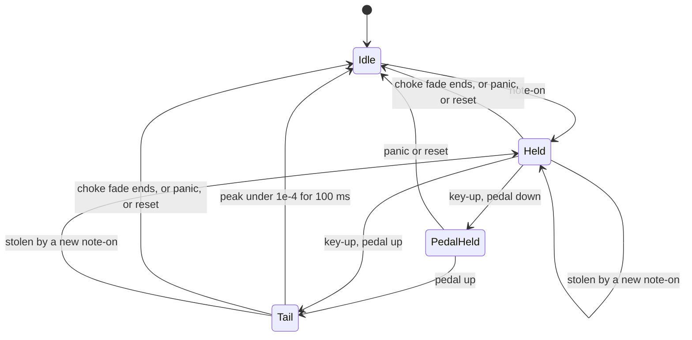
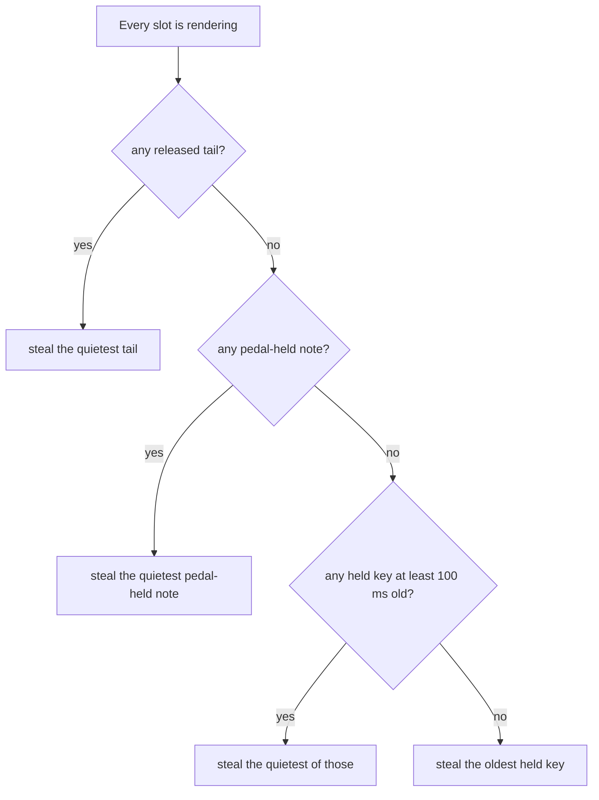

# Voices and Polyphony

A voice is one sounding note: an exciter, a modal resonator and a force envelope. Corrosion has a fixed pool of 16 voices, owned by `VoiceManager` in `src/voice/manager.rs`; each `Voice` (`src/voice/mod.rs`) owns everything it can ever need, so starting, stealing and ending a note never allocates. This page covers a voice's life (note-on, release, tail, end), how a slot is chosen and stolen, the sustain pedal, the panic paths, and where the voice mix goes.

## Voice states

A voice has two flags: `active` (the key is held, or the pedal holds it) and `rendering` (it still makes sound). A third, `pedal_held`, marks a key that is up while the sustain pedal keeps the note.

| State | `active` | `pedal_held` | `rendering` | Meaning |
|---|---|---|---|---|
| Idle | false | false | false | Costs nothing; skipped by the manager. |
| Held | true | false | true | Key down. Gets live control updates every block. |
| Pedal-held | true | true | true | Key up, sustain pedal down. Still counts as held. |
| Tail | false | false | true | Released; the exciter's envelope releases and the resonator rings out. |

The transitions:

- Idle → Held on note-on.
- Held → Pedal-held on a key-up while the pedal is down; Held → Tail on a key-up with the pedal up.
- Pedal-held → Tail when the pedal lifts.
- Tail → Idle when the peak stays under 1e-4 for 100 ms.
- Any sounding state → Idle at the end of a choke fade, a panic or a reset.
- Any state goes to Held when its slot is taken for a new note: `note_on_with_controls` resets everything that note needs.

## Note-on

`handle_note_event` (`src/lib.rs`) builds a `NoteSetup` from the parameters (`note_setup`: profile, macro-biased size, rust and damage, exciter ID, and a `VoiceControls` snapshot of every per-note parameter) and calls `VoiceManager::note_on_addressed`. Kit pads call `note_on_pad` instead ([Kit Mode](Kit-Mode)). Both go through `start_voice`:

1. **Re-strike under the pedal.** Any pedal-held voice on the same key is released first, so repeated notes under the pedal don't pile up.
2. **Pick a slot.** The first voice with `!is_rendering()`; if none, `steal_index()` (below).
3. **Channel expression.** `apply_channel_expression_to` gives the slot the current channel pressure, mod wheel and pitch bend, so a note started during a bend starts bent.
4. **`Voice::note_on_with_controls`:**
   - sets `active` and `rendering`, clears `pedal_held`, the pad flag and gain, and stores note, velocity and the exciter ID (normalized through `ExciterType::from_int`, so a bad ID plays Hand Strike);
   - resets peak hold, governor, the tail counter, poly pressure, per-note tuning, voice ID, choke;
   - starts Pressure at its target, unsmoothed;
   - reseeds every noise source from `note_seed(note, velocity, start_frame)`, one salted stream per consumer, so a note is deterministic given the frame it starts on;
   - rebuilds the resonator in place (`ModalResonator::rebuild_in_place`) for the profile, size, material transforms, pitch (`midi_to_hz`), damping, brightness, character and mode-count scale, at the voice's rate. This is the expensive part of a note-on; it reuses buffers preallocated to the largest bank;
   - sets the interaction parameters (strike position, coupling, wander, anchor) and the Position Envelope amount;
   - applies the pitch (channel bend plus tuning);
   - configures the force envelope for the exciter's family;
   - applies the global Speed and Roughness to a copy of the controls, then sets the parameters of and triggers the one exciter selected (a `match` on 1..16).
5. **Address.** `set_address(voice_id, channel)` records how the host addressed the note ([Note Expression](Note-Expression)).

`start_frame` is the manager's `frame_counter`, which counts samples processed since the last reset.

## Release, tail and end

- **`note_off`** clears `active` and `pedal_held` and releases the force envelope: the Hit one-shot goes to its release ramp, the ADSR to Release, the MSEG to its release stage. The exciters keep running until their envelope reaches 0, so Release and MSEG Release shape the tail. Friction exciters that held a static deflection let go at once; the object rings out from it (up to about +30 dB over the held note on the default patch, a known behaviour).
- **Tail.** The resonator decays at its own rate. Each sample `peak_hold` takes the larger clamped output and decays by `PEAK_DECAY` = 0.999 per sample (at 48 kHz).
- **End.** While `!active` and `peak_hold < TAIL_ENERGY_THRESHOLD` (1e-4, −80 dBFS), a counter runs; after `TAIL_DEACTIVATE_FRAMES` (4800 at 48 kHz, 100 ms, converted with `rate::frames`) the voice sets `rendering = false`. Any louder sample resets the counter.
- **`reset`** returns a voice to idle in place: flags, resonator state, envelopes, expression, address. It doesn't touch the resonator's bank; the next note-on rebuilds it.

## Choosing a voice to steal

When all 16 voices are rendering, `steal_index` ranks them in four tiers, lowest stolen first:

| Tier | Voices | Order within the tier |
|---|---|---|
| 0 | released tails (`!is_active()`) | quietest `peak_hold`, oldest on a tie |
| 1 | pedal-held notes | quietest, oldest on a tie |
| 2 | held keys at least `STEAL_PROTECTION_SECONDS` (0.1 s) old | quietest, oldest on a tie |
| 3 | younger held keys | oldest |

- "Quietest" uses `comparable_peak_hold`, which maps a non-finite `peak_hold` to −∞, so a voice that went NaN is reclaimed first and the comparison never panics.
- Tier 3 ignores level on purpose: a note that started a few milliseconds ago (a slow bow attack) hasn't reached its peak, so its level says nothing about how audible it will be. 100 ms covers a slow friction attack with margin.
- The protection window is `0.1 × sample_rate` frames, so it is 100 ms at any rate (`protection_window_is_one_hundred_milliseconds_at_any_rate`).
- A stolen voice is not faded: the new note's `note_on_with_controls` overwrites it, and its resonator state starts from the rebuilt bank.

## Sustain pedal

`VoiceManager::sustain_down` holds the pedal state (CC64, down at 64 or more).

- A key-up goes through `release_key`: with the pedal down the voice is marked `pedal_held` (it stays `active` and still gets live controls); otherwise it is released.
- Lifting the pedal (`set_sustain(false)`) releases every pedal-held voice. Keys still physically down keep sounding, because they were never marked.
- CC123 All Notes Off (`all_notes_off`) releases every held key through `release_key`, so a down pedal still holds them, as MIDI 1.0 specifies.
- CC121 Reset All Controllers lifts the pedal (releasing pedal-held notes) and zeroes mod wheel, bend and channel pressure.
- A note-off never matches a pedal-held voice (it already had its key-up).

## Panic and reset

| Path | Trigger | What happens |
|---|---|---|
| All Sound Off | CC120 | `Corrosion::start_panic` fades the plugin's output linearly over 5 ms (`PANIC_FADE_SECONDS`, computed from the voices' rate). At the end, `VoiceManager::silence` resets every voice and the frame counter, and the DC blocker, post chain and lookahead limiters are cleared in place. Pedal, mod wheel, bend and pressure keep their values: the message mutes sound, it doesn't move controllers. |
| Host reset | `Plugin::reset` | `VoiceManager::reset`: every voice reset, the frame counter to 0, and the channel state (bend, pressure, mod wheel, pedal) cleared. |
| Choke | host `Choke` event | One voice (or every voice on a key) fades over 2 ms and resets ([Note Expression](Note-Expression)). |

The panic fade is on the output, not per voice, so it also fades reverb and echo tails. A note-on during the 5 ms fade starts a voice, but the end of the fade clears it too.

## The voice mix

Every sample, `VoiceManager::process_sample_stereo(rate, width)` advances `frame_counter`, records the rate, and adds the stereo output of every rendering voice. Nothing divides the sum by the voice count, so one note is as loud alone as in a chord (`single_voice_is_not_downmixed_by_empty_slots`). The sum goes to the voice-mix DC blocker, then the master drive and the post chain ([Signal Chain](Signal-Chain)).

Other manager services:

- `set_sample_rate` rates every voice, idle ones included, so a note's bank is built at the host rate. `Voice::set_rate` is a cheap comparison when nothing changed.
- `update_live_controls` sends the per-block live controls to held, non-pad voices.
- `active_notes` (held notes, published for the editor's key highlights) and `sounding_notes` (held or tailing) iterate without allocating.

## Memory and cost

Each `Voice` contains one instance of all 16 exciters plus a `ModalResonator` preallocated to `MAX_MODES`. Dispatch is a `match` on the exciter ID, with no trait objects and no allocation. The cost is memory (16 × 16 exciter structs); the gain is a note-on path that only rebuilds data in place. `tests/no_alloc.rs` checks note-on, stealing, release, live controls and MIDI expression; see [Real-Time Safety](Real-Time-Safety).

## Source files

- [`src/voice/mod.rs`](https://github.com/GerMP21/Corrosion-VST/blob/main/src/voice/mod.rs): `Voice`, `VoiceControls`, note-on, `note_off`, `reset`, tail tracking, the constants `TAIL_ENERGY_THRESHOLD`, `TAIL_DEACTIVATE_FRAMES`, `PEAK_DECAY`.
- [`src/voice/manager.rs`](https://github.com/GerMP21/Corrosion-VST/blob/main/src/voice/manager.rs): `VoiceManager`, `start_voice`, `steal_index`, the pedal, `silence`, `reset` and the voice mix.
- [`src/lib.rs`](https://github.com/GerMP21/Corrosion-VST/blob/main/src/lib.rs): `note_setup`, `handle_note_event`, the CC routing and the panic fade.
