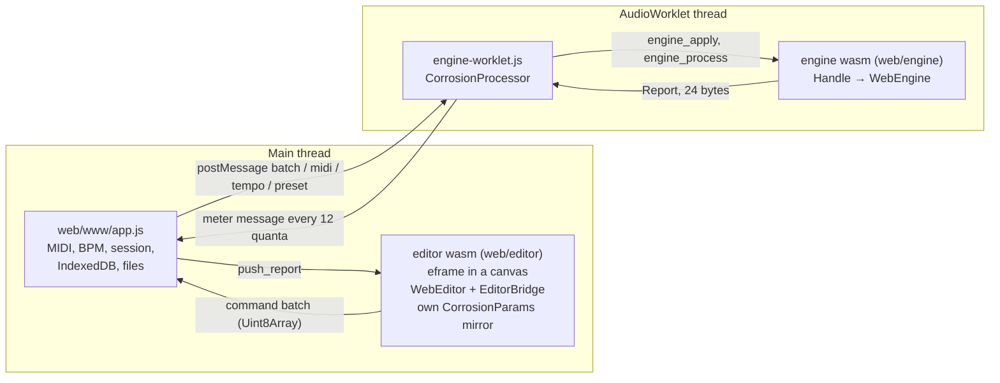
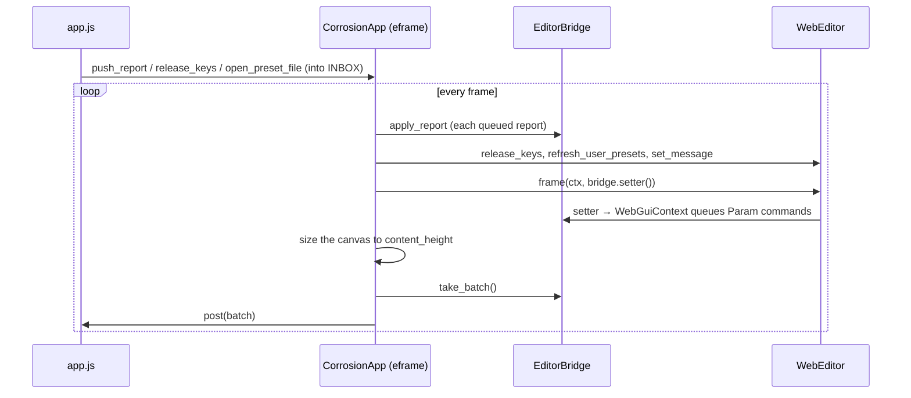

# Web App

The web app at `/play/` runs the plugin in a browser: the same engine, the same editor, no install. It is built from the plugin crate itself, so it can't drift from the plugin's sound. This page covers how: two WebAssembly instances that share nothing, a byte protocol between them, and a page (`web/www/`) that plays the role of the DAW.

How the site around it is built and deployed is on [Site and User Wiki Tooling](Site-and-User-Wiki-Tooling).

## Shape

| Piece | Runs on | Built from | Role |
|---|---|---|---|
| Editor wasm | Main thread | `web/editor` (`corrosion-web-editor`, feature `web-gui`) | The plugin's egui editor in eframe; keeps its own copy of the parameters. |
| Engine wasm | AudioWorklet thread | `web/engine` (`corrosion-web-engine`, feature `web-host`) | `WebEngine`: the plugin driven block by block. |
| `app.js` | Main thread | `web/www/` | Starts audio, routes messages, MIDI, tempo, storage, file open/download. |
| `engine-worklet.js` | AudioWorklet thread | `web/www/` | Instantiates the engine wasm, renders each quantum, posts reports. |

**Why two instances.** The audio has to render on the AudioWorklet thread, and the editor has to draw on the main thread (it owns the canvas and DOM events). One instance with shared memory would need `SharedArrayBuffer` (cross-origin isolation headers) and wasm threads (nightly Rust); the design rejected that as more fragile to host and build. So each side has its own instance and its own `CorrosionParams`, and they talk by messages. Parameters are addressed by index in `param_map()` order, which both sides compute from the same crate.

## The web workspace and the patched NIH-plug

`web/Cargo.toml` is a Cargo workspace of its own (members `engine` and `editor`), separate from the plugin's.

- **Why separate.** The engine has to set parameters as a host does, which needs `ParamPtr::set_normalized_value` and `ParamPtr::update_smoother`. Upstream NIH-plug keeps both `pub(crate)`. `web/nih-plug-public-setters.patch` makes them `pub` (a two-line change in `src/params/internals.rs`), and the workspace's `[patch."https://github.com/robbert-vdh/nih-plug"]` points `nih_plug` at `web/vendor/nih-plug`. Keeping the patch in its own workspace means the plugin's builds never see it.
- **Fetching it.** `web/scripts/fetch-nih-plug.sh` reads the NIH-plug revision the plugin pins in the root `Cargo.lock`, clones it into `web/vendor/nih-plug`, checks out that revision, applies the patch and writes a `.patched-<rev>` marker; with the marker present it exits at once. `build.sh` and CI's `web` job run it first. `web/vendor/` isn't committed.
- **Features.** `src/web/` is behind `web-host`; `web-gui` adds `dep:egui` and turns on `web-host`. Both build only in this workspace (they need the patch). In `src/gui/mod.rs`, `editor` and `fonts` compile with `gui` **or** `web-gui`; `create_editor` and `file_dialog` need `gui` (baseview), `WebEditor` and `install_fonts` need `web-gui`.
- **wasm32 in the plugin crate.** On `wasm32` the root `Cargo.toml` takes `nih_plug` without default features (no VST3), and `src/lib.rs` compiles the CLAP and VST3 exports only for `cfg(not(target_arch = "wasm32"))`.
- **Release profile.** `opt-level = 3`, `lto = true`, `codegen-units = 1`, `panic = "abort"`. `build.sh` adds `-C target-feature=+simd128` (autovectorised SIMD only).
- Both workspaces patch `nih_log` to `vendor/nih_log` (the `atty` dependency replaced), which is unrelated to the web build.

## The engine: `WebEngine`

`src/web/mod.rs` holds `WebEngine`, which is target-independent so its tests run natively. It does what a plugin host does for `Corrosion`:

| Host duty | `WebEngine` |
|---|---|
| Initialize at the device rate | `new(sample_rate)`: `Corrosion::default()`, collects `param_map()` into `ids` and `params` (`ParamPtr`s), resets every smoother to the rate, calls `Corrosion::prepare(sample_rate)` (what `initialize` does without a host context: voice rate, DC blocker rate, latency, pad table) and `reset()`. |
| Automation | `set_param(index, normalized)`: `set_normalized_value`, then `update_smoother(rate, false)` if the value changed, so it glides like host automation. Out-of-range indices are ignored. `param_index(id)` finds an index by ID. |
| MIDI | `midi(status, data1, data2)`: `NoteEvent::from_midi` into `pending`, a `Vec` preallocated to `MAX_PENDING_EVENTS` (512). Unparsable messages and messages past 512 are dropped. All are played at the next block's first sample. |
| Transport tempo | `set_tempo(Some(bpm))`; non-positive means no tempo. |
| Process | `process(frames)`: at most `MAX_BLOCK` (1024) frames, through `Corrosion::process_block`, the same function the plugin's `process()` and the offline renderer run, into preallocated `left`/`right` buffers. Allocation-free. |
| State | `load_preset(&Preset)`: builds the preset's parameters (`Preset::into_params`), sets every parameter by index (smoothed), replaces the kit and rebuilds the pad table. Allocates; called between blocks. |

`apply(batch)` decodes a command batch (below) and dispatches each command. Editor notes go into the plugin's own `editor_notes` ring, exactly as the plugin window's keyboard does, so `process_block`'s `handle_editor_notes` plays them (see [Editor](Editor#the-note-path-to-the-audio-thread)). `report()` builds the `Report`.

**Real time.** An AudioWorklet must never block or allocate unpredictably. `process` and every command except `Kit` are allocation-free; `Kit` deserialises JSON and rebuilds the table, as a state restore does in the plugin. `web/engine/tests/no_alloc.rs` checks this with the same checking allocator as the plugin (debug builds only).

### The engine wasm (`web/engine`)

The worklet instantiates the engine module **directly, with no JS glue**: worklets have no `TextDecoder` or `fetch`, which wasm-bindgen's glue needs. So `web/engine/src/lib.rs` exports plain C-ABI functions over a heap-allocated `Handle { engine, inbox, report }`:

| Export | Does |
|---|---|
| `engine_new(rate) -> *mut Handle` | A default patch at the rate. The handle is never freed (one per page). The inbox starts at 64 KiB. |
| `engine_inbox(h, len) -> *mut u8` | Where the caller writes `len` bytes. Grows (allocates) only when a batch is larger than any before (a kit). |
| `engine_apply(h, len)` | `WebEngine::apply` on the first `len` inbox bytes. |
| `engine_process(h, frames)`, `engine_left(h)`, `engine_right(h)` | Render and expose the output buffers in linear memory. |
| `engine_report(h) -> *const u8`, `engine_report_len()` | Encode the report into the handle; returns where its 24 bytes are. |
| `engine_midi`, `engine_set_param`, `engine_param_count`, `engine_param_index`, `engine_set_tempo`, `engine_load_preset`, `engine_active_voices`, `engine_max_block` | Direct calls for MIDI, parameters by index or ID (ID in the inbox), tempo, preset JSON (returns 1 or 0), voice count, block size. |

### The worklet (`web/www/engine-worklet.js`)

`CorrosionProcessor` (registered as `"corrosion"`):

- On `{type: "init", bytes}` it compiles the bytes with `WebAssembly.instantiate(bytes, {})`, calls `engine_new(sampleRate)`, applies any messages queued before then, and posts `{type: "ready"}`. The page sends **bytes, not a compiled `WebAssembly.Module`**: Chromium silently drops a `Module` posted to a worklet port.
- Messages: `midi` → `engine_midi`; `batch` → copy into the inbox, `engine_apply`; `param` / `paramById` → `engine_set_param`; `tempo` → `engine_set_tempo`; `preset` → `engine_load_preset`, answered with `presetLoaded`.
- `process()` renders one quantum (128 frames in current browsers) and copies `left`/`right` out of wasm memory into the output.
- Every 12 quanta (about 32 ms at 48 kHz) it posts `{type: "meter", rms, voices, load, report}`, the report's bytes transferred.
- **Load.** Worklets have no `performance.now()`, so it sums `Date.now()` differences around `engine_process` and divides by wall time about once a second. Each difference is a millisecond step, but the sum over ~375 quanta is unbiased.

## The protocol

`src/web/protocol.rs` encodes both directions in one place so the two sides can't drift.

**Commands (editor → engine).** A batch is a sequence of frames `[tag: u8][len: u32 LE][payload: len bytes]`.

| Tag | `Command` | Payload |
|---|---|---|
| 1 | `Param { index, normalized }` | `u32` LE index, `f32` LE value (8 bytes) |
| 2 | `Midi([u8; 3])` | 3 bytes |
| 3 | `EditorNoteOn { note, velocity }` | 2 bytes |
| 4 | `EditorNoteOff { note }` | 1 byte |
| 5 | `ReleaseEditorNotes` | empty |
| 6 | `Tempo(f32)` | `f32` LE |
| 7 | `Kit(&str)` | the `kit` persist field's JSON, UTF-8 |

`decode(batch)` is an allocation-free iterator: it stops at the first truncated frame, and skips frames with an unknown tag or a wrong payload length. `Command::Kit` borrows its string from the batch.

The page currently sends MIDI and tempo as their own worklet messages rather than as `Midi`/`Tempo` commands in a batch; the commands exist and are covered by the bridge and `no_alloc` tests.

### Reports

**Report (engine → editor).** `Report { diode_reduction_db: f32, voices: u32, held: NoteMask }`, encoded into `REPORT_LEN` = 24 bytes: the dB value (0..4), the voice count (4..8), and the two `u64` words of the 128-bit held-note mask (8..16, 16..24), all little-endian. `Report::decode` returns `None` unless it gets exactly 24 bytes. `WebEngine::report` takes (and clears) the plugin's `DiodeMeter` peak, so each report carries the largest reduction since the last.

## The editor wasm

`web/editor/src/lib.rs` is a wasm-bindgen crate around eframe (`glow` renderer, no default fonts). Its `start(canvas, post, seed, session)` export starts an `eframe::WebRunner` whose creation closure installs the editor's fonts (`corrosion::gui::install_fonts`) and builds `CorrosionApp`:

- a fresh `CorrosionParams` (the editor's mirror), an `EditorNotes` ring and a `DiodeMeter`;
- an `EditorBridge` over them; if the page passed a session preset, `bridge.load_preset(session)` runs **before the first frame**, so the first batch carries the session to the engine;
- a `WebEditor` over the same params, meter and ring, seeded with the page's `seed`.

Calls from JavaScript (`push_report`, `release_keys`, `set_user_presets`, `open_preset_file`) don't touch the editor directly; they write into a thread-local `Inbox` that the next `update` drains. Each `update` then draws a frame, sets the canvas's CSS height to `content_height × zoom_factor` when it changed, takes the batch and posts it, and asks for a repaint after 33 ms so the highlights and the diode dot follow the engine.

### `WebGuiContext` and `EditorBridge`

`src/web/editor_side.rs`:

- **`WebGuiContext`** implements NIH-plug's `GuiContext` for the editor's widgets. It maps each `ParamPtr` of the mirror to its index. `raw_set_parameter_normalized` sets the mirror, then queues a `Param` command with the value **the parameter took** (`unmodulated_normalized_value`), so stepped parameters send their snapped value. Begin/end gestures do nothing; `plugin_api` is `Standalone`; `request_resize` returns true. It is marked `Send + Sync` by hand: the pointers are only map keys, and the page runs the editor on one thread.
- **`EditorBridge`** owns the mirror, the note ring, the meter and the context.
  - `setter()` gives the editor a `ParamSetter` over the context.
  - `load_preset` sets every parameter through the context (so each queues a command), then replaces the kit and reloads `kit_table`.
  - `take_batch()` drains the editor's `EditorNotes` ring into `EditorNoteOn`/`Off` commands, adds `ReleaseEditorNotes` if a release-all was requested, and adds a `Kit` command when `KitTable::generation()` moved since the last batch. The generation is the sum of the 128 slots' seqlock sequence counters, so any slot write (a pad assigned, cleared or retuned, a preset loaded) moves it. Then it returns the queued bytes.
  - `apply_report` republishes the reported diode peak into the editor's `DiodeMeter` and the held mask into `EditorNotes`, so the editor code reads them exactly as in the plugin.

### `WebEditor`

`WebEditor` (in `src/gui/editor.rs`, feature `web-gui`) is the editor without a window:

- `frame(ctx, setter)` uses `page_scale(screen width)`: the layout fills the canvas width (`width / 1080`, floor 0.25); the UI Scale parameter has no effect here. It draws `render_page_body` (panels, kit bar, strip, no scroll view) in a `CentralPanel` and measures the height from the cursor, not `min_rect`, because the header's columns reserve the whole available height without using it.
- `content_height()` is that height; the page makes the canvas that tall, so **the page scrolls, not the editor**.
- `wants_wheel(ctx)` is true only when the pointer is over a layer above the background (an open popup or menu).
- `release_keys`, `refresh_user_presets`, `set_message` serve the inbox.
- The randomizer's `Noise` is seeded from the page: `SystemTime::now` panics on `wasm32-unknown-unknown`, so `clock_seed()` returns 1 there and `WebEditor::new` overrides it with `seed.max(1)`.
- "Open folder" and Import/Export aren't drawn (`cfg(not(target_arch = "wasm32"))` and `gui` only); the page has its own Open preset… and Download preset buttons.

## The page (`web/www/`)

`index.html` is the app's chrome: a header (Start audio, status, CPU load, MIDI input select, BPM, Open preset…, Download preset, links home and to the Wiki and GitHub), the `#stage` with the `<canvas id="editor">`, and a footer. It uses only the site's tokens (`/theme/tokens.css`). The canvas is 80 % of the page width, 100 % under 900 px. `build.sh` stamps the commit into ``.

`app.js` (an ES module):

| Concern | How |
|---|---|
| Start | `initEditor()`, then `editor.start(canvas, postBatch, seed, session)` with `seed = crypto.getRandomValues | 1` and the session from `localStorage`. Then load user presets. |
| Audio | Browsers start audio only after a click: **Start audio** creates an `AudioContext` (`latencyHint: "interactive"`), fetches `corrosion_web_engine.wasm` and adds the worklet module in parallel, creates the `AudioWorkletNode` (no inputs, stereo out), resumes the context, sends `init` with the bytes (transferred), and waits for `ready`. Then it sends the BPM and every batch the editor produced before audio started (`pending`), in order: the engine's state is its default plus those batches. |
| Batches | `postBatch` copies the `Uint8Array` (it points into the editor's wasm memory) and transfers the copy to the worklet. |
| Reports | On `meter`: `editor.push_report(bytes)`, status text with the voice count, and `CPU n %` (warning style above 80 %, with underruns from `playbackStats` where the browser has it). |
| MIDI | `navigator.requestMIDIAccess()`; every input's messages (or only the selected one) go straight to the worklet as `midi`. System messages (≥ 0xF0) are dropped. Without Web MIDI, or when refused, the select says so; the on-screen and computer keyboards still play. |
| Tempo | The BPM field (20–300, stored in `localStorage` under `corrosion.bpm`) is sent as `tempo`; synced effects follow it as they would a host transport. |
| Session | `current_preset_json("Session")` autosaved to `localStorage` (`corrosion.session`) every 1.5 s when it changed, on `pagehide`, and when the page is hidden. Restored at start. |
| User presets | IndexedDB database `corrosion`, store `presets`, records `{key, folder, file, json}` keyed by lower-cased `folder/file`. Loaded with `set_user_presets` at start; every 1.5 s `take_saved_presets()` is drained into it. |
| Files | Open preset… reads a `.corrosion-preset` and calls `open_preset_file` (load it and keep it with the user presets). Download preset prompts for a name and downloads `current_preset_json(name)`. |
| Held keys | `blur` and `visibilitychange` (hidden) call `release_keys`, since a key-up can be lost when the page loses focus. |
| Scrolling | eframe would take every wheel event over the canvas. A capturing `wheel` listener on `#stage` stops propagation unless `wants_wheel()` says the pointer is over a popup. `HTMLElement.prototype.focus` is wrapped to pass `preventScroll: true`, because eframe focuses the canvas on every click and frame and the canvas is taller than the window. |
| Test hooks | `window.corrosionPost`, `window.corrosionEditorReady`, `window.corrosionMeter` for the browser checks. |

### Presets kept in the browser

On `wasm32` the editor has no file system. `src/presets/browser.rs` stands in for the user preset folder with an in-memory, process-global store of `BrowserPreset { folder, file, json }`:

- `replace_all` fills it from the page at start; `list` and `folders` give the editor the same view a folder would (sorted the same way, unparsable entries counted as unreadable);
- `save` follows the folder's rules: same folder and file name (case-insensitive) needs the overwrite confirmation, as on disk;
- `import` (a file the visitor opened) puts the preset in the root under its own name, replacing one there;
- every save and import is also pushed to `SAVED`, which `take_saved` drains for the page to persist.

Storage is per origin: presets and sessions saved under one address don't follow to another.

## Cost

Measured when the app was built (numbers in its design document): wasm runs 1.3–2.1× slower than native code; the heaviest presets measured with 16 voices took about 61 % of a 128-frame block in V8 with `+simd128`, and SIMD saved 5–10 % on heavy presets. `web/scripts/bench-engine.mjs` (cost per block by quality mode and voice count, against the 2.67 ms budget at 48 kHz) and `bench-presets.mjs` (named presets with held chords) re-measure it in Node's V8. The page's CPU readout is the same measure live.

## Tests

| Where | What |
|---|---|
| `web/engine/tests/engine.rs` | A note sounds and silence is silent; a parameter change reaches the engine; the engine plays like the offline renderer; factory presets loaded through the engine sound like their offline render. Ignored tables print native block costs. |
| `web/engine/tests/bridge.rs` | Every command round-trips; an editor parameter, an editor-keyboard note, a kit edit and a preset load each reach the engine through `EditorBridge` + `WebEngine::apply`; the report carries the diode meter; the page tempo drives the synced echo. |
| `web/engine/tests/no_alloc.rs` | Blocks and the parameter, MIDI, editor-note, release and tempo commands don't allocate. |
| `web/scripts/smoke.cjs` | Headless Chromium (Playwright): the editor starts, audio starts, a strip key and a computer key sound, a preset chosen in the editor reaches the engine, the page (not the editor) scrolls, no console error. |
| `web/scripts/features.cjs` | Session autosave and restore, saving a preset into IndexedDB, opening a preset file, downloading the sound, MIDI reaching the engine, the BPM field, the load meter. |
| `src/gui/editor.rs` | `web_page_fills_the_width`, `web_page_body_height_is_independent_of_the_canvas` (GUI lane). |

CI's `web` job runs fmt, clippy (native and `wasm32`), `cargo test -p corrosion-web-engine`, the full deploy build, then `site.cjs`, `smoke.cjs` and `features.cjs` against `web/dist` served by `serve.cjs` (see [CI and Releases](CI-and-Releases)).

*History:* [openspec/changes/archive/2026-11-15-add-web-app](https://github.com/GerMP21/Corrosion-VST/tree/main/openspec/changes/archive/2026-11-15-add-web-app) (measurements and the reasons behind the two-instance design).

## Source files

- [`src/web/mod.rs`](https://github.com/GerMP21/Corrosion-VST/blob/main/src/web/mod.rs): `WebEngine`, the host stand-in that drives `Corrosion`.
- [`src/web/editor_side.rs`](https://github.com/GerMP21/Corrosion-VST/blob/main/src/web/editor_side.rs): `WebGuiContext` and `EditorBridge`.
- [`src/web/protocol.rs`](https://github.com/GerMP21/Corrosion-VST/blob/main/src/web/protocol.rs): command frames and the 24-byte report.
- [`web/Cargo.toml`](https://github.com/GerMP21/Corrosion-VST/blob/main/web/Cargo.toml): the web workspace, its NIH-plug patch entry and release profile.
- [`web/engine`](https://github.com/GerMP21/Corrosion-VST/tree/main/web/engine): the engine wasm's C-ABI exports and the engine, bridge and `no_alloc` tests.
- [`web/editor`](https://github.com/GerMP21/Corrosion-VST/tree/main/web/editor): the editor wasm (eframe app, wasm-bindgen exports).
- [`web/www`](https://github.com/GerMP21/Corrosion-VST/tree/main/web/www): `index.html`, `app.js`, `engine-worklet.js`.
- [`web/nih-plug-public-setters.patch`](https://github.com/GerMP21/Corrosion-VST/blob/main/web/nih-plug-public-setters.patch): makes the two parameter setters public.
- [`web/scripts/fetch-nih-plug.sh`](https://github.com/GerMP21/Corrosion-VST/blob/main/web/scripts/fetch-nih-plug.sh): fetches NIH-plug at the pinned revision and applies the patch.
- [`src/presets/browser.rs`](https://github.com/GerMP21/Corrosion-VST/blob/main/src/presets/browser.rs): the in-memory user preset store on `wasm32`.
- [`src/gui/editor.rs`](https://github.com/GerMP21/Corrosion-VST/blob/main/src/gui/editor.rs): `WebEditor`, `render_page_body`, `page_scale`, `clock_seed`.
- [`src/lib.rs`](https://github.com/GerMP21/Corrosion-VST/blob/main/src/lib.rs): `Corrosion::prepare`, `process_block`, the `wasm32` gates on the plugin exports.
